# BuildGenix: North Star System Design

**Document type:** Architecture reference (North Star target, with the Phase 0 path to it)
**Audience:** Senior engineers, solution architects, engineering leadership
**Author:** Badru Siddique
**Date:** 2026-10-07
**Status:** FINAL-CONDITIONAL. Facts follow the canonical design spec of 2026-10-07 (`internal/system-design-pack/design-spec.md`). Wave2 Critical findings (NS-DO-1, NS-SEC-1..4, NS-QA-1..2, NS-SA-1) are applied. Proposed starting values are marked *proposed*. Questions nobody has decided yet stay OPEN in section 18. Not implementation GO.

> **How to read this document.** Leadership: sections 1 to 3 and 17. Engineers building agents: sections 4 to 6, 9 and 12. Platform and DevOps: sections 11, 13 to 15. The three worked examples in section 10 tie everything together and are the best way to check your understanding of the design.

---

## Table of contents

1. [Executive summary](#1-executive-summary)
2. [Architecture](#2-architecture)
3. [The pipeline: stages, gates and loops](#3-the-pipeline-stages-gates-and-loops)
4. [Agent catalogue](#4-agent-catalogue)
5. [Agent-to-agent communication](#5-agent-to-agent-communication)
6. [Status propagation: from a subagent to the UI chip](#6-status-propagation-from-a-subagent-to-the-ui-chip)
7. [UI state map](#7-ui-state-map)
8. [Resources each agent and subagent creates](#8-resources-each-agent-and-subagent-creates)
9. [Artifact storage and versioning](#9-artifact-storage-and-versioning)
10. [End-to-end examples](#10-end-to-end-examples)
11. [Execution environment: the builder machine](#11-execution-environment-the-builder-machine)
12. [Code-state management](#12-code-state-management)
13. [Azure DevOps integration](#13-azure-devops-integration)
14. [Deployment ladder](#14-deployment-ladder)
15. [Identity and security](#15-identity-and-security)
16. [Observability and governance](#16-observability-and-governance)
17. [Trade-offs: Phase 0 shortcuts and their extension paths](#17-trade-offs-phase-0-shortcuts-and-their-extension-paths)
18. [Open items](#18-open-items)

---

## 1. Executive summary

BuildGenix is an internal platform that takes a business request written in plain language and carries it through the software delivery lifecycle with AI agents: requirements, design, code, review, tests and deployment. People stay in charge at the points that matter. Every step leaves an immutable, versioned artifact, a ledger entry and an audit line, so anyone can answer later what was built, why, from which inputs, by which model and at what cost.

### The problem

Delivery at Marvel crosses many teams, review boards and handoffs. A small change waits on requirement write-ups, design documents, ticket grooming, test authoring and environment requests, and most of that effort is coordination rather than engineering. Knowledge about how an application is built lives in people and scattered documents, so every change starts by rediscovering context. Coding assistants speed up the typing part of the job, which was never the slow part.

### The outcome

A requester describes what they want in a chat. BuildGenix turns that conversation into a PRD the requester approves, a technical design the requester approves, and then, without further hand-holding, a repository in Azure DevOps with a backlog, tested code, a reviewed pull request and a running application in DEV. The requester checks the DEV app and accepts it, and only then does BuildGenix merge the pull request into `main`. The next request on the same project starts from the accepted state of the previous one, so the platform builds up a living record of each application across work items.

### Why this is governed and not "Copilot with extra steps"

| | A coding assistant | BuildGenix |
|---|---|---|
| State | A chat history | A work item with defined stages, entry inputs, exit outputs and a status the platform owns |
| Governance | The user trusts what they see | Human gates at the PRD, the design and DEV acceptance; ADO branch policies; environment approvals; nothing reaches `main` until the tests pass and a person has accepted the running app built from that exact commit |
| Accountability | None | Token budgets per stage and per work item, bounded loops, and metrics on the platform's own rework (churn, backflow, ping-pong) |
| Reproducibility | Whatever the model said last | Immutable artifacts per revision, an effect ledger that replays LLM outputs after a crash, git history for code |
| Blast radius | The assistant can touch anything the user can | Agents never call agents, never read orchestrator tables, and generated code runs without any platform identity |

### How it is built, in five sentences

1. **buildgenix-api is the only orchestrator.** It is deterministic C# code that owns work item state, gates, the stage-to-topic map and the UI; no model decides what runs next.
2. **Each agent is a stateless worker.** It takes one task message from its own Service Bus topic, runs a fixed sequence of sub-steps (subagents) and reports exactly one of three outcomes: `Completed`, `HumanActionRequired` or `Failed`.
3. **Agents share state only through immutable blobs, a registry and git.** buildgenix-api resolves the latest revision of every input and puts the paths in the task message, so an agent never searches for anything.
4. **Every loop is bounded and every effect is recorded once.** Redrafts, fix loops and route-backs all have limits; the effect ledger makes a crashed run resume without repeating LLM calls, pushes or ADO writes.
5. **Phase 0 and the North Star run the same agent code.** What changes between them is hosting, identity scoping and the deployment path, never the agent code. The contract only widens additively (contract 2.1, section 5), and a stage opts in through a stage-map setting `contract: 2.1` after its host accepts that version.

### Where we are today

The HEALTHY harness agent, the Service Bus integration, the Table Storage schema and the buildgenix-api and agenthub-api scaffolds exist. Other engineers have a UI working on stub data. No production stage agent exists yet. buildgenix-api has no results or events consumer yet, `InternalNotifyController` is a stub, HEALTHY publishes its result to `sdlc-results`, and nothing publishes sub-step events yet. This document describes where those pieces end up.

---

## 2. Architecture

### 2.1 North Star topology

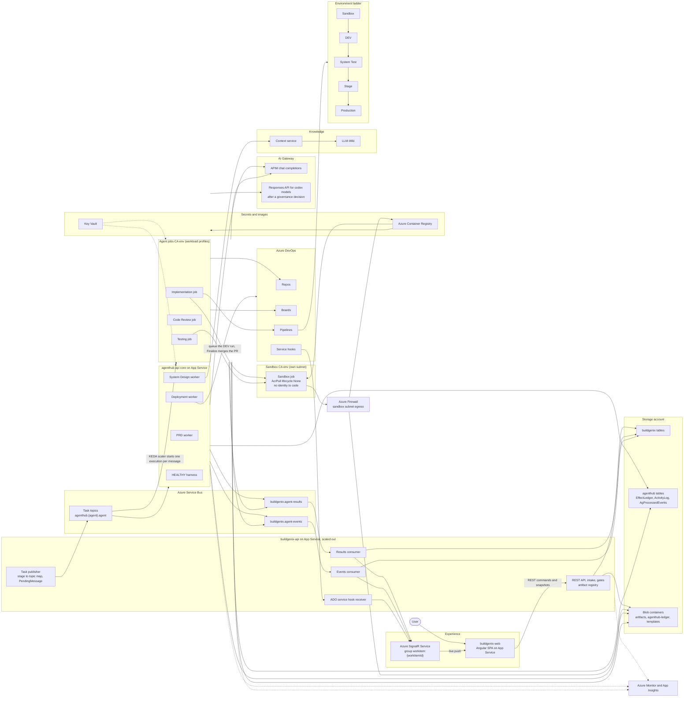

### 2.2 What each box does, and why it is a separate box

**buildgenix-web.** The Angular single-page app. It sends commands and reads snapshots over REST and receives live updates over SignalR (D-6). It never talks to agenthub, Service Bus or storage, because the UI should depend on one contract only. If the browser reloads, it rebuilds the screen from REST snapshots and rejoins its SignalR group, so nothing on screen depends on having been connected the whole time.

**buildgenix-api.** The orchestrator and the only writer of buildgenix tables. It runs the intake conversation, binds the intake summary when the user clicks Implement now, holds the project's `~ACTIVE` lock, raises and resolves gates, keeps the artifact registry, publishes task messages, consumes results and events, and pushes to the UI. It is deliberately deterministic code: transitions are testable, replayable and free, and the intelligence lives inside the agents where it can be bounded. In Phase 0 it is one App Service instance with an in-process SignalR hub. The North Star scales it out behind Azure SignalR Service. Dedup on `SgProcessedEvents` and ETag-conditional writes already make concurrent consumers safe, but scale-out still needs specific code changes, listed in section 17: leader election for the resender and the watchdog, the per-work-item `~SEQ` counter kept as one counter with an ETag retry (it must not be sharded, because reload needs a gap-free sequence), and Azure SignalR Service.

**agenthub-api core.** The same agenthub-api codebase, zip-deployed to App Service, running BackgroundService workers for agents that only need the .NET runtime: PRD, System Design and the HEALTHY harness. In the North Star the Deployment worker also runs here, because it no longer builds or deploys code itself (ADO pipelines do). It queues the pipeline run that deploys the tested commit to DEV, verifies the result, and after the requester accepts, merges the pull request (the Finalize action). Which workers start on which host is configuration (`Workers:<Agent>:Enabled`), so moving an agent between hosts is a settings change.

**Builder.** Where generated code is cloned, built, tested and analysed. In Phase 0 it is a second deployment of agenthub-api: App Service for Containers, a custom image from ACR with the .NET 10 SDK, Node 22 and the Angular CLI, git, Azure CLI, `uv`, Graphify and `setpriv`, running under the user-assigned identity `id-bgx-builder`. In the North Star it becomes Azure Container Apps Jobs: one job execution per task message, started by a KEDA Service Bus scaler, so runs are isolated from each other and capacity scales with the queue. Commands that execute generated code run in a separate sandbox job that has no managed identity at all (section 11).

**Azure Service Bus.** One task topic per agent, named after the consumer (`agenthub.{agent}.agent`), and two inbound topics for buildgenix-api (`buildgenix.agent-results`, `buildgenix.agent-events`). Results travel on a topic rather than a REST call so that a finished run is never lost while buildgenix-api restarts (section 5.1). Every host connects with `FullyQualifiedNamespace` and its managed identity, not a connection string; only the local emulator uses one.

**Table Storage.** One shared account with ownership by table (D-CL-7), enforced with table-scoped role assignments: buildgenix-api's identity can write only buildgenix tables and agenthub's identities only `EffectLedger`, `ActivityLog` and `AgProcessedEvents`. A 403 is the enforcement, not a code review. A table-scoped identity cannot create tables, so the infrastructure script creates every table, container, topic and subscription; hosts only check at start that theirs exist.

**Blob containers.** `artifacts` holds every document an agent or buildgenix writes, at `{projectId}/{workItemId}/v{n}/{filename}`, with versioning and soft delete on and write-once behaviour from the ledger. `agenthub-ledger` holds ledger inputs and outputs longer than 30,000 characters (section 5.6). `templates` holds stack templates and the platform standards pack.

**Key Vault and ACR.** Key Vault holds the AI Gateway keys (`cc-sb-ts-aigw-kv`) and, separately, the sandbox vault that holds the generated apps' LLM key. ACR holds the builder image, pulled by a user-assigned identity (Phase 0 `id-bgx-builder`; North Star one per job), so there is no registry password.

**AI Gateway.** The platform's LLM front door. Chat aliases (`opus`, `5.4` and others) go through APIM with `Ocp-Apim-Subscription-Key` and `X-AIGW-Model`, which meters and logs every call. Codex models need the Responses endpoint (deployment name such as `53codex-chat` in the body), which goes straight to Azure OpenAI and bypasses APIM. Phase 0 therefore uses APIM chat only; the North Star adds the Responses path after a governance decision (open item 7), with the same ledger step and guardrails. Locally the same code uses Ollama or the Fixture provider (`Llm:Provider`). No request ever sends `temperature`.

**Context service and LLM-Wiki (North Star).** Phase 0 ships a static standards pack with the templates (`templates/standards/v1/`). The North Star puts the organisation's engineering standards in an LLM-Wiki behind a context service: agents send a request describing the task and receive a structured, source-referenced answer that includes conflicts and gaps. Agents never read the wiki directly, which keeps retrieval swappable and grounding auditable.

**Azure DevOps.** A dedicated ADO project for generated repositories, proposed as `BuildGenix-Apps` (name to confirm, open item 14), so the platform's own repos stay in `AI-Operations` and the agent identities hold rights there and not across the organisation. One repository per BuildGenix project (`bgx-{slug}`), one branch per work item, one epic per project with stories per work item, a pull request per work item that is merged only after the requester accepts the running app, and in the North Star a CI/CD pipeline from the stack template with service hooks that report pipeline and pull request events back to buildgenix-api.

**Environment ladder.** Phase 0 deploys into one pre-created DEV sandbox resource group. The North Star has five rungs: Sandbox, DEV, System Test, Stage and Production. The work branch reaches Sandbox and DEV before merge; after acceptance the PR is merged and the build of `main` is promoted through the higher rungs with ADO environment approvals (section 14).

**Observability.** agenthub writes its execution trace to `ActivityLog` and its effects to `EffectLedger`; buildgenix projects events into `StageStatuses`, `ClientEvents`, `RunLog` and `WorkItemTelemetry`. In the North Star all hosts export OpenTelemetry to Azure Monitor, and governance metrics (churn, backflow, ping-pong) are computed from the same events (section 16).

### 2.3 Boundaries the design enforces

| Boundary | Rule | Why | Enforced by |
|---|---|---|---|
| UI to platform | The browser talks only to buildgenix-api | One contract, one auth surface | Network and CORS |
| Orchestrator to agent | One TaskMessage on that agent's topic | Agents stay ignorant of pipeline order | buildgenix owns the stage-to-topic map |
| Agent to agent | Never | No hidden coupling, no ownership disputes over the user goal | Agents know no topic names but their own |
| Agent to buildgenix data | Never read or write buildgenix tables | The orchestrator's state has one writer | Table-scoped RBAC (403) |
| Agent to subagent | In-process typed calls only | Subagents cannot persist, publish or log behind the handler's back | Code structure and review |
| Platform to generated code | Generated code runs without platform credentials | A generated test must not be able to act as the platform | Phase 0: environment allowlist, build and test processes under a per-agent sandbox user through `setpriv`, git as its own user `bgx-git` that alone gets the token and ignores repo hooks and config, isolation test. North Star: sandbox job with no identity |

---

## 3. The pipeline: stages, gates and loops

### 3.1 Stages

| Stage code | UI label | Owner and host (North Star) | Gate after it, Phase 0 | Gate after it, North Star |
|---|---|---|---|---|
| none (intake) | Intake | buildgenix-api (IntakeConversation and friends) | Implement now is the approval (D-11, D-C4) | Same |
| `PRD` | PRD | PRD agent, core | Human: approve or reject | Configurable, default on |
| `SYSTEM_DESIGN` | System Design | System Design agent, core | Human: approve or reject | Configurable, default on |
| `IMPLEMENTATION` | Build | Implementation agent, builder job | Auto-advance | Auto-advance |
| `CODE_REVIEW` | Code Review | Phase 0: CodeReviewer subagent inside Implementation. North Star: Code Review agent, builder job | n/a | Floor for every project whose ladder goes beyond DEV: human reviewer (other than requester) before Finalize; DEV-only projects may omit it |
| `TESTING` | Test | Testing agent, builder job. Tests the work branch head commit and never merges | Auto-advance | Auto-advance, with a confirmation when verification proposes "PRD wrong" |
| `DEPLOY_DEV`, action `Deploy` | Deploy | Phase 0: Deployment agent, builder, deploys the tested head commit itself. North Star: Deployment agent on core queues the ADO pipeline run that deploys that commit, then verifies | Human: DEV acceptance (Accept, or Request changes) | Always on; not configurable |
| `DEPLOY_DEV`, action `Finalize` | Deploy ("Finishing: merging to main") | Deployment agent, Finalizer subagent: merges the PR only if its head still equals the deployed commit | None; the work item completes | Same |
| `DEPLOY_ST`, `DEPLOY_STAGE`, `DEPLOY_PROD` | Promote (System Test, Stage, Production) | ADO pipeline promotes the merged build of `main`; Deployment agent verifies (action `Verify`, contract 2.1) | n/a | Per environment policy; Production always human-led |
| `DONE` | Done | none | n/a | n/a |

The order is fixed by buildgenix's pipeline definition, not by agents. An agent cannot know whether its stage is gated, and that is the point: a gated stage simply returns `Completed`, and buildgenix raises the gate. Agents never ask for their own approval.

**When code reaches `main` (S7a).** Testing proves the head commit of the work branch. Deployment deploys that same commit. Only after the requester accepts the running app does buildgenix send the Deployment agent a `Finalize` action (`context.deploymentAction = Finalize`), whose Finalizer checks that the PR head still equals the deployed commit and then completes the PR (merge, transition the stories). A moved head or a conflict returns `HumanActionRequired` instead of merging untested code. The baseline moves only when Finalize reports the merge. The consequence that matters most: if a work item fails anywhere before acceptance, `main` still matches the project's accepted baseline, so the next work item's `code-state.json` describes the code it will actually clone.

In the North Star, with a ladder, the rule generalises to "merge after the first human-accepted environment". Sandbox and DEV run the work branch's tested commit; DEV acceptance is the human acceptance; Finalize merges; System Test, Stage and Production then receive the build of `main` that the merge produced, promoted by the ADO pipeline (section 14). The Finalizer completes the PR only when `main` is still an ancestor of the deployed commit, so the merged tree is exactly the tree that was accepted.

### 3.2 Human gates

Phase 0 has exactly three gates (S7): PRD, SYSTEM_DESIGN and DEV acceptance. Everything else advances on its own unless an agent stops with `HumanActionRequired` (a question, a loop limit or a budget). A reject at a gate is not a failure: buildgenix writes the reviewer's feedback to `feedback-{stage}.json` (for example `feedback-prd.json`), issues a new `taskId` for the same stage with `outputRevision + 1`, and the agent redrafts. After 3 human rejects of the same stage, the work item stops with `HumanActionRequired` `LoopLimit` so a person decides whether the request itself needs rethinking; the person can allow one more loop at a time up to a hard cap of 5, or Stop (section 3.6). At DEV acceptance the reject is called Request changes: buildgenix writes `feedback-implementation.json` and publishes an Implementation rework on the same branch and pull request, with its own limit of 3, counted separately from the PRD and design rejects and from test route-backs. Every redraft, route-back and Request changes raises the work item's `pipelineVersion` by 1 (section 5.2).

In the North Star gates become a policy per project and per BuildGenix stage (proposed: a `gatePolicy` section in the project's `SettingsJson`). Until Entra sign-in exists, gates are advisory and the acceptance screen says so. Four floors are not a project setting: DEV acceptance before any merge; a person other than the requester approves the pull-request diff before Finalize when the ladder goes beyond DEV; Production stays human-led; and once Entra sign-in exists the approver is not the requester. `gatePolicy` may switch only the PRD gate, the System Design gate, and the Code Review gate of a project that stops at DEV. Rungs after the merge are Azure DevOps environment checks owned by the platform team.

### 3.3 Loops and their guards

Every loop has a limit, and every limit ends in a state a person can act on. "No loop is unbounded" is a design rule, not an aspiration; a stuck agent that keeps spending tokens is the single most expensive failure mode of this kind of system.

| Loop | Where it runs | Limit (spec section 11) | When exhausted |
|---|---|---|---|
| LLM JSON repair | Inside any LLM step (`LlmRepairStepAsync`) | 2 attempts per step | `HumanActionRequired` `LoopLimit` |
| PRD draft and critique | PRD agent | 3 drafts per run | `LoopLimit` |
| Design revision | System Design agent | 3 revisions per run | `LoopLimit` |
| Build fix loop | Implementation, per phase | 3 fix attempts per phase | `LoopLimit` |
| Code review fix rounds | Phase 0: inside Implementation. North Star: route-back from CODE_REVIEW | 2 rounds | `LoopLimit` |
| Test route-back | buildgenix, Testing to Implementation (North Star also to PRD) | 3 loops per work item | `LoopLimit` |
| Human reject redraft | buildgenix, per gated stage | 3 redrafts | `LoopLimit` |
| Request changes at DEV acceptance | buildgenix, Implementation rework on the same branch and PR | 3, counted separately | `LoopLimit` |
| CI red route-back | buildgenix, `CI_Wait` to Implementation when the PR build for the current head is red | 3 per work item, counter `ciLoopIndex` | `LoopLimit` |
| Deploy pipeline red route-back | buildgenix, `DEPLOY_DEV` to Implementation on a pipeline build or test failure | 3 per work item, counter `deployLoopIndex` | `LoopLimit` |
| In-step transient retry | Every call to the LLM, ADO, ARM and storage (`Microsoft.Extensions.Http.Resilience`) | Exponential back-off with a circuit breaker, up to 10 minutes per step | The exception reaches the dispatcher and the message is abandoned |
| Service Bus redelivery | Dispatcher | MaxDeliveryCount 5 | Last delivery publishes `Failed`; if it cannot, the dead-letter watcher raises `HumanActionRequired` `Stuck` |
| Handler deadline | Every handler | Lock renewal cap minus 10 minutes or 20 percent, whichever is smaller | `Failed` `DeadlineExceeded` |
| Stage watchdog | buildgenix | `Running` with no event for 15 minutes (agents send a `Heartbeat` every 60 seconds); `Queued` and not started after 6 hours shows "waiting for capacity", after 12 hours `Stuck`. `AwaitingCi` is excluded from the queued-task clock | `HumanActionRequired` `Stuck` |
| CI wait | buildgenix, from entering `CI_Wait` | 60 minutes (proposed) without a `CiStatus` row for the current head | `HumanActionRequired` `Stuck` with reason `CiTimeout`; Retry publishes Testing in `ciCheck` mode (first sub-step reads the PR build for the head through ADO REST and applies the same CI_Wait join) |
| Questions per run | Every agent | 3 | `LoopLimit` (the agent keeps asking, so a person decides) |
| "One more loop" after a buildgenix `LoopLimit` | buildgenix, per counter | Cap rises by one each time, hard cap 5 | Only Stop remains |
| Smoke validation | Deployment | 5 minute window with back-off | `HumanActionRequired` `Question` with logs |
| Token budget | Every LLM step | 3,000,000 per work item; stage caps PRD 300k, SD 500k, Implementation 1.8M, Testing 200k, Deployment 50k | `HumanActionRequired` `BudgetExceeded` |
| Intake token budget | buildgenix-api Intake | 200,000 per work item, separate from the pipeline budget | Intake asks the requester to narrow the request |

In-step retry is what makes five deliveries meaningful: without it a short gateway outage would burn all five attempts in seconds, while with it five deliveries ride out close to an hour. The North Star keeps the same limits; Container Apps Jobs only change who restarts a run, not how a run is bounded.

### 3.4 Work item state machine (North Star)

The diagram shows stages as states. Inside each stage the work item status moves `Queued` to `Running`; the gate states are `AwaitingApproval`. Any running stage can also move to `HumanActionRequired` (and back when the person resumes it) or to `Failed`, and any gate can move to `Failed` on Stop; only a few of those edges are drawn to keep the picture readable.

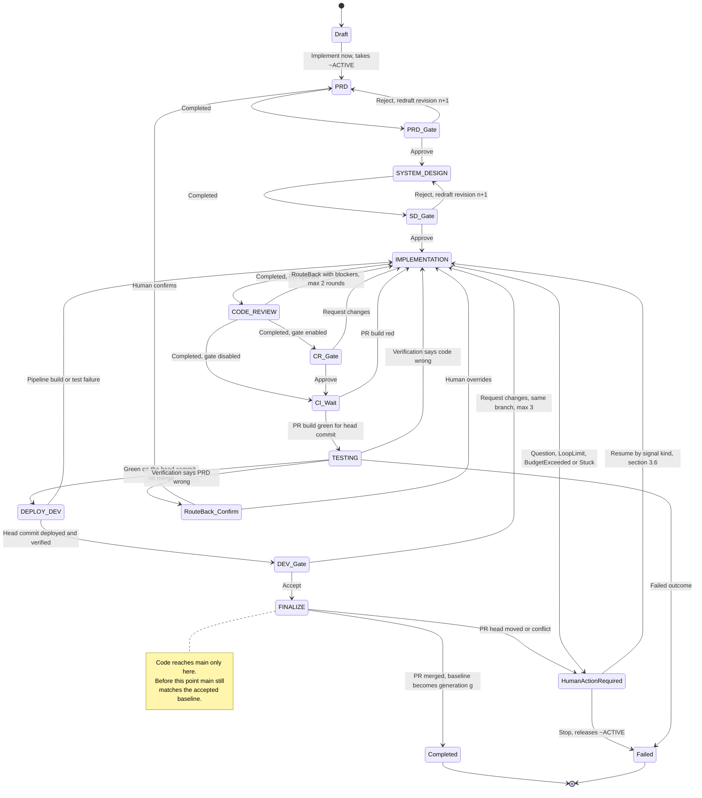

`Completed` and `Failed` release `~ACTIVE`; every other status keeps it (D-C4b). The backward edges are where churn comes from, and each traversal is counted for the backflow and ping-pong metrics (section 16.3). FINALIZE is not a separate stage code: it is the `DEPLOY_DEV` stage running the Deployment agent with `deploymentAction = Finalize`, shown on screen as "Finishing: merging to main". In Phase 0 the picture is simpler: CODE_REVIEW and CI_Wait do not exist as stages (review is a subagent inside IMPLEMENTATION), test failures always go to IMPLEMENTATION, and the Deploy action is the Deployment agent provisioning and deploying the tested commit itself.

How NEXT, END and HUMAN-ACTION relate to this: they are names for the orchestrator's transitions, not agent outcomes. On the wire an agent only ever says `Completed`, `HumanActionRequired` or `Failed`. buildgenix then decides: `Completed` on a non-gated stage is NEXT, `Completed` on a gated stage raises the gate (for the Deploy action, that is the DEV acceptance gate), the human's Accept is NEXT to the Finalize action, `Completed` from Finalize is END with work item status `Completed`, `HumanActionRequired` is HUMAN-ACTION, and `Failed` is END with work item status `Failed`.

### 3.5 Failure paths and where they are covered

| Failure | What happens | Covered in |
|---|---|---|
| Any agent `Failed` | Work item `Failed`, `~ACTIVE` released; `main` untouched because nothing merges before acceptance | 3.4, 5.3 |
| First work item on a new project fails after the repo exists | The Failed result still carries the `outputs` gathered so far, so buildgenix stores the repo URL on the project. The next work item is still New (no accepted baseline): WorkspaceManager looks up `bgx-{slug}` by name and reuses it (its `main` holds only the template), Provisioner's `CreateOrUpdate` reuses the DEV apps, and BacklogSync creates fresh stories under the new work item's tag. Stories from the failed attempt keep their own `bgx-wi` tag: Phase 0 leaves them for the user to close; the North Star closes them automatically when the work item fails (a BacklogSync cleanup run, since only agents hold ADO rights). The failed work item does not consume its generation | 4.5, 4.8, 9.3 |
| Crash or restart mid-run | Redelivery; ledger replays effects; external effects are find-or-create, so a crash between an ADO call and its ledger row adopts what exists; working copy rebuilt from the last pushed commit | 5.6, 11.1; Phase 0 guide 11.1 |
| Crash on the last delivery, no `Failed` result published | The broker dead-letters the task; the dead-letter watcher raises `HumanActionRequired` `Stuck` with the reason | 5.10 |
| Running run silent for 15 minutes (no heartbeat), or a task still queued after 12 hours | The stage watchdog raises `HumanActionRequired` `Stuck`; retry republishes the same task with `inputVersion + 1` | 5.10, 3.6 |
| Handler reaches its deadline | `Failed` `DeadlineExceeded`, published before the lock cap so the result is never lost | 5.1 |
| Result or event out of order, or from an old task | Recorded in Activity, ignored for state by the current-task and expected-state guards | 5.10 |
| Gate decision clicked twice or against an old revision | ETag on the gate row and the quoted artifact revision; a stale or repeated decision returns 409 `GateArtifactMismatch` | 3.2 |
| Late or still-queued copy of a task after Stop | The cancel marker stops it before any push, PR, merge, Azure call or deploy; it publishes `Failed` `Cancelled`, which the current-task guard ignores | 3.6, 5.10 |
| Key Vault reference does not resolve in a generated app | Phase 0 Provisioner checks the reference status through ARM and fails `ExternalService` naming the setting; North Star `drift` checks the same | 4.8 |
| Graphify fails or returns an empty graph | CodeStateBuilder fails the step, `Failed` `BuildEnvironment`, rather than publishing an empty code-state a later work item would trust | 12.1 |
| Loop limit, budget, question | `HumanActionRequired` with the reason; how it resumes depends on the signal kind | 3.3, 3.6 |
| PR head moved or conflict at Finalize | `HumanActionRequired`; nothing merged | 4.8 |
| Pipeline failure (North Star) | Build or test failure routes back to Implementation; policy or quota failure asks a person | 4.8, 14 |
| Dead-lettered message, stalled `PendingMessage` | Alerts and the investigation runbook | 16.4, 16.5 |

The Phase 0 guide (section 11) shows the restart, question and other failure paths message by message; the North Star uses the same agent code, so those sequences hold for both.

### 3.6 How each kind of stop resumes, and Stop

`HumanActionRequired` always carries a signal kind, and the kind decides what the person can do and what buildgenix publishes next. The rule behind the table: a resume either replays the same task (the ledger skips finished work) or starts a new task (an empty ledger, so nothing committed is replayed). Mixing the two is how a stuck step loops for ever.

| Signal | Raised by | What the person can do | What buildgenix publishes | Why it moves forward |
|---|---|---|---|---|
| `Question` | An agent (`AskAsync`, ledger ordinal 900 + q) | Answer | Same `taskId`, `inputVersion + 1`, `humanAnswer` | The ledger replays up to the question and `AnswerAsync` commits the answer at 950 + q. What runs next depends on where the agent asked (table below). An answered question always grants one extra revision, so a question asked at the last revision still has a step to continue into |
| `LoopLimit` or `BudgetExceeded` from an agent | An agent | Retry with guidance; raise the budget and retry; Stop | A new `taskId`, the next `outputRevision` and `pipelineVersion + 1` for the stage, the guidance as `feedback-{stage}.json`, the raised budget in `config`. For Implementation, `context.implementationMode = Continue` | A new task has an empty ledger, so nothing committed is replayed. Implementation in `Continue` mode keeps every phase already pushed (found by its `Bgx-Phase` trailer), restarts the phase that hit the limit with the guidance, then builds the remaining phases |
| `LoopLimit` from buildgenix | buildgenix (3 route-backs, 3 rejects at a gate, 3 Request changes) | One more loop; Stop | An Implementation rework or a redraft | The counter's cap rises by one, up to a hard cap of 5 |
| `Stuck` | Dead-letter watcher or stage watchdog (section 5.10) | Retry; Stop | The same task with `inputVersion + 1` | The ledger replays finished work and the run continues |
| `Stuck` with `CiTimeout` | CI wait clock (section 3.3) | Retry (Testing in `ciCheck` mode); Stop | Testing task whose first sub-step reconciles the PR build from ADO REST, then the CI_Wait join | A lost or disabled hook no longer stalls forever |
| Any | | Stop | Nothing | Work item `Failed` ("Stopped by user"), `~ACTIVE` released |

Where an answered question continues:

| Asked during | After the answer |
|---|---|
| PRD `analyse` or `critique`, Design `plan` or `critique` | The next draft or revision, with the answer in the prompt (one extra revision granted) |
| Implementation, during a phase | The phase's next fix attempt with the answer, then the remaining phases |
| Deployment `smoke` (still failing after 5 minutes) | "retry" re-runs `smoke` (deterministic, so never ledger-cached); "redeploy" re-runs `deploy` and `smoke` under a new ledger band; or Stop |
| Deployment `finalize` (moved head or merge conflict) | "re-test" (the head moved) routes back to TESTING for the current head, then Deploy and acceptance again. "resolve" (a merge conflict) routes to Implementation in Rework mode on the same branch. Or Stop. Finalize never reports `Completed` without a merge commit, and buildgenix completes a work item only on a Finalize result that carries one |

Stop (`POST /api/work-items/{id}/stop`) is allowed in Phase 0 only when no agent is running: the work item is `AwaitingApproval`, `HumanActionRequired` or flagged `Stuck`. buildgenix-api first writes the cancel marker `{projectId}/{workItemId}/control/cancelled.json` (section 5.10), then fails the work item, so a late or still-queued copy of the task cannot push, deploy or merge afterwards. That removes the "project locked for ever" case without having to kill a running agent. The North Star keeps the marker and cancels a running agent without a control message (a Container Apps job receives exactly one task message): the handler reads the marker at every sub-step boundary, before every external effect and on a 30 second timer, and when it names the current `taskId` it trips its own token and publishes `Failed` `Cancelled` at the next boundary, so effects already in the ledger stay consistent.

---

## 4. Agent catalogue

### 4.1 What every agent shares

Every agent is a subclass of `AgentHandlerBase` behind the host-neutral `AgentDispatcher`. The dispatcher parses the message, checks `AgProcessedEvents`, publishes `AgentStarted`, runs the handler, publishes the result and the terminal event, marks the message processed and completes it (D-C1). The handler supplies the stage body; the base class supplies the services below, which are deliberately not subagents because every agent needs them in the same form.

| Shared service | What it does | Why it is shared |
|---|---|---|
| Input loader (`ReadRequired`, `ReadOptional`) | Reads blobs by the paths in `artifacts`; a missing required input ends the run `Failed` `MissingInput` | Agents never derive or search paths |
| Guardrails (`IGuardrailPipeline`) | Input checks (length, injection phrases, secret shapes) before every LLM call; output checks before every ledger commit, with one profile per content type: JSON (schema, injection markers, secret scan), code (secret scan, banned APIs, URLs outside the allowlist), markdown (secret scan, injection markers; headings allowed); Prompt Shields when configured | One policy, one audit format; a Block ends the run `Failed` `GuardrailBlocked` without retry. Profiles exist because a rule that fits JSON (no markdown headings) would block every rendered document |
| Ledger-guarded LLM step (`LlmStepAsync`, `LlmRepairStepAsync`) | Checks `EffectLedger` for `{taskId}_{intentKind}_{ordinal}`; calls the model only if absent, with in-step back-off and a circuit breaker for transient errors; commits the output write-once (the prompt as a hash plus a pointer) | A redelivered run replays LLM outputs instead of paying for them twice |
| Artifact writer (`WriteArtifactAsync`) | Secret-scans the body, writes the blob at `blobPrefix`, records the effect | Blobs are write-once per task |
| Sub-step reporter (`SubStepAsync`) | Emits `SubStepStarted`, `SubStepCompleted`, `SubStepFailed` with fixed ids and labels | The UI chips are driven by a stable vocabulary |
| Ask and answer (`AskAsync`, `AnswerAsync`) | Ends the run with a `Question` and, on the next delivery, injects `humanAnswer` at ledger ordinals 900 and up | Resume after a question is a replay, not a restart |

**How agents use the LLM.** The C# handler drives every step. The model returns structured JSON against a schema, and C# validates it. There is no autonomous tool-calling loop. This keeps every step ledger-guarded and testable, and it avoids the chat-completions limitation on tools combined with reasoning effort. When a later agent genuinely needs tool use, it goes through the Responses API behind the same ledger step.

**Subagent rules.** Subagents are plain C# classes with typed input and output records. They do not write tables, publish messages or log directly; the handler logs and reports around each call. They know nothing about other subagents. This is what lets a subagent move to its own agent later (CodeReviewer becoming the Code Review agent is exactly that move) without rewriting it.

### 4.2 Intake (buildgenix-api, not an agenthub agent)

Intake is synchronous and user-facing, so it lives in the service that owns the chat and the UI. It produces the one input every downstream stage depends on: a structured intake summary with requirement ids.

| Field | Value |
|---|---|
| Host | buildgenix-api (conversation service, thread `I01`) |
| Trigger | `POST /api/work-items/{workItemId}/conversations/I01/messages` |
| Inputs | User messages and attachments; for existing projects the project's baseline rows (buildgenix may read its own tables) |
| Output | `intake-summary.json` revision r (`intakeSummary`), registered in `Artifacts` |
| Subagents | IntakeConversation (LLM, multi-turn); StackClassifier (LLM proposal plus deterministic rules giving `fe`, `fe-be`, `fe-be-db` or `fe-be-llm`); CompletenessChecker (deterministic required slots: goal, users, behaviours, success criteria, stack); SummaryBuilder (requirement ids R-n, assumptions A-n, out-of-scope, success criteria, technology constraints, provenance) |
| LLM access and guardrails | buildgenix-api's own `Llm:Provider` configuration and gateway secret (Key Vault Secrets User on that secret only), and the same input guardrails as agents (injection markers, secret scan, length), shared through one package |
| Token budget | 200,000 per work item, counted separately from the 3,000,000 pipeline budget; when reached, Intake asks the requester to narrow the request |
| Exit | Implement now with `summaryRevision` binds the revision (D-C5: same revision again is a no-op) and takes `~ACTIVE`. The summary is stored at `v{summaryRevision}` and labelled `v{g}.0` whatever its revision number |
| Failure modes | Completeness not met (the button stays disabled and the missing slots are shown); `~ACTIVE` held by another work item (HTTP 409 `ActiveConflict`) |

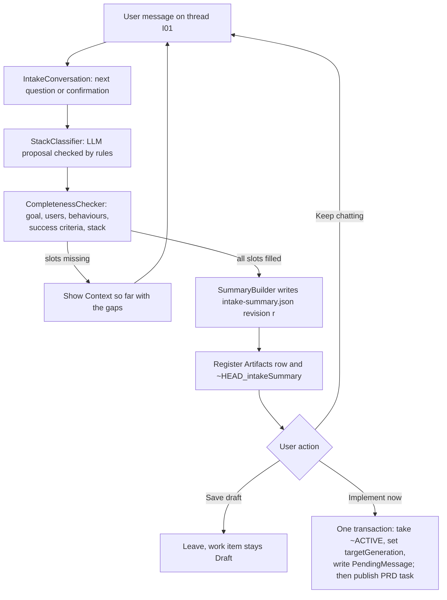

### 4.3 PRD agent

Turns the intake summary into a product requirements document that a human can approve and the design agent can consume: functional requirements, epics, stories, tasks, estimates, acceptance criteria and a test plan. The critic is internal ("create and review"), so the human sees a draft that already passed coverage checks.

| Field | Value |
|---|---|
| Stage, topic, subscription | `PRD`, `agenthub.prd.agent`, `agenthub-prd` |
| Host | agenthub-api core (Phase 0 and North Star) |
| Lock renewal cap, handler deadline | 30 min, 24 min (the cap minus 20 percent, because 20 percent is less than 10 minutes) |
| Inputs | `intakeSummary` (required); `baselinePrd` (existing projects); `feedback` and `prd` (redraft) |
| Outputs | `prd.json` (`prd`), `prd.md` (`prdMd`) |
| Gate after | PRD |
| Retries | 3 drafts per run; 2 JSON repairs per LLM step; 3 human redrafts; 5 deliveries |
| Token budget | 300k stage cap |
| Model | Recommended `opus` (open item 7) |
| Contract key fields | `context.projectMode`, `context.baselineGeneration`, `context.targetGeneration`, `config.limits.maxRevisions`, `humanAnswer` |
| Resources created | Two blobs at `blobPrefix`; ledger rows per LLM call and blob write; ActivityLog rows |
| Failure modes | `MissingInput` (no intake summary); `GuardrailBlocked`; blocking requirement gap (`Question`); critic never satisfied (`LoopLimit`); budget (`BudgetExceeded`); gateway down after retries (`Failed` `ExternalService`) |

| Sub-step id | Subagent | Kind | Does |
|---|---|---|---|
| `context` | shared input loader | deterministic | Loads inputs; checks the intake requirement ids exist |
| `analyse` | RequirementsAnalyst | LLM | Turns intake requirements into a requirement set with ids; lists conflicts and gaps; a blocking gap becomes a `Question` |
| `write` | PrdWriter | LLM | Writes `prd.json`: summary, functional requirements, epics, stories, tasks, Fibonacci estimates, acceptance criteria, technical acceptance criteria, test plan, automation scope. Existing projects: cumulative, the whole product as it will be after this work item; every baseline requirement, story and criterion is carried forward and marked `added`, `changed` or `retired` where this work item touches it |
| `critique` | PrdCritic | deterministic and LLM | Schema check; every intake requirement maps to a story; every story has testable criteria; out-of-scope respected. Issues go back to `write` |
| `render` | PrdRenderer | deterministic | `prd.json` to `prd.md` |
| `publish` | shared artifact writer | deterministic | Writes both files at `blobPrefix` |

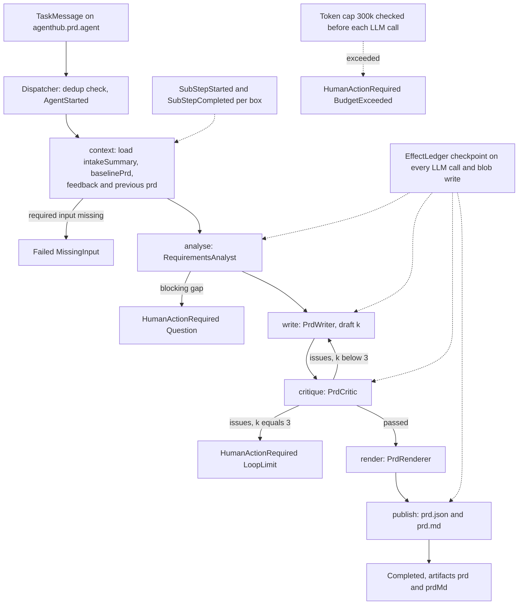

### 4.4 System Design agent

Produces the technical specification every later agent follows: components, phases, a file plan, API contracts, executable acceptance checks, the ADO backlog shape, the deployment plan and the run and test commands. Its validator is deterministic on purpose: "every path is inside the template layout" and "every modify target exists" are facts, not opinions, and should never cost tokens. For an existing project the techspec is cumulative like the PRD: it carries every baseline acceptance check forward, while the file plan lists only the files this work item touches. The baseline therefore always points at a complete description, and Testing always runs every check the product has.

| Field | Value |
|---|---|
| Stage, topic, subscription | `SYSTEM_DESIGN`, `agenthub.system-design.agent`, `agenthub-system-design` |
| Host | agenthub-api core |
| Lock renewal cap, handler deadline | 60 min, 50 min |
| Inputs | `prd`, `intakeSummary`; existing projects `baselineTechSpec`, `baselineCodeState`; template manifest `templates/{templateId}/manifest.json`; standards pack `templates/standards/v1/` (North Star: the context service) |
| Outputs | `techspec.json` (`techSpec`), `system-design.md` (`techSpecMd`) |
| Gate after | SYSTEM_DESIGN |
| Retries | 3 revisions per run; 2 JSON repairs per LLM step; 3 human redrafts; 5 deliveries |
| Token budget | 500k stage cap |
| Model | Recommended `opus` for planning and writing; review model for critique (open item 7) |
| Contract key fields | `context.templateId`, `context.stackProfile`, `context.projectMode`, `artifacts.baselineCodeState` |
| Resources created | Two blobs; ledger rows; ActivityLog rows |
| Failure modes | `MissingInput`; planner cannot complete the file plan without an assumption (`Question`); validator or critic never satisfied (`LoopLimit`); `BudgetExceeded` |

| Sub-step id | Subagent | Kind | Does |
|---|---|---|---|
| `context` | ModeDetector and TemplateResolver | deterministic | New or existing (baseline present); resolves template layout: projects, folders, ports, test frameworks |
| `repo-context` | RepoContextBuilder (existing only) | deterministic | Selects the symbols in `code-state.json` relevant to the PRD stories and their neighbours, within a token budget |
| `plan` | DesignPlanner | LLM | Components, phases and milestones, file plan (path, create or modify, classes, methods), API contracts |
| `write` | SectionWriter | LLM, one call per section | Architecture, data, API, LLM integration (`fe-be-llm` only), TDD plan, acceptance tests as executable checks (method, path, body, expected status, expected shape), ADO epics and stories, deployment plan, run and test commands |
| `validate` | DesignValidator | deterministic | Every PRD acceptance criterion has a test; every story has files; every path is inside the template; existing mode: every "modify" target exists, no "create" collides, and no baseline acceptance check disappears without a `retired` entry; packages only from the template allowlist; stack within .NET 10, Angular and Table Storage; resource names follow the convention (41 characters at most, section 4.8) |
| `critique` | DesignCritic | LLM | Gaps against the PRD and the standards; issues go back to `plan` or `write` |
| `render` | DesignRenderer | deterministic | `techspec.json` to `system-design.md` |
| `publish` | artifact writer | deterministic | Writes both files |

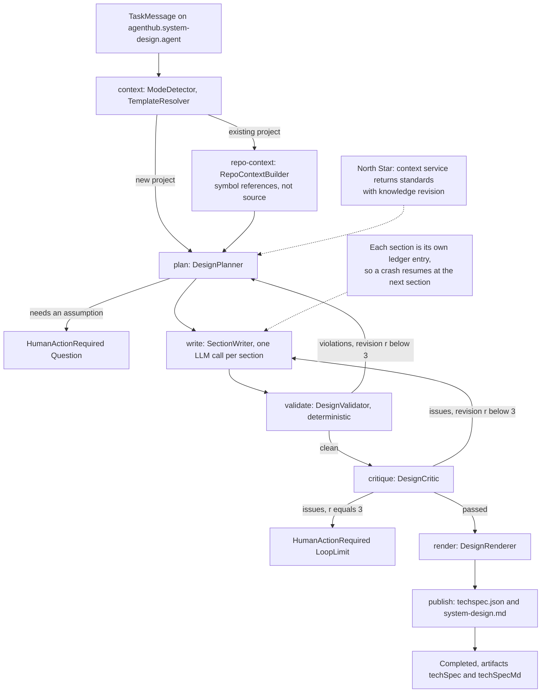

### 4.5 Implementation agent

Builds the code the design describes, test first, one phase at a time, and leaves a pull request. It is the longest-running agent (hours), which is why it has the largest lock renewal cap and why every phase ends with a push: after a crash the working copy is rebuilt from the pushed branch and the LLM outputs are replayed from the ledger.

| Field | Value |
|---|---|
| Stage, topic, subscription | `IMPLEMENTATION`, `agenthub.implementation.agent`, `agenthub-implementation` |
| Host | Phase 0: builder App Service container. North Star: Container Apps Job, one execution per message |
| Lock renewal cap, handler deadline | 4 h, 3 h 50 min |
| Inputs | `techSpec`, `prd`; existing projects `baselineCodeState`; rework `feedback` plus `testResults` (route-back from Testing), `review` (North Star, from Code Review) or the requester's note (Request changes at DEV acceptance) |
| Outputs | Code on the work branch; pull request (never merged by this agent); `code-state.json` (`codeState`), `code-graph.json` (`codeGraph`). Phase 0 also `review.json` (`review`) from the CodeReviewer subagent |
| Result `outputs` | `repoUrl`, `workBranch`, `headCommit`, `pullRequestId`, `pullRequestUrl`, `adoWorkItems` (including the epic id); sent with every status, including `Failed`, so buildgenix always learns what already exists |
| Gate after | None (auto-advance) |
| Retries | 3 fix attempts per phase; Phase 0: 2 review fix rounds; 5 deliveries |
| Token budget | 1.8M stage cap (North Star proposed: 1.65M, with 150k moving to Code Review) |
| Model | Phase 0: recommended `5.4` through APIM chat. North Star: a codex model (`53codex-chat`) through the Responses API once governance approves that path (open item 7) |
| Contract key fields | `context.repo.url` (null for a new project until this stage creates it), `context.repo.workBranch`, `context.ado.epicId` (null until the first Implementation creates the project's epic), `context.templateId`, `loopIndex` |
| Resources created | ADO repo `bgx-{slug}` (new project), `main` scaffold, work branch, commits with `Bgx-Task` and `Bgx-Phase` trailers, pull request, the project's epic (first work item) and stories, lock files; North Star also the thin pipeline definitions that `extends` platform templates; blobs. Environments, connections and hooks are platform-owned |
| Failure modes | `BuildEnvironment` (SDK, feed or disk problem); `ExternalService` (ADO down); fix loop exhausted (`LoopLimit`); `BudgetExceeded`; push rejected by branch policy (`Failed` with reason). A failed first work item leaves a repo whose `main` holds only the template; the next attempt reuses it (section 3.5) |

| Sub-step id | Subagent | Kind | Does |
|---|---|---|---|
| `workspace` | WorkspaceManager | deterministic | New project: look up repo `bgx-{slug}` by name and reuse it if a failed earlier first work item created it (its `main` can only hold the template, because merges happen only after acceptance); otherwise create it, scaffold from the template, push `main`. Existing: clone `main`. Create or reuse the work branch. Rework: clone the work branch. After a crash: re-clone at the last pushed commit |
| `pipeline` (North Star) | PipelineProvisioner | deterministic (ADO REST) | New project: create the three pipeline definitions (PR, deploy-dev, main) as thin `extends` wrappers from the protected templates repo, each looked up by name before create; existing project: look each up and fail `BuildEnvironment` if missing. ADO environments, their checks, service connections and service hook subscriptions are pre-created once by the platform team per `BuildGenix-Apps` (section 15.2); no agent holds Administrator or Creator on them. The platform team authorizes each new pipeline for the environments and connections it may use (no open access) |
| `backlog` | BacklogSync | deterministic (ADO REST) | Creates the project's epic if `context.ado.epicId` is null, otherwise adds stories under it; items tagged `bgx-wi:{workItemId}` and `bgx-key:{storyKey}`; queries by tag before create so a retry never duplicates. Stories left by a failed attempt keep their own tag (Phase 0: the user closes them; North Star: closed automatically on failure). Skipped in rework |
| `dependencies` | DependencyManager | deterministic | Adds the packages the techspec lists, only from the template's allowlist, at pinned versions (`npm install --save-exact --ignore-scripts`, `dotnet add package`), and commits the lock files. CodeWriter may not edit `package.json`, `package-lock.json` or package references |
| `phase-{k}` | PhaseRunner, running TestWriter (LLM, tests first), CodeWriter (LLM, one file at a time with code-state references and the current file content), BuildVerifier (`dotnet build`, `dotnet test`, `npm ci --ignore-scripts`, `ng build`, `ng test --watch=false` with Vitest, no browser), FixLoop (LLM repair from compiler and test output), PhaseCommitter (commit "phase k: {title}" with the `Bgx-Task: {taskId}` and `Bgx-Phase: {k}` trailers and ledger-pinned author and committer dates, push, record the commit) | mixed | One sub-step per techspec phase |
| `review` (Phase 0 only) | CodeReviewer | deterministic and LLM | Deterministic checks first, and the LLM cannot override them: secret scan, banned APIs, dependency allowlist, no edits to package manifests, file-plan conformance, acceptance coverage. Then an LLM review against the techspec. Blockers go to FixLoop, BuildVerifier re-runs and a "review fixes" commit is pushed, max 2 rounds; writes `review.json`. Moves to the Code Review agent in the North Star |
| `code-state` | CodeStateBuilder | deterministic (Graphify) | `graphify extract . --code-only` to `code-graph.json`, normalised into `code-state.json` |
| `pull-request` | PullRequestPublisher | deterministic (ADO REST) | Opens or updates the PR from the work branch to `main` and links the ADO work items. The PR stays open until Finalize |

`context.implementationMode` selects one of three modes. Each is a new task with its own ledger, and each pushes to the same branch, so the same pull request picks up the new head commit:

| Mode | When | What runs |
|---|---|---|
| `Build` | First Implementation of a work item | Every step in the table above |
| `Continue` | Retry after `LoopLimit` or `BudgetExceeded` | `workspace` from the work branch, `backlog` and `dependencies` (no-ops through find-or-create), the phase that hit the limit with the guidance, the remaining phases, then `review`, `code-state`, `pull-request` |
| `Rework` | Test route-back, Request changes at DEV acceptance, and in the North Star a Code Review route-back | `workspace` from the work branch, one `phase-fix` driven by `feedback` (failing tests and their output, review findings, or the requester's change request), then `review` (Phase 0), `code-state`, `pull-request` |

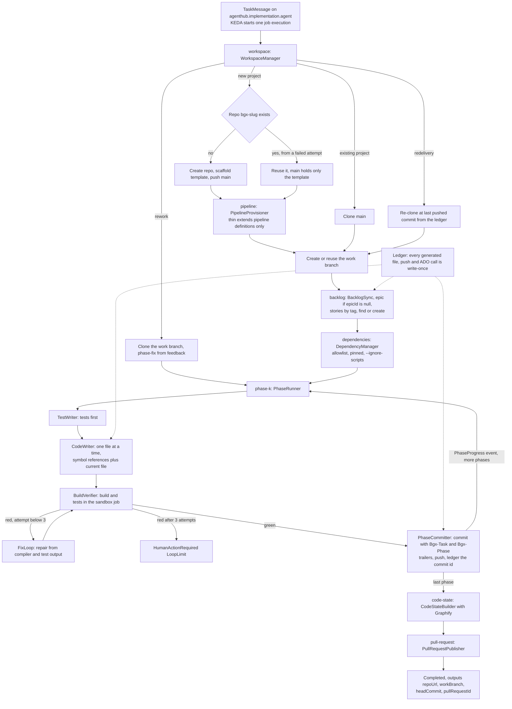

### 4.6 Code Review agent (North Star; a subagent in Phase 0)

An independent reviewer with its own identity, its own topic and a human gate that is a floor for every project whose ladder goes beyond DEV (optional only for DEV-only projects). In Phase 0 the same checks run as the CodeReviewer subagent inside Implementation (S6), which is cheaper but means the author grades its own work. Splitting it out in the North Star is what makes the PR review meaningful under ADO branch policies: the reviewing identity is not the authoring identity. In both forms the deterministic checks run first and block on their own: the LLM review can add findings but cannot clear a deterministic blocker.

| Field | Value |
|---|---|
| Stage, topic, subscription | `CODE_REVIEW`, `agenthub.code-review.agent`, `agenthub-code-review` |
| Host | Container Apps Job (needs a clone and Graphify) |
| Lock renewal cap, handler deadline | 60 min, 50 min (proposed) |
| Inputs | `techSpec`, `prd`, `codeState`, `codeGraph`; existing projects `baselineCodeState`; `context.repo` with the head commit and PR id |
| Outputs | `review.json` (`review`); review threads on the ADO pull request |
| Gate after | Floor beyond DEV; optional only for DEV-only projects |
| Retries | 2 fix rounds per work item (orchestrator route-backs); 2 JSON repairs per LLM step; 5 deliveries |
| Token budget | 150k (proposed, carved out of Implementation's 1.8M) |
| Model | Recommended `5.4` for review (open item 7) |
| Result | No blockers: `Completed`. Blockers: `Completed` with `signal.kind = RouteBack`, `routeBackTo = IMPLEMENTATION` (contract 2.1, additive); buildgenix republishes Implementation with `feedback`, and its rework rebuilds, retests and pushes a "review fixes" commit, which the next review sees as a new head |
| Resources created | PR threads (each tagged with a finding id so a retry updates instead of duplicating); blob; ledger rows |
| Failure modes | Head commit missing (`InvalidInput`); ADO down (`ExternalService`); `BudgetExceeded` |

| Sub-step id | Subagent | Kind | Does |
|---|---|---|---|
| `workspace` | WorkspaceManager | deterministic | Clone the work branch at the head commit |
| `diff` | DiffMapper | deterministic | `git diff main...head`, mapped onto code-state symbols so each change is a symbol, not a line range |
| `static` | StaticChecks | deterministic | Secret scan, banned APIs, dependency allowlist, no edits to package manifests outside DependencyManager's commit. Any hit is a blocker the LLM cannot override |
| `conformance` | ConformanceChecker | deterministic | Techspec acceptance coverage; file-plan conformance; existing mode: no baseline symbol changed that the plan did not name |
| `review` | LlmReviewer | LLM | Review of each changed symbol against the techspec and standards; findings as blocker, warning or suggestion |
| `comment` | PrCommenter | deterministic (ADO REST) | Posts or updates one PR thread per finding |
| `publish` | artifact writer | deterministic | `review.json` |

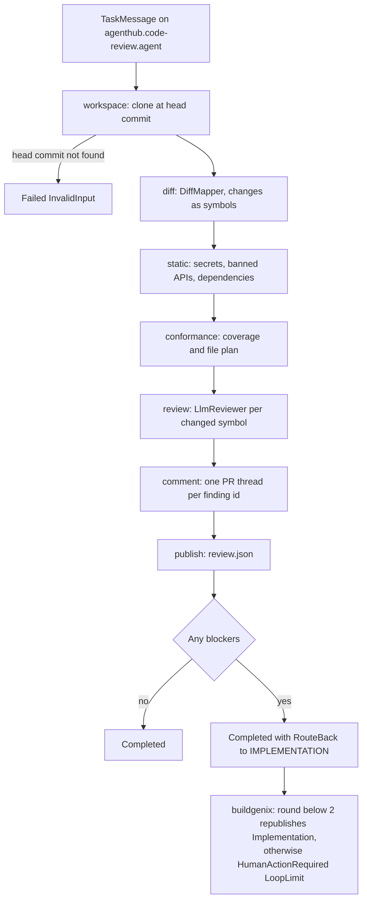

### 4.7 Testing agent

Proves that the head commit of the work branch works. It never merges: the merge waits until a person has accepted the running app (S7a). Unit suites and executable acceptance checks run against a local build with the LLM replaced by a fixture, so results are deterministic. In the North Star a verification step reads the failure evidence and proposes whether the requirement or the code is wrong, which is what turns a test failure into a productive loop instead of an infinite one.

| Field | Value |
|---|---|
| Stage, topic, subscription | `TESTING`, `agenthub.testing.agent`, `agenthub-testing` |
| Host | Phase 0: builder. North Star: Container Apps Job |
| Lock renewal cap, handler deadline | 60 min, 50 min |
| Inputs | `techSpec`, `review`; North Star also `prd` (for verification); `context.repo` with Implementation's head commit and PR id |
| Outputs | `test-results.json` (`testResults`) only; no side effects outside the workspace |
| Gate after | None. North Star: a confirmation when verification proposes "PRD wrong" |
| Retries | 3 route-back loops per work item (orchestrator); 5 deliveries |
| Token budget | 200k stage cap (LLM only used on failure) |
| Model | Recommended `5.4` for analysis (open item 7) |
| Result | Green: `Completed` for the tested head commit; buildgenix then publishes the Deploy action for that commit. Red: `Completed` with `signal.kind = RouteBack`; Phase 0 `routeBackTo = IMPLEMENTATION` always; North Star `IMPLEMENTATION` or `PRD` as proposed by verification (`PRD` is a contract 2.1 additive value) |
| Resources created | Blob; ledger rows |
| Failure modes | Build environment broken (`BuildEnvironment`); head commit missing (`InvalidInput`); ADO down (`ExternalService`) |

| Sub-step id | Subagent | Kind | Does |
|---|---|---|---|
| `workspace` | WorkspaceManager | deterministic | Clone the work branch at the head commit |
| `suites` | SuiteRunner | deterministic | `dotnet test` (TRX), `ng test --watch=false` (Vitest, JUnit reporter) |
| `acceptance` | AcceptanceRunner | deterministic | Starts the BE on localhost with `Llm:Provider=Fixture`; runs every acceptance check in the cumulative techspec, from earlier work items as well as this one, which is the regression test for an existing project; for LLM endpoints checks the response shape, not the text |
| `sandbox` (North Star) | SandboxProbe | deterministic | Runs the smoke subset of acceptance checks against the Sandbox deployment of the PR build for the same head commit, with the real model behind the generated app |
| `analyse` | FailureAnalyst (Phase 0, on failure) | LLM | Summarises failures; proposes code-wrong or spec-wrong, but Phase 0 always routes to Implementation |
| `verify` (North Star, on failure) | Verifier | deterministic and LLM | Traces each failing check to its acceptance criterion and story; proposes PRD-wrong (the criterion contradicts the intake or another criterion) or code-wrong (the criterion is coherent and the code misses it), with evidence |
| `publish` | artifact writer | deterministic | `test-results.json` |

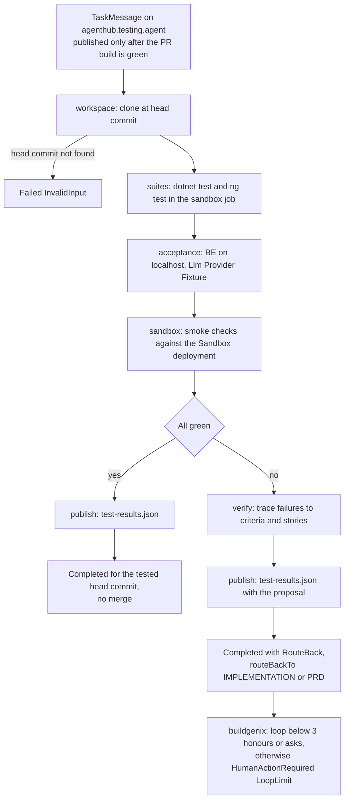

### 4.8 Deployment agent

The Deployment agent runs at least twice per work item, selected by `context.deploymentAction`. The **Deploy** action deploys the tested head commit of the work branch and ends at the DEV acceptance gate. After the requester accepts, buildgenix sends the same agent a **Finalize** action, which only merges the pull request. Keeping the merge in an agent that already holds ADO rights means buildgenix-api never needs Azure DevOps credentials.

Phase 0 and the North Star differ most in the Deploy action. In Phase 0 the agent provisions with the Azure SDK, packages, deploys with Kudu OneDeploy and smoke-tests, all under the builder's identity in one sandbox resource group (S10). In the North Star the ADO pipeline from the stack template does build, infrastructure and deployment under environment-scoped service connections: the agent queues the pipeline run that deploys the tested commit to DEV, waits for it, and verifies. For the higher rungs it only verifies (action **Verify**, a contract 2.1 additive value), because those deployments are promotions of the merged `main` build that ADO runs after its own environment approvals. Removing deployment rights from the agent identity is the main security gain. Generated apps are protected differently in the two forms: Phase 0 restricts them to the corporate IP ranges with App Service access restrictions, the North Star puts Entra authentication in front of every generated app, so access follows identity and not network location.

| Field | Value |
|---|---|
| Stage, topic, subscription | `DEPLOY_DEV` (North Star also `DEPLOY_ST`, `DEPLOY_STAGE`, `DEPLOY_PROD` for Verify), `agenthub.deployment.agent`, `agenthub-deployment` |
| Host | Phase 0: builder. North Star: core (no build or deploy work left) |
| Lock renewal cap, handler deadline | 60 min, 50 min |
| Inputs | `techSpec` (deployment section); `context.repo` with the tested `headCommit` and `pullRequestId`; `context.deploymentAction` (`Deploy` or `Finalize`; North Star also `Verify`); `context.environment`; North Star Verify also `context.pipeline` with the run id and stage reported by the service hook (contract 2.1, additive) |
| Outputs | Deploy: `completion-summary.json` (`completionSummary`) for DEV; Phase 0 also the Azure resources. Finalize: `outputs.mergeCommit`. Verify: `completion-summary-{env}.json` for System Test, Stage and Production |
| Result `outputs` | Deploy and Verify: `headCommit`, `deployedUrls`, `azureResources`. Finalize: `mergeCommit` |
| Gate after | Deploy: DEV acceptance. Finalize: none, the work item completes. Verify: none in BuildGenix; promotion approvals live in ADO environments |
| Retries | Smoke window 5 min with back-off; 5 deliveries; Finalize is a no-op if the PR is already completed with the same head |
| Token budget | 50k (one short summary blurb) |
| Resources created | Phase 0 Deploy: App Service plan (first time), `bgx-{slug}-be-dev`, `bgx-{slug}-fe-dev`, app settings, access restrictions, all through `CreateOrUpdate`, so a second attempt reuses them. North Star Deploy: one queued pipeline run; the pipeline creates the resources. Finalize: PR completion (merge commit on `main`), linked stories transitioned |
| Failure modes | Smoke never healthy (`HumanActionRequired` `Question` with logs); North Star pipeline build or test failure (`Completed` with `RouteBack` to `IMPLEMENTATION`, contract 2.1); policy or quota error (`HumanActionRequired` `Question`); Finalize finds the PR head moved, `mergeStatus` `conflicts` or `failure`, or (North Star) `main` no longer an ancestor of the deployed commit (`HumanActionRequired` `Question` with the ADO status, nothing merged); a Key Vault reference that does not resolve (`Failed` `ExternalService` naming the setting) |

| Sub-step id | Subagent | Action and phase | Does |
|---|---|---|---|
| `workspace` | WorkspaceManager | Deploy, Phase 0 | Clone the work branch at the tested `headCommit` |
| `provision` | Provisioner | Deploy, Phase 0 | Idempotent ARM `CreateOrUpdate` in the sandbox resource group: shared plan (Linux B2, so Always On is available and there is no daily CPU quota), BE app (.NET 10) and FE app (Node, startup command `pm2 serve /home/site/wwwroot --no-daemon --spa` for the SPA fallback), created with `autoGeneratedDomainNameLabelScope = TenantReuse` (names need not be globally unique; `bgx-` plus a 30-character slug plus `-be-dev` is 41 characters, inside the 43-character label limit), CORS origin, LLM settings, Key Vault references, health check path, access restrictions to the corporate IP ranges (open item 13); attaches the pre-created user-assigned identity to LLM-enabled apps and sets `keyVaultReferenceIdentity` to it, then checks the Key Vault reference status through ARM; reads back each app's `defaultHostName` and SCM host and hands them to `package` and `deploy`. Reuses apps left by a failed earlier attempt |
| `package` | PackageBuilder | Deploy, Phase 0 | `dotnet publish` BE; `ng build` FE; writes `assets/runtime-config.json` with the BE hostname from `provision` (Angular is static, so app settings cannot reach it); zips both. Runs after `provision` because the hostname is only known once the app exists |
| `deploy` | Deployer | Deploy, Phase 0 | Kudu OneDeploy (`/api/publish?type=zip`) on the SCM host read back by `provision`, with an Entra bearer token; waits for deployment status. Re-deploying the same zip is harmless |
| `run` | PipelineRunner | Deploy, North Star | Queues the DEV deployment for the tested head commit, reusing the PR build's artifact for that commit; waits with back-off inside the handler deadline; reads the stage result, the log on failure and the output variables (URLs, resource ids) |
| `run-facts` | PipelineRunReader | Verify, North Star | Reads the promotion run named in `context.pipeline`: stage result, log on failure, output variables |
| `smoke` | SmokeValidator | Deploy and Verify | BE `/health`, one techspec smoke request, FE index loads; retries with back-off up to 5 min |
| `drift` | ConfigVerifier | Deploy and Verify, North Star | Read-only ARM check that app settings, identities, `keyVaultReferenceIdentity` and its reference status, and the Entra authentication settings match the techspec deployment plan |
| `summary` | SummaryWriter | Deploy and Verify | URLs, resources, deployed commit, how to run locally, what changed, plus a short LLM blurb |
| `finalize` | Finalizer | Finalize, both | GET the PR first (already `completed` means read `lastMergeCommit` and stop). North Star also refuses if `main` is no longer an ancestor of the deployed commit. Then `PATCH status=completed` with `lastMergeSourceCommit` = the deployed commit (ADO itself refuses if the head moved), `completionOptions.mergeStrategy = noFastForward` (the tested commit becomes an ancestor of `main`), `transitionWorkItems = true`, `deleteSourceBranch = false`; polls `status` and `mergeStatus` until completed and records `lastMergeCommit` as `mergeCommit`. A moved head, `conflicts` or `failure` returns `HumanActionRequired` instead of merging untested code |

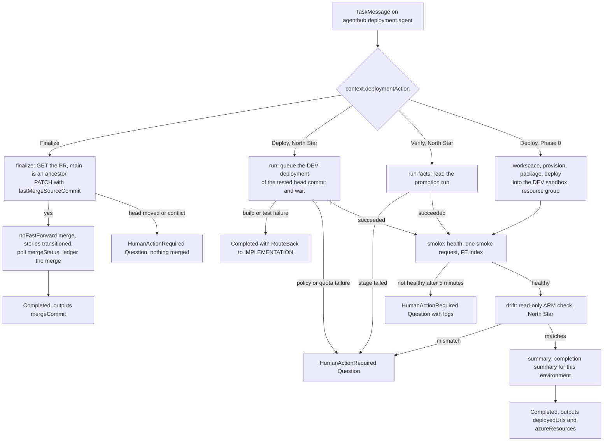

### 4.9 HEALTHY harness

HEALTHY is not a pipeline stage. It proves the hosting template end to end: a REST call on agenthub-api publishes to `agenthub.healthy.agent` (subscription `agenthub-healthy`, lock cap 2 min), the core worker makes one ledger-guarded LLM call, writes `healthy-result.json` under the standard path and publishes a result. It moves from today's `sdlc-tasks-healthy` and `sdlc-results` to the new names by configuration only.

---

## 5. Agent-to-agent communication

Agents do not communicate with each other at all. What looks like agent-to-agent communication is two separate conversations with the orchestrator: agent A reports to buildgenix-api, buildgenix-api registers what A produced, and later publishes a task to agent B whose message names A's files. This indirection is the core of the design: it is what lets buildgenix enforce gates, budgets and loop limits between any two steps, and what lets either agent be replaced, re-hosted or re-run without the other noticing.

### 5.1 Topics and subscriptions

Task topics are named after their consumer (S5). The two inbound topics follow the same rule and are named after buildgenix (open item 1 asks Badru to confirm those two names).

| Topic | Publisher | Subscription | Consumer, Phase 0 | Consumer, North Star | Lock renewal cap |
|---|---|---|---|---|---|
| `agenthub.prd.agent` | buildgenix-api | `agenthub-prd` | core | core | 30 min |
| `agenthub.system-design.agent` | buildgenix-api | `agenthub-system-design` | core | core | 60 min |
| `agenthub.implementation.agent` | buildgenix-api | `agenthub-implementation` | builder | Container Apps Job | 4 h |
| `agenthub.code-review.agent` | buildgenix-api | `agenthub-code-review` | n/a (subagent) | Container Apps Job | 60 min (proposed) |
| `agenthub.testing.agent` | buildgenix-api | `agenthub-testing` | builder | Container Apps Job | 60 min |
| `agenthub.deployment.agent` | buildgenix-api | `agenthub-deployment` | builder | core | 60 min |
| `agenthub.healthy.agent` | agenthub-api REST | `agenthub-healthy` | core | core | 2 min |
| `buildgenix.agent-results` | all agents | `buildgenix-api` | buildgenix-api | buildgenix-api | short |
| `buildgenix.agent-events` | all agents | `buildgenix-api` | buildgenix-api | buildgenix-api | short |

All subscriptions use MaxDeliveryCount 5, a 5 minute lock (the Service Bus maximum on every tier) with auto-renewal up to the cap, and dead-letter on filter and expiration.

**Concurrency.** Every worker receives with `MaxConcurrentCalls = 1` and `PrefetchCount = 0`, and there is no global run gate across the workers of a host. A global gate looks safer but is not: a message received while the gate is closed waits with its lock renewal clock and delivery count running, so a long Implementation run can burn the attempts of every message queued behind it. Without the gate, the Phase 0 core host can run one PRD and one design at the same time and the builder one run of each of its three agents. The builder plan is chosen in Phase 0 slice 1 from the measured peak memory of three concurrent runs (measurement starts on P2v3), and builds run with `dotnet build -maxcpucount:2` and a Node `--max-old-space-size` so one run cannot starve the others. In the North Star each Container Apps execution receives exactly one message and settles it; parallelism is the number of executions KEDA starts, capped per job, and there is still no gate shared between jobs.

**Deadline.** Each handler runs under a wall-clock deadline of its lock renewal cap minus 10 minutes or 20 percent, whichever is smaller (PRD 24 min, Implementation 3 h 50 min, the 60 minute agents 50 min). On the deadline the handler stops, publishes `Failed` with `errorCode = DeadlineExceeded` and completes the message, so the result always lands before the lock cap. The North Star sets the Container Apps execution timeout above the lock cap, so the handler deadline, not the platform, ends a long run.

**In-step resilience.** Transient failures to the LLM, ADO, ARM and storage (HTTP 429, 5xx, timeouts) are retried inside the step with exponential back-off and a circuit breaker (`Microsoft.Extensions.Http.Resilience`) for up to 10 minutes per step. Only then does the exception reach the dispatcher and the message is abandoned. Five deliveries therefore ride out close to an hour of outage instead of burning every attempt in seconds.

**Why a second copy is safe.** In normal operation one copy of a task runs at a time. That is not what keeps the system correct, because a lock can be lost early (a network detach, or two containers overlapping during a platform swap or a job restart). Correctness comes from two rules instead: every effect is ledger-guarded, and every external call is find-or-create (section 5.6). A `MessageLockLost` on settle after the result was published is treated as already processed.

**Why results travel on a topic and not a REST call.** buildgenix-api is a single instance in Phase 0. During its deploy or restart a REST call fails; the agent would have to hold its own message and burn delivery attempts, and after 5 attempts finished work would be dead-lettered. A topic keeps the result durably until buildgenix-api is back. buildgenix already has the dedup table for it (`SgProcessedEvents`), and HEALTHY already publishes this way. The body and dedup key are identical for both transports, so the documented fallback `POST /api/internal/sdlc-results` is a transport adapter, not a redesign (open item 2).

### 5.2 TaskMessage

Service Bus `MessageId` = `{taskId}:{inputVersion}`. `taskId` is one ULID per (work item, stage, output revision): stable across redelivery, resend and human answers, new on a redraft. The example below is the Hello World System Design task after the PRD was approved on its first draft.

```json
{
  "contractVersion": "2.0",
  "workItemId": "01JC8W4M7Q9V3T5R2X6Y8Z0A1B",
  "projectId": "01JC8W2F3K5H7J9L1N3P5R7T9V",
  "stage": "SYSTEM_DESIGN",
  "taskId": "01JC9A0B1C2D3E4F5G6H7J8K9M",
  "correlationId": "c0a8017e-5f1d-4d5e-9a4b-2f6e7d8c9b0a",
  "causationId": "gate:01JC99ZZ...:Approved",
  "inputVersion": 4,
  "pipelineVersion": 1,
  "loopIndex": 0,
  "outputRevision": 1,
  "blobPrefix": "01JC8W2F.../01JC8W4M.../v1/",
  "stateContextId": "01JC8W2F...:01JC8W4M...",
  "artifacts": {
    "intakeSummary": "01JC8W2F.../01JC8W4M.../v1/intake-summary.json",
    "prd": "01JC8W2F.../01JC8W4M.../v1/prd.json"
  },
  "context": {
    "projectName": "Hello World",
    "projectSlug": "hello-world",
    "projectMode": "New",
    "baselineGeneration": 0,
    "targetGeneration": 1,
    "stackProfile": "fe-be-llm",
    "templateId": "fe-be-llm@1.0.0",
    "repo": { "provider": "AzureDevOps", "url": null, "defaultBranch": "main", "workBranch": "feature/wi-1-hello-world", "headCommit": null, "pullRequestId": null },
    "ado": { "organization": "wcbbc", "project": "BuildGenix-Apps", "epicId": null },
    "environment": "DEV",
    "deploymentAction": null
  },
  "humanAnswer": null,
  "config": {
    "modelId": "opus",
    "reasoningEffort": "high",
    "budget": { "stageMaxTokens": 500000, "workItemRemainingTokens": 2700000 },
    "limits": { "maxRevisions": 3, "maxFixAttempts": 3 }
  }
}
```

| Field | Meaning and why it is there |
|---|---|
| `inputVersion` | The work item's `CurrentInputVersion`, bumped on every human input (approve, reject, answer, Request changes, retry). Part of the MessageId, so an answer produces a new message that passes dedup while keeping the same `taskId` and therefore the same ledger |
| `outputRevision`, `blobPrefix` | The revision this run will write and the folder it writes into. The agent writes only under `blobPrefix` |
| `pipelineVersion` | The `PipelineVersion` of the work item's `ApprovalGates` rows: 1 at Implement now, plus 1 every time a stage already run gets a new `taskId` (redraft, route-back, Request changes, retry after a limit; D-52). Gate ids (`GATE_v{pv:D4}_{stage}`) and `StageStatuses` row keys embed it, so the rows of a new attempt never collide with the old ones. In this example nothing has been redrafted yet, so it is 1 |
| `loopIndex` | The test route-back counter for Implementation (0 on the first run) |
| `artifacts` | Authoritative input paths, resolved by buildgenix to the latest revision of each key. Fixed keys: `intakeSummary`, `prd`, `prdMd`, `techSpec`, `techSpecMd`, `review`, `codeState`, `codeGraph`, `testResults`, `completionSummary`, `feedback`, `baselinePrd`, `baselineTechSpec`, `baselineCodeState`. The registry keeps one key per feedback file kind (`feedbackPrd`, `feedbackSystemDesign`, `feedbackImplementation`); buildgenix maps the one meant for this stage to the message key `feedback` (section 9.2) |
| `context` | A small resolved block of facts the agent would otherwise have to look up. `repo.url` is null until Implementation creates the repo for a new project; buildgenix stores the URL it receives and sends it on every later task. `repo.pullRequestId` comes from the latest Implementation result. `repo.headCommit` is the latest Implementation `headCommit` on TESTING tasks, `testedCommit` on Deploy tasks and `deployedCommit` on Finalize tasks. `templateId` is the intake classifier result on a new project and `~BASELINE.TemplateId` on an existing project. `deploymentAction` (`Deploy` or `Finalize`) is set only on Deployment tasks. `ado.project` is the dedicated ADO project for generated repositories, proposed as `BuildGenix-Apps` (open item 14); `ado.epicId` is the project's epic, null until the first Implementation creates it, after which later work items add stories under it |
| `humanAnswer` | Set on the delivery that follows a `Question` |
| `config` | Model, reasoning effort (never temperature), the remaining token budget and loop limits, so limits are data, not code |

### 5.3 AgentResult (`buildgenix.agent-results`)

Service Bus `MessageId` = `result:{taskId}:{inputVersion}`, stable across redelivery so buildgenix dedups a re-published result.

```json
{
  "contractVersion": "2.0",
  "workItemId": "01JC8W4M...",
  "taskId": "01JC9A0B...",
  "stage": "SYSTEM_DESIGN",
  "status": "Completed",
  "correlationId": "c0a8017e-...",
  "inputVersion": 4,
  "outputRevision": 1,
  "runId": "01JC9A0B...:4:1",
  "artifacts": {
    "techSpec": "01JC8W2F.../01JC8W4M.../v1/techspec.json",
    "techSpecMd": "01JC8W2F.../01JC8W4M.../v1/system-design.md"
  },
  "outputs": {},
  "signal": null,
  "humanMessage": null,
  "errorCode": null,
  "errorMessage": null,
  "tokenUsage": { "input": 61234, "output": 18877, "modelId": "opus" },
  "durationMs": 412000
}
```

`status` is `Completed`, `HumanActionRequired` or `Failed`, and nothing else. `signal.kind` is `Question`, `LoopLimit` or `BudgetExceeded` with `HumanActionRequired`, or `RouteBack` with `Completed` (`signal.routeBackTo` names the stage). A fourth kind, `Stuck`, is never sent by an agent: buildgenix sets it on the work item when the dead-letter watcher or the stage watchdog fires (section 5.10). The orchestrator decides whether to honour a route-back. `outputs` carries facts that are not files: `repoUrl`, `workBranch`, `headCommit`, `pullRequestId`, `pullRequestUrl`, `mergeCommit`, `adoWorkItems`, `deployedUrls`, `azureResources`. It is sent with every status, including `Failed`, so buildgenix always knows what a run created (a repo, a branch, apps) even when the run did not finish. `errorCode` on `Failed` is one of `MissingInput`, `InvalidInput`, `GuardrailBlocked`, `BuildEnvironment`, `ExternalService`, `DeadlineExceeded`, `Cancelled`, `Unhandled`.

**Contract 2.1 (North Star, additive).** Phase 0 sends `RouteBack` only from Testing with `routeBackTo = IMPLEMENTATION`, and `deploymentAction` only as `Deploy` or `Finalize`. The North Star widens these: `RouteBack` also from Code Review (blockers) and from Deployment (pipeline build or test failure), `routeBackTo = PRD` from Testing's verify step, `deploymentAction = Verify` for promotions, and a `context.pipeline` block (`runId`, `stage`) on Verify tasks. Because these widen the meaning of existing fields, they ship as `contractVersion` 2.1: a 2.0 consumer rejects nothing it already understands, and buildgenix sends 2.1 values only to agents that declare 2.1.

The fields that change for the two most common non-trivial results:

```json
{ "status": "HumanActionRequired",
  "signal": { "kind": "Question" },
  "humanMessage": "The intake asks for a daily thought but also for a new thought on every page load. Which should the app do?" }
```

```json
{ "status": "Completed",
  "signal": { "kind": "RouteBack", "routeBackTo": "IMPLEMENTATION" },
  "artifacts": { "testResults": "01JCALP0.../01JCAL1W.../v1/test-results.json" } }
```

### 5.4 AgentEvent (`buildgenix.agent-events`)

`eventId` = `{taskId}:{inputVersion}:{deliveryCount}:{seq}`, unique per delivery attempt (`seq` restarts at 1 each attempt), and the Service Bus `MessageId` equals it. Events are best effort; the UI projection is forward-only so a replay cannot move a step backwards.

```json
{
  "contractVersion": "2.0",
  "eventId": "01JC9A0B...:4:1:7",
  "workItemId": "01JC8W4M...",
  "taskId": "01JC9A0B...",
  "stage": "SYSTEM_DESIGN",
  "runId": "01JC9A0B...:4:1",
  "kind": "SubStepCompleted",
  "subStep": { "id": "validate", "ordinal": 6, "label": "Checking the design against the PRD", "iteration": 2, "of": 3 },
  "progress": null,
  "tokens": { "input": 8120, "output": 2311, "modelId": "opus" },
  "message": "Design checks passed on revision 2",
  "level": "info",
  "occurredAt": "2026-10-07T10:14:22.481Z"
}
```

`kind` is one of `AgentStarted`, `Heartbeat` (every 60 seconds while a run is active; it only resets the watchdog clock and is not stored in ClientEvents), `SubStepStarted`, `SubStepCompleted`, `SubStepFailed`, `PhaseProgress` (Implementation: `progress = { phase, phases, fileCount }`), `FixLoopAttempt`, `TokensUsed`, `LogLine` (verbose channel only), `AgentCompleted`, `AgentFailed`, `AgentHumanActionRequired`.

### 5.5 Identity and dedup keys

| Thing | Key | Dedup or uniqueness enforced by | Stable across |
|---|---|---|---|
| Task message | `{taskId}:{inputVersion}` | `AgProcessedEvents` (PK `AGPROC`, RK = MessageId) | Redelivery and resend; changes on answer (new `inputVersion`) and redraft (new `taskId`) |
| Result | `result:{taskId}:{inputVersion}` | `SgProcessedEvents` (PK `SGPROC_{yyyyMMdd}`) | Redelivery of the task |
| Event | `{taskId}:{inputVersion}:{deliveryCount}:{seq}` | `SgProcessedEvents`, plus `ClientEvents` `~EID_{eventId}` | Nothing; each delivery attempt has its own events |
| Run | `runId` = `{taskId}:{inputVersion}:{deliveryCount}` | `WorkItemTelemetry` `RUN_{runId}`, `RunLog` `RUN_{runId}` | One delivery attempt |
| Effect | `{taskId}_{intentKind}_{ordinal:D6}` | `EffectLedger` write-once Add, 409 returns the stored winner | Every delivery and resend of the same task |
| ADO service hook (North Star, API catalog addition) | `ado:{eventId}` | `SgProcessedEvents` | ADO retries |

### 5.6 Crash order

Agent side (D-C1): check `AgProcessedEvents`, run the handler, publish the result, publish the terminal event, mark `AgProcessedEvents`, complete the message. buildgenix side: the results and events consumers check `SgProcessedEvents` by MessageId, apply, mark, then complete. buildgenix publishes the next task through its `PendingMessage` marker on the work item row, written in the same ETag-conditional update as the state change, so a crash between "state saved" and "task sent" is resent by `PendingResenderService` (threshold 150 s, scan every 30 s).

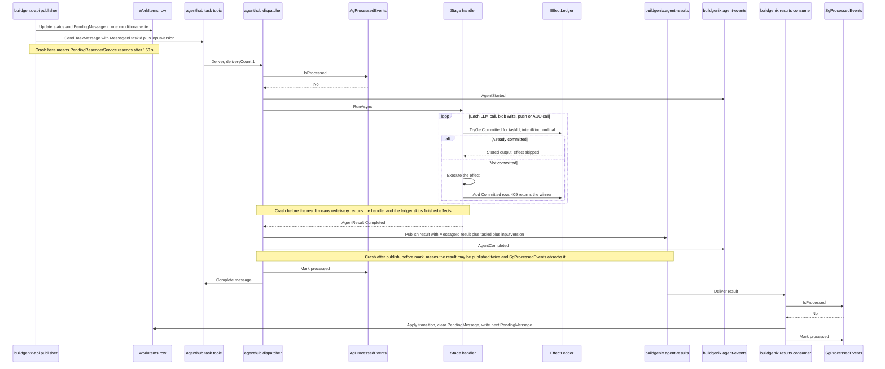

| Crash point | What happens on recovery |
|---|---|
| buildgenix: after state saved, before task sent | `PendingResenderService` resends the stored TaskMessage with the same MessageId |
| Agent: before result publish | Redelivery re-runs the handler; ledger-guarded effects return stored outputs |
| Agent: after result publish, before mark | Handler may re-run and publish the same result MessageId again; buildgenix dedups |
| Agent: after mark, before complete | Dedup check completes the message as a no-op |
| Agent: last delivery throws | Dispatcher publishes exactly one `Failed` result and terminal event, marks, dead-letters |
| buildgenix: after apply, before mark | Redelivered result re-applies; every write is conditional or idempotent (Artifacts head row, deterministic gate keys) |
| Agent: after an external call, before its ledger row | Redelivery repeats the step; the find-or-create check below finds what the first attempt created and adopts it |

The ledger row for an external effect can only be written after the call returns, so a crash between the call and the row is always possible. Every external effect is therefore find-or-create: it checks reality before acting.

| Effect | Check before acting | North Star addition |
|---|---|---|
| Create ADO repo | GET the repo by name `bgx-{slug}`; reuse it if present | Same |
| Create epic or story | WIQL query by tags `bgx-wi:{workItemId}` and `bgx-key:{storyKey}`; the epic by `context.ado.epicId` | Same |
| git push of phase k | Fetch the remote branch; if its head carries the trailers `Bgx-Task: {taskId}` and `Bgx-Phase: {k}`, adopt that commit. Commits take author and committer name and email from the fixed builder identity (`Builder:GitIdentity`, recorded in the GitPush ledger input), take `GIT_AUTHOR_DATE` and `GIT_COMMITTER_DATE` from the ledger, are never signed, and use `core.autocrlf=false`, so a replayed commit of the same tree and parent gets the same sha | Same |
| Create PR | GET active PRs with the same `sourceRefName` | Same |
| Complete PR | GET the PR; if `status = completed`, read `lastMergeCommit` | Same |
| Create pipeline definitions only | Not in Phase 0 | GET each pipeline by name; create thin extends wrapper if missing. Never create environments, connections or hooks (platform-owned) |
| Queue the DEV run | Not in Phase 0 | Run id in the ledger; on redelivery adopt only a run of `bgx-{slug}-deploy-dev` for the commit whose run tag carries `bgx-task:{taskId}`; never adopt by commit alone |
| Azure resources, OneDeploy | ARM `CreateOrUpdate` is idempotent; re-deploying the same zip is harmless | Done by the pipeline, not the agent |

**Ledger spill rule.** A Table Storage string property holds at most 64 KiB, which is 32,768 UTF-16 characters, and an entity at most 1 MiB. Any ledger `InputJson` or `OutputJson` longer than 30,000 characters goes to the `agenthub-ledger` container at `{workItemId}/{taskId}/{intentKind}_{ordinal:D6}.{input|output}.json`, and the row stores the path and a SHA-256. LLM inputs are stored as a prompt hash plus that pointer, never inline, so a large prompt cannot push a row over the limit. The threshold leaves headroom under the property limit for the JSON envelope.

### 5.7 How state context flows between agents

| Between | Carried by | Durable where |
|---|---|---|
| UI and buildgenix | REST snapshots and SignalR | buildgenix tables |
| buildgenix to agent | TaskMessage: ids, context block, input paths, output prefix | Service Bus until completed; `PendingMessage` on WorkItems |
| Agent to agent, through buildgenix | Blobs written by one stage, registered by buildgenix, passed as paths to the next | Blob (immutable, versioned) and the `Artifacts` registry |
| Across work items in a project | Baseline: accepted PRD, techspec and code-state paths, repo URL, epic id, generation; moved only when Finalize reports the merge | One reserved row `~BASELINE` in `WorkItems`, partition `{projectId}`, next to `~ACTIVE` (section 9.4) |
| Agent and its subagents | In-process typed request and result records owned by the handler | EffectLedger checkpoint per LLM call, file write and external call |
| Code | git: ADO repo, feature branch pushed after every phase | ADO |
| Builder working copy | Local disk `/tmp/bgx/{workItemId}/{taskId}/repo` | Disposable; rebuilt from the pushed branch after a crash |

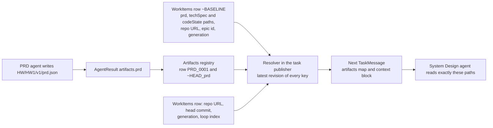

Because buildgenix resolves `~HEAD_` rows at publish time and writes the result into the message, the agent always gets the latest version (S4), and a replay of the same message reads the same files even if a newer revision appears later. This is the property that makes a run reproducible.

In the North Star an agent that needs live data during a run (for example the current state of a gate) calls a read-only buildgenix REST endpoint. It still never reads a table.

### 5.8 How state flows between subagents

Inside a run the handler is the only owner of state. It calls each subagent with a typed request, receives a typed result, records what matters in the ledger and passes the next subagent only what that subagent needs. In Implementation, for example, PhaseRunner receives the phase definition and the symbol references for the files it touches; TestWriter returns test file contents; CodeWriter receives one file specification, the relevant tests and the current content of that file, and returns new content; BuildVerifier returns exit codes and captured output; FixLoop receives that output and the failing files. No subagent sees another subagent, and none holds state between calls. This is why a crash can restart mid-phase: the handler rebuilds its in-memory state from the ledger and the pushed branch, and every subagent call before the crash returns its stored result.

### 5.9 Counters and identifiers in one place

| Name | Scope | Starts | Changes when | Used for |
|---|---|---|---|---|
| `summaryRevision` | Intake summary of one work item | 1 | The requester regenerates the summary | Implement now binds one (D-C5); intake path `v{summaryRevision}` |
| `taskId` | One stage run | New ULID | A redraft, rework, retry after a limit, or Finalize creates a new one; answers and redeliveries keep it | EffectLedger partition of the run, MessageId |
| `inputVersion` | Work item | 1 at Implement now | Every human input: approve, reject, answer, Request changes, retry | MessageId `{taskId}:{inputVersion}`; answers accepted only from a later version |
| `outputRevision` (`n`) | Stage within a work item | 1 | That stage runs again for a redraft, rework, retry or change request | Blob folder `v{n}`; the Artifacts row's `Revision` |
| `pipelineVersion` | Work item | 1 | Once per backward transition (a reject, a test route-back, a Request changes, or a retry after a limit). The new task for that stage carries the new version. Stages that only run forward again after it, including Testing and Code Review, keep that version. Finalize and a Verify task do not change it | ApprovalGates and StageStatuses row keys; the progress view shows the highest version that has rows |
| `loopIndex` | Work item | 0 | Each test route-back | Limit of 3 route-backs |
| Reject counters | One per gated stage | 0 | Each human reject or Request changes at that gate | Limit of 3 per gate |
| `generation` (`g`) | Project | 0 | A work item is finalized | Label `v{g}.{n-1}`; baseline |
| `deliveryCount` | Service Bus delivery | 1 | Each redelivery | `runId`, `eventId` |
| `seq` | One delivery of one run | 1 | Each event | `eventId` |
| Ledger ordinal | One effect inside a run | Per band (Phase 0 guide 8.8) | Never | EffectLedger row key |

The North Star adds `ciLoopIndex` and `deployLoopIndex` (each starts at 0, rises by 1 on a red PR build or a red deploy pipeline, limit 3, and one more loop up to 5). Contract 2.1 values (Verify tasks, wider route-backs) reuse `taskId`, `inputVersion` and `outputRevision`; a Verify task after the work item completed takes a new `taskId` and does not change `pipelineVersion`.

### 5.10 Applying results and events safely

Results and events travel on different topics with separate consumers, so they can arrive in any order, and a redelivered run can emit events after its result was already applied. buildgenix-api applies them with four guards:

1. **Current-task guard.** A result or event changes `WorkItems` only if its `taskId` and `inputVersion` equal the work item's `CurrentTaskId` and `CurrentInputVersion`. Anything else is recorded in Activity, marked processed and completed, but does not move the work item.
2. **Expected-state guard.** `AgentStarted` sets `Running` only when the status is `Queued`; a result applies only when the status is `Queued` or `Running`. Writes are ETag-conditioned, so two consumers can never both apply.
3. **Forward-only projection.** StageStatuses chips only move forward within a `pipelineVersion` (section 6).
4. **Last write is the state change.** Applying a result touches several tables first (Artifacts, gates, pending actions, telemetry). Each of those writes is idempotent by key, and the `WorkItems` update comes last, carrying `LastAppliedResultId`. A crash part-way leaves the work item in its previous state, so the redelivered result passes the guards again.

Three safety nets close the remaining gaps:

- **Dead-letter watcher.** buildgenix-api listens to the dead-letter sub-queue of every task subscription. A dead-lettered task (for example a crash on the last delivery, where no `Failed` result could be published) turns the work item into `HumanActionRequired` with signal `Stuck` and the dead-letter reason.
- **Stage watchdog.** Two clocks, so waiting for capacity is never confused with a dead run. A `Running` work item with no event for 15 minutes (heartbeats arrive every 60 seconds) becomes `HumanActionRequired` with signal `Stuck`. A `Queued` work item whose task has not started within 6 hours (the 4 hour Implementation cap plus a margin) shows an informational "waiting for capacity" note, and becomes `Stuck` only after 12 hours. The person can retry (the same task is republished with `inputVersion + 1`, and the ledger replays finished work) or Stop (section 3.6).
- **Cancel marker.** On Stop, buildgenix-api writes `{projectId}/{workItemId}/control/cancelled.json` (reason, time, the current `taskId`) before it fails the work item. The dispatcher checks it before starting a handler, and every external effect (push, PR, merge, Azure call, deploy) checks it again just before acting, so a late copy publishes `Failed` `Cancelled` instead. Agents already read `artifacts`, so no new rights are needed. This is the one blob path agents compute themselves, because a stopped work item has no next task message to carry it; it sits outside the `v{n}` folders because it is a control signal, not an artifact.

In the North Star these guards are unchanged, but with several buildgenix-api instances the watchdog and the `PendingMessage` resender must run on one instance at a time, through leader election on a blob lease (section 17). The dead-letter watcher is safe on every instance because its writes go through the same `SgProcessedEvents` dedup and ETag checks.

---

## 6. Status propagation: from a subagent to the UI chip

### 6.1 Live path

The example is the System Design validator finishing on revision 2. The sub-step event and the final result take two different paths: events are best effort and drive the chips; the result is the contract and drives the work item.

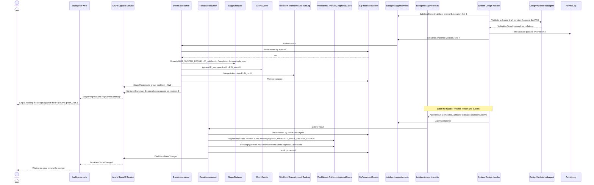

Projection rules that keep this correct under at-least-once delivery:

- `StageStatuses` rows rank Pending below Running below Completed and Failed, within one `pipelineVersion`. An upsert never lowers a rank, so a late `SubStepStarted` arriving after its `SubStepCompleted` changes nothing. A redraft or rework gets a new `pipelineVersion`, so its chips start fresh in new rows instead of moving old ones backwards.
- Events and results also pass the current-task and expected-state guards (section 5.10), so an event from an old task is recorded in Activity but moves no chip.
- `ClientEvents` assigns a gap-free sequence through the `~SEQ` row, and the append and its `~EID_{eventId}` guard row are written in one transaction, so a crash between the two cannot show an event twice. `Heartbeat` events only reset the watchdog clock and are never appended.
- `LogLine` events go only to `RunLog` and the `VerboseLog` SignalR message while the verbose panel is open; they never enter `ClientEvents`.
- Token totals in `WorkItemTelemetry` are counted from AgentResults only. `TokensUsed` events update the live display but are not added, so nothing is counted twice.

### 6.2 Reload recovery

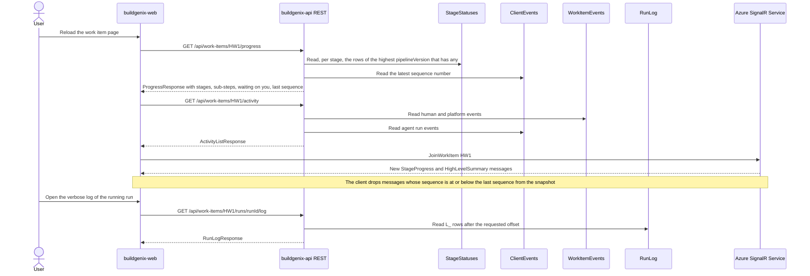

Nothing the user sees depends on having been connected. The snapshot is authoritative; SignalR only shortens the time until the next snapshot would have shown the same thing.

---

## 7. UI state map

North Star rows extend the Phase 0 map (spec section 9) with Code Review, the pull request build, verification and environment promotions. The DEV acceptance, change request and "Finishing: merging to main" rows apply to both.

| UI lifecycle step | What the user sees | WorkItem status | Stage | Running (agents and subagents) | User actions |
|---|---|---|---|---|---|
| Intake | Chat and "Context so far" | `Draft` | none | buildgenix Intake: IntakeConversation, StackClassifier, CompletenessChecker, SummaryBuilder | Chat, attach, Save draft, Implement now |
| PRD | "Writing the PRD" with sub-step chips | `Queued` then `Running` | `PRD` | PRD agent: analyse, write, critique, render, publish | Watch |
| PRD | "Waiting on you: review the PRD" | `AwaitingApproval` | `PRD` | none | Approve; Reject with feedback |
| PRD redraft | "Redrafting the PRD (revision n)" | `Queued` then `Running` | `PRD` | PRD agent with `feedback` | Watch |
| System Design | "Designing" with sub-step chips | `Queued` then `Running` | `SYSTEM_DESIGN` | System Design: context, repo-context, plan, write, validate, critique, render, publish | Watch |
| System Design | "Waiting on you: review the design" | `AwaitingApproval` | `SYSTEM_DESIGN` | none | Approve; Reject with feedback |
| Build | "Building: phase k of N" | `Running` | `IMPLEMENTATION` | Implementation: workspace, pipeline, backlog, phase-k, code-state, pull-request | Watch; open the ADO repo |
| Code Review (North Star) | "Reviewing the code" | `Running` | `CODE_REVIEW` | Code Review: workspace, diff, static, conformance, review, comment, publish | Watch; open the PR |
| Code Review gate (North Star; floor beyond DEV) | "Waiting on you: review the findings" | `AwaitingApproval` | `CODE_REVIEW` | none | Approve; Request changes. Required for any project whose ladder goes beyond DEV |
| Build (review loop) | "Fixing review findings (round r of 2)" | `Running` | `IMPLEMENTATION` | Implementation with `feedback` from `review` | Watch |
| PR build (North Star) | "Waiting for the pull request build" | `AwaitingCi` | `CI_Wait` | ADO PR pipeline (build, unit tests, Sandbox deploy of the head commit); no agent. Status allows Stop; excluded from the queued-task watchdog clock | Watch; open the Sandbox deployment; Stop |
| Test | "Testing" | `Running` | `TESTING` | Testing: workspace, suites, acceptance, sandbox, verify, publish (no merge) | Watch |
| Build (test loop) | "Fixing test failures (loop L of 3)" | `Running` | `IMPLEMENTATION` | Implementation with `feedback` and `testResults` | Watch |
| Verification (North Star) | "Tests suggest the requirement is wrong" | `AwaitingApproval` (route-back confirmation) | `TESTING` | none | Confirm route to PRD; Route to Implementation instead |
| Deploy | "Deploying to DEV" | `Running` | `DEPLOY_DEV` | Phase 0: Deployment, Deploy action: workspace, provision, package, deploy, smoke, summary. North Star: Deployment, Deploy action: run (queues the ADO DEV deployment of the tested commit), smoke, drift, summary | Watch; open the pipeline run |
| Deploy | "Waiting on you: check the DEV app", with links to the app and the PR diff. Phase 0 and DEV-only North Star projects keep "Accept merges code that no person has reviewed". Projects whose ladder goes beyond DEV have already passed the human code-review floor (section 15.3) | `AwaitingApproval` | `DEPLOY_DEV` | none | Accept; Request changes (Implementation rework on the same branch and PR, max 3); Stop |
| Build (change request) | "Applying your changes (round c of 3)" | `Running` | `IMPLEMENTATION` | Implementation in `Rework` mode with `feedback-implementation.json` | Watch |
| Build (retry after a limit) | "Continuing the build from phase k" | `Running` | `IMPLEMENTATION` | Implementation in `Continue` mode with the guidance | Watch |
| Deploy | "Finishing: merging to main" | `Running` | `DEPLOY_DEV` | Deployment, Finalize action: finalize | Watch |
| Done | Completion summary and URLs | `Completed` | `DONE` | none | Open app; start the next work item |
| Promote (North Star) | "Promoting to System Test, Stage or Production" | stays `Completed`; promotions are tracked outside the work item (record shape is open item 10) | `DEPLOY_ST`, `DEPLOY_STAGE`, `DEPLOY_PROD` | ADO pipeline promotes the merged `main` build, then Deployment, Verify action: run-facts, smoke, drift, summary | Approve the promotion in the ADO environment (System Test and Stage per policy; Production always human-led, with the change board) |
| Any | "Waiting for capacity" (a task queued for more than 6 hours) | `Queued` | any | none | Watch; Stop is not offered while the task may still start |
| Any | "Question for you" (including "the PR changed after deployment" from Finalize) | `HumanActionRequired` (`Question`) | any | none | Answer; Stop |
| Any | "Stopped: limit reached" | `HumanActionRequired` (`LoopLimit` or `BudgetExceeded`) | any | none | Limit inside an agent: Retry with guidance; raise the budget and retry; Stop. Limit counted by buildgenix: One more loop (hard cap 5); Stop |
| Any | "Something is stuck" with the dead-letter or watchdog reason | `HumanActionRequired` (`Stuck`) | any | none | Retry; Stop |
| Any | Failure reason | `Failed` | any | none | Read reason; start a new work item |

`~ACTIVE` is taken at Implement now and released at `Completed` or `Failed`, which includes Stop (D-C4b). The gate rows also offer Stop, because no agent is running while a gate waits (section 3.6).

---

## 8. Resources each agent and subagent creates

| Created by | Resource | Where | Idempotency |
|---|---|---|---|
| buildgenix Intake (SummaryBuilder) | `intake-summary.json` revision r | Blob `artifacts` | One revision per summary request |
| buildgenix | Rows in WorkItems (including the reserved `~ACTIVE` and `~BASELINE` rows), Artifacts, ApprovalGates, Approvals, WorkItemEvents, SgProcessedEvents; planned StageStatuses, ClientEvents, RunLog, WorkItemTelemetry, PendingApprovals, and ProjectArtifactIndex (the project Artifacts tab only, rebuilt from `~BASELINE`) | Table Storage; the tables themselves are created by the infrastructure script, never at runtime, because table-scoped role assignments cannot create tables | ETag-conditional writes, deterministic keys, entity-group transactions within `{projectId}` |
| buildgenix | `feedback-{stage}.json` on reject, route-back or change request | Blob `artifacts` | At the next revision's prefix of the stage that will rework |
| buildgenix | Cancel marker `control/cancelled.json` on Stop | Blob `artifacts`, outside the `v{n}` folders | Written once before the work item fails |
| buildgenix | TaskMessages | Service Bus task topics | `PendingMessage` plus MessageId |
| Every agent | EffectLedger, ActivityLog, AgProcessedEvents rows; large ledger payloads | Table Storage; Blob `agenthub-ledger` | Write-once ledger |
| Every agent | AgentResult, AgentEvents | `buildgenix.agent-results`, `buildgenix.agent-events` | Stable MessageIds |
| PRD (publish) | `prd.json`, `prd.md` | Blob | Ledger |
| System Design (publish) | `techspec.json`, `system-design.md` | Blob | Ledger |
| Implementation (WorkspaceManager) | ADO repo `bgx-{slug}` (new project), `main` scaffold, work branch | ADO Repos | Look up `bgx-{slug}` by name before create; a repo left by a failed first work item is reused |
| Implementation (PipelineProvisioner, North Star) | Thin PR, deploy-dev and `main` pipeline definitions that `extends` `BuildGenix-Apps/pipeline-templates` at a pinned ref | ADO Pipelines only (no environment or hook create) | Look up by name before create; platform team authorizes the new pipelines |
| Implementation (DependencyManager) | Package additions from the template allowlist at pinned versions, and the lock files | ADO Repos (work branch) | Commit carries the `Bgx-Task` trailer and is found on the branch before committing again |
| Implementation (BacklogSync) | Epic and stories tagged `bgx-wi:{workItemId}` and `bgx-key:{storyKey}` | ADO Boards | Query by tag before create; a failed attempt's stories keep their own tag (Phase 0: left for the user; North Star: closed on failure) |
| Implementation (PhaseCommitter) | One commit per phase, pushed, with `Bgx-Task` and `Bgx-Phase` trailers and ledger-pinned dates | ADO Repos | Commit id in the ledger; after a crash the trailer finds the pushed commit (section 5.6) |
| Implementation (CodeStateBuilder) | `code-state.json`, `code-graph.json` | Blob | Ledger |
| Implementation (PullRequestPublisher) | Pull request work branch to `main`, linked work items | ADO Repos | Look up the open PR by `sourceRefName` before create |
| Code Review (PrCommenter, North Star) | PR threads, one per finding id | ADO Repos | Finding id in thread properties |
| Code Review (publish) | `review.json` (Phase 0: written by Implementation's CodeReviewer) | Blob | Ledger |
| Testing (publish) | `test-results.json` | Blob | Ledger |
| Deployment, Phase 0 (Provisioner) | App Service plan (first time), `bgx-{slug}-be-dev`, `bgx-{slug}-fe-dev`, app settings, identity attachment with `keyVaultReferenceIdentity`, access restrictions to the corporate IP ranges | Sandbox resource group | ARM `CreateOrUpdate`; reuses apps left by a failed attempt |
| Deployment, North Star (PipelineRunner) | One DEV deployment run of the tested head commit | ADO Pipelines | Run id in the ledger; a redelivery reads the existing run instead of queuing another |
| ADO pipelines, North Star | Per environment: plan, BE and FE apps `bgx-{slug}-be-{env}` and `bgx-{slug}-fe-{env}` (proposed naming), app settings, Key Vault references | Environment resource group | Bicep, declarative |
| Deployment (SummaryWriter) | `completion-summary.json` (DEV); North Star Verify: `completion-summary-{env}.json` | Blob | Ledger |
| Deployment (Finalizer, after acceptance) | PR completion with `mergeStrategy = noFastForward`, merge commit on `main`, linked stories transitioned | ADO Repos and Boards | GET the PR first: no-op if already completed with the same `lastMergeSourceCommit`; refuses if the head moved |
| Builder sandbox job, North Star | Workspace input archive and output files for each command batch | Blob container for sandbox exchange, deleted at run end | Per run and step |

---

## 9. Artifact storage and versioning

### 9.1 Path formula

```text
artifacts/{projectId}/{workItemId}/v{n}/{filename}
```

`n` is the **output revision of the stage that wrote the file**: 1 on the stage's first run in this work item, plus 1 on every redraft, route-back or rework of that stage (S3). The document type lives in the filename, never in a folder. The filename catalog is `intake-summary.json`, `prd.json`, `prd.md`, `techspec.json`, `system-design.md`, `review.json`, `code-state.json`, `code-graph.json`, `test-results.json`, `completion-summary.json` (DEV), `completion-summary-{env}.json` (North Star promotions to higher environments, written by a Verify task), and `feedback-prd.json`, `feedback-system-design.json` and `feedback-implementation.json` (written by buildgenix on reject, route-back or change request; the stage is in the filename because several stages can reach the same revision in one work item, for example PRD revision 2 and Implementation revision 2). The intake summary is the exception to "revision of the stage": it is stored at `v{summaryRevision}`, the summary revision Implement now bound. The container has versioning and soft delete enabled, and agents never overwrite: the ledger makes every write once per task.

One control file sits outside the versioned folders: `{projectId}/{workItemId}/control/cancelled.json`, written only by buildgenix-api on Stop (section 5.10). It is not an artifact and is never registered.

Retention (Phase 0 starting values, unchanged in the North Star): `artifacts` blobs and the registry live as long as the project; ClientEvents, RunLog and ActivityLog 90 days; SgProcessedEvents and AgProcessedEvents 14 days, far beyond any redelivery window; EffectLedger rows and `agenthub-ledger` blobs 30 days after the work item ends. Each service deletes only its own rows.

Two stages can share a folder (`v1/prd.json` and `v1/techspec.json` both live in `v1/`) because they write different filenames. Within one stage, each revision gets its own folder, so a redraft never touches the files a reviewer already saw.

### 9.2 Registry

The `Artifacts` table holds one row per (work item, registry key, revision) with RK `{stage}_{revision:D4}_{artifactId}` and columns including `ArtifactKey`, `Revision`, `BlobPath`, `IsCurrent` and `Status`. The row's `Revision` equals `n` in the blob path, so the registry and the folder can never disagree. A `~HEAD_{registryKey}` row points at the newest revision and is updated in the same transaction as each new registration, so two registrations cannot both become current.

Registry keys are one per file kind: `intakeSummary`, `prd`, `prdMd`, `techSpec`, `techSpecMd`, `review`, `codeState`, `codeGraph`, `testResults`, `completionSummary`, `feedbackPrd`, `feedbackSystemDesign`, `feedbackImplementation`. The North Star adds `completionSummary{Env}` for promotions. When buildgenix builds a task it takes every input from the `~HEAD_` pointers and maps the one feedback file meant for that stage to the message key `feedback`, so agents see one `feedback` input whatever stage wrote it. The registry, not the folder layout, is how anything finds the latest revision, which is why agents never list storage.

### 9.3 Project generation and the display label

A project generation `g` counts accepted work items that changed the project baseline. It is assigned when the user clicks Implement now, under the project's `~ACTIVE` lock: `targetGeneration = baselineGeneration + 1`, stored on the work item (new column `TargetGeneration`). The `~ACTIVE` insert, the work item update and the `PendingMessage` write are one entity-group transaction (all in partition `{projectId}` of WorkItems), so a crash cannot leave an orphan lock or a lock with no task. The label shown in the UI is `v{g}.{n-1}`:

- Work item 1's first PRD draft is `v1.0`; after one reject the redraft is `v1.1`.
- Work item 2's first PRD on the same project is `v2.0`.
- The intake summary bound at Implement now is labelled `v{g}.0` whatever its revision number, because earlier summary revisions were never used by the pipeline.

If a work item fails, its generation is not consumed: the baseline did not move, so the next work item computes the same `targetGeneration` and reuses it. The UI always shows the work item number next to the label, so two attempts at `v2.x` are never confused.

This matches the whiteboard's "V1.0 / V2.0" reading: versions evolve per project across work items, while paths stay per work item.

`pipelineVersion` is a third counter, separate from both. It starts at 1 and rises by 1 once per backward transition (a reject, a test route-back, a Request changes, or a retry after a limit). The new task for that stage carries the new version. Stages that only run forward again after it, including Testing and Code Review, keep that version. Finalize and a Verify task do not change it. Gate ids and StageStatuses row keys embed it. Section 5.9 lists every counter in one table.

### 9.4 Baseline pointers

The project baseline is one reserved row `~BASELINE` in the `WorkItems` table, partition `{projectId}`, next to `~ACTIVE`. It holds `Generation`, `WorkItemId`, `PrdPath`, `TechSpecPath`, `CodeStatePath`, `RepoUrl`, `AdoEpicId`, `MergeCommit`, `TemplateId` and `AcceptedAt` (the same ten columns as Phase 0 guide section 5.1). When the Finalize result with a merge commit arrives (S7a), one entity-group transaction updates the work item to `Completed`, deletes `~ACTIVE` and upserts `~BASELINE`. A crash therefore cannot release the lock without moving the baseline, or move the baseline without releasing the lock. The next work item on the project reads `baselinePrd`, `baselineTechSpec`, `baselineCodeState`, the repo URL, the epic id and the template id from that row. `ProjectArtifactIndex` (the project Artifacts tab) is rebuilt from it afterwards and is never the source of truth.

Nothing is copied: a generation 2 design reads a generation 1 file by its original path. Moving the baseline on the merge, and not on the Accept click, keeps the baseline equal to what `main` holds: if Finalize returns HumanActionRequired because the head moved, the baseline stays where it was until the merge really happens.

**Documents are cumulative.** For an existing project the PRD and the techspec describe the whole product as it will be after this work item, not only the change. The PRD and Design agents carry every baseline requirement, story and acceptance check forward and mark what this work item adds, changes or retires; DesignValidator fails if a baseline acceptance check disappears without a `retired` entry. Only the file plan is limited to the files this work item touches. So the baseline always points at a complete description, no reader has to replay a chain of deltas, and Testing always runs every acceptance check, old and new. The North Star keeps this rule; promotions read the same cumulative checks for their smoke runs.

### 9.5 Worked examples

Ids are shortened. `HW` = project `01JHW0P0...`, `HW1` = its first work item `01JHW1W1...`. `CALC` = project `01JCALP0...`, `CALC1` = work item `01JCAL1W...` (add), `CALC2` = work item `01JCAL2W...` (subtract).

**Example 1: Hello World, new project, no rejects, `targetGeneration` 1.**

| Written by | Revision n | Path | Label |
|---|---|---|---|
| Intake | 1 | `HW/HW1/v1/intake-summary.json` | v1.0 |
| PRD (approved) | 1 | `HW/HW1/v1/prd.json`, `HW/HW1/v1/prd.md` | v1.0 |
| System Design (approved) | 1 | `HW/HW1/v1/techspec.json`, `HW/HW1/v1/system-design.md` | v1.0 |
| Implementation | 1 | `HW/HW1/v1/code-state.json`, `HW/HW1/v1/code-graph.json` | v1.0 |
| Code Review | 1 | `HW/HW1/v1/review.json` | v1.0 |
| Testing (green) | 1 | `HW/HW1/v1/test-results.json` | v1.0 |
| Deployment, Deploy action | 1 | `HW/HW1/v1/completion-summary.json` | v1.0 |

Every stage ran once, so everything sits in `v1/`. The Finalize task writes no artifact (it records the merge commit on the work item and in the ledger). Baseline when Finalize reports the merge: the `~BASELINE` row gets PRD `HW/HW1/v1/prd.json`, techspec `HW/HW1/v1/techspec.json`, code-state `HW/HW1/v1/code-state.json`, the repo URL and the epic id; generation 1.

**Example 2: Calculator add, new project, PRD rejected once and one test route-back, `targetGeneration` 1.**

| Written by | Revision n | Path | Label |
|---|---|---|---|
| Intake | 1 | `CALC/CALC1/v1/intake-summary.json` | v1.0 |
| PRD, first draft (rejected) | 1 | `CALC/CALC1/v1/prd.json`, `prd.md` | v1.0 |
| buildgenix, reject feedback for PRD revision 2 | 2 | `CALC/CALC1/v2/feedback-prd.json` | |
| PRD, redraft (approved) | 2 | `CALC/CALC1/v2/prd.json`, `prd.md` | v1.1 |
| System Design (approved) | 1 | `CALC/CALC1/v1/techspec.json`, `system-design.md` | v1.0 |
| Implementation, first pass | 1 | `CALC/CALC1/v1/code-state.json`, `code-graph.json` | v1.0 |
| Code Review, first pass | 1 | `CALC/CALC1/v1/review.json` | v1.0 |
| Testing, red | 1 | `CALC/CALC1/v1/test-results.json` | v1.0 |
| buildgenix, route-back feedback for Implementation revision 2 | 2 | `CALC/CALC1/v2/feedback-implementation.json` | |
| Implementation, rework | 2 | `CALC/CALC1/v2/code-state.json`, `code-graph.json` | v1.1 |
| Code Review, second pass | 2 | `CALC/CALC1/v2/review.json` | v1.1 |
| Testing, green | 2 | `CALC/CALC1/v2/test-results.json` | v1.1 |
| Deployment, Deploy action | 1 | `CALC/CALC1/v1/completion-summary.json` | v1.0 |

`v2/` holds the second revision of each stage that needed one. That is safe because every filename is unique to the stage that writes it, and nobody reads by folder. Baseline when Finalize reports the merge: PRD `CALC/CALC1/v2/prd.json`, techspec `CALC/CALC1/v1/techspec.json`, code-state `CALC/CALC1/v2/code-state.json`; generation 1. Each pointer names the revision that was accepted, which is why the three pointers name different folders.

**Example 3: Calculator subtract, existing project, baseline generation 1 to 2.**

| Role | Path | Label |
|---|---|---|
| Input `baselinePrd` | `CALC/CALC1/v2/prd.json` | v1.1 |
| Input `baselineTechSpec` | `CALC/CALC1/v1/techspec.json` | v1.0 |
| Input `baselineCodeState` | `CALC/CALC1/v2/code-state.json` | v1.1 |
| Intake output | `CALC/CALC2/v1/intake-summary.json` | v2.0 |
| PRD output (cumulative: add carried forward, subtract marked `added`) | `CALC/CALC2/v1/prd.json`, `prd.md` | v2.0 |
| System Design output (cumulative: add checks carried forward) | `CALC/CALC2/v1/techspec.json`, `system-design.md` | v2.0 |
| Implementation output | `CALC/CALC2/v1/code-state.json`, `code-graph.json` | v2.0 |
| Code Review, Testing, Deployment outputs | `CALC/CALC2/v1/review.json`, `test-results.json`, `completion-summary.json` | v2.0 |

### 9.6 Columns this design adds

Phase 0 builds these in slice 3 (the same rows as Phase 0 guide section 5.1); the North Star keeps them and adds only the `CiStatus` table.

| Table | Column or row | Type | Written by | When |
|---|---|---|---|---|
| WorkItems | `CurrentTaskId`, `CurrentInputVersion` (exists in schema), `PipelineVersion` | string, int, int | Task publisher | Every task publish |
| WorkItems | `StageRevisionsJson` | JSON `{stage: n}` | Task publisher | Every task publish |
| WorkItems | `LoopIndex`, `RejectCountsJson` | int, JSON `{gate: count}` | Results consumer, gate service | Route-back, reject, Request changes |
| WorkItems | `TargetGeneration` | int | Implement now | Once |
| WorkItems | `PendingMessage`, `PendingAt` (schema ADR-025) | JSON, time | Task publisher | Every task publish, cleared after send |
| WorkItems | `SignalKind`, `HumanMessage` (exists) | string | Results consumer, watchdog, dead-letter watcher | HumanActionRequired |
| WorkItems | `RepoFactsJson` | JSON (url, branch, headCommit, testedCommit, deployedCommit, prId, mergeCommit, deployed URLs) | Results consumer | After Implementation, Testing, Deployment |
| WorkItems | `LastAppliedResultId` | string (`result:{taskId}:{inputVersion}`) | Results consumer | Last write of every applied result (section 5.10, guard 4) |
| WorkItems | `StackProfile`, `TemplateId` | string, string | Implement now | Once; copied into `~BASELINE.TemplateId` at Finalize |
| WorkItems | `~BASELINE` row | Generation, WorkItemId, PrdPath, TechSpecPath, CodeStatePath, RepoUrl, AdoEpicId, MergeCommit, TemplateId, AcceptedAt | Results consumer | Finalize, in the same transaction as `Completed` |
| Projects | `Slug` plus claim row `~SLUG_{slug}` | string | Project create | Once; the claim row makes the slug unique |
| Projects | `Repository` | string | Results consumer | First result that reports `outputs.repoUrl` |
| ProjectArtifactIndex | PK `{projectId}`, RK `{invertedTicks}_{artifactId}` | | Results consumer | After each registration; rebuilt from `~BASELINE`; never SoT |
| CiStatus (North Star) | PK `{workItemId}`, RK `{sourceCommit}_{buildId:D10}`; PullRequestId, PipelineId, BuildId, Result (`Succeeded`, `Failed`, `Canceled`), HookEventId, ReceivedAt | | ADO service hook handler (after ADO REST read-back) | Every PR build hook, deduped by `ado:{eventId}`; the CI_Wait join reads the highest `BuildId` under RK prefix `{headCommit}_`; kept for the life of the project |

When the Finalize run reports the merge, the same transaction that completes CALC2 points the `~BASELINE` row at the `CALC/CALC2/v1/` files and sets generation 2.

---

## 10. End-to-end examples

The three examples run the North Star flow, because that is the target this document describes. Each one closes with a short note on what Phase 0 does differently. Ids and paths use the short forms from section 9.5. The diagrams are split by stage so each stays readable, and every participant that does work in a stage appears in that stage's diagram. Example 1 shows every hop. Examples 2 and 3 draw a task topic hop as one arrow ("through agenthub.prd.agent") and leave out the routine SignalR pushes, because example 1 already shows both. Event traffic is shown once per stage rather than for every sub-step, because section 6.1 already shows the full event path for one sub-step.

Participant ids used across the diagrams: `WEB`, `API`, `BT`, `SIG` are buildgenix-web, buildgenix-api, the buildgenix tables and Azure SignalR Service. `T...` is a stage's task topic (for example `TPRD` is `agenthub.prd.agent`). `EVT` and `RES` are `buildgenix.agent-events` and `buildgenix.agent-results`. `ACA` and `ACR` are Container Apps Jobs with the KEDA Service Bus scaler and Azure Container Registry. `SBX` is the sandbox job execution that runs generated code with no identity. `BLOB` is the `artifacts` container (and `templates`), and `LED` is EffectLedger with ActivityLog and `agenthub-ledger`. `AIGW`, `CTX` and `KV` are the AI Gateway, the context service in front of the LLM-Wiki, and Key Vault. `ADO` is Azure DevOps (repos, boards, pipelines, service hooks) and `AZ` the Azure environments the pipeline deploys to. `H1`, `H2` and `M1` are commit ids: work branch head commits and the merge commit.

### 10.1 Example 1: "Hello World: Angular FE + .NET BE + LLM thought of the day" (new project, `fe-be-llm`)

**What the requester wants.** A page that shows a short "thought of the day" written by a model. The BE exposes `GET /health` and `GET /api/thought`, which returns `{ "text": "..." }`. Every gate is approved on the first draft, so every stage writes revision 1 and `pipelineVersion` stays 1.

**Stage by stage.**

1. **Intake.** The requester creates project `HW` (slug `hello-world`) and chats. IntakeConversation asks for users and success criteria. StackClassifier proposes `fe-be-llm` and the deterministic rule agrees because a BE endpoint calls a model. CompletenessChecker finds every required slot. SummaryBuilder writes `HW/HW1/v1/intake-summary.json` with requirements R-1 (a thought of the day from a model), R-2 (health endpoint) and assumption A-1 (one thought per request, no caching).
2. **Implement now.** buildgenix-api takes `~ACTIVE` for `HW`, sets `targetGeneration = 0 + 1 = 1` and `pipelineVersion` 1, binds summary revision 1 and publishes the PRD task through `PendingMessage`.
3. **PRD.** The PRD agent loads the summary, asks the context service for the requirements guidance of the `fe-be-llm` stack, then analyses, writes and critiques. It publishes `HW/HW1/v1/prd.json` and `prd.md` (v1.0) and returns `Completed`. buildgenix raises the PRD gate and the requester approves.
4. **System Design.** The task names `prd` at revision 1 and `templateId` `fe-be-llm@1.0.0`. The agent resolves the template layout and plans three phases: the BE thought endpoint with an LLM client behind an interface, the FE page that calls it, and configuration and health. On critique it adds a timeout and fallback for the model call. It publishes `HW/HW1/v1/techspec.json` and `system-design.md`, and the requester approves.
5. **Implementation.** KEDA starts one job execution. WorkspaceManager looks for repo `bgx-hello-world` by name, finds none, creates it and pushes the template scaffold to `main`. PipelineProvisioner creates the thin extends pipeline definitions (environments, connections and hooks already exist, platform-owned). The agent creates `feature/wi-1-hello-world` and syncs one epic and three stories. Each phase writes tests first, then code, builds and tests in the sandbox job, and pushes. Phase 1 needs one fix attempt. Graphify produces the code graph, the PR is opened, and the PR build starts and deploys head commit `H1` to Sandbox.
6. **Code Review.** A separate job clones `H1`, maps the diff to symbols, runs static and conformance checks and the LLM review. It posts two suggestions and no blockers and writes `review.json`. buildgenix waits for the PR build.
7. **Testing.** Published after the service hook reports the PR build green for `H1`. Suites and acceptance checks run with `Llm:Provider=Fixture`. SandboxProbe calls the Sandbox deployment of `H1` with the real model behind it. All green, so the agent returns `Completed` for `H1`. Nothing is merged.
8. **DEV deployment (Deploy action).** buildgenix publishes the Deployment task with `deploymentAction = Deploy` and `headCommit = H1`. PipelineRunner queues the DEV deployment of `H1`, reusing the PR build's artifact, and the pipeline deploys `bgx-hello-world-be-dev` and `bgx-hello-world-fe-dev` under the DEV service connection. The agent smoke-tests, checks drift and writes `completion-summary.json`. buildgenix raises the DEV acceptance gate.
9. **Acceptance and Finalize.** The requester opens the DEV app, sees a thought and accepts. buildgenix shows "Finishing: merging to main" and publishes a second Deployment task with `deploymentAction = Finalize`. The Finalizer checks that the PR head is still `H1` and that `main` is an ancestor of `H1`, then completes the PR with `lastMergeSourceCommit = H1` and `mergeStrategy = noFastForward`, transitions the three stories, and polls until the PR is completed. When the result reports `mergeCommit`, one transaction marks the work item `Completed`, deletes `~ACTIVE` and writes the `~BASELINE` row (generation 1, repo, epic, the three paths).
10. **Promotion.** The merge starts the `main` pipeline. It builds the merged commit once and promotes that artifact to System Test, then to Stage and Production after the ADO environment approvals. After each promotion the service hook makes buildgenix publish a Verify task, which writes `completion-summary-{env}.json`. The work item is already `Completed`; promotions are tracked outside it (open item 10).

**1a. Intake and PRD**

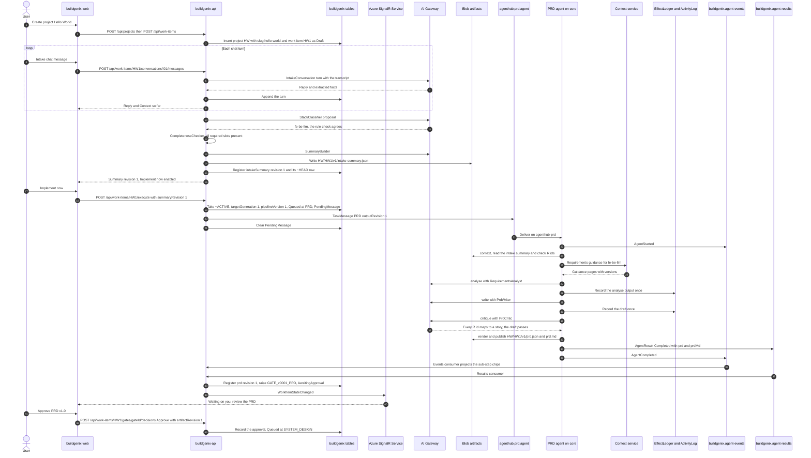

**1b. System Design**

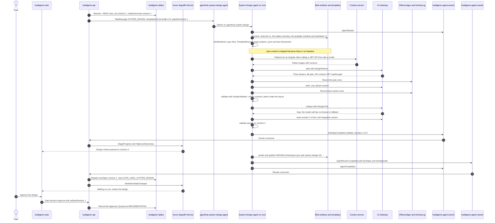

The critique loop inside System Design revises one section of the draft; it is not a redraft of the stage, so the output stays revision 1 and `pipelineVersion` does not change.

**1c. Implementation and Code Review**

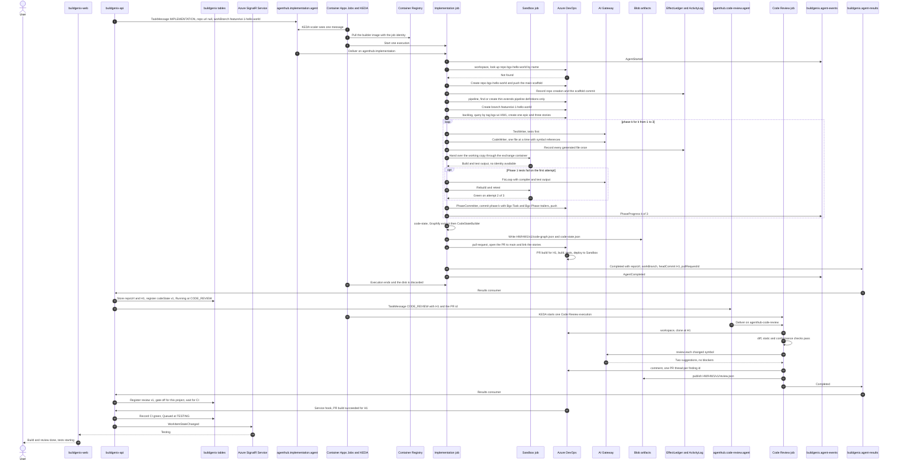

**1d. Testing and DEV deployment (Deploy action)**

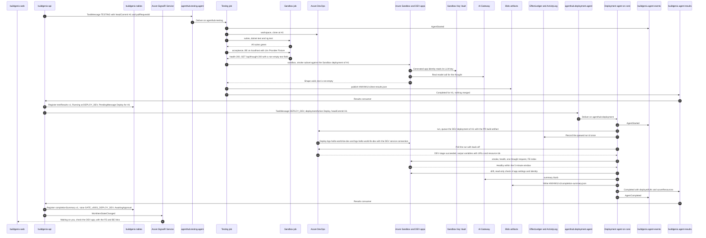

**1e. DEV acceptance, Finalize and promotion**

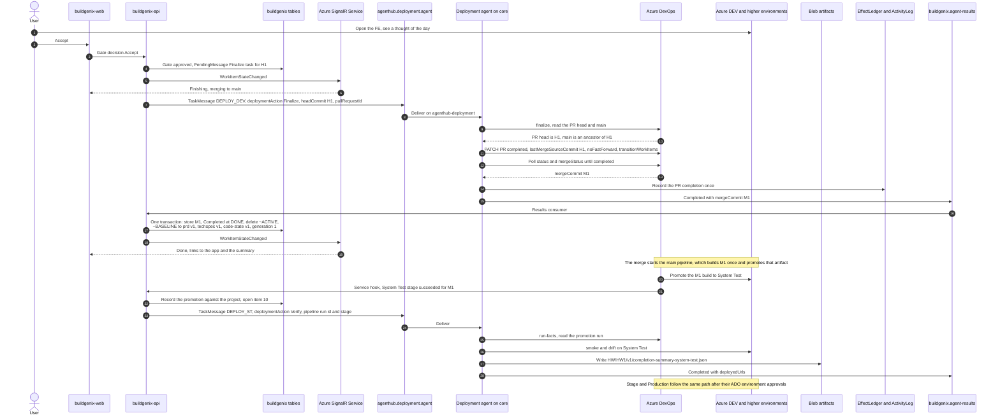

Because `main` is an ancestor of `H1`, the merged tree is the tree that was tested and accepted, and the `main` pipeline builds exactly that code. If someone had pushed to the work branch after the deploy, the Finalizer would see a head other than `H1` and return `HumanActionRequired` instead of merging code nobody tested.

**Phase 0 difference.** Implementation, Testing and Deployment run as workers in the single builder container, not as jobs, so there is no KEDA, no sandbox job and no exchange container; generated code runs as child processes with an environment allowlist under a per-agent sandbox user (section 11.1). Code review is the `review` sub-step inside Implementation. There is no pipeline, no PR build and no Sandbox probe: Testing publishes straight after Implementation. The Deploy action runs workspace, provision, package, deploy, smoke and summary into the one DEV sandbox resource group under the builder identity. Finalize works as in the North Star but checks only that the PR head equals the deployed commit (the PATCH with `lastMergeSourceCommit` enforces the same thing at ADO), and there are no promotions. The DEV apps sit behind IP access restrictions instead of Entra authentication. All agents call models through APIM chat (`opus` for PRD and design, `5.4` for code and review). Which key the deployed app uses for its model calls is open item 4.

### 10.2 Example 2: "calculator that adds two numbers" (new project, `fe-be`)

**What the requester wants.** A page with two number inputs and an Add button. The BE exposes `POST /api/calculator/add` with body `{ "a": 2, "b": 3 }` and returns `{ "result": 5 }`. This example exercises both loops: the requester rejects the first PRD, and Testing catches a floating point bug that routes back to Implementation.

**Stage by stage.**

1. **Intake.** StackClassifier proposes `fe-be` (no persistence, no model). The summary lands at `CALC/CALC1/v1/intake-summary.json`. Implement now sets `targetGeneration` 1 and `pipelineVersion` 1.
2. **PRD, reject and redraft.** The first PRD (v1.0) treats the inputs as integers. The requester rejects it with "inputs can be decimals; show an error for non-numeric input". buildgenix writes `CALC/CALC1/v2/feedback-prd.json`, raises `pipelineVersion` to 2 and publishes a redraft task (new `taskId`, `outputRevision` 2) carrying the first PRD and the feedback. The redraft lands at `CALC/CALC1/v2/`, labelled v1.1, with R-2 "works with decimal numbers, 0.1 plus 0.2 is 0.3" and R-3 "non-numeric input returns a validation error". The requester approves.
3. **System Design** is approved on its first draft (`CALC/CALC1/v1/`, v1.0). It uses `fe-be@1.0.0` with two phases (BE endpoint and service with validation returning 400 and a message, FE form and API client). Acceptance check AC-2 posts `{ "a": 0.1, "b": 0.2 }` and expects exactly `0.3`.
4. **Implementation, first pass.** WorkspaceManager finds no repo named `bgx-calculator`, creates it and scaffolds `main`, then creates branch `feature/wi-1-calculator`, one epic and two stories. The CodeWriter types the operands as `double`. The unit tests it wrote use whole numbers, so the sandbox build is green. Code Review raises no blocker, and the PR build is green for head commit `H1`.
5. **Testing, red.** AC-2 returns `0.30000000000000004` where the techspec expects `0.3`. The verify step traces the failure to AC-2, sees that AC-2 matches R-2 and no other criterion contradicts it, and proposes "code wrong". The agent writes `CALC/CALC1/v1/test-results.json` and returns `Completed` with `signal.kind = RouteBack` and `routeBackTo = IMPLEMENTATION`. Nothing was merged, so `main` still holds only the template.
6. **Route-back.** buildgenix checks the loop count (0 of 3), writes `CALC/CALC1/v2/feedback-implementation.json`, sets `loopIndex` 1, raises `pipelineVersion` to 3 and publishes a new Implementation task with `outputRevision` 2, the test results and the feedback.
7. **Rework.** Implementation reuses the work branch, changes the request and service types to `decimal`, adds a decimal unit test, pushes `H2` and the PR updates. Code-state and Code Review move to revision 2. The PR build runs again for `H2` and deploys it to Sandbox.
8. **Testing, green** on `H2`. The Deploy action queues the DEV deployment of `H2`, which creates `bgx-calculator-be-dev` and `bgx-calculator-fe-dev`, and writes `CALC/CALC1/v1/completion-summary.json`. The requester tries 0.1 plus 0.2 and accepts. Finalize checks that the PR head is `H2`, merges and transitions the two stories, and the baseline becomes generation 1 with code-state `CALC/CALC1/v2/code-state.json`.

**2a. Intake, PRD with one reject, and System Design**

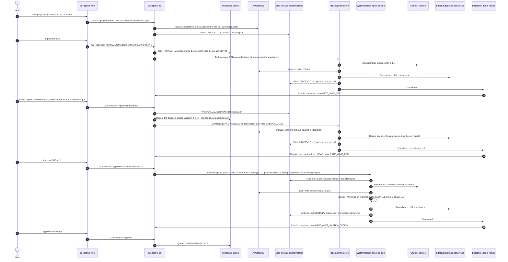

**2b. Implementation, a red test, the route-back, and the green rework**

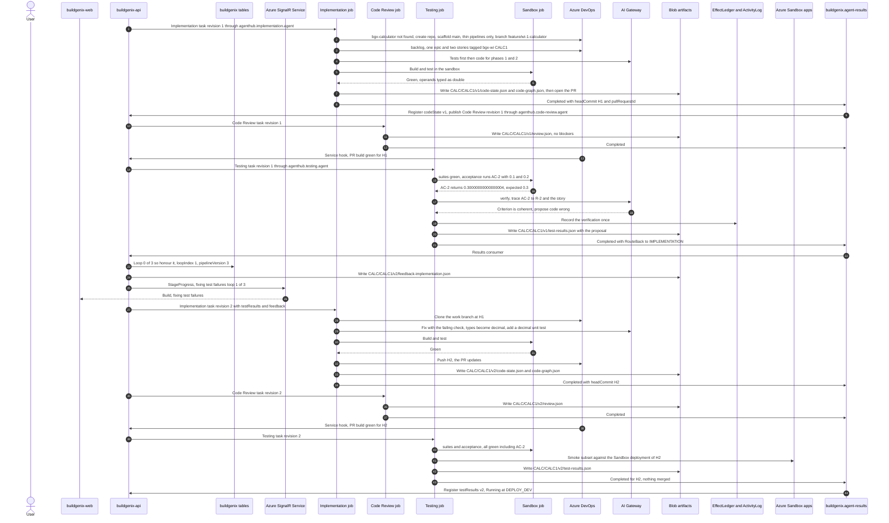

**2c. DEV deployment, acceptance and Finalize**

```mermaid
sequenceDiagram
    autonumber
    actor User
    participant WEB as buildgenix-web
    participant API as buildgenix-api
    participant BT as buildgenix tables
    participant DEP as Deployment agent on core
    participant ADO as Azure DevOps
    participant AZ as Azure DEV apps
    participant BLOB as Blob artifacts
    participant LED as EffectLedger and ActivityLog
    participant RES as buildgenix.agent-results

    API->>DEP: Deployment task, deploymentAction Deploy, headCommit H2
    DEP->>ADO: run, queue the DEV deployment of H2
    DEP->>LED: Record the queued run id once
    ADO->>AZ: Create bgx-calculator-be-dev and bgx-calculator-fe-dev, deploy H2
    ADO-->>DEP: DEV stage succeeded
    DEP->>AZ: smoke, health, one add request, FE index, then drift
    DEP->>BLOB: Write CALC/CALC1/v1/completion-summary.json
    DEP->>RES: Completed with deployedUrls
    RES->>API: Raise GATE_v0003_DEPLOY_DEV
    User->>AZ: Try 0.1 plus 0.2 on the DEV app
    User->>WEB: Accept
    WEB->>API: Gate decision Accept
    API->>DEP: Deployment task, deploymentAction Finalize, headCommit H2, pullRequestId
    DEP->>ADO: finalize, PR head is H2 and main is an ancestor
    DEP->>ADO: PATCH PR completed, lastMergeSourceCommit H2, noFastForward, poll until completed
    DEP->>LED: Record the PR completion once
    DEP->>RES: Completed with mergeCommit
    RES->>API: Results consumer
    API->>BT: One transaction: Completed, delete ~ACTIVE,<br/>~BASELINE prd v2, techspec v1, code-state v2, generation 1
```

Three details are worth calling out. First, nothing merges before acceptance, so `main` never holds code that failed a test or that the requester has not seen running. Second, the second Implementation run gets a new `taskId` and therefore a fresh ledger: replaying revision 1's outputs would rebuild the bug. The revision 1 ledger rows stay untouched for audit. Third, the gate ids carry the `pipelineVersion` at the time they were raised (`GATE_v0001_PRD`, then `GATE_v0002_PRD` after the redraft, then `GATE_v0003_DEPLOY_DEV` after the route-back), so the rows of each attempt stay separate and every decision names the exact gate it was made on.

**Phase 0 difference.** The red result routes to Implementation without a verify step: FailureAnalyst writes its proposal into `test-results.json`, but Phase 0 always routes to Implementation. The code review is the `review` sub-step inside Implementation's rework run. Deployment provisions, packages and deploys from the builder itself, and Finalize then merges exactly as above. In Phase 0 tests the float bug is not left to chance: the `Agents:Fixture:Scenario` switch makes the Fixture model return scripted replies, and the example 2 script writes the `double` bug in Implementation revision 1, so the route-back loop is reproducible on every run (section 11.1).

### 10.3 Example 3: "update calculator to subtract" (existing project, generation 1 to 2)

**What the requester wants.** A Subtract button next to Add, backed by `POST /api/calculator/subtract` with the same body shape. Add must keep working.

**Stage by stage.**

1. **Intake with a baseline.** The requester opens project `CALC` and starts work item `CALC2`. buildgenix reads the project's `~BASELINE` row (generation 1, repo `bgx-calculator`, the epic id and the three paths). Because the project has a baseline, Intake shows the accepted PRD summary as context and keeps the project's stack `fe-be`. It writes `CALC/CALC2/v1/intake-summary.json` (v2.0) with R-1 "subtract b from a" and R-2 "existing add behaviour unchanged".
2. **Implement now.** buildgenix takes `~ACTIVE`, sets `targetGeneration = 1 + 1 = 2` and `pipelineVersion` 1, and from now on every task carries `projectMode` `Existing`, `baselineGeneration` 1, `targetGeneration` 2, the repo URL and `context.ado.epicId` from the baseline, and `baselinePrd`, `baselineTechSpec`, `baselineCodeState` paths (section 9.5).
3. **A cumulative PRD.** PrdWriter carries the add story and its acceptance criteria forward unchanged, adds a subtract story marked `added`, and adds a regression requirement that add must keep working. The PRD lands at `CALC/CALC2/v1/prd.json`, labelled v2.0, and describes the whole product, so the next work item reads one file rather than a chain of deltas.
4. **System Design against the code-state.** RepoContextBuilder picks `CalculatorController`, `CalculatorService.Add`, the Angular `CalculatorComponent` and their tests from `CALC/CALC1/v2/code-state.json`, so the planner sees the real class and method names without reading the whole repository. DesignPlanner produces a modify-only file plan: `CalculatorService.cs` and `CalculatorController.cs` (add `Subtract`), `calculator.component.ts` and `.html` (an operation selector), plus the two test files. The techspec is cumulative: it carries the add acceptance checks forward and adds `POST /api/calculator/subtract {a: 5.5, b: 2}` expecting `{result: 3.5}`. DesignValidator checks that every modify target exists in the code-state and that no baseline check was dropped without a `retired` entry.
5. **Implementation on an existing repo.** WorkspaceManager clones `main`, which holds the CALC1 merge made by Finalize, so the code matches the baseline code-state the design was planned against. It creates `feature/wi-2-subtract`. PipelineProvisioner finds the three pipeline definitions by name and fails BuildEnvironment if any is missing; environments, connections and hooks stay platform-owned. BacklogSync adds one story tagged `bgx-wi:CALC2` under the epic named by `context.ado.epicId` (from the `~BASELINE` row). The subtract tests are written first, the four source files are modified, all tests run (add and subtract), Graphify regenerates the full graph, and the PR opens.
6. **Code Review** compares `main...head` against the baseline code-state. Conformance confirms that the only baseline symbols changed are the ones the plan named.
7. **Testing** runs the full suites and every acceptance check in the cumulative techspec, add and subtract, on the head commit, so the add checks act as regression tests. All green; nothing merges.
8. **Deploy, accept, Finalize.** The DEV deployment updates the existing apps in place. The requester accepts, Finalize merges the PR into `main` with `noFastForward`, and the same transaction that completes CALC2 moves the `~BASELINE` row to the `CALC/CALC2/v1/` files with generation 2.

**3a. Intake with a baseline, and the cumulative PRD**

```mermaid
sequenceDiagram
    autonumber
    actor User
    participant WEB as buildgenix-web
    participant API as buildgenix-api
    participant BT as buildgenix tables
    participant AIGW as AI Gateway
    participant BLOB as Blob artifacts
    participant PRD as PRD agent on core
    participant CTX as Context service
    participant LED as EffectLedger and ActivityLog
    participant RES as buildgenix.agent-results

    User->>WEB: Open project Calculator, new work item
    WEB->>API: POST /api/work-items for project CALC
    API->>BT: Insert work item CALC2 as Draft, read WorkItems ~BASELINE<br/>generation 1, repo, epic, paths
    BT-->>API: Generation 1, baseline prd, techspec and code-state paths, repo URL
    API->>BLOB: Read CALC/CALC1/v2/prd.json for the intake context
    User->>WEB: Add a subtract button, keep add working
    WEB->>API: POST /api/work-items/CALC2/conversations/I01/messages
    API->>AIGW: IntakeConversation with the baseline PRD summary
    API->>API: StackClassifier keeps fe-be from the project
    API->>BLOB: Write CALC/CALC2/v1/intake-summary.json
    User->>WEB: Implement now
    WEB->>API: POST /api/work-items/CALC2/execute with summaryRevision 1
    API->>BT: Take ~ACTIVE, targetGeneration 2, pipelineVersion 1, projectMode Existing
    API->>PRD: TaskMessage PRD with intakeSummary and baselinePrd through agenthub.prd.agent
    PRD->>BLOB: context, read the intake summary and CALC/CALC1/v2/prd.json
    PRD->>CTX: Requirements guidance for fe-be
    PRD->>AIGW: analyse against the baseline requirement set
    PRD->>AIGW: write a cumulative PRD, add kept, subtract story added, add regression criterion
    PRD->>AIGW: critique, R-1 and R-2 both covered
    PRD->>LED: Record each LLM output once
    PRD->>BLOB: Write CALC/CALC2/v1/prd.json and prd.md
    PRD->>RES: Completed
    RES->>API: Register prd revision 1, raise GATE_v0001_PRD
    User->>WEB: Approve PRD v2.0
    WEB->>API: Gate decision Approve
```

**3b. System Design with repo context**

```mermaid
sequenceDiagram
    autonumber
    actor User
    participant WEB as buildgenix-web
    participant API as buildgenix-api
    participant BT as buildgenix tables
    participant SD as System Design agent on core
    participant BLOB as Blob artifacts and templates
    participant CTX as Context service
    participant AIGW as AI Gateway
    participant LED as EffectLedger and ActivityLog
    participant RES as buildgenix.agent-results

    API->>BT: Resolve prd CALC2 v1 and the three baseline paths
    API->>SD: TaskMessage SYSTEM_DESIGN with baselineTechSpec and baselineCodeState through agenthub.system-design.agent
    SD->>BLOB: context, read prd v1, CALC/CALC1/v1/techspec.json and the template manifest
    SD->>SD: ModeDetector says Existing because a baseline is present
    SD->>BLOB: repo-context, read CALC/CALC1/v2/code-state.json
    SD->>SD: RepoContextBuilder selects CalculatorController, CalculatorService.Add, CalculatorComponent and their tests
    Note over SD,BLOB: Only the selected symbols and their neighbours enter the prompt, within the token budget
    SD->>CTX: Conventions for extending an existing controller
    SD->>AIGW: plan with DesignPlanner, modify 4 source and 2 test files, create 0
    SD->>AIGW: write each section, add checks carried forward, subtract check added
    SD->>LED: Record each LLM output once
    SD->>SD: validate, every modify target exists, no create collides, no baseline check dropped
    SD->>AIGW: critique, no gaps
    SD->>BLOB: Write CALC/CALC2/v1/techspec.json and system-design.md
    SD->>RES: Completed
    RES->>API: Register techSpec revision 1, raise GATE_v0001_SYSTEM_DESIGN
    User->>WEB: Approve
    WEB->>API: Gate decision Approve
    API->>BT: Queued at IMPLEMENTATION
```

**3c. Implementation, Code Review, Testing, DEV, Finalize and the move to generation 2**

```mermaid
sequenceDiagram
    autonumber
    actor User
    participant WEB as buildgenix-web
    participant API as buildgenix-api
    participant BT as buildgenix tables
    participant IMP as Implementation job
    participant CR as Code Review job
    participant TST as Testing job
    participant SBX as Sandbox job
    participant ADO as Azure DevOps
    participant AIGW as AI Gateway
    participant BLOB as Blob artifacts
    participant LED as EffectLedger and ActivityLog
    participant DEP as Deployment agent on core
    participant AZ as Azure Sandbox and DEV apps
    participant RES as buildgenix.agent-results

    API->>IMP: Implementation task, repo url bgx-calculator,<br/>workBranch feature/wi-2-subtract, ado.epicId from the baseline
    IMP->>ADO: workspace, clone main at the CALC1 merge commit, create the branch
    IMP->>ADO: pipeline found by name, nothing to change, backlog adds one story tagged bgx-wi CALC2 under the epic from ado.epicId
    IMP->>BLOB: Read CALC/CALC1/v2/code-state.json for symbol references
    IMP->>AIGW: Subtract tests first, then modify each of the 4 planned source files with its current content
    IMP->>LED: Record each generated file once
    IMP->>SBX: Build and test
    SBX-->>IMP: Green, add and subtract tests pass
    IMP->>ADO: Commit with the Bgx-Task trailer and push H1
    IMP->>BLOB: Graphify of the whole repo, write CALC/CALC2/v1/code-state.json and code-graph.json
    IMP->>ADO: Open the PR and link the new story
    IMP->>RES: Completed with headCommit H1 and pullRequestId
    API->>CR: Code Review task with baselineCodeState
    CR->>ADO: Clone and diff main against H1
    CR->>CR: Map changes to symbols, only planned baseline symbols changed
    CR->>AIGW: Review the changed symbols
    CR->>BLOB: Write CALC/CALC2/v1/review.json
    CR->>RES: Completed
    ADO->>API: Service hook, PR build green for H1
    API->>TST: Testing task
    TST->>SBX: Full suites as regression, then acceptance for add and subtract, all green
    TST->>AZ: Smoke subset against the Sandbox deployment of H1
    TST->>BLOB: Write CALC/CALC2/v1/test-results.json
    TST->>RES: Completed for H1, nothing merged
    API->>DEP: Deployment task, deploymentAction Deploy, headCommit H1
    DEP->>ADO: run, queue the DEV deployment of H1
    ADO->>AZ: Update bgx-calculator-be-dev and bgx-calculator-fe-dev in place
    DEP->>AZ: smoke for subtract and add, drift
    DEP->>BLOB: Write CALC/CALC2/v1/completion-summary.json
    DEP->>RES: Completed
    RES->>API: Raise the DEV acceptance gate
    User->>WEB: Accept
    WEB->>API: Gate decision Accept
    API->>DEP: Deployment task, deploymentAction Finalize, headCommit H1
    DEP->>ADO: finalize, PR head is H1 and main is an ancestor,<br/>PATCH with lastMergeSourceCommit H1 and noFastForward
    DEP->>RES: Completed with mergeCommit
    RES->>API: Results consumer
    API->>BT: One transaction: Completed, delete ~ACTIVE,<br/>~BASELINE to CALC/CALC2/v1 files, generation 2
```

**Phase 0 difference.** The flow is the same apart from the hosting and deployment differences listed for example 1; in Phase 0 the Provisioner's `CreateOrUpdate` finds both apps and changes nothing, and the Deployer pushes the new zips. One Phase 0 detail matters more for existing projects: because code review is a sub-step of the authoring agent, the "only planned baseline symbols changed" check is the author checking itself. That is acceptable for one sandbox, and it is the main reason the North Star splits Code Review out.

---

## 11. Execution environment: the builder machine

Three agents need a real toolchain: Implementation, Code Review (North Star) and Testing. They clone repositories, run `dotnet` and `ng`, and run Graphify. The App Service .NET runtime image has no SDK, no Node and no git, which is why a code-deployed host cannot do this work (S1). Every builder therefore runs from one custom image, and the important question is not "can it build" but "what can the code it builds reach".

### 11.1 Phase 0: one builder container

These are the facts from spec section 6 as refined by the Phase 0 guide (sections 9.1 to 9.7), with the reason for each.

- **Image.** `mcr.microsoft.com/dotnet/sdk:10.0` base, plus Node 22, Angular CLI, git, Azure CLI, `uv` and `graphifyy` (pinned), util-linux for `setpriv`, and the published agenthub-api. The host runs as root inside the container; generated code never does. The image is pulled from ACR with the user-assigned identity `id-bgx-builder` (AcrPull, `acrUseManagedIdentityCreds = true`, `acrUserManagedIdentityID` set), which is also the runtime identity (`AZURE_CLIENT_ID`). A user-assigned identity exists before the app does, so the first image pull cannot fail for want of an identity, and there is no registry password anywhere. The same image runs locally in Docker Compose, so "works on my machine" and "works on the builder" are the same statement.
- **Process execution.** Shell steps run through `System.Diagnostics.Process` in `/tmp/bgx/{workItemId}/{taskId}/repo`. Every command has a timeout (restore 10 min, build 10 min, tests 15 min), captured output and an exit-code check, and runs in its own process group so a timeout kills its children too, because a hung `npm ci` must end the step, not the run. NuGet and npm caches are per run, at `NUGET_PACKAGES=/tmp/bgx/{workItemId}/{taskId}/cache/nuget` and `npm_config_cache=/tmp/bgx/{workItemId}/{taskId}/cache/npm`, and are deleted with the workspace. Do not use a shared `/tmp/bgx/cache` directory. `WEBSITES_ENABLE_APP_SERVICE_STORAGE=false`, so caches are not on the network-backed `/home`. The acceptance run binds the BE to a free port chosen at run time, so concurrent runs never collide.
- **Long runs.** Implementation has a 4 h lock renewal cap and a handler deadline below it; Always On keeps the host warm. A restart causes a redelivery, the workspace is rebuilt from the last pushed commit, LLM outputs are replayed from the ledger, and builds run again. Operators check that no run is in flight before deploying a new builder image, because otherwise the run costs a redelivery and a rebuild.
- **Container settings.** `WEBSITES_PORT=8080`, `WEBSITES_CONTAINER_START_TIME_LIMIT=600` (the image is several GB), `WEBSITES_CONTAINER_STOP_TIME_LIMIT=60`, and health check path `/health/live`, which reports only that the process is up. `/health/ready`, which checks dependencies, stays for diagnostics, so a storage blip never makes App Service restart a container in the middle of a run. On `ApplicationStopping` the workers stop receiving and abandon in-flight messages, so redelivery is immediate instead of waiting for the lock to expire. The core deployment uses the same path.
- **Disk.** Workspaces live on the container's local storage and are deleted at run end.

**How generated code is kept away from the platform's identity.** On App Service a process gets a token by calling the local identity endpoint with the secret in `IDENTITY_HEADER` (also exposed as `MSI_ENDPOINT` and `MSI_SECRET`). Three controls keep generated code away from it:

1. **Environment allowlist, not a denylist.** Every child process starts from an empty environment and receives only `PATH`, `HOME=/tmp/bgx/{run}/home`, `DOTNET_CLI_TELEMETRY_OPTOUT=1`, `NUGET_PACKAGES`, `npm_config_cache` and named tool variables. Nothing is inherited, so no identity variable, connection string or key can leak by being forgotten in a list.
2. **Different users.** Build and test processes run as a per-agent sandbox user (`sbx-impl`, `sbx-test`, `sbx-deploy`) through `setpriv --reuid=<user> --regid=<user> --clear-groups --no-new-privs`, and git runs as its own user `bgx-git`. Linux lets only the same user, or root, read `/proc/{pid}/environ`, so generated code cannot read the host's or git's variables. The builder runs at most one task per agent type, so two concurrent runs never share a sandbox user. Each run's workspace is mode 0770, owned by `bgx-git` with the run's sandbox user as group, so another run's code cannot read or alter it. (`ProcessStartInfo.UserName` does not work on Linux, which is why `setpriv` is used.)
3. **Git credentials only to git, and git ignores the repository's own hooks and config.** git receives its ADO token through `GIT_CONFIG_COUNT`, `GIT_CONFIG_KEY_0=http.https://dev.azure.com/.extraHeader` and `GIT_CONFIG_VALUE_0=Authorization: Bearer ...`, never on build or test processes, refreshed before every push because an Entra token lives about an hour. Every git call also sets `GIT_CONFIG_NOSYSTEM=1` and `-c core.hooksPath=/dev/null -c core.fsmonitor=false -c credential.helper= -c protocol.file.allow=never`, so hooks or config that generated code plants in the working copy never run. The git directory itself sits outside the work tree at `/tmp/bgx/{workItemId}/{taskId}/gitdir`, mode 0700, owned by `bgx-git`, and every git call passes `--git-dir` and `--work-tree`. The token header is scoped to `http.https://dev.azure.com/.extraHeader` only, so a remote rewrite cannot send the token anywhere else.

Supply-chain controls sit next to these: `npm ci --ignore-scripts`, packages only from the template allowlist through DependencyManager, and stdout and stderr passed through the secret redactor before they reach ActivityLog, RunLog or the browser. Slice 1 ends with an isolation test: a child process runs `env`, `cat /proc/1/environ`, `cat /proc/{hostPid}/environ` and a request to the identity endpoint, and every one must fail or show no identity data.

**Egress the builder needs.** Slice 1 proves each of these from inside the deployed container, because they are environment facts, not design choices:

| Need | Endpoints |
|---|---|
| Packages | `api.nuget.org`, `registry.npmjs.org` (or an Azure Artifacts feed with upstream sources, open item 5) |
| Identity | `login.microsoftonline.com` |
| Azure Resource Manager | `management.azure.com` |
| Kudu for generated apps | The SCM hosts read back from ARM (`*.scm.azurewebsites.net` or the generated-label form) |
| Azure DevOps | `dev.azure.com`, `vssps.dev.azure.com`, `*.visualstudio.com` |
| AI Gateway | `cc-sb-ts-aigw-apim.azure-api.net` |
| Key Vault | `*.vault.azure.net` |
| Service Bus | `*.servicebus.windows.net` (AMQP 5671, or 443 with WebSockets) |
| Storage | `*.table.core.windows.net`, `*.blob.core.windows.net` |

Slice 1 also measures peak memory with an Implementation, a Testing and a Deployment run at the same time and chooses the builder plan from it (starting on P2v3), with `dotnet build -maxcpucount:2` and a Node `--max-old-space-size` so one run cannot starve the others.

**Local runs.** The builder image runs under Docker Compose with Azurite and the Service Bus emulator, and the model is Ollama. Three differences are stated rather than hidden: there is no managed identity, so `DefaultAzureCredential` falls back to the developer's `az login` and reaches a real ADO test project and sandbox resource group under the developer's own rights; the Service Bus emulator does not support Entra auth, so it uses a connection string from user secrets; and the isolation test only means something in Azure, so it runs against the deployed container.

**Test seams.** Every deployment sets `ASPNETCORE_ENVIRONMENT` explicitly (`Local`, `AzureDev`, `Production`), because ASP.NET Core falls back to `Production` when it is unset. Two switches load only when `BuildGenix:AllowTestSeams=true` and the environment is not `Production`. `Agents:Fixture:Scenario` makes the Fixture model return scripted replies per step, so example 2's float bug is reproducible on every run; real-model runs prove the happy path and are never relied on to make a specific mistake. `Agents:Faults:CrashAt` ends the process at a named point (`before-result-publish`, `after-result-publish`, `after-mark`, `mid-phase:{k}`, `after-external-call:{intentKind}`), so every crash row of section 5.6 has a repeatable test.

The residual risk of Phase 0 is that generated code shares a kernel, a network and a file system with the worker that holds a privileged identity. The three controls remove the token path, but not the network path. That is acceptable for one DEV sandbox with internal requesters, and it is the first thing the North Star removes.

### 11.2 North Star: Container Apps Jobs and a separate sandbox

| Concern | North Star design | Why |
|---|---|---|
| Unit of execution | One Container Apps event-driven job per builder agent (Implementation, Code Review, Testing). The KEDA Service Bus scaler starts one execution per message, and the execution receives and settles that message itself | Each run gets a clean file system and its own resources; a noisy build cannot slow another work item |
| Concurrency | Many executions in parallel across work items; each execution receives exactly one message (`MaxConcurrentCalls = 1`, `PrefetchCount = 0`) and settles it; KEDA caps executions per job, and there is no gate shared between jobs | The handler code stays the same as Phase 0; scale comes from executions, not threads |
| Timeouts | Execution timeout set above the subscription's lock renewal cap | The handler deadline (cap minus 10 minutes or 20 percent), not the platform, must be what ends a long run, so the result is always published |
| Agent identity | One user-assigned identity per agent job, scoped to that agent's grants (section 15) | Container Apps assigns managed identity per job, so per-agent jobs are what make per-agent identities possible |
| Generated code | Runs in a separate sandbox job in its own Container Apps environment (workload profiles) on its own subnet. A route table sends all outbound traffic from that subnet to Azure Firewall, whose application rules allow only: the package feeds (or the Azure Artifacts upstream, open item 5), the exchange storage account `{account}.blob.core.windows.net`, and the ACR login and data endpoints. Agent jobs run in a different environment and subnet with their own egress rules. The sandbox has no identity available to code: one user-assigned identity `id-bgx-sandbox-pull` with AcrPull only, attached with `lifecycle: None`. The Phase 0 environment allowlist, `--ignore-scripts`, package allowlist, git hardening and output redaction stay. The agent job holds the identity and a custom role with only `Microsoft.App/jobs/start/action` and `Microsoft.App/jobs/executions/read` on the sandbox job resource | Identity is a job-level setting; only a separate job on a separate subnet removes both the token path and the network path to platform resources |
| Hand-off | The agent job uploads the working copy to a per-run prefix in a sandbox exchange container, starts the sandbox execution with a short-lived SAS for that prefix, and reads the outputs back | The sandbox can touch exactly one run's files for a few minutes and nothing else |
| Alternative | Azure Container Apps dynamic sessions (custom container) instead of a sandbox job | Faster start for many short commands; needs a spike to confirm the toolchain fits |
| Cold start | A large SDK image pulled on a fresh node takes noticeably longer than a warm App Service. Keep the toolchain in stable base layers so they cache, and measure in the spike | Acceptable against runs measured in tens of minutes or hours; most visible for Code Review |

```mermaid
flowchart LR
    SB["Service Bus subscription<br/>agenthub-implementation"] -->|"KEDA scaler, one execution per message"| AJ
    subgraph AJ["Implementation job execution, user-assigned identity"]
        H["AgentDispatcher and handler"] --> WS["/tmp/bgx working copy"]
    end
    ACR["Container Registry"] -->|"AcrPull by the job identity"| AJ
    H -->|"upload working copy"| EX["Sandbox exchange container<br/>per-run prefix"]
    H -->|"start execution with a short-lived SAS"| SJ
    subgraph SJ["Sandbox job execution, AcrPull lifecycle None"]
        R["dotnet build and test<br/>npm ci, ng build, ng test"]
    end
    EX -->|"SAS read"| SJ
    SJ -->|"SAS write of outputs"| EX
    SJ -->|"Firewall allow-list"| FEED["Package feeds, exchange blob,<br/>ACR endpoints only"]
    H -->|"LLM calls"| AIGW["AI Gateway"]
    H -->|"git and REST"| ADO["Azure DevOps"]
    H -->|"results and events"| OUT["buildgenix.agent-results<br/>buildgenix.agent-events"]
```

Graphify does not execute the code it parses, so it can run in the agent job; only commands that run generated code go to the sandbox.

---

## 12. Code-state management

Agents need a map of the code without reading the whole repository into a prompt. The map has to be exact (real file paths and symbol names), cheap to regenerate, and independent of any model. `code-state.json` is that map.

### 12.1 How it is produced

- **Tool.** Graphify, package `graphifyy` from PyPI (not npm), pinned in the builder image. The command is `graphify extract . --code-only`, run at the repository root. Parsing is local and deterministic with tree-sitter; there is no LLM call and no network. It covers `.cs`, `.csproj`, `.sln`, `.ts` and `.json` among about 40 languages, and writes `graphify-out/graph.json` (S8).
- **Normalisation.** CodeStateBuilder reads Graphify's graph and writes our own schema. The raw graph is kept as `code-graph.json` for debugging and audit; agents read only `code-state.json`. A Graphify format change, or a later Roslyn-based replacement, therefore touches one class and no agent.
- **When.** At the end of every Implementation run (the `code-state` sub-step), always from the full working copy, never incrementally. Regeneration takes seconds against a run that takes much longer, and a full rebuild cannot drift. If Graphify fails or returns an empty graph, CodeStateBuilder fails the step and the run ends `Failed` `BuildEnvironment`: an empty code-state would become the baseline a later design trusts, which is worse than a failed run.
- **Why Python is allowed here.** The stack rule is ".NET first, other only with a valid reason". No .NET tool parses both C# and TypeScript, and Graphify is a pinned CLI inside the image, not platform code.

### 12.2 The normalised schema (illustrative sample)

```json
{
  "schemaVersion": "1.0",
  "generatedFrom": { "repoUrl": "https://dev.azure.com/org/proj/_git/bgx-calculator", "commit": "H2", "tool": "graphifyy", "toolVersion": "pinned" },
  "projects": [
    { "id": "be", "path": "src/Calculator.Api/Calculator.Api.csproj", "kind": "dotnet" },
    { "id": "fe", "path": "src/calculator-web/package.json", "kind": "angular" }
  ],
  "files": [
    { "path": "src/Calculator.Api/Controllers/CalculatorController.cs", "project": "be", "language": "csharp" }
  ],
  "types": [
    { "id": "T:Calculator.Api.Controllers.CalculatorController", "file": "src/Calculator.Api/Controllers/CalculatorController.cs", "kind": "class" }
  ],
  "members": [
    { "id": "M:Calculator.Api.Controllers.CalculatorController.Add", "type": "T:Calculator.Api.Controllers.CalculatorController", "visibility": "public", "signature": "Add(OperandsRequest) : CalculationResponse" }
  ],
  "routes": [
    { "method": "POST", "path": "/api/calculator/add", "handler": "M:Calculator.Api.Controllers.CalculatorController.Add" }
  ],
  "angular": {
    "components": [ { "name": "CalculatorComponent", "file": "src/calculator-web/src/app/calculator/calculator.component.ts" } ],
    "services": [ { "name": "CalculatorApiService", "file": "src/calculator-web/src/app/calculator/calculator-api.service.ts" } ]
  },
  "edges": [
    { "from": "M:Calculator.Api.Controllers.CalculatorController.Add", "to": "M:Calculator.Api.Services.CalculatorService.Add", "kind": "calls" },
    { "from": "src/calculator-web/src/app/calculator/calculator.component.ts", "to": "src/calculator-web/src/app/calculator/calculator-api.service.ts", "kind": "imports" }
  ]
}
```

The sections match spec 7.3: files, projects, types, public members, HTTP routes, Angular components and services, and call and import edges. Field names inside each section are illustrative until CodeStateBuilder is written.

### 12.3 Who reads it, and for what

| Reader | Uses it to | Why it matters |
|---|---|---|
| System Design, `repo-context` (existing projects) | Select the symbols relevant to the PRD stories and their neighbours, within a token budget | The planner names real classes and methods, so DesignValidator can check that every "modify" target exists and no "create" collides |
| Implementation, CodeWriter | Get symbol references for the file being written, alongside the current content of that file | One file at a time with exact references keeps prompts small and edits precise |
| Code Review, `diff` and `conformance` | Turn `git diff main...head` into a list of changed symbols; in existing mode, check that only planned baseline symbols changed | Reviewing symbols rather than line ranges is what lets the LLM reviewer reason about intent |
| Testing, `verify` (North Star) | Trace a failing check through the route to the handler and the story | Evidence for "code wrong" names the symbol that misses the criterion |

### 12.4 Freshness and the baseline

The baseline `code-state.json` describes the accepted code at the end of the previous work item. Agents use it for **planning**; they use the clone for **content**. CodeWriter always reads the current file from the working copy, and the next Implementation run regenerates code-state from the full repository. If someone changes `main` outside BuildGenix, the plan may be stale, but the generated code is still written against the real files, and the build in the sandbox catches the mismatch. Inside BuildGenix, `main` cannot get ahead of the baseline: code merges only through Finalize after acceptance, and the baseline moves when Finalize reports that merge. A work item that fails or is reworked leaves `main` exactly where the last accepted work item put it, so the next work item's baseline code-state describes the code it will clone.

Code-state and the cumulative techspec answer different questions. The techspec says what the product must do, including every acceptance check carried forward (section 9.4); code-state says what the code currently contains. DesignValidator uses both: a "modify" target must exist in code-state, and no baseline check may disappear from the techspec without a `retired` entry.

The LLM-Wiki behind the context service is a different thing. It holds standards and patterns ("how we build an Angular client for a .NET API"), not facts about one repository. The two are deliberately separate: code-state is exact and per repository, the wiki is curated and shared.

---

## 13. Azure DevOps integration

### 13.1 Model

- **One ADO repository per BuildGenix project**, named `bgx-{slug}`, in a dedicated ADO project for generated apps, proposed as `BuildGenix-Apps` (open item 14), so the builder's rights cover only generated code and never the platform's own repos in `AI-Operations`. WorkspaceManager looks the name up before it creates anything, so a new project whose first work item failed reuses the repository; its `main` holds only the template, because nothing merges before acceptance. buildgenix stores the URL from `outputs.repoUrl` (sent on Failed results too) and sends it on every later task (`context.repo.url`).
- **One branch per work item**, named in `context.repo.workBranch` as `feature/wi-{displayNumber}-{titleSlug}`, where `titleSlug` is the lower-case title cut to 30 characters (for example `feature/wi-1-hello-world`, `feature/wi-2-subtract`). A route-back or a Request changes reuses the branch; a crash rebuilds the working copy from it. Every commit carries `Bgx-Task: {taskId}` and, for phase commits, `Bgx-Phase: {k}` trailers, with author and committer dates pinned in the ledger, so a redelivered run finds its own commit on the branch instead of pushing a second one, and `Continue` mode can tell which phases are done.
- **Backlog.** One epic per project, created by the first Implementation and stored as `AdoEpicId` in the `~BASELINE` row; later work items receive it as `context.ado.epicId` and add their stories under it. Each item is tagged `bgx-wi:{workItemId}` and `bgx-key:{storyKey}`, and BacklogSync queries by tag before it creates anything. Stories left by a failed work item keep their own tag: Phase 0 leaves them for the user, the North Star closes them automatically on failure.
- **One pull request per work item**, from the work branch to `main`, linked to the stories. BuildGenix finds it by `sourceRefName` before creating one. Only the Deployment agent's Finalize action completes it, after DEV acceptance: it GETs the PR first, then PATCHes `status = completed` with `lastMergeSourceCommit` set to `context.repo.headCommit` (the Deploy result's `deployedCommit`) and `completionOptions` `mergeStrategy = noFastForward`, `transitionWorkItems = true`, `deleteSourceBranch = false`, and polls `status` and `mergeStatus` until the merge commit exists. `lastMergeSourceCommit` makes ADO itself refuse the merge if the head moved, and keeping the branch means a re-test after a conflict still has something to test. North Star branch policies on `main`: build validation by the PR pipeline, the Code Review identity as a required reviewer, and, for every project whose ladder goes beyond DEV, a required human reviewer group (the requester cannot approve their own changes, votes reset on new pushes).
- **Pipeline from a platform template** (North Star). Generated repositories hold a thin `azure-pipelines.yml` that only `extends` `bgx-pipeline-templates/{stackProfile}.yml@templates`, pinned to a tag, from the protected repository `BuildGenix-Apps/pipeline-templates` that agents cannot write. Every service connection and ADO environment the templates use carries a Required template check for those templates, so a pipeline that does not extend them cannot use them. System Test, Stage and Production connections also have a branch control check allowing only `refs/heads/main`. CodeWriter, FixLoop and DependencyManager may not write `azure-pipelines*.yml`, `.azure-pipelines/` or `pipelines/`, and StaticChecks reports any change to those paths as a blocker the LLM cannot clear. The pipeline templates repository is changed only through PRs approved by the platform team. Build and test run in a job with no service connection, `persistCredentials: false`, job authorization scope limited to the current repository, and the same `--ignore-scripts` and package allowlist as the sandbox job. Only a separate deploy job uses the Sandbox connection, and it consumes the built artifact without running generated code. The PR pipeline checks out the PR head explicitly (`git checkout $(System.PullRequest.SourceCommitId)` after `checkout: self`), builds, tests and publishes an artifact tagged `head:{commit}`, and deploys it to Sandbox. buildgenix matches hooks on the head commit from the run's `triggerInfo` (`pr.sourceSha`) or the artifact tag, never on `sourceVersion`. Build validation remains on the merge commit as a separate required check. The DEV deployment is a separate pipeline `bgx-{slug}-deploy-dev` (`trigger: none`) queued by PipelineRunner with the PR build id Testing tested. The `main` pipeline runs on merge, builds the merged commit once and promotes that artifact to System Test, Stage and Production.
- **Service hooks** (North Star). The platform team creates project-wide hooks once (`build.complete`, stage-state-changed). ADO notifies buildgenix when a PR build finishes and when a promotion stage finishes. The hook is a signal, not evidence: buildgenix records a `CiStatus` row and evaluates the CI_Wait join (section 13.2); it never publishes a task from the hook handler alone. The DEV run needs no hook, because the Deployment agent that queued it waits for it inside its own task.

### 13.2 Service hook path

```mermaid
sequenceDiagram
    autonumber
    actor User
    participant ADO as Azure DevOps pipelines
    participant API as buildgenix-api webhook
    participant SGP as SgProcessedEvents
    participant BT as WorkItems and WorkItemEvents
    participant SIG as Azure SignalR Service
    participant WEB as buildgenix-web
    participant TTST as agenthub.testing.agent

    ADO->>API: POST /api/webhooks/azure-devops, PR build succeeded
    API->>API: Authenticate the hook, parse run id, PR id, commit and branch
    API->>SGP: IsProcessed with key ado plus eventId
    SGP-->>API: No
    API->>BT: Find the work item by work branch and PR id
    API->>BT: Record CiStatus for the commit, evaluate the CI_Wait join
    opt Join ready: status AwaitingCi, CiStatus green for current headCommit, Code Review done
        API->>BT: set PendingMessage for the Testing task
        API->>TTST: TaskMessage TESTING with headCommit and pullRequestId
        API->>BT: Clear PendingMessage
        API->>SIG: StageProgress, PR build green, testing
        SIG-->>WEB: StageProgress
        WEB-->>User: Testing chip starts
    end
    API->>SGP: Mark processed
    Note over ADO,API: ADO retries a failed hook delivery, so the dedup key makes a second delivery a no-op. A lost hook is recovered by the CI wait clock and ciCheck Retry.
```

buildgenix records every PR build outcome in a `CiStatus` row keyed by work item and source commit, whatever stage the work item is in, and never publishes a task from the hook handler directly. Testing is published by one join that is evaluated in two places, when a `CiStatus` row is written and when the Code Review result (or the Code Review gate approval) is applied: the work item is in `CI_Wait` (status `AwaitingCi`), the current `headCommit` has a `CiStatus` row, and that row is green. A red row for the current head applies the CI red route-back (section 3.3). A row for any other commit is kept for audit and ignored. A promotion event takes the same record-then-join path for Verify tasks.

The webhook route `POST /api/webhooks/azure-devops` and the dedup key `ado:{eventId}` are North Star additions to the API contract catalog. The hook authenticates with credentials held in Key Vault and configured on the subscription. The hook carries facts only; buildgenix decides what they mean, exactly as it does for an `AgentResult`.

### 13.3 Operations and how each stays idempotent

Every ADO write an agent makes is listed in section 8 with its idempotency rule, and section 5.6 gives the find-or-create table with the key each one is found by: look up by name, tag, trailer or `sourceRefName` before creating (repository, pipeline definitions, stories, commits, the open PR for the branch; environments, connections and hooks are platform-owned and never created by an agent), record commit and run ids in the ledger (phase commits, the queued DEV run, the merge), and check state before acting (Finalize is a no-op on a PR already completed with the same head and refuses on a moved head). Three rules are specific to the integration. The work branch is reused when it exists, and a crash re-clones it at the last pushed commit. Reading a pipeline run (PipelineRunner while waiting, PipelineRunReader for Verify) is read-only and safe to repeat. A redelivered service hook is a no-op through `SgProcessedEvents` key `ado:{eventId}`.

ADO access for the builder uses its user-assigned identity `id-bgx-builder` added as an ADO user in the custom `BGX Agents` group (not Contributors) in the dedicated project (open items 6 and 14), with Contribute, Create branch, Contribute to pull requests and work item edit only, and in the North Star the right to create pipeline definitions. No Creator role on environments or service connections and no service hook rights. The fallback is a token for a dedicated non-personal service account whose only rights are in that project (a token cannot itself be limited to one project), scoped to Code and Work Items, kept in Key Vault, with a 90 day expiry, a named owner and a rotation reminder.

---

## 14. Deployment ladder

Phase 0 has one rung: a pre-created DEV sandbox resource group into which the Deployment agent deploys with the Azure SDK and Kudu OneDeploy under the builder identity (S10). Whether "DEV" and "Sandbox" are the same resource group, and its name, is open item 3.

The North Star ladder has five rungs: Sandbox, DEV, System Test, Stage and Production. S7a generalises to one rule: the merge happens after the first human-accepted rung, which is DEV. Rungs before the merge deploy the tested head commit of the work branch; rungs after it promote the build of the merged `main` commit.

```mermaid
flowchart LR
    PR["Pull request<br/>head commit"] -->|"PR build"| SBX["Sandbox<br/>PR build deployment"]
    SBX -->|"Testing green on the head commit"| DEV["DEV<br/>same head commit,<br/>queued by the Deployment agent"]
    DEV -->|"DEV acceptance"| FIN["Finalize<br/>merge the PR to main"]
    FIN -->|"main pipeline builds the merge once"| ST["System Test"]
    ST -->|"ADO environment approval per policy"| STG["Stage"]
    STG -->|"ADO environment approval, human-led"| PROD["Production"]
    DEP["Deployment agent verifies<br/>DEV and every promotion"] -.-> DEV
    DEP -.-> ST
    DEP -.-> STG
    DEP -.-> PROD
```

| Rung | Purpose | Deployed by | Trigger | Gate | What BuildGenix does |
|---|---|---|---|---|---|
| Sandbox | Run the PR's head commit in Azure before a person looks at it | PR pipeline, Sandbox service connection | Each PR build | None | Testing's SandboxProbe runs smoke checks against it. Whether this is a per-PR preview or one shared sandbox is open item 11 |
| DEV | The requester checks the running app | DEV deployment with the PR build's artifact, DEV service connection | Deployment agent, Deploy action (PipelineRunner) | DEV acceptance (spec gate) | Smoke, drift and summary; Accept leads to Finalize, which merges and moves the baseline |
| System Test | System and integration testing of the merged build | `main` pipeline, System Test service connection | Merge to `main` | ADO environment checks owned by the platform team, not a BuildGenix gate | Verify task under `DEPLOY_ST`, writes `completion-summary-system-test.json` |
| Stage | Production-like rehearsal | `main` pipeline, Stage service connection | Promotion | ADO environment approval per policy | Verify task under `DEPLOY_STAGE` |
| Production | Production | `main` pipeline, Production service connection | Promotion | ADO environment approval, human-led, change process outside BuildGenix | Verify task under `DEPLOY_PROD`; never deploys |

Four rules hold on every rung. The agent never deploys: in DEV it queues the pipeline run, and the pipeline deploys under a service connection scoped to that environment. What was accepted is what merges: the Finalizer refuses unless the PR head equals the deployed commit and `main` is an ancestor of it, so the merged tree is the accepted tree. From System Test on, promotion moves one built artifact of the merged commit and does not rebuild per rung. The work item is `Completed` when Finalize reports the merge, so a slow production window never holds `~ACTIVE`; promotions are tracked outside the work item, and whether they become project release records or work item stages is open item 10.

---

## 15. Identity and security

### 15.1 Phase 0 identities (spec section 12)

| Identity | Grants (least privilege) | Why this shape |
|---|---|---|
| buildgenix-api (system-assigned) | Storage Table Data Contributor on each buildgenix table (table-scoped role assignments); Blob Data Contributor on `artifacts` (writes intake summaries, feedback and the cancel marker, reads for the UI); Service Bus Data Sender on `agenthub.*`, Data Receiver on `buildgenix.*` and on the dead-letter sub-queues of the task subscriptions (for the dead-letter watcher); Key Vault Secrets User on the gateway secret Intake needs | It is the only writer of orchestration state, so it is the only identity with those tables. Intake calls the model itself, so it needs its own key, its own guardrails and its own 200,000 token budget |
| agenthub core (system-assigned) | Table Data Contributor on EffectLedger, ActivityLog and AgProcessedEvents only; Blob Data Contributor on `artifacts` and `agenthub-ledger`; Blob Data Reader on `templates`; Service Bus Data Receiver on its own topics, Data Sender on `buildgenix.*` and on `agenthub.healthy.agent` (the HEALTHY REST endpoint publishes its task); Key Vault Secrets User on the gateway secrets it uses, as secret-scoped role assignments rather than the whole vault (D-C9) | Table-scoped RBAC is what turns "agents never read buildgenix tables" from a convention into an enforced rule (S11): a write to `WorkItems` returns 403 |
| agenthub builder (user-assigned `id-bgx-builder`) | Everything the core identity has; AcrPull on the registry; an ADO user with Contributor rights only in the dedicated ADO project for generated repos (open items 6 and 14), not in the whole organisation; Contributor on the sandbox resource group only; Managed Identity Operator on the pre-created app identity (it can attach that identity but cannot grant roles) | Phase 0 deploys from the agent, so this identity needs deploy rights, but only inside one resource group. User-assigned, so it exists before the app and the first image pull works |
| Generated app identity (pre-created, user-assigned `id-bgx-sandbox-apps`) | Key Vault Secrets User on the sandbox vault that holds the generated apps' LLM key | The deployed app reads its own key by reference (`keyVaultReferenceIdentity`); no secret is ever copied into app settings |

Platform rules: no connection strings in source; `DefaultAzureCredential` everywhere; `IHttpClientFactory` for every HTTP client; no temperature parameter on model calls. Service Bus moves from connection strings to `FullyQualifiedNamespace` plus managed identity in Phase 0 slice 2; only the local emulator keeps a connection string, from user secrets. A table-scoped identity cannot create tables, so every table, container, topic and subscription is created by the infrastructure script, and hosts only check at start that theirs exist. Agents have write but no delete on blobs, and guardrails run one profile per content type (JSON, code, markdown).

What goes to which model. Every call goes through the AI Gateway (APIM) chat endpoint, which meters and logs it:

| Step | Data sent | Endpoint |
|---|---|---|
| Intake | The requester's chat and attachment text | APIM chat |
| PRD, System Design | Intake summary, PRD, baseline documents, code-state symbol names and signatures, template manifest, standards pack | APIM chat |
| Implementation, Code Review, Testing | Techspec, one file plan entry, signatures, the current content of the one file being written, compiler and test output after redaction | APIM chat |
| Deployment | The completion facts for the summary text | APIM chat |

The Responses API path for codex models goes straight to Azure OpenAI and bypasses APIM, so Phase 0 does not use it. The North Star may adopt codex for code once there is a governance decision on metering and logging outside APIM, or a gateway route for Responses (open item 7).
 The AI Gateway key is read from `cc-sb-ts-aigw-kv` at runtime (secret `apim-{consumer-id}-subscription-key`), and the consumer id itself is open item 9. The audit trail is ActivityLog, EffectLedger, the blob artifacts, WorkItemEvents and ADO history.

### 15.2 North Star hardening

| Change | From | To | Risk removed |
|---|---|---|---|
| Per-agent identities | One builder identity for three agents | One user-assigned identity per agent job (Implementation, Code Review, Testing), one for core (PRD and System Design), and one for the Deployment worker on core | A compromised test run cannot use another agent's rights; Deployment's queue and merge rights do not share the LLM agents' identity |
| Author is not reviewer | CodeReviewer inside Implementation | Code Review job with its own ADO identity, a required reviewer by branch policy | The author can no longer approve its own pull request |
| No deploy rights for agents | Builder has Contributor on the sandbox resource group | Deployment agent on core under its own identity, with the ADO rights in the next row and Reader on the target resource groups (for the drift check); deployments run under ADO service connections, one per project environment, using workload identity federation | No agent identity can change Azure resources, and no long-lived deploy secret exists |
| Extra ADO rights | Builder: repo create, contribute, PR and work item rights | The platform team pre-creates, when a project is registered, per-project ADO environments and service connections `bgx-{slug}-{env}` and `sc-bgx-{slug}-{env}` (workload identity federation), their approvals and checks, and the service hook subscriptions. No agent identity holds Administrator or Creator on any environment or service connection. Implementation creates pipeline definitions only, and the platform team authorizes each new pipeline for the environments and connections it may use (no open access). Deployment queues runs and completes PRs. Promotion approvals stay with people. Owner of these grants: open item 12 | Each right sits with the one agent that uses it, and one project's connection cannot deploy another project's apps |
| Generated code has no identity | Environment allowlist, per-agent sandbox users and git as its own user in the builder container | Separate sandbox job in its own CA environment and subnet (AcrPull `lifecycle: None`), SAS-scoped file exchange, Azure Firewall egress allow-listed to package feeds, exchange blob and ACR | Removes the token path and the network path to platform resources, in the sandbox job and in the PR pipeline's build and test job |
| Real users | Dummy auth (D-13 deferred to Phase 1) | Entra ID sign-in for buildgenix-web and buildgenix-api; approver cannot be the requester; Production approval stays in ADO | Gates mean something only when the approver is a known, different person |
| Prompt and output safety | Guardrail pipeline with input and output checks | The same pipeline with Prompt Shields enabled on every model call, and secret scanning before every artifact or ledger write | Indirect prompt injection through PRD text, repository content or test output |
| Network | Public endpoints with RBAC | Private endpoints for Storage, Service Bus and Key Vault; agents reach only the AI Gateway, ADO and their own resources (proposed) | Data exfiltration from a compromised worker |
| Generated app keys | One shared sandbox key (open item 4) | A gateway consumer and identity per generated app and environment (proposed) | One app's leak or quota use cannot affect another |
| Who can open a generated app | IP access restrictions to the corporate ranges (open item 13) | Entra authentication on every generated app, with the requester and approvers assigned | Access follows a person, not a network location |
| Blob writes | Write but no delete on `artifacts` | An ABAC condition limiting each agent's writes to the task's `blobPrefix` | A misbehaving run cannot write into another work item's folders |
| Model endpoints | APIM chat only | APIM chat, plus codex through Responses once governed (open item 7) | Every model call stays metered and logged |

The order matters. Separate sandbox and per-agent identities come first, because they bound the damage of the one component that runs untrusted code. Entra sign-in comes next, because gates without real identities are advisory. Network isolation comes last, because it is the most operationally expensive and adds the least once the first two are in place.

### 15.3 Code that reaches `main` without a person reading the diff

This follows from Badru's answers of 2026-10-07: code review is a subagent of Implementation, and people approve only the PRD, the design and the running DEV app. The consequence is that LLM-written code, including any package it adds, runs in DEV and can use the sandbox LLM key before any person has read it, and is merged to `main` the same way.

Phase 0 compensating controls:

- CodeReviewer's deterministic checks (secret scan, banned APIs, dependency allowlist, no manifest edits, file-plan conformance, acceptance coverage) block, and the LLM review cannot override them.
- Packages come only from the template allowlist through DependencyManager, installed with `--ignore-scripts`.
- The merge happens only after a person accepted the running app, and only for the exact commit that was tested and deployed (`lastMergeSourceCommit`).
- The acceptance screen links the PR diff and says "Accept merges code that no person has reviewed", so the person accepting knows what Accept means.

The Phase 0 guide words the rule as: "In Phase 0, code written by the Build agent is merged to main after automated review, tests and a human's acceptance of the running app, without a person reading the diff." Confirming that wording is open item 15.

The North Star narrows the gap in two steps. The Code Review agent runs under its own identity as a required reviewer by branch policy, so the author no longer reviews itself. A human code-review gate is a floor for every project whose ladder goes beyond DEV: before Finalize, a person other than the requester approves the PR diff in ADO (a required human reviewer by branch policy, in addition to the Code Review identity). Projects that stop at DEV may run without it, and their acceptance screen keeps "Accept merges code that no person has reviewed". Turning the floor off is not a project setting.

---

## 16. Observability and governance

### 16.1 What is recorded, and by whom

| Record | Writer | Holds | Used for |
|---|---|---|---|
| `ActivityLog` | agenthub | The execution trace of every run: sub-step boundaries, decisions, warnings | "What did the agent do and why" |
| `EffectLedger` and `agenthub-ledger` blobs | agenthub | Every LLM output, file write, push and external call, write-once, with SHA-256 for large payloads | Crash replay; proof of exactly what the model returned |
| `StageStatuses`, `ClientEvents`, `RunLog` | buildgenix | Projected chips, the replayable activity stream, verbose log lines | The UI, live and after reload |
| `WorkItemTelemetry` | buildgenix | Tokens per run and model, counted from AgentResults only (events update the live display) | Budgets and cost |
| `WorkItemEvents`, `Approvals` | buildgenix | Human decisions and platform transitions | Audit of who approved what, and when |
| Blob artifacts | agents and buildgenix | Every revision of every document | Reproducing any decision from its inputs |
| ADO history | ADO | Commits, PRs, threads, pipeline runs, approvals | Code and deployment audit |

In the North Star every host also exports OpenTelemetry traces, metrics and logs to Azure Monitor. The `correlationId` of the work item is the trace correlation, and `runId` is a span attribute, so one query joins the UI request, the task message, the agent run and the downstream ADO and gateway calls.

### 16.2 The observability five

The whiteboard names five things to observe. This is how each maps onto the design (the mapping is proposed).

| Whiteboard item | Measures | Source in this design |
|---|---|---|
| Agents (Eval) | Agent quality | Offline eval cases per agent with pinned fixtures; first-pass rates from 16.3 as the live signal |
| Watchtower | Agent input, output and tokens | EffectLedger, ActivityLog, `WorkItemTelemetry`, OpenTelemetry spans |
| Work Matrix | Output | Artifacts and revisions per work item, stories delivered, deployments verified |
| Infra metrics | Hardware | Container Apps and App Service metrics: job duration, queue depth, CPU, memory, disk |
| Memory (LLM-Wiki) | Knowledge use | Context service hits per page and version, and which pages fed which artifacts |

The whiteboard's "Timesheet" (t1 SDLC, t2 Code, t3 Dev) reads as cost attribution. A proposed mapping: t1 is Intake, PRD and System Design tokens; t2 is Implementation, Code Review and Testing; t3 is Deployment (Deploy, Finalize and the Verify tasks for promotions).

### 16.3 Rework metrics (proposed definitions)

All are computed from `WorkItemEvents` transitions and Artifacts revisions, so they need no extra instrumentation.

- **Churn per work item** is the sum over stages of (runs of the stage minus 1). It is reported split into **cross-state** churn (route-backs and human rejects) and **intra-state** churn (critique revisions, fix attempts and JSON repairs inside a run, taken from sub-step iterations).
- **Backflow rate** is backward transitions divided by all stage transitions in a period. A backward transition is any edge that moves to an earlier stage (the backward edges in section 3.4).
- **Ping-pong index** is the number of times a work item moves A to B and back to A for the same pair of stages. A value of 2 or more on the same pair is a signal that the route-back reason is not being fixed.
- **First-pass completion** is the share of stage runs accepted at revision 1.

These are the numbers that tell the design owner whether the verification step is routing failures to the right stage. A falling backflow rate with a stable first-pass rate means the loops are productive.

### 16.4 Alerts (proposed starting set)

| Condition | Why it matters |
|---|---|
| Any message in a dead-letter queue | A run exhausted 5 deliveries. The dead-letter watcher already shows the requester `Stuck`; operators still need to read the reason |
| `Stuck` rate above its weekly baseline | Runs are dying without a result (crashes, heartbeats lost), which the watchdog hides from the requester as a retry |
| Any `Failed` `DeadlineExceeded` | A run hit its handler deadline; phases are too large or a tool hung |
| A task queued longer than 6 hours | Capacity is short; the requester already sees "waiting for capacity" |
| `PendingMessage` older than the resender threshold plus one scan | The resender itself is failing, so work items are silently stalled |
| A work item past 80 percent of its 3,000,000 token budget | Review before it stops with `BudgetExceeded` |
| `LoopLimit` rate above its weekly baseline | Prompts, templates or the standards pack regressed |
| `~ACTIVE` held longer than a working day with no running stage | A forgotten gate is blocking the project |
| Smoke failures on DEV for a stack template | The template or its pipeline is broken for everyone using it |
| Finalize stopped with `HumanActionRequired` | The work branch or `main` moved after the deploy; accepted code stays unmerged until a person decides |

### 16.5 Investigating a failed run

1. Open the work item. Its activity stream (`ClientEvents` and `WorkItemEvents`) shows the failing stage, the `runId` and the `errorCode`.
2. Read `RunLog` for that `runId` for the verbose lines, then `ActivityLog` for the agent's trace of decisions around the failure.
3. Read the `EffectLedger` rows for the `taskId` to see which effects completed. This tells you what a retry will replay and what it will redo.
4. Open the input artifacts named in the task message (the exact paths, not "the latest"), and the outputs the run wrote.
5. For code stages, check ADO: the last pushed commit, the PR, and the pipeline run. For deploy stages, check the pipeline log that `run` or `run-facts` read, and for Finalize the PR's head and status.
6. If the message dead-lettered, the work item already shows `Stuck` with the dead-letter reason. Fix the cause, then Retry (the same task with `inputVersion + 1`, so the ledger replays finished work) or Stop. Never edit the ledger to force progress.
7. To reproduce a crash path, run the same work item in `AzureDev` or locally with `Agents:Faults:CrashAt` set to the point in question (section 11.1); each crash row of section 5.6 has a named point.

---

## 17. Trade-offs: Phase 0 shortcuts and their extension paths

A project's `pipelineModel` is `Phase0` or `NorthStar`. It is read at Implement now and frozen on that work item, so a work item never changes model mid-flight. A project created in Phase 0 gets its pipeline definitions on its first North Star work item. After those definitions are created, Implementation returns `HumanActionRequired` with reason `PipelineAuthorization` until the platform team authorizes the new pipelines. The CI wait clock starts only after that answer.

| Phase 0 choice | Why it is right for Phase 0 | What it costs | North Star extension path |
|---|---|---|---|
| Builder is one App Service container | One image, one deploy, local parity, no new platform | One run per agent type at a time; generated code shares a kernel and a network with a privileged identity | Container Apps Jobs per agent with a separate sandbox CA environment and Azure Firewall egress; same handler code |
| Fixed platform cost | Phase 0: App Service plans and ACR Basic | North Star adds Azure Firewall (Standard), a second Dedicated workload-profiles environment for the sandbox, ACR Premium, extra ADO Basic licences, Azure SignalR Standard units | Estimate per month from the Azure pricing calculator before North Star slice 1; owned by the platform team |
| Code review is a subagent of Implementation | No extra topic, host or identity | The author reviews itself | CODE_REVIEW agent on its own topic and identity. A human code review before Finalize is a floor for every project whose ladder goes beyond DEV, and that floor is not a project setting |
| Agent deploys with the Azure SDK | Real deployment now, without pipeline plumbing | The builder needs Contributor; no promotion path | ADO pipeline from the template; the agent on core queues the DEV run of the tested commit and verifies; higher rungs promote the merged build |
| Merge only after acceptance, through Finalize | `main` always equals the accepted baseline, so a failed or reworked work item never leaves unaccepted code for the next one to clone | One extra short Deployment run per work item, and a `HumanActionRequired` if someone pushed to the branch after the deploy | Same rule on the ladder: merge after the first human-accepted rung (DEV), then promote the merged build |
| Failed work items leave their leftovers | The repo and DEV apps are reused by name on the next attempt, so nothing breaks | Leftover stories stay in Boards (tagged with the failed work item) until the user closes them | Stories closed automatically on failure |
| Three fixed gates | Matches how the first users want to work | Every project gets the same policy | `gatePolicy` per project and BuildGenix stage, with fixed floors; rungs after the merge use ADO environment checks |
| Test failures always go to Implementation | Simple and bounded | A wrong requirement costs three loops before a person sees it | Verify step proposes PRD or code, with human confirmation for PRD |
| Per-worker concurrency, no global run gate | A gate would let one long run burn the delivery attempts of every message behind it | Up to one run per worker at a time, so the plan is sized for three builder runs | One message per job execution; KEDA caps executions per job |
| Stop only when no agent is running | No cancellation plumbing; the cancel marker stops late copies | A running agent must reach its deadline, a question or a limit before it can be stopped | The handler polls the cancel marker at sub-step boundaries, before external effects and on a 30 second timer, then publishes `Failed` `Cancelled` |
| DEV apps behind IP access restrictions | Works without app registrations | Access follows the network, not the person (open item 13) | Entra authentication on generated apps |
| One shared sandbox LLM key for generated apps | One secret to manage | One app's leak or quota use affects all (open item 4) | A gateway consumer per app and environment |
| Models through APIM chat only | Every call metered and logged in one place | No codex model for code | Codex through Responses after a governance decision (open item 7) |
| Code merges without a person reading the diff | Matches the three gates Badru chose | Unreviewed code runs in DEV and reaches `main` (section 15.3, open item 15) | Code Review agent as required reviewer; human CR floor for ladders beyond DEV |
| Static standards pack | No new service | Knowledge does not grow with use | LLM-Wiki behind the context service |
| One instance of each host | Easy to reason about, matches the single `~ACTIVE` lock | Throughput is bounded by one core host and one builder | Many job executions for agents. Scaling out buildgenix-api needs specific code changes, not a redesign: leader election (a blob lease) for the `PendingMessage` resender and the stage watchdog, the per-work-item `~SEQ` counter kept as one counter with an ETag retry (it must not be sharded), Azure SignalR Service instead of the in-process hub, and lifting D-7 to allow more than one active work item per project, which needs a generation and rebase model for parallel branches |
| Results over a Service Bus topic | Durable through buildgenix restarts; HEALTHY already does it | One more topic to operate | Same; REST stays a documented fallback transport |
| Agents get everything in the message | No coupling to buildgenix storage | Messages must be complete at publish time | Plus read-only buildgenix REST for live data |
| Graphify for code-state | Works today, deterministic, covers C# and TypeScript | A Python tool in a .NET platform | Swap behind CodeStateBuilder (for example Roslyn for C#) without touching agents |
| Dummy authentication | Lets the pipeline be built first | Gates are advisory | Entra sign-in and approver-not-requester |

---

## 18. Open items

Items 1 to 9 are the open questions from spec section 14, also items 1 to 9 of the Phase 0 guide. Items 10 to 12 are open questions the North Star design raises. Items 13 to 16 come from the revised Phase 0 guide, where they are numbered 10, 6 (the project name), 11 and 12. This document does not answer them; the right-hand column says how the text behaves until they are answered.

| # | Open question | How this document treats it meanwhile |
|---|---|---|
| 1 | Confirm the inbound topic names `buildgenix.agent-results` and `buildgenix.agent-events` | Uses them as proposed; they are configuration, so a rename is not a design change |
| 2 | Confirm results over a topic rather than REST | Uses the topic; REST stays the documented fallback with the same body and dedup key |
| 3 | "DEV" and "Sandbox" in Phase 0: one pre-created resource group named for DEV; confirm the name | Phase 0 has one DEV sandbox resource group; no name is assumed |
| 4 | Which key the generated "thought of the day" app uses for LLM calls in DEV (gateway consumer, governance) | Shows the generated app reading "its LLM key" from the sandbox vault through its identity; which consumer issues that key is not assumed |
| 5 | Package egress from the builder (nuget.org, npmjs) or an Azure Artifacts upstream feed | Treated as a prerequisite proven by the builder spike |
| 6 | An ADO organisation admin adds `id-bgx-builder` in the `BGX Agents` group (not Contributors) in the dedicated project; fallback a token for a dedicated service account whose only rights are in that project, scoped to Code and Work Items, 90 day expiry | Assumes the managed identity path and names the PAT fallback (section 13.3) |
| 7 | Model per agent. Recommended: `opus` for PRD and System Design, `5.4` for code writing, review and failure analysis, all through APIM chat; Ollama locally. Codex models need the Responses API, which bypasses APIM, so using them waits for a governance decision | Phase 0 agent cards show the recommendation; the North Star cards show codex for code only as "after governance" (section 15.1) |
| 8 | Owner of the platform standards pack content | No owner named |
| 9 | AI Gateway Consumer ID (OPEN-I2-6) | Written as `{consumer-id}` |
| 10 | Promotions above DEV: project release records, or stages of the work item | Work item completes at the Finalize merge; promotions are recorded against the project and verified under `DEPLOY_ST`, `DEPLOY_STAGE`, `DEPLOY_PROD` |
| 11 | What exactly the North Star Sandbox rung is: a per-PR preview environment or one shared sandbox | Describes it as "the Sandbox deployment of the PR build" without assuming which |
| 12 | Who grants and owns the extra ADO rights: platform team owns environments, connections and hooks; Implementation creates pipeline definitions only (then platform authorizes them); Deployment queues runs, completes PRs and transitions work items | Lists the rights in section 15.2; owner to confirm |
| 13 | The corporate IP ranges for the access restrictions on generated DEV apps | Provisioner sets access restrictions from configuration; no ranges are assumed. The North Star replaces them with Entra authentication (section 15.2) |
| 14 | The name of the dedicated ADO project for generated repos (proposed `BuildGenix-Apps`) | Uses `BuildGenix-Apps` in examples and `context.ado.project`; the platform's own repos stay in `AI-Operations` |
| 15 | Confirm in these words: "In Phase 0, code written by the Build agent is merged to main after automated review, tests and a human's acceptance of the running app, without a person reading the diff." | Section 15.3 states the consequence and the compensating controls; the acceptance screen carries "Accept merges code that no person has reviewed" |
| 16 | ACR and Key Vault names are global, so `bgxdevacr` and `kv-bgx-sandbox-dev` need an availability check when Phase 0 slice 1 creates them; with dummy auth, approvals cannot be attributed to a person | Uses the names as proposed; treats gates as advisory until Entra sign-in (section 15.2) |
| 17 | Who may open the BuildGenix screen in Phase 0 (Phase 0 guide item 13) | No pilot group or network rule assumed; treat as OPEN |
| 18 | Intake data-classification rule owner (Phase 0 guide item 14) | Screen warning and secret scan only; no classification owner assumed |
| 19 | Who may raise a work item's token budget, and whether a raise needs a second person (Phase 0 guide item 15 / Leadership 15) | Budget raises stay possible from the screen; no second-person rule assumed |
| 20 | How long approvals and work item history are kept once a project is closed, and what closing means (Phase 0 guide item 16 / Leadership 16) | Retention numbers in section 9 stay Phase 0 starting values; close semantics OPEN |
| 21 | Who receives Phase 0 alerts, who removes old DEV apps and leftover backlog items, and who rebuilds the builder image (Phase 0 guide item 17 / Leadership 17) | No named owners; alerts and cleanup stay OPEN |

**Numbering crosswalk (same question, different ids):** Phase 0 / Leadership corporate IPs = this table 13; dedicated ADO project name = 14; merge-without-diff wording = 15; ACR/KV = 16; screen access = 17; intake classification = 18; budget raise = 19; retention/close = 20; alerts/cleanup/image = 21. Do not invent answers.
