# BuildGenix Phase 0: Implementation Guide

**Document type:** Engineering design and build guide
**Audience:** Engineers, senior engineers, solution architects
**Author:** Badru Siddique
**Date:** 2026-10-07
**Status:** FINAL-CONDITIONAL. Design complete; open items in section 16.1 remain. Not implementation GO. Coding starts only on Badru's explicit GO per slice (see section 14). Where this guide and the design-spec differ on Phase 0, this guide wins (design-spec header precedence).

> **Scope.** This guide covers exactly what must work end to end for the three Phase 0 examples: a new Hello World app with an AI "thought of the day", a new calculator that adds two numbers, and an update to that calculator to subtract. Anything beyond those three is North Star (`north-star-system-design.md`).
>
> **How to read it.** Sections 1 to 5 explain the shape of the system and the rules every piece follows. Sections 6 and 7 map the screens to the agents. Section 8 is the agent catalogue with each agent's internal flow. Section 9 explains the build machine. Sections 10 and 11 walk the three examples and the failure paths message by message. Sections 12 to 16 cover resources, build order, risks, open items and the decision changes this design introduces.

---

## Table of contents

1. [What Phase 0 delivers](#1-what-phase-0-delivers)
2. [Phase 0 topology](#2-phase-0-topology)
3. [How the pieces talk: topics and contracts](#3-how-the-pieces-talk-topics-and-contracts)
4. [State context](#4-state-context)
5. [Artifacts and versions per project and work item](#5-artifacts-and-versions-per-project-and-work-item)
6. [UI states mapped to agents](#6-ui-states-mapped-to-agents)
7. [Status changes from subagent to screen](#7-status-changes-from-subagent-to-screen)
8. [Agents and subagents](#8-agents-and-subagents)
9. [The builder: where code gets compiled and tested](#9-the-builder-where-code-gets-compiled-and-tested)
10. [End-to-end sequences for the three examples](#10-end-to-end-sequences-for-the-three-examples)
11. [Failure and recovery sequences](#11-failure-and-recovery-sequences)
12. [Resources each agent and subagent creates](#12-resources-each-agent-and-subagent-creates)
13. [Identity and security](#13-identity-and-security)
14. [Phase 0 build order](#14-phase-0-build-order)
15. [Risks and mitigations](#15-risks-and-mitigations)
16. [Open items and decision changes](#16-open-items-and-decision-changes)

---

## 1. What Phase 0 delivers

### 1.1 The three examples

| # | Request typed by the user | Project | Stack profile | Proves |
|---|---|---|---|---|
| 1 | "Build a Hello World app: Angular FE + .NET BE + an LLM giving a thought of the day" | New | `fe-be-llm` | Every stage, ADO repo creation, LLM-backed generated app, first deploy |
| 2 | "Create a calculator app that adds two numbers" | New | `fe-be` | Human reject and redraft at PRD, a failing test routed back to Implementation, recovery to green |
| 3 | "Update the calculator app to subtract two numbers" | Existing (from example 2) | `fe-be` | Existing-project path: baseline artifacts, code-state, delta design, regression tests, in-place redeploy |

Done for a work item means: the app runs in the DEV sandbox, the user has opened it and pressed **Accept**, the pull request has been merged into `main`, and the completion summary with both URLs is on the work item.

One ordering rule matters for all three examples: code reaches `main` only after the user accepts the running app. Testing proves the head commit of the work branch, Deployment deploys that same commit, and a short Finalize run merges it after acceptance. If a work item fails at any point before that, `main` still matches the project's accepted baseline, so the next work item's `code-state.json` describes the code it will actually clone.

### 1.2 What exists today

Badru's summary (2026-10-07): the HEALTHY harness agent, the Service Bus integration and the Table Storage schema are built; a UI from other engineers runs on stub data. In code at commit `e8d5b0a` of agent-sdlc that means:

| Area | Exists today | Built by this guide |
|---|---|---|
| agenthub-api | `AgentHub.Core` (models, ports, guardrails), `AgentHub.Agents.Healthy` (handler and dispatcher), `AgentHub.Hosting` (HEALTHY worker), `AgentHub.Infrastructure` (LLM clients, blob, Service Bus publishers), `AgentHub.Data` (EffectLedger, ActivityLog, AgProcessedEvents) | Shared `AgentDispatcher`, contract v2, five agents, builder image |
| buildgenix-api | WebApi with the full route catalog (most routes return NotReady), work item create and Implement-now lock path with D-C5 idempotency, BG table catalog, heartbeat, a stub `InternalNotifyController` | Results and events consumers, task publisher with PendingMessage and resender, gate decisions, `/answer`, Request changes, Stop, Intake conversation service, SignalR hub, the planned tables |
| Not anywhere yet | Results consumer, events consumer, `PendingResenderService`, `GateService`, the `PendingMessage`, `PipelineVersion` and per-stage revision columns, any sub-step events | Slices 2 to 4 (section 14) |

`db-schema.md` "Built tables" describes the code on the isolated machine, which has more of buildgenix-api than this workspace. Where this guide says "planned" or names a slice, the code must be written here.

### 1.3 What Phase 0 does not do

Out of scope: steering of an in-flight work item, more than one active work item per project (D-7), a separate Code Review agent, environments beyond DEV, ADO CI/CD pipelines and service hooks, SSO (D-CL-9 dummy user id stays), the LLM-Wiki, cost dashboards.

Phase 0 shortcuts, named so nobody mistakes them for the end state:

| Shortcut | Consequence accepted for Phase 0 | North Star |
|---|---|---|
| One instance of every host | A host restart pauses work; topics hold messages until it is back | Scale out (needs the code changes listed in section 15) |
| No cancel of a running agent | Stop works only while nothing is running (waiting on a person, or flagged Stuck by the watchdog). A running agent finishes within its limits first | Cancel token per task, published as a control message |
| Code review is an automated subagent | No person reads the diff before merge (section 15) | Separate review agent and human review floor for ladders beyond DEV |
| DEV apps reachable from the network | Restricted to corporate IP ranges by App Service access restrictions (open item 10) | Entra authentication in front of every generated app |
| One shared LLM key for generated apps | Spend shows as one consumer | One consumer per project with quotas |
| Builder is one container on App Service | One run per agent type at a time, shared disk | Container Apps Job per run |
| Generated code can reach the network from the builder | It has no credentials (section 9.3), but its tests could still call out | The sandbox job runs in a subnet with an egress allowlist |
| No automated test of the screens | Unit tests (`ng test`) and the FE smoke check run; the person checks the screen at DEV acceptance | Browser tests (Playwright) generated from the acceptance criteria |
| No DEV rollback or cleanup | After Request changes the DEV app shows the rejected version until the rework redeploys; after Stop or Failed it keeps the last deployed version. Generated apps are removed by the reset script, not automatically | Deployment `Restore` action (deploy `main`) and automatic cleanup of inactive projects |
| Approvals are not tied to a named person | Dummy user id (D-CL-9): the screen records "who" as a placeholder | SSO with author and approver identities (D-13) |
| Minimum operational alerting only | Azure Monitor alerts on dead-letter count above 0, any `Stuck` work item, builder container restarts, Failed rate above 20 percent in an hour, and gateway 429s | Full observability (dashboards, cost, churn) |

### 1.4 The decisions this design rests on

Locked decisions from the decision log stay as they are: workers inside agenthub-api (D-AS-1), agents never call agents (D-AS-2), three outcomes (D-AS-3), agents write only their own three tables (D-AS-4, D-CL-7), dual LLM provider by configuration (D-AS-6, D-C9), dedup mark after result publish (D-C1), write-once effect ledger (D-C2), Implement-now lock and idempotency (D-C4b, D-C5), Save draft (D-C7).

Badru's answers of 2026-10-07 and the design review of the same day change several locked decisions. All of them are listed in section 16.2 so the decision log can be updated in one pass. The main ones: two deployments of agenthub-api (core and builder), topic names `agenthub.{agent}.agent`, code review as a subagent of Implementation, human gates at PRD, System Design and DEV acceptance only, `v{n}` meaning the output revision of the stage, and Graphify used inside the builder for `code-state.json`.

---

## 2. Phase 0 topology

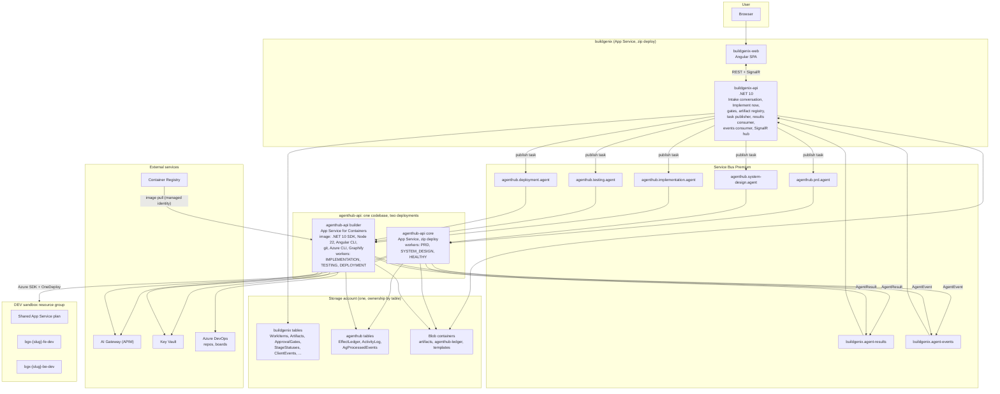

### 2.1 Why agenthub-api is deployed twice

The App Service runtime image for .NET carries the .NET runtime only. It has no .NET SDK, no Node, no Angular CLI and no git, so a code-deployed agenthub-api can call an LLM and write files, but it cannot compile or test the code it generates. Rather than build a separate "builder service" with its own HTTP API, we deploy the same agenthub-api code a second time, as a container whose image adds those tools. Which workers start on each deployment is configuration (`Workers:<Agent>:Enabled`). This is the "own host" for Implementation that D-AS-1 already anticipated, and it keeps one codebase, one dispatcher and one contract.

The builder is the only container deployment in Phase 0. It needs a container registry, which D-CL-2 did not allow for the three apps. That exception is scoped to this one deployment and is listed in section 16.

### 2.2 Concrete resources

Names marked **(confirm)** come from historical sources and must be confirmed with the platform team. Names marked **(convention)** are new and follow `{app}-{env}` or `bgx-{slug}-{tier}-{env}`.

| Resource | Name | Notes |
|---|---|---|
| Service Bus namespace (Premium) | `cc-sb-ts-aisdlc-sb` **(confirm)** | Topics in section 3.1 |
| Storage account | `aisdlcdev` **(confirm)** | Tables + containers `artifacts`, `agenthub-ledger`, `templates`; blob versioning and soft delete on |
| AI Gateway | `cc-sb-ts-aigw-apim` | `docs/ai-gateway.md` |
| Gateway Key Vault | `cc-sb-ts-aigw-kv` | Secret names only; Consumer ID still pending (OPEN-I2-6) |
| buildgenix-web | `buildgenix-web-dev` **(convention)** | Zip deploy |
| buildgenix-api | `buildgenix-api-dev` **(convention)** | Zip deploy, Always On, 1 instance |
| agenthub-api core | `agenthub-api-dev` **(convention)** | Zip deploy, Always On, 1 instance |
| agenthub-api builder | `agenthub-builder-dev` **(convention)** | Container, Always On, 1 instance; plan chosen in slice 1 from measured peak memory with three concurrent runs (start the measurement on P2v3) |
| Container registry | `bgxdevacr` **(convention)** | Builder image only; pulled with AcrPull by the builder's identity |
| DEV sandbox resource group | `rg-bgx-sandbox-dev` **(convention)** | Pre-created; everything generated apps need lives here |
| Shared plan for generated apps | `asp-bgx-sandbox-dev` **(convention)** | Linux, B2 (Always On available, no daily CPU quota); created by the first deployment if missing |
| Builder identity | `id-bgx-builder` **(convention)** | User-assigned; AcrPull and the builder's runtime identity (section 13) |
| Generated app identity | `id-bgx-sandbox-apps` **(convention)** | Pre-created user-assigned identity with read on the sandbox vault |
| Sandbox Key Vault | `kv-bgx-sandbox-dev` **(convention)** | Holds the generated apps' LLM key (open item 4) |
| Azure DevOps | `https://dev.azure.com/wcbbc`, a dedicated project for generated apps, `BuildGenix-Apps` **(name to confirm, open item 6)** | One repo per BuildGenix project: `bgx-{slug}`. The platform's own repos stay in `AI-Operations` |

---

## 3. How the pieces talk: topics and contracts

### 3.1 The rules

1. The browser talks only to buildgenix-api: REST for commands and snapshots, SignalR for live updates (D-6).
2. buildgenix-api is the only orchestrator. It decides what runs next and publishes one task message to that agent's topic (D-AS-2). It owns the stage to topic map.
3. An agent knows its own topic and nothing else. It never calls another agent, never publishes another agent's task, and never reads or writes a buildgenix table.
4. An agent reports back by publishing an **AgentResult** (once, at the end) and **AgentEvents** (progress) to the two topics buildgenix-api consumes. buildgenix-api records them in its own tables and is the only component that pushes anything to the browser.
5. Everything an agent needs is in the task message: ids, a small resolved context block, and blob paths for anything large. Phase 0 agents make no calls back to buildgenix-api.

| Topic | Publisher | Subscription | Consumer | Lock renewal cap |
|---|---|---|---|---|
| `agenthub.prd.agent` | buildgenix-api | `agenthub-prd` | core | 30 min |
| `agenthub.system-design.agent` | buildgenix-api | `agenthub-system-design` | core | 60 min |
| `agenthub.implementation.agent` | buildgenix-api | `agenthub-implementation` | builder | 4 h |
| `agenthub.testing.agent` | buildgenix-api | `agenthub-testing` | builder | 60 min |
| `agenthub.deployment.agent` | buildgenix-api | `agenthub-deployment` | builder | 60 min |
| `agenthub.healthy.agent` | agenthub-api REST | `agenthub-healthy` | core | 2 min |
| `buildgenix.agent-results` | all agents | `buildgenix-api` | buildgenix-api | short |
| `buildgenix.agent-events` | all agents | `buildgenix-api` | buildgenix-api | short |

Every subscription: MaxDeliveryCount 5 (D-I2-3), lock duration 5 minutes (the Service Bus maximum on every tier, auto-renewed by the worker up to the cap above), dead-letter after MaxDeliveryCount and on message time-to-live expiry (`DeadLetteringOnMessageExpiration = true`; an expired lock is a redelivery, not a dead-letter). Every worker uses `MaxConcurrentCalls = 1` and `PrefetchCount = 0`, and there is **no** global run gate across workers on a host. A global gate would leave a received message waiting for the slot while its renewal clock and delivery count run out. The core host can therefore run one PRD and one design at the same time, and the builder one run of each of its three agents; the builder plan is sized for that (section 9). This replaces the `Workers:MaxConcurrentRuns = 1` default from agent-model §9.

Each handler runs under a wall-clock deadline of its cap minus 10 minutes or 20 percent, whichever is smaller. On the deadline the handler stops, publishes Failed with `errorCode = DeadlineExceeded`, and completes the message. In normal operation one copy of a task runs at a time. If a lock is ever lost early (a network detach, an overlapping container during a platform swap), a second copy is still safe, because every effect is ledger-guarded and every external call is find-or-create (section 3.6). A `MessageLockLost` on settle, after the result was published, is treated as already processed.

Transient failures (HTTP 429, 5xx, timeouts) to the LLM, ADO, ARM and storage are retried inside the step with exponential back-off and a circuit breaker (`Microsoft.Extensions.Http.Resilience`), for up to 10 minutes per step, before the exception reaches the dispatcher. Only then is the message abandoned. Five deliveries therefore ride out close to an hour of outage instead of burning all attempts in seconds.

### 3.2 Why the result goes on a topic and not a REST call

Badru's model is that agents report to buildgenix, buildgenix updates its database, and buildgenix updates the screen. This design keeps that ownership exactly. The one choice made differently is the transport for the report. buildgenix-api runs as a single instance in Phase 0. If an agent finishes a 40-minute design while buildgenix-api is restarting, a REST call fails, the agent has to hold its message and retry, and after five failed deliveries finished work would be dead-lettered. A topic holds the result durably until buildgenix-api is back. buildgenix-api already has the dedup table for this (`SgProcessedEvents`), and HEALTHY already reports this way. The JSON body and its dedup key are the same for both transports, and the stub route `POST /api/internal/sdlc-results` stays as a fallback, so switching later is an adapter change, not a redesign.

### 3.3 TaskMessage (buildgenix-api to agent)

Service Bus `MessageId` = `{taskId}:{inputVersion}` (D-I2-4). `taskId` is one ULID per (work item, stage, output revision). It stays the same across redeliveries, resends and human answers, and changes when a stage is redrafted or reworked. `inputVersion` rises every time a human gives new input (Implement now, approve, reject, answer), so a resumed task gets a new message id and is not swallowed by dedup.

```json
{
  "contractVersion": "2.0",
  "workItemId": "01JC8W4M7Q9V3T5R2X6Y8Z0A1B",
  "projectId": "01JC8W2F3K5H7J9L1N3P5R7T9V",
  "stage": "SYSTEM_DESIGN",
  "taskId": "01JC9A0B1C2D3E4F5G6H7J8K9M",
  "correlationId": "c0a8017e-5f1d-4d5e-9a4b-2f6e7d8c9b0a",
  "causationId": "gate:01JC99ZZQ4M2N8P6R0T2V4X6Y8:Approved",
  "inputVersion": 4,
  "pipelineVersion": 1,
  "loopIndex": 0,
  "outputRevision": 1,
  "blobPrefix": "01JC8W2F3K5H7J9L1N3P5R7T9V/01JC8W4M7Q9V3T5R2X6Y8Z0A1B/v1/",
  "stateContextId": "01JC8W2F3K5H7J9L1N3P5R7T9V:01JC8W4M7Q9V3T5R2X6Y8Z0A1B",
  "artifacts": {
    "intakeSummary": "01JC8W2F.../01JC8W4M.../v1/intake-summary.json",
    "prd": "01JC8W2F.../01JC8W4M.../v1/prd.json"
  },
  "context": {
    "projectName": "Hello World",
    "projectSlug": "hello-world",
    "projectMode": "New",
    "baselineGeneration": 0,
    "targetGeneration": 1,
    "stackProfile": "fe-be-llm",
    "templateId": "fe-be-llm@1.0.0",
    "repo": {
      "provider": "AzureDevOps",
      "url": null,
      "defaultBranch": "main",
      "workBranch": "feature/wi-1-hello-world",
      "headCommit": null,
      "pullRequestId": null
    },
    "ado": { "organization": "wcbbc", "project": "BuildGenix-Apps", "epicId": null },
    "environment": "DEV",
    "deploymentAction": null
  },
  "humanAnswer": null,
  "config": {
    "modelId": "opus",
    "reasoningEffort": "high",
    "budget": { "stageMaxTokens": 500000, "workItemRemainingTokens": 2700000 },
    "limits": { "maxRevisions": 3, "maxFixAttempts": 3 }
  }
}
```

| Field | Who sets it | Rule |
|---|---|---|
| `artifacts` | buildgenix-api | Latest registered revision of every input the stage needs (resolved from the `~HEAD_` rows). Fixed keys: `intakeSummary`, `prd`, `prdMd`, `techSpec`, `techSpecMd`, `review`, `codeState`, `codeGraph`, `testResults`, `completionSummary`, `feedback`, and for existing projects `baselinePrd`, `baselineTechSpec`, `baselineCodeState` |
| `blobPrefix` | buildgenix-api | Where this run writes its outputs: `{projectId}/{workItemId}/v{outputRevision}/`. The agent never computes a path |
| `context` | buildgenix-api | Small facts the agent would otherwise have to look up. `repo.url` is null until Implementation creates the repo; buildgenix stores the URL from the result and sends it on every later task. `repo.headCommit` and `repo.pullRequestId` come from the latest Implementation result. `deploymentAction` (`Deploy` or `Finalize`) is set only on Deployment tasks. `ado.epicId` is the project's epic, null until the first Implementation creates it; later work items add stories under it |
| `humanAnswer` | buildgenix-api | Text of the human's answer when the task resumes after a Question |
| `config.budget` | buildgenix-api | Stage cap and what is left of the work item's token budget (section 8.7) |

### 3.4 AgentResult (agent to buildgenix-api)

Published once per run on `buildgenix.agent-results`. Service Bus `MessageId` = `result:{taskId}:{inputVersion}`. A run that crashes after publishing and is redelivered publishes the same id again, and buildgenix-api discards the copy.

```json
{
  "contractVersion": "2.0",
  "workItemId": "01JC8W4M7Q9V3T5R2X6Y8Z0A1B",
  "taskId": "01JC9C3D4E5F6G7H8J9K0M1N2P",
  "stage": "IMPLEMENTATION",
  "status": "Completed",
  "correlationId": "c0a8017e-5f1d-4d5e-9a4b-2f6e7d8c9b0a",
  "inputVersion": 5,
  "outputRevision": 1,
  "runId": "01JC9C3D4E5F6G7H8J9K0M1N2P:5:1",
  "artifacts": {
    "review": "01JC8W2F.../01JC8W4M.../v1/review.json",
    "codeState": "01JC8W2F.../01JC8W4M.../v1/code-state.json",
    "codeGraph": "01JC8W2F.../01JC8W4M.../v1/code-graph.json"
  },
  "outputs": {
    "repoUrl": "https://dev.azure.com/wcbbc/BuildGenix-Apps/_git/bgx-hello-world",
    "workBranch": "feature/wi-1-hello-world",
    "headCommit": "4f2a9c1",
    "pullRequestId": 1182,
    "adoWorkItems": { "epic": 52110, "stories": [52111, 52112, 52113] }
  },
  "signal": null,
  "humanMessage": null,
  "errorCode": null,
  "errorMessage": null,
  "tokenUsage": { "input": 612340, "output": 188770, "modelId": "53codex-chat" },
  "durationMs": 2412000
}
```

| Field | Values |
|---|---|
| `status` | `Completed`, `HumanActionRequired`, `Failed` (D-AS-3). Nothing else |
| `signal.kind` | With HumanActionRequired: `Question`, `LoopLimit`, `BudgetExceeded`. With Completed from Testing: `RouteBack` (`routeBackTo: "IMPLEMENTATION"`). The agent proposes; buildgenix-api decides. buildgenix-api itself can also set `Stuck` on a work item (section 3.9); agents never send it |
| `outputs` | Facts that are not files: `repoUrl`, `workBranch`, `headCommit`, `pullRequestId`, `pullRequestUrl`, `mergeCommit`, `adoWorkItems`, `deployedUrls`, `azureResources`. Sent with every status, including Failed, so buildgenix-api always knows what was created |
| `errorCode` (Failed) | `MissingInput`, `InvalidInput`, `GuardrailBlocked`, `BuildEnvironment`, `ExternalService`, `DeadlineExceeded`, `Cancelled`, `Unhandled` |

How buildgenix-api turns a result into the next step. The words NEXT, END and HUMAN-ACTION describe these transitions; they are never values of `status`.

| Result | Stage | Transition | What buildgenix-api does |
|---|---|---|---|
| Completed | PRD, SYSTEM_DESIGN | HUMAN-ACTION (gate) | Registers artifacts, raises the gate, status `AwaitingApproval` |
| Completed | IMPLEMENTATION | NEXT | Registers artifacts, stores repo facts, publishes TESTING |
| Completed, no signal | TESTING | NEXT | Publishes DEPLOYMENT with the tested `headCommit` |
| Completed, `RouteBack` | TESTING | NEXT (back) | If loops < 3: writes `feedback-implementation.json`, publishes IMPLEMENTATION with `loopIndex + 1`. Else: `HumanActionRequired` LoopLimit |
| Completed, action `Deploy` | DEPLOY_DEV | HUMAN-ACTION (acceptance) | Registers the summary, stores URLs, raises the acceptance gate |
| Accept at the acceptance gate | DEPLOY_DEV | NEXT | Publishes DEPLOYMENT with `context.deploymentAction = Finalize` |
| Request changes at the acceptance gate | DEPLOY_DEV | NEXT (back) | If rejects < 3: writes `feedback-implementation.json`, publishes IMPLEMENTATION rework on the same branch and PR. Else: LoopLimit |
| Completed, action `Finalize` | DEPLOY_DEV | END | Stores `mergeCommit`, status `Completed`, stage DONE, releases `~ACTIVE`, moves the project baseline to this work item |
| HumanActionRequired | any | HUMAN-ACTION | Stores the question, status `HumanActionRequired`, adds a pending action |
| Failed | any | END | Status `Failed`, releases `~ACTIVE` |

### 3.5 AgentEvent (agent to buildgenix-api, progress)

Published on `buildgenix.agent-events` while the agent works. `eventId` = `{taskId}:{inputVersion}:{deliveryCount}:{seq}` and is also the Service Bus `MessageId`. A redelivered run produces new event ids, which is correct: it really is running again. The screen does not flicker backwards because buildgenix-api projects events forward only (section 7).

```json
{
  "contractVersion": "2.0",
  "eventId": "01JC9A0B1C2D3E4F5G6H7J8K9M:4:1:7",
  "workItemId": "01JC8W4M7Q9V3T5R2X6Y8Z0A1B",
  "taskId": "01JC9A0B1C2D3E4F5G6H7J8K9M",
  "stage": "SYSTEM_DESIGN",
  "runId": "01JC9A0B1C2D3E4F5G6H7J8K9M:4:1",
  "kind": "SubStepCompleted",
  "subStep": { "id": "validate", "ordinal": 6, "label": "Checking the design against the PRD", "iteration": 2, "of": 3 },
  "progress": null,
  "tokens": { "input": 8120, "output": 2311, "modelId": "opus" },
  "message": "Design checks passed on revision 2",
  "level": "info",
  "occurredAt": "2026-10-07T10:14:22.481Z"
}
```

`kind` values: `AgentStarted`, `Heartbeat` (every 60 seconds while a run is active, so a long step is never mistaken for a dead one), `SubStepStarted`, `SubStepCompleted`, `SubStepFailed`, `PhaseProgress` (Implementation, with `progress = { phase, phases, fileCount }`), `FixLoopAttempt`, `TokensUsed`, `LogLine` (only when the verbose channel is on), `AgentCompleted`, `AgentFailed`, `AgentHumanActionRequired`. `Heartbeat` updates only the watchdog clock; it is not stored in ClientEvents.

### 3.6 Crash order and dedup

Agent side, unchanged from D-C1: check `AgProcessedEvents`, run the handler, publish the result, publish the terminal event, mark `AgProcessedEvents`, complete the message. Every effect inside the handler (each LLM call, file write, git push, ADO call, Azure call) is a write-once EffectLedger row (D-C2), so a redelivered run skips what it already did.

The ledger row for an **external** effect is written after the call returns, so a crash between the call and the row is still possible. Every external effect is therefore written as find-or-create, and checks reality before acting:

| Effect | Check before acting |
|---|---|
| Create ADO repo | GET the repo by name `bgx-{slug}`; reuse it if present |
| Create epic or story | WIQL query by tags `bgx-wi:{workItemId}` and `bgx-key:{storyKey}` |
| git push of phase k | Fetch the remote branch; if its head carries the commit trailer `Bgx-Task: {taskId}` and `Bgx-Phase: {k}`, adopt that commit. Commits also take `GIT_AUTHOR_DATE` and `GIT_COMMITTER_DATE` from the ledger, so a replayed commit gets the same sha |
| Create PR | GET active PRs with the same `sourceRefName` |
| Complete PR | GET the PR; if `status = completed`, read `lastMergeCommit` |
| Azure resources | ARM CreateOrUpdate is idempotent by definition |
| OneDeploy | Re-deploying the same zip is harmless |

buildgenix side: both consumers check `SgProcessedEvents`, apply the change with ETag-conditioned writes, then mark and complete (section 3.9). The next task is published through the `PendingMessage` marker on the work item, written in the same table operation as the state change, so a crash between "state saved" and "task sent" is resent by `PendingResenderService`.

Sizing rule: a Table Storage string property holds at most 64 KiB, which is 32,768 UTF-16 characters, and an entity at most 1 MiB. Any ledger `InputJson` or `OutputJson` longer than 30,000 characters is written to the `agenthub-ledger` container at `{workItemId}/{taskId}/{intentKind}_{ordinal:D6}.{input|output}.json`, and the row stores the path and a SHA-256. LLM inputs are stored as a prompt hash plus that pointer, not inline.

### 3.7 How an agent gets the data it needs

The agent never reads a buildgenix table and never calls buildgenix-api in Phase 0. When buildgenix-api publishes a task it already knows everything the agent will need, so it puts small facts in `context` and big things in blobs whose paths go in `artifacts`. This has three benefits that matter in production. The agent has no runtime dependency on buildgenix-api being up. A redelivered or replayed message reads exactly the same inputs, so behaviour is reproducible. And table ownership stays a hard boundary: each service's managed identity is granted rights only on its own tables (section 13), so a mistake fails with HTTP 403 instead of corrupting data. If a later agent genuinely needs live data during a long run, it calls a read-only buildgenix-api endpoint; it still never touches a table.

---

### 3.8 Counters and identifiers in one place

| Name | Scope | Starts | Changes when | Used for |
|---|---|---|---|---|
| `summaryRevision` | Intake summary of one work item | 1 | The user regenerates the summary | Implement now binds one (D-C5); intake path `v{summaryRevision}` |
| `taskId` | One stage run: (work item, stage, action, output revision), where action is `Deploy` or `Finalize` for DEPLOY_DEV and empty otherwise | new ULID | A redraft, rework, retry after a limit, or Finalize creates a new one; answers and redeliveries keep it | EffectLedger partition of the run, message id |
| `inputVersion` | Work item | 1 at Implement now | Every human input: approve, reject, answer, Request changes, retry | Message id `{taskId}:{inputVersion}`; answers accepted only from a later version |
| `outputRevision` (`n`) | Stage within a work item | 1 | That stage runs again for a redraft, rework, change request or retry after a limit | Blob folder `v{n}`; Artifacts row revision |
| `pipelineVersion` | Work item | 1 | Once per backward transition: a reject, a test route-back, a change request, a retry after a limit (+1, schema D-52). Stages that simply run again after that transition, such as Testing after a rework, stay on the new version | ApprovalGates and StageStatuses row keys |
| `loopIndex` | Work item | 0 | Each test route-back | Limit of 3 route-backs |
| Reject counters | One per gated stage | 0 | Each human reject at that gate | Limit of 3 per gate |
| `generation` (`g`) | Project | 0 | A work item is finalized | Label `v{g}.{n-1}`; baseline |
| `deliveryCount` | Service Bus delivery | 1 | Each redelivery | `runId`, `eventId` |
| `seq` | One delivery of one run | 1 | Each event | `eventId` |
| Ledger ordinal | One effect inside a run | per band (section 8.8) | Never | EffectLedger row key |

### 3.9 Applying results and events safely

Results and events travel on different topics with separate consumers, so they can arrive in any order, and a redelivered run can emit events after its result was already applied. buildgenix-api applies them with three guards:

1. **Current-task guard.** A result or event changes `WorkItems` only if its `taskId` and `inputVersion` equal the work item's `CurrentTaskId` and `CurrentInputVersion`. Anything else is recorded in Activity, marked processed and completed, but does not move the work item.
2. **Expected-state guard.** `AgentStarted` sets `Running` only when the status is `Queued`; a result applies only when the status is `Queued` or `Running`. Writes are ETag-conditioned, so two consumers can never both apply.
3. **Forward-only projection.** StageStatuses chips only move forward within a `pipelineVersion` (section 7).
4. **Last write is the state change.** Applying a result touches several tables (Artifacts, gates, pending actions, telemetry). Each of those writes is idempotent by key, and the `WorkItems` update comes last, carrying `LastAppliedResultId`. A crash part-way leaves the work item in its previous state, so the redelivered result passes the guards and re-applies the idempotent writes before the final update.

Two safety nets close the remaining gaps:

- **Dead-letter watcher.** buildgenix-api listens to the dead-letter sub-queue of every task subscription. A dead-lettered task (for example a crash on the last delivery, where no Failed result could be published) turns the work item into `HumanActionRequired` with signal `Stuck` and the dead-letter reason. A task that already failed normally (five failed deliveries, where the last delivery publishes Failed before it dead-letters) is only logged: the work item is already `Failed`.
- **Stage watchdog.** Two clocks, so waiting for capacity is never confused with a dead run. A `Running` work item with no event for 15 minutes (heartbeats arrive every 60 seconds) becomes `HumanActionRequired` with signal `Stuck`. A `Queued` work item whose task has not started within 6 hours (longer than the 4-hour Implementation cap plus a margin) gets an informational "waiting for capacity" note on screen, and becomes `Stuck` only after 12 hours. The person can retry (the same task is republished with `inputVersion + 1`; the ledger replays finished work) or stop.
- **Cancel marker.** When a person stops a work item, buildgenix-api first writes `{projectId}/{workItemId}/control/cancelled.json` (reason, time, the `taskId` current at the time), then fails the work item. The dispatcher checks for this file before starting a handler, the handler checks it at every sub-step boundary, and every external effect (push, PR, merge, Azure call, deploy) checks it again just before acting. A late or still-queued copy of the task therefore stops before it can push, deploy or merge, publishes Failed `Cancelled`, and its result is ignored by the current-task guard. Agents only need read access to the `artifacts` container for this, which they already have.

## 4. State context

| Between | Carried by | Durable in |
|---|---|---|
| Browser and buildgenix-api | REST snapshots, SignalR pushes | buildgenix tables |
| buildgenix-api and an agent | TaskMessage (ids, context, input paths, output prefix) | Service Bus until completed; `PendingMessage` on the work item |
| One agent and the next | Files written by one stage, registered by buildgenix-api, passed by path to the next | Blob (immutable) + Artifacts registry |
| Intake chat and the summary | Conversation messages, attachments, extracted slots | `Conversations` table (planned B1, built in slice 4) and Blob |
| One work item and the next on the same project | Baseline: latest accepted PRD, techspec, code-state, repo URL, epic id, generation | One reserved row `~BASELINE` in the `WorkItems` table, partition `{projectId}` (section 5.1) |
| An agent and its subagents | Typed C# request and result records owned by the handler | EffectLedger row per LLM call, file write and external call |
| Generated code | git: ADO repo, work branch pushed after every phase | Azure DevOps |
| Builder working copy | Local disk `/tmp/bgx/{workItemId}/{taskId}/repo` | Disposable; rebuilt from the pushed branch after a crash |

Subagent rules: a subagent is a plain C# class with a typed input record and a typed output record. It never writes a table, never publishes a message, and never logs directly; the handler logs and reports progress around each call. It knows nothing about other subagents. That keeps every subagent unit-testable with fixtures and keeps all persistence decisions in one place.

The important property: nothing that matters lives only in memory. If any host restarts at any point, the message comes back, the ledger replays finished effects, git holds the code, and the run continues.

---

## 5. Artifacts and versions per project and work item

### 5.1 The rules

- Every artifact lives at `{projectId}/{workItemId}/v{n}/{filename}` in container `artifacts` (D-C3 formula).
- `n` is the **output revision of the stage that wrote the file** (`outputRevision`). A stage's first run in a work item writes `v1`. A redraft after a rejection, a rework after a test failure, a retry after a limit, or a change requested at DEV acceptance writes the next revision of that stage only. Other stages' files stay where they are. The intake summary uses `v{summaryRevision}`.
- buildgenix-api registers every file in its `Artifacts` table: one row per work item, registry key and revision, where the row's `Revision` equals `n`, plus a `~HEAD_{registryKey}` pointer to the newest revision. Registry keys are one per file kind: `intakeSummary`, `prd`, `prdMd`, `techSpec`, `techSpecMd`, `review`, `codeState`, `codeGraph`, `testResults`, `completionSummary`, `feedbackPrd`, `feedbackSystemDesign`, `feedbackImplementation`. When it builds a task it takes every input from those pointers and maps the one feedback file meant for that stage to the message key `feedback`. That is how "always the latest version of each stage" is guaranteed without agents searching storage.
- **Documents are cumulative.** For an existing project the PRD and the techspec describe the whole product as it will be after this work item, not only the change. The Design agent carries every baseline requirement, story and acceptance check forward, marks what this work item adds, changes or retires, and DesignValidator fails if a baseline acceptance check disappears without a `retired` entry. The file plan lists only the files this work item touches. So the baseline always points at a complete description, and Testing always runs every acceptance check, old and new.
- A project has a **generation** `g`: the number of finalized work items. When the user clicks Implement now, buildgenix-api sets the work item's `TargetGeneration = baseline generation + 1` while holding the project's `~ACTIVE` lock (D-C4b), so two work items can never claim the same generation. A failed work item does not consume it; the next work item reuses it, and the screen always shows the work item number beside the label.
- The label users see is `v{g}.{n-1}`: the first PRD of the first work item is v1.0, its redraft v1.1, and the first PRD of the next work item on the same project is v2.0. The intake summary bound at Implement now is labelled `v{g}.0` whatever its revision number.
- `pipelineVersion` starts at 1 and rises by one per backward transition: a reject, a test route-back, a change request, or a retry after a limit (schema D-52). The stages that run again after that transition stay on the new version. In example 2 that gives v1 (first pass), v2 (after the PRD reject), v3 (after the test route-back). Gate rows and progress rows are keyed by it. The progress view shows, for each stage, the rows of the highest `pipelineVersion` that has any.
- **Baseline.** The project baseline is one reserved row `~BASELINE` in the `WorkItems` table, partition `{projectId}`, next to `~ACTIVE`. When the Finalize result arrives, one entity-group transaction updates the work item to `Completed`, deletes `~ACTIVE`, and upserts `~BASELINE`. A crash cannot release the lock without moving the baseline, or the other way round. The next work item reads `baselinePrd`, `baselineTechSpec`, `baselineCodeState`, the repo URL and the epic id from that row. `ProjectArtifactIndex` (the project Artifacts tab) is rebuilt from it afterwards and is never the source of truth.
- Files are never overwritten: the ledger makes each write happen once, and the container has versioning and soft delete as a safety net.

Filename catalog: `intake-summary.json`, `prd.json`, `prd.md`, `techspec.json`, `system-design.md`, `review.json`, `code-state.json`, `code-graph.json`, `test-results.json`, `completion-summary.json`, and the feedback files buildgenix-api writes for a redraft, rework or retry: `feedback-prd.json`, `feedback-system-design.json`, `feedback-implementation.json`. Feedback carries its stage in the filename because several stages can reach the same revision number in one work item. One control file sits outside the versioned folders: `{projectId}/{workItemId}/control/cancelled.json`, written only by buildgenix-api on Stop (section 3.9). It is the single path agents compute themselves, because a stopped work item has no next task message to carry it.

Retention (Phase 0 starting values): `artifacts` blobs and the Artifacts registry are kept for the life of the project; ClientEvents, RunLog and ActivityLog 90 days; SgProcessedEvents and AgProcessedEvents 14 days (far beyond any redelivery window); EffectLedger rows and `agenthub-ledger` blobs 30 days after the work item ends. A nightly job in each service deletes its own rows only. Blob versioning is an account-wide setting, so deletes keep older versions; blob lifecycle management rules delete previous versions and soft-deleted blobs in `agenthub-ledger` after 30 days and never apply to `artifacts`. Builder workspaces are local container disk, not blobs, so their deletion at run end is real.

New columns this design needs (built in slice 3):

| Table | Column or row | Type | Written by | When |
|---|---|---|---|---|
| WorkItems | `CurrentTaskId`, `CurrentInputVersion` (exists in schema), `PipelineVersion` | string, int, int | task publisher | Every task publish |
| WorkItems | `StageRevisionsJson` | JSON `{stage: n}` | task publisher | Every task publish |
| WorkItems | `LoopIndex`, `RejectCountsJson` | int, JSON `{gate: count}` | results consumer, gate service | Route-back, reject, Request changes |
| WorkItems | `TargetGeneration` | int | Implement now | Once |
| WorkItems | `PendingMessage`, `PendingAt` (schema ADR-025) | JSON, time | task publisher | Every task publish, cleared after send |
| WorkItems | `SignalKind`, `HumanMessage` (exists) | string | results consumer, watchdog | HumanActionRequired |
| WorkItems | `RepoFactsJson` | JSON (url, branch, headCommit, prId, mergeCommit, deployed URLs) | results consumer | After Implementation, Testing, Deployment |
| WorkItems | `~BASELINE` row | Generation, WorkItemId, PrdPath, TechSpecPath, CodeStatePath, RepoUrl, AdoEpicId, MergeCommit, TemplateId, AcceptedAt | results consumer | Finalize, in the same transaction as Completed |
| Projects | `Slug` + claim row `~SLUG_{slug}` | string | project create | Once; the claim row makes the slug unique |
| Projects | `Repository` (D-49 planned) | string | results consumer | The first result that reports `outputs.repoUrl`, including a Failed one, so a retried first work item finds it |
| ProjectArtifactIndex | PK `{projectId}`, RK `{invertedTicks}_{artifactId}`; WorkItemId, DisplayNumber, RegistryKey, Revision, Label, BlobPath, Accepted (bool) | | results consumer | After each registration; rebuilt from Artifacts and `~BASELINE`; `Accepted` separates finalized work from failed attempts that share a label |

### 5.2 Worked example: versions across the three examples

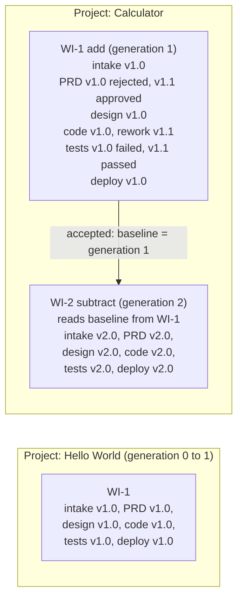

Calculator, work item 1 (`wi1` stands for its ULID, `cal` for the project ULID):

| Artifact | Path | Label |
|---|---|---|
| Intake summary | `cal/wi1/v1/intake-summary.json` | v1.0 |
| PRD draft 1 (rejected) | `cal/wi1/v1/prd.json`, `cal/wi1/v1/prd.md` | v1.0 |
| Reject feedback | `cal/wi1/v2/feedback-prd.json` | written by buildgenix for PRD revision 2 |
| PRD draft 2 (approved) | `cal/wi1/v2/prd.json`, `cal/wi1/v2/prd.md` | v1.1 |
| Design | `cal/wi1/v1/techspec.json`, `cal/wi1/v1/system-design.md` | v1.0 |
| Implementation | `cal/wi1/v1/review.json`, `code-state.json`, `code-graph.json` | v1.0 |
| Tests run 1 (one failure) | `cal/wi1/v1/test-results.json` | v1.0 |
| Rework feedback | `cal/wi1/v2/feedback-implementation.json` | written by buildgenix for Implementation revision 2 |
| Implementation rework | `cal/wi1/v2/review.json`, `code-state.json`, `code-graph.json` | v1.1 |
| Tests run 2 (green) | `cal/wi1/v2/test-results.json` | v1.1 |
| Deployment | `cal/wi1/v1/completion-summary.json` | v1.0 |

`v2/` holds the second revision of each stage that needed one. That is safe because every filename is unique to the stage that writes it, and nobody reads by folder; every reader gets an exact path from the registry. Each task message carries the one feedback file meant for it under the key `feedback`.

Calculator, work item 2 (subtract) writes `cal/wi2/v1/...` for everything and labels it v2.0, and its tasks carry `baselinePrd = cal/wi1/v2/prd.json`, `baselineTechSpec = cal/wi1/v1/techspec.json`, `baselineCodeState = cal/wi1/v2/code-state.json`.

---

## 6. UI states mapped to agents

### 6.1 The map

| Lifecycle bar (D-CL-1) | What the user sees | Work item status | Stage | What is running | What the user can do |
|---|---|---|---|---|---|
| Intake | Chat and "Context so far" panel | `Draft` | none | buildgenix-api Intake: IntakeConversation, StackClassifier, CompletenessChecker, SummaryBuilder | Chat, attach files, Save draft, Implement now |
| PRD | "Writing the PRD", sub-step chips | `Queued` then `Running` | PRD | PRD agent: context, analyse, write, critique, render, publish | Watch |
| PRD | "Waiting on you: review the PRD" | `AwaitingApproval` | PRD | nothing | Approve, or Reject with feedback |
| System Design | "Designing", sub-step chips | `Queued` then `Running` | SYSTEM_DESIGN | System Design agent: context, repo-context, plan, write, validate, critique, render, publish | Watch |
| System Design | "Waiting on you: review the design" | `AwaitingApproval` | SYSTEM_DESIGN | nothing | Approve, or Reject with feedback |
| Build | "Building: phase k of N" | `Running` | IMPLEMENTATION | Implementation agent: workspace, backlog, phase-1 to phase-N, review, code-state, pull-request | Watch |
| Test | "Testing" | `Running` | TESTING | Testing agent: workspace, suites, acceptance, analyse, publish | Watch |
| Build | "Fixing test failures (loop L of 3)" | `Running` | IMPLEMENTATION | Implementation agent, `Rework` from a test route-back | Watch |
| Build | "Applying your requested changes (round R of 3)" | `Running` | IMPLEMENTATION | Implementation agent, `Rework` from Request changes | Watch |
| Build | "Resolving a merge conflict" | `Running` | IMPLEMENTATION | Implementation agent, `Rework` with the conflict as feedback | Watch |
| Build | "Continuing the build with your guidance" | `Running` | IMPLEMENTATION | Implementation agent, `Continue` | Watch |
| Deploy | "Deploying to DEV" | `Running` | DEPLOY_DEV | Deployment agent: workspace, provision, package, deploy, smoke, summary | Watch |
| Deploy | "Waiting on you: check the DEV app" | `AwaitingApproval` | DEPLOY_DEV | nothing | Accept, or Request changes with a note |
| Deploy | "Finishing: merging to main" | `Running` | DEPLOY_DEV | Deployment agent, Finalize action: finalize | Watch |
| any | "A question for you" | `HumanActionRequired` | unchanged | nothing | Answer |
| Done | Completion summary with both URLs | `Completed` | DONE | nothing | Open the app, start the next work item |
| any | The failure reason | `Failed` | unchanged | nothing | Read the reason, start a new work item |

`~ACTIVE` is taken at Implement now and released only at `Completed` or `Failed` (D-C4b). `Running` is written by the events consumer when `AgentStarted` arrives.

### 6.2 Work item state machine

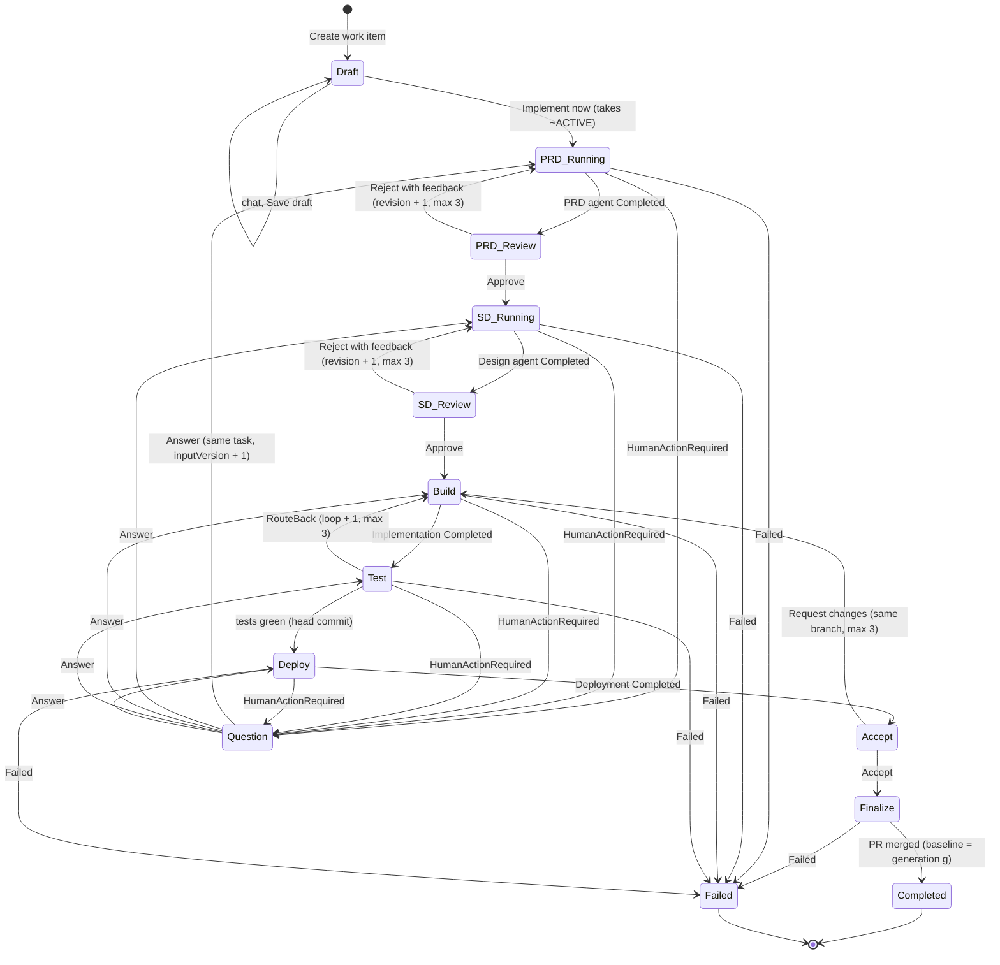

### 6.3 How each kind of stop resumes

| Signal | Raised by | What the person can do | What buildgenix-api publishes | Why it moves forward |
|---|---|---|---|---|
| `Question` | an agent (`AskAsync`, ledger ordinal 900 + q) | Answer | Same `taskId`, `inputVersion + 1`, `humanAnswer` | The ledger replays everything up to the question and `AnswerAsync` commits the answer at 950 + q. What runs next depends on where the agent asked (table below). An answered question always grants one extra revision, so a question asked at the last revision still has a step to continue into |
| `LoopLimit` or `BudgetExceeded` | an agent | Retry with guidance; raise the budget (by at most 50 percent per retry and to at most twice the configured budget; the raise is recorded as a WorkItemEvent with the user id) and retry; Stop | A **new** `taskId`, the next `outputRevision` and `pipelineVersion + 1` for the same stage, the guidance as `feedback-{stage}.json`, the raised budget in `config`. For Implementation, `context.implementationMode = Continue` | A new task has an empty ledger, so nothing committed is replayed. Implementation in `Continue` mode keeps every phase already pushed (found by its `Bgx-Phase` trailer), restarts the phase that hit the limit with the guidance, and then builds the remaining phases |
| `LoopLimit` | buildgenix-api (3 route-backs, or 3 rejects at a gate) | One more loop; Stop | For a test route-back or Request changes: an Implementation rework. For a PRD or design reject: a redraft of that stage | The counter's cap rises by one, up to a hard cap of 5 |
| `Stuck` | dead-letter watcher or watchdog (section 3.9) | Retry; Stop | The same task with `inputVersion + 1` | The ledger replays finished work; the run continues |
| any | | Stop | nothing | Work item `Failed` ("Stopped by user"), `~ACTIVE` released |

Where an answered question continues:

| Asked during | After the answer |
|---|---|
| PRD `analyse` or `critique`, Design `plan` or `critique` | The next draft or revision, with the answer in the prompt (one extra revision granted) |
| Implementation, during a phase | The phase's next fix attempt with the answer, then the remaining phases |
| Deployment `smoke` (still failing after 5 minutes) | Answer "retry" re-runs `smoke` (it is deterministic, so it is never ledger-cached); answer "redeploy" re-runs `deploy` and `smoke` with the Deploy and AzureResource ordinals shifted by 100 × the answer index (so 1050, 1051 for the first redeploy), which the ledger has never seen; or Stop |
| Deployment `finalize` (moved head or merge conflict) | Answer "re-test" (the head moved) makes buildgenix-api route back to TESTING for the current head, then Deploy and acceptance again. Answer "resolve" (a merge conflict) makes it publish an Implementation `Rework` whose feedback is the conflict, which merges `main` into the work branch, re-runs every test and pushes; then Testing, Deploy and acceptance follow again. Or Stop. Finalize never reports Completed without a merge commit, and buildgenix-api completes a work item only on a Finalize result that carries one |

Stop (`POST /api/work-items/{id}/stop`) is allowed only when no agent is running: the work item is `AwaitingApproval`, `HumanActionRequired` or flagged `Stuck`. buildgenix-api writes the cancel marker (section 3.9) before it fails the work item, so a late copy of a task cannot act afterwards. That removes the "locked for ever" case without needing to kill a running agent.

---

## 7. Status changes from subagent to screen

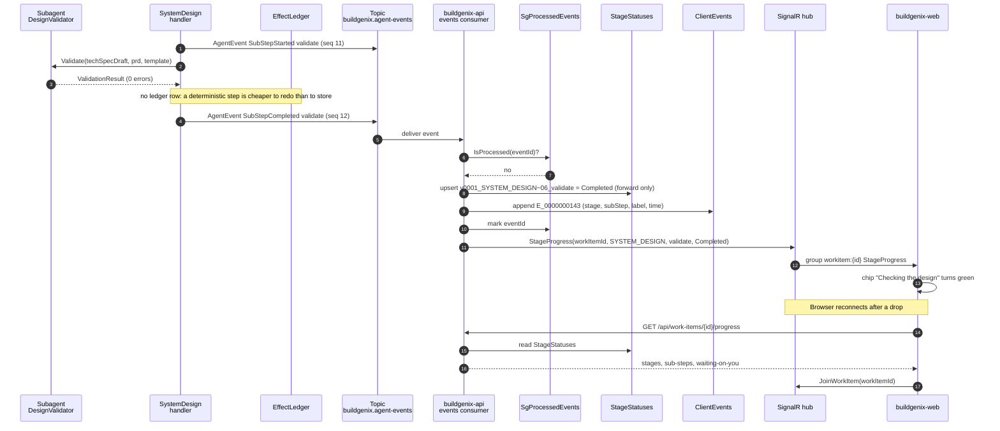

The ClientEvents append and its `~EID_{eventId}` guard row are written in one transaction, so a crash between append and dedup mark cannot show an event twice. The events consumer applies a forward-only rank (`Pending` < `Running` < `Completed` or `Failed`), so an old or duplicated event can never move a chip backwards. Results follow the same path through the results consumer, which updates `WorkItems`, `Artifacts`, `ApprovalGates` and pending actions, publishes the next task, and pushes `WorkItemStateChanged`. Verbose lines (`LogLine`) go to `RunLog` and are pushed as `VerboseLog` only to browsers that have the log drawer open (D-6).

`StageStatuses`, `ClientEvents`, `RunLog`, `WorkItemTelemetry`, `PendingApprovals` and `ProjectArtifactIndex` are designed in the schema but not built. They are part of build slice 3 (section 14).

---

## 8. Agents and subagents

Every agent is a subclass of `AgentHandlerBase` (template §8). Shared services that every agent uses and that are therefore not listed as subagents: input loading (a missing required input ends the run as Failed `MissingInput`), guardrails (P-GUARDRAILS-PHASE0) with one profile per content type (JSON: schema, injection markers, secret scan; code: secret scan, banned APIs, URLs outside the allowlist; markdown: secret scan and injection markers, headings allowed), ledger-guarded LLM steps, the artifact writer (secret scan, ledger-guarded, writes at `blobPrefix`), the sub-step reporter, and ask and answer.

The LLM pattern is the same everywhere: the C# handler drives each step, the LLM returns JSON against a schema, and C# validates it before anything is written. There is no autonomous tool-calling loop. That keeps every step ledger-guarded and replayable, and it avoids the chat-completions restriction on tools combined with reasoning effort.

### 8.0 Intake (buildgenix-api, not an agenthub agent)

| Step | Kind | Does |
|---|---|---|
| IntakeConversation | LLM, multi-turn | Asks what the user wants until the required slots are filled |
| StackClassifier | LLM proposal + deterministic rules | Chooses `fe`, `fe-be`, `fe-be-db` or `fe-be-llm` and records why. Phase 0 has templates for `fe-be` and `fe-be-llm` only, so for `fe` or `fe-be-db` Intake tells the user plainly that the stack is not supported yet and does not allow Implement now |
| CompletenessChecker | deterministic | Goal, users, behaviours, success criteria and stack must be present before a summary can be produced (D-30: never the model alone) |
| SummaryBuilder | LLM + schema | Writes `intake-summary.json` revision r: requirements R-1..R-n, assumptions A-1..A-n, out of scope, success criteria, technology constraints, provenance (which message each item came from) |

Implement now binds the summary revision (D-C5), takes `~ACTIVE`, sets `TargetGeneration`, and publishes the PRD task. The `~ACTIVE` insert, the work item update and the `PendingMessage` write are one entity-group transaction (all are in partition `{projectId}` of WorkItems), replacing today's insert-then-update with a compensating delete, so a crash cannot leave an orphan lock.

Intake runs inside buildgenix-api, so buildgenix-api needs its own LLM configuration (`Llm:Provider`, the gateway secret through Key Vault), the same input guardrails as agents (injection markers, secret scan, length), and its own token budget of 200,000 per work item, counted separately from the 3,000,000 pipeline budget.

### 8.1 PRD agent

**Topic** `agenthub.prd.agent` · **Host** core · **Inputs** `intakeSummary`; existing projects `baselinePrd`; redraft `prd` (previous) + `feedback` · **Outputs** `prd.json`, `prd.md` · **Gate** PRD · **Token cap** 300k · **Model** open item 7.

| Sub-step | Subagent | Kind | Does |
|---|---|---|---|
| `context` | input loader | deterministic | Loads inputs; checks every requirement id the intake declared |
| `analyse` | RequirementsAnalyst | LLM | Turns intake requirements into a requirement set, lists conflicts and gaps; a gap that blocks the PRD becomes a Question |
| `write` | PrdWriter | LLM | Writes `prd.json`: summary, functional requirements, epics, stories, tasks, Fibonacci estimates, acceptance criteria, technical acceptance criteria, test plan, automation scope. Existing projects write a cumulative PRD: everything in `baselinePrd` carried forward, with this work item's additions, changes and retirements marked (section 5.1). Redrafts address every point in `feedback` |
| `critique` | PrdCritic | deterministic + LLM | Schema check; every intake requirement maps to at least one story; every story has testable acceptance criteria; out-of-scope items stay out; on a redraft every feedback point is addressed |
| `render` | PrdRenderer | deterministic | `prd.json` to `prd.md` |
| `publish` | artifact writer | deterministic | Writes both files at `blobPrefix` |

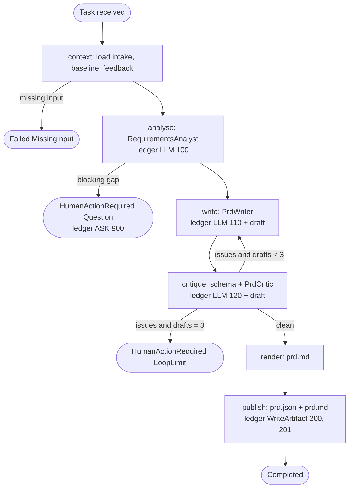

Each box emits `SubStepStarted` and `SubStepCompleted`; each critique iteration carries `iteration` and `of` so the chip reads "Reviewing the PRD (2 of 3)".

### 8.2 System Design agent

**Topic** `agenthub.system-design.agent` · **Host** core · **Inputs** `prd`, `intakeSummary`; existing `baselineTechSpec`, `baselineCodeState`; template manifest `templates/{templateId}/manifest.json`; standards pack `templates/standards/v1/` · **Outputs** `techspec.json`, `system-design.md` · **Gate** SYSTEM_DESIGN · **Token cap** 500k.

This is the agent whose output every later stage executes, so its job is to leave nothing to guess. `techspec.json` contains, for the target stack: components and boundaries, phases with milestones, a file plan (path, create or modify, classes and methods with signatures), API contracts, the LLM integration for `fe-be-llm`, a TDD plan, acceptance tests written as executable checks (method, path, body, expected status, expected response shape), the ADO epic and stories, the deployment plan (which resources to create or update, with names), and the exact commands to run and test locally.

| Sub-step | Subagent | Kind | Does |
|---|---|---|---|
| `context` | ModeDetector, TemplateResolver | deterministic | New project or existing (baseline present); resolves the template layout: project names, folders, ports, test frameworks, health path |
| `repo-context` | RepoContextBuilder | deterministic, existing only | Picks the symbols in `code-state.json` that the PRD stories touch, plus their callers and callees, inside a token budget. The LLM sees symbol references and signatures, not raw source |
| `plan` | DesignPlanner | LLM | Components, phases, file plan, API contracts |
| `write` | SectionWriter | LLM, one call per section | Architecture, data, API, LLM integration, TDD plan, acceptance checks, ADO backlog, deployment plan, run and test commands |
| `validate` | DesignValidator | deterministic | Runs before critique. Every PRD acceptance criterion has a check; every story has files; every path is inside the template layout; existing mode: every "modify" target exists in code-state, no "create" collides with an existing file, and a baseline acceptance check that disappears without a `retired` entry fails; packages are only from the template allowlist; stack is .NET 10, Angular, Table Storage only; resource names follow the convention. Violations while the revision is 0, 1 or 2 go back to `plan` and do not call critique. The next failure is `HumanActionRequired` `LoopLimit` |
| `critique` | DesignCritic | LLM | Gaps against the PRD and the standards pack; issues go back to `plan` or `write` |
| `render` | DesignRenderer | deterministic | `techspec.json` to `system-design.md` |
| `publish` | artifact writer | deterministic | Writes both files |

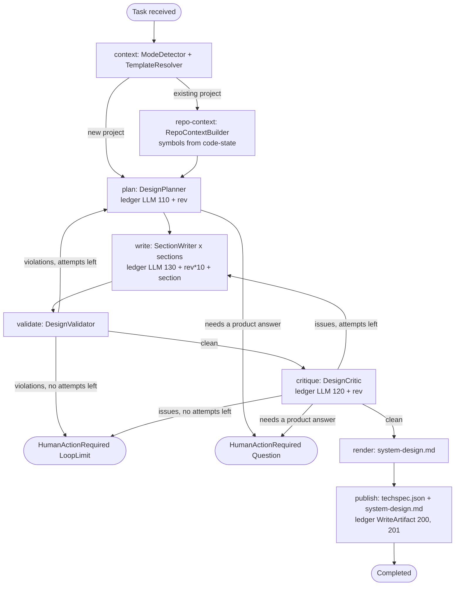

### 8.3 Implementation agent (with the CodeReviewer subagent)

**Topic** `agenthub.implementation.agent` · **Host** builder · **Inputs** `techSpec`, `prd`; existing `baselineCodeState`; rework `feedback`, `testResults` · **Outputs** code on the work branch, a pull request, `review.json`, `code-state.json`, `code-graph.json`; `outputs.repoUrl`, `workBranch`, `headCommit`, `pullRequestId`, `adoWorkItems` · **Auto-advance** · **Token cap** 1.8M · **Lock cap** 4 h.

| Sub-step | Subagent | Kind | Does |
|---|---|---|---|
| `workspace` | WorkspaceManager | deterministic | New project: looks up ADO repo `bgx-{slug}` by name first and reuses it if an earlier, failed first work item already created it (its `main` can only hold the template, because merges happen only after acceptance); otherwise creates it, unpacks the template, commits and pushes `main`, then sets branch security on `main` so only `id-bgx-builder` may push or complete pull requests into it (people can read and open PRs, but not push). Existing: clones `main` and checks that its head is the baseline's `MergeCommit`; if `main` moved outside BuildGenix, the agent asks a Question instead of building on code the baseline does not describe. Creates or reuses the work branch. After a crash: re-clones at the last pushed commit recorded in the ledger |
| `backlog` | BacklogSync | deterministic, ADO REST | Creates the project's epic if `context.ado.epicId` is null, otherwise adds stories under that epic. Each item is tagged `bgx-wi:{workItemId}` and `bgx-key:{storyKey}`; it queries by tag before creating, so a retry never duplicates |
| `dependencies` | DependencyManager | deterministic | Adds the packages the techspec lists, only from the template's allowlist, at pinned versions, with `npm install --save-exact --ignore-scripts` and `dotnet add package`, then commits the lock files. CodeWriter may not edit `package.json`, `package-lock.json` or package references; CodeReviewer rejects it if it does |
| `phase-{k}` | PhaseRunner | mixed | For each techspec phase: TestWriter (LLM) writes the tests first; CodeWriter (LLM) writes one file at a time from the file plan, the code-state references and the file's current content; BuildVerifier runs `dotnet build`, `dotnet test`, `npm ci --ignore-scripts`, `ng build`, `ng test --watch=false`; FixLoop (LLM) repairs from compiler and test output, at most 3 times per phase; PhaseCommitter commits "phase k: {title}" with the `Bgx-Task` and `Bgx-Phase` trailers, pushes, and records the commit in the ledger |
| `review` | CodeReviewer | deterministic + LLM | Deterministic checks first and they cannot be overridden by the LLM: secret scan, banned APIs, dependency allowlist, no edits to package manifests, file-plan conformance, acceptance coverage. Then an LLM review against the techspec. Blockers go back through FixLoop, BuildVerifier re-runs, and a "review fixes" commit is pushed (2 rounds); still blocked means LoopLimit. Writes `review.json` |
| `code-state` | CodeStateBuilder | deterministic | Runs `graphify extract . --code-only` (local tree-sitter parsing, no LLM, no network), saves the raw graph as `code-graph.json`, and normalises it into `code-state.json`: projects, files, types, public members, HTTP routes, Angular components and services, call and import edges |
| `pull-request` | PullRequestPublisher | deterministic, ADO REST | Opens or updates the PR from the work branch to `main` and links the stories |

`context.implementationMode` selects one of three modes. Each is a new task with its own ledger:

| Mode | When | What runs |
|---|---|---|
| `Build` | First Implementation of a work item | Every step in the table above |
| `Continue` | Retry after LoopLimit or BudgetExceeded | `workspace` from the work branch, `backlog` and `dependencies` (no-ops through find-or-create), then the phase that hit the limit with the guidance, then the remaining phases, then `review`, `code-state`, `pull-request`. If every phase is already pushed (the limit was hit in `review`), it starts at `review` with the guidance |
| `Rework` | Test route-back or Request changes | `workspace` from the work branch, one `phase-fix` driven by `feedback` (failing tests and their output, or the user's change request), then `review`, `code-state`, `pull-request` |

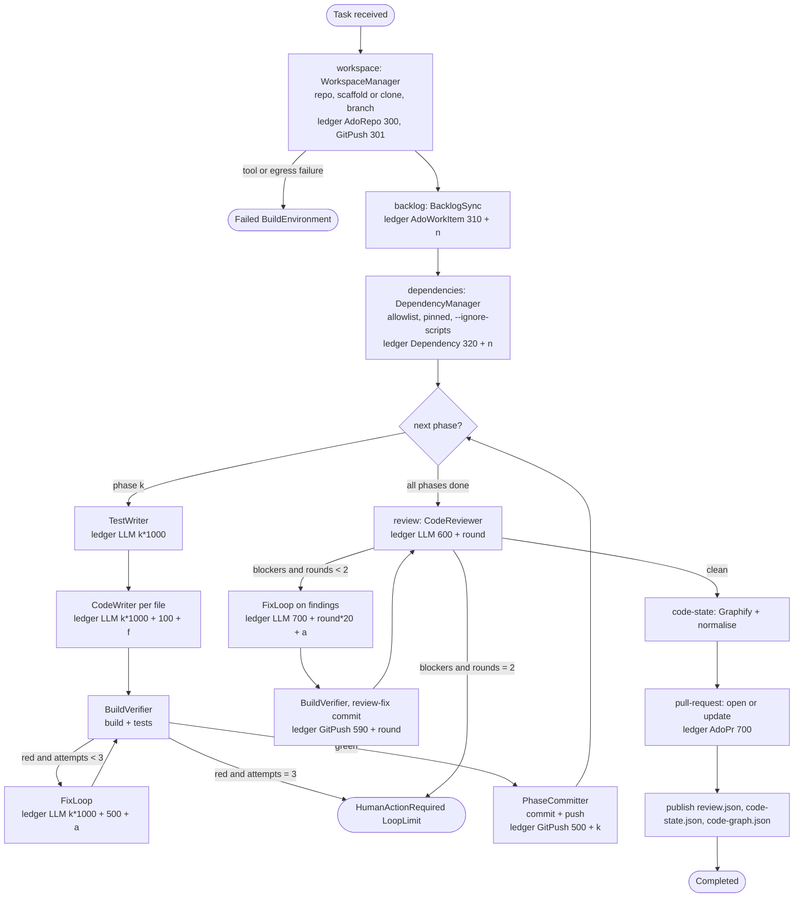

Context management: CodeWriter never receives the whole repository. It receives the file plan entry, the signatures of the symbols it calls (from `code-state.json`), the tests it must satisfy, and the current content of the one file it is writing. That keeps each call small and makes the token cap realistic.

### 8.4 Testing agent

**Topic** `agenthub.testing.agent` · **Host** builder · **Inputs** `techSpec`, `review`; `context.repo` with `headCommit` and `pullRequestId` · **Outputs** `test-results.json` · **Side effects** none outside the builder workspace · **Auto-advance** · **Token cap** 200k.

| Sub-step | Subagent | Kind | Does |
|---|---|---|---|
| `workspace` | WorkspaceManager | deterministic | Clones the work branch at `headCommit` |
| `suites` | SuiteRunner | deterministic | `dotnet test` (TRX) and `ng test --watch=false` (Vitest, JUnit reporter) |
| `acceptance` | AcceptanceRunner | deterministic | Starts the BE on localhost with `Llm:Provider=Fixture`, runs every acceptance check from the techspec, checks status codes and response shapes (for LLM endpoints the shape, not the text) |
| `analyse` | FailureAnalyst | LLM, only on failure | Summarises each failure and proposes whether the code or the spec is wrong. Phase 0 always routes to Implementation; the proposal is kept for the North Star verification step |
| `publish` | artifact writer | deterministic | `test-results.json` |

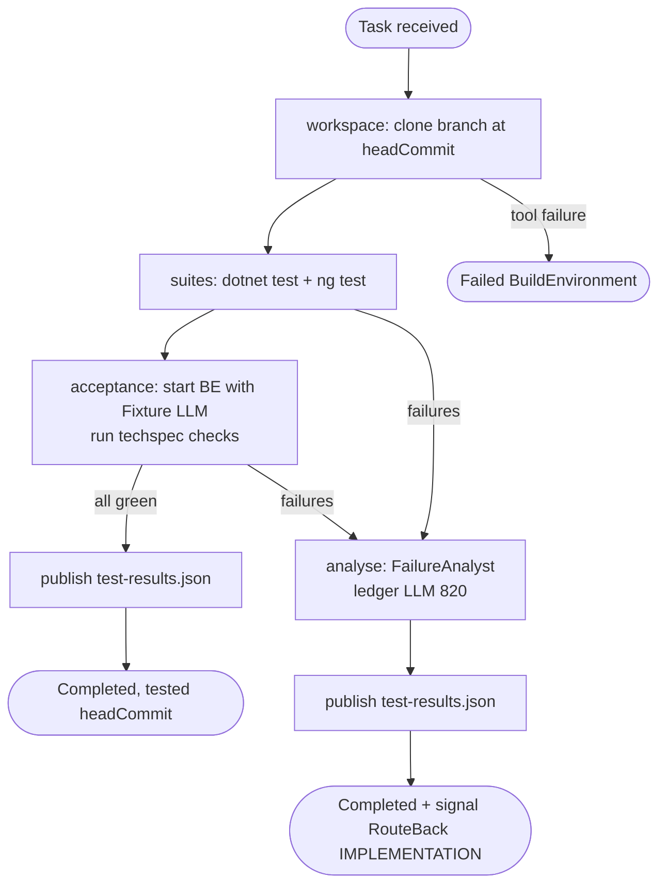

Because the techspec is cumulative (section 5.1), `acceptance` runs every check the product has, including those from earlier work items. That is the regression test for example 3.

A failing test is a business outcome, not an agent failure, so the agent reports Completed with a RouteBack signal. buildgenix-api decides whether to loop (section 3.4).

### 8.5 Deployment agent

**Topic** `agenthub.deployment.agent` · **Host** builder · **Inputs** `techSpec` (deployment plan), `context.repo` with the tested `headCommit` and `pullRequestId`, `context.deploymentAction` (`Deploy` or `Finalize`) · **Outputs** resources in the DEV sandbox, `completion-summary.json`, `outputs.deployedUrls`, `outputs.azureResources`; Finalize: `outputs.mergeCommit` · **Gate after** DEV acceptance (after Deploy) · **Token cap** 50k.

The agent runs twice per work item. The **Deploy** action deploys the tested head commit of the work branch and ends at the acceptance gate. After the user accepts, buildgenix-api sends the same agent a **Finalize** action, which only merges the pull request. Keeping the merge in the agent that already holds ADO rights means buildgenix-api never needs Azure DevOps credentials.

| Sub-step | Subagent | Kind | Does |
|---|---|---|---|
| `workspace` | WorkspaceManager | deterministic | Clones the work branch at the tested `headCommit` |
| `provision` | Provisioner | deterministic, Azure SDK | Idempotent CreateOrUpdate in `rg-bgx-sandbox-dev`: plan `asp-bgx-sandbox-dev` (first time only), `bgx-{slug}-be-dev` (.NET 10), `bgx-{slug}-fe-dev` (Node, startup command `pm2 serve /home/site/wwwroot --no-daemon --spa`), app settings (CORS origin of the FE, LLM provider, Key Vault references), health check path, access restrictions to the corporate IP ranges (open item 10); attaches `id-bgx-sandbox-apps` to LLM-enabled apps and sets `keyVaultReferenceIdentity` to it, then checks the Key Vault reference status through ARM. Apps are created with `autoGeneratedDomainNameLabelScope = TenantReuse`, so names need not be globally unique; it reads back each app's `defaultHostName` and SCM host from ARM and gives those to `package` and `deploy` |
| `package` | PackageBuilder | deterministic | `dotnet publish` for the BE; `ng build` for the FE; writes `assets/runtime-config.json` with the BE hostname read back by `provision` (the Angular build is static files, so App Service settings cannot reach it); zips both |
| `deploy` | Deployer | deterministic | Kudu OneDeploy (`/api/publish?type=zip`) with an Entra bearer token from the builder identity; waits for the deployment to report success |
| `smoke` | SmokeValidator | deterministic | BE `/health` and one smoke request from the techspec; FE index returns 200; retries with back-off for up to 5 minutes |
| `summary` | SummaryWriter | deterministic + one short LLM call | `completion-summary.json`: FE and BE URLs, resources, deployed commit, how to run locally, what changed |
| `finalize` | Finalizer (Finalize action only) | deterministic, ADO REST | Completes the PR with `PATCH status=completed`, `lastMergeSourceCommit` = the deployed commit (ADO itself refuses if the head moved), `completionOptions.mergeStrategy = noFastForward` (the tested commit becomes an ancestor of `main`), `transitionWorkItems = true`, `deleteSourceBranch = false`. Polls until `status = completed` and records `lastMergeCommit`. A moved head, `mergeStatus = conflicts` or `failure` returns HumanActionRequired instead of merging untested code. Phase 0 repos have no branch policy on `main`, so no bypass permission is needed |

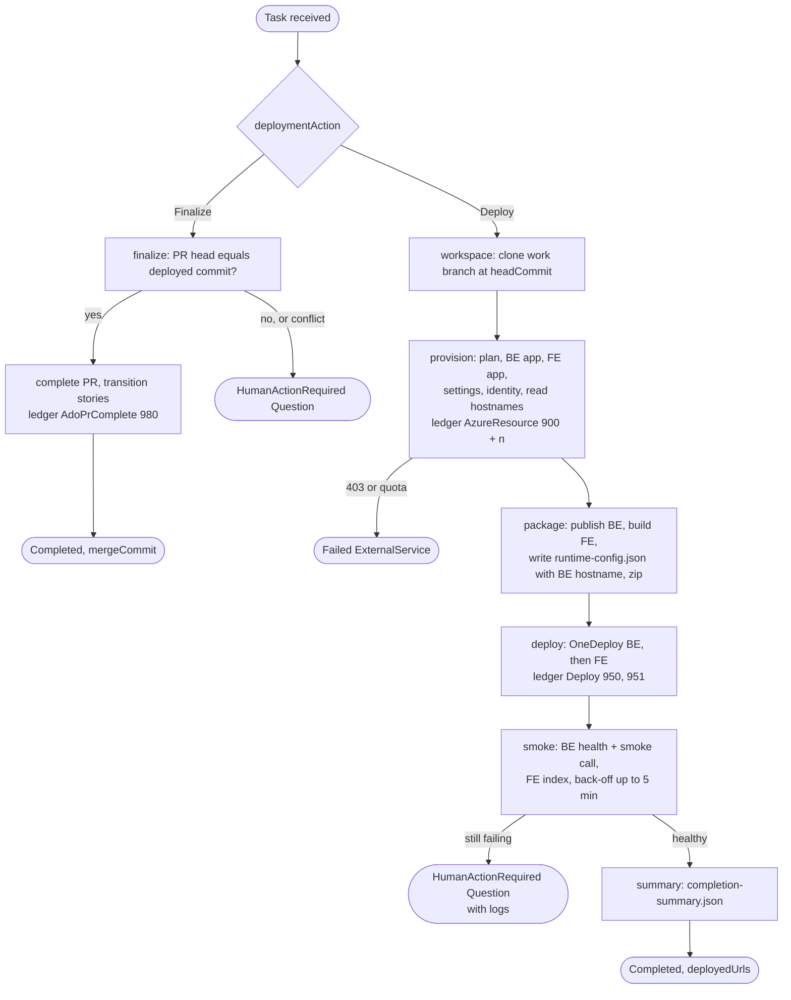

### 8.6 Resource naming the Design agent must use

The DesignValidator rejects any deployment plan that does not follow: app names `bgx-{slug}-{fe|be}-dev`, resource group `rg-bgx-sandbox-dev`, plan `asp-bgx-sandbox-dev`. `slug` is the project slug, lower case, letters, digits and hyphens, at most 30 characters, unique per project (buildgenix-api enforces it at project creation). With `bgx-` + 30 + `-be-dev` the longest name is 41 characters, inside the 43-character label limit for apps created with a generated domain label. Because the app name is stable per project, the second deployment of the same project finds and updates the same apps.

### 8.7 Limits

| Limit | Phase 0 starting value (configuration) | When reached |
|---|---|---|
| Service Bus deliveries | 5 | Last delivery publishes one Failed result, then dead-letters |
| LLM repair attempts per step | 2 | Step fails, which the handler maps to a fix loop or LoopLimit |
| PRD drafts per run | 3 | LoopLimit |
| Design revisions per run | 3 | LoopLimit |
| Fix attempts per implementation phase | 3 | LoopLimit |
| Code review fix rounds | 2 | LoopLimit |
| Test route-back loops per work item | 3 | buildgenix-api raises LoopLimit |
| Human rejects per gated stage (PRD, design, and Request changes at DEV acceptance, each counted separately) | 3 | buildgenix-api raises LoopLimit |
| Token budget per work item | 3,000,000 (PRD 300k, design 500k, implementation 1.8M, testing 200k, deployment 50k) | BudgetExceeded |
| Smoke validation | 5 minutes | Question with logs |
| Questions per run | 3 | LoopLimit (the agent keeps asking, so a person decides) |
| Intake token budget per work item | 200,000 | Intake asks the user to narrow the request |
| Hard cap after "one more loop" | 5 | Only Stop remains |
| Handler deadline | lock cap minus 10 minutes or 20 percent, whichever is smaller | Failed `DeadlineExceeded` |

buildgenix-api counts tokens from AgentResults only (`TokensUsed` events update the live display but are not added to the totals, so nothing is counted twice). A result's `tokenUsage` covers only LLM calls made in that run; calls replayed from the ledger cost nothing and count zero. A run that ends without a result (dead-lettered) is counted from its `TokensUsed` events and marked as estimated in `WorkItemTelemetry` and sends the remaining budget on every task. An agent stops at the lower of its stage cap and the work item's remainder. These numbers are starting values to tune after the first real runs; none is a hidden constant.

---

### 8.8 Ledger ordinal plan

Ordinals only need to be unique within an intent kind inside one task, because the row key is `{taskId}_{intentKind}_{ordinal:D6}`. A retry after a limit or a rework is a new task, so it starts its own numbering.

| Agent | Intent kind | Ordinals |
|---|---|---|
| all | Ask, Answer, AskedAt | 900 + q, 950 + q, 1000 + q (template §8) |
| all | WriteArtifact | 200 + file index |
| PRD | LLM | analyse 100; write 110 + draft; critique 120 + draft |
| System Design | LLM | plan 110 + rev; critique 120 + rev; sections 130 + rev × 10 + section |
| Implementation | AdoRepo, GitPush (scaffold) | 300, 301 |
| Implementation | AdoWorkItem | 310 + item index (epic first) |
| Implementation | Dependency | 320 + package index |
| Implementation | LLM | phase k: tests k × 1000, files k × 1000 + 100 + f, fixes k × 1000 + 500 + a; review 600 + round; review fixes 700 + round × 20 + a |
| Implementation | GitPush | phase k: 500 + k; review fixes 590 + round |
| Implementation (Rework) | LLM, GitPush | `phase-fix` uses phase number k = 90 in the same formulas: tests 90000, files 90100 + f, fixes 90500 + a, push 590 is reserved for review fixes so `phase-fix` pushes at 580 |
| Deployment (redeploy after an answer) | AzureResource, Deploy | base ordinal + 100 × answer index |
| Implementation | AdoPr | 700 |
| Testing | LLM | failure analysis 820 |
| Deployment | AzureResource, Deploy, AdoPrComplete | 900 + n; 950, 951; 980 |

`LlmRepairStepAsync` keeps its repair attempts inside one row (template §8), so repairs need no ordinals. Sub-step ordinals for the progress view are fixed per agent (`context` 01 up to `publish`), with `phase-k` at 10 + k and `phase-fix` at 90.

## 9. The builder: where code gets compiled and tested

### 9.1 What it is

The builder deployment runs the same agenthub-api code as the core deployment, from a container image:

```dockerfile
FROM mcr.microsoft.com/dotnet/sdk:10.0
# Node 22 + Angular CLI, git, Azure CLI, uv + graphifyy (pinned), util-linux (setpriv)
# users: root (host process), bgx-git (git only), sbx-impl, sbx-test, sbx-deploy (build and test, one per builder agent)
# COPY published agenthub-api, ENTRYPOINT dotnet AgentHub.WebApi.dll
```

The exact Dockerfile is part of build slice 1. The image is pulled from `bgxdevacr` with the builder's **user-assigned** identity `id-bgx-builder` (AcrPull, `acrUseManagedIdentityCreds = true`, `acrUserManagedIdentityID` set). A user-assigned identity avoids the first-start problem of a system identity that does not exist until the app does. The same identity is the builder's runtime identity (`AZURE_CLIENT_ID`), so there is no registry password anywhere. The same image runs in Docker Compose locally (D-CL-2 allows Docker locally), so the tools, versions and users are identical on a laptop and in Azure. What differs (identity, emulators, network) is listed in section 9.6.

### 9.2 How shell work runs

Workers call `git`, `dotnet`, `npm`, `ng` and `graphify` through `System.Diagnostics.Process` inside `/tmp/bgx/{workItemId}/{taskId}/`. Every command has a timeout, captured stdout and stderr (summarised into ActivityLog and the verbose channel), and an exit-code check. Workspaces are deleted at the end of a run. NuGet, npm and dotnet caches are per run, inside the run's workspace (`NUGET_PACKAGES=/tmp/bgx/{workItemId}/{taskId}/cache/nuget`, `npm_config_cache=.../cache/npm`), deleted with it, and on local container disk (`WEBSITES_ENABLE_APP_SERVICE_STORAGE=false`), not the network-backed `/home`. A shared cache would let one project's code plant a package that another project's build then trusts; the speed cost is recovered by the Azure Artifacts feed if open item 5 chooses it. Timeouts: git 5 min, restore 10 min, build 10 min, unit tests 15 min, acceptance 10 min, Graphify 10 min, OneDeploy 15 min. Every command runs in its own process group so a timeout kills its children too, and the acceptance run binds the BE to a free port chosen at run time. At the end of every run, success or not, the worker kills every process owned by the run's sandbox user (`pkill -KILL -u sbx-impl`) and checks none remain before that worker takes its next message, so nothing started by generated code survives into another run.

### 9.3 Why generated code cannot use the platform's identity

Generated code and its tests run inside the builder, which has an identity with real permissions (ADO, the sandbox resource group, storage). On App Service a process gets a token by calling the local identity endpoint with the secret in `IDENTITY_HEADER` (also exposed under the older names `MSI_ENDPOINT` and `MSI_SECRET`). Three controls keep generated code away from it:

1. **Environment allowlist, not a denylist.** Every child process starts from an empty environment and receives only `PATH`, `HOME=/tmp/bgx/{run}/home`, `DOTNET_CLI_TELEMETRY_OPTOUT=1`, `NUGET_PACKAGES`, `npm_config_cache` and named tool variables. No identity variable, connection string or key can leak because nothing is inherited.
2. **Different users.** The host process runs as root inside the container. Build and test processes run as a per-agent sandbox user (`sbx-impl`, `sbx-test`, `sbx-deploy`), started through `setpriv --reuid=<user> --regid=<user> --clear-groups --no-new-privs`; git runs as its own user `bgx-git`. Linux only lets the same user (or root) read `/proc/{pid}/environ`, so generated code cannot read the host's or git's variables, and because the builder runs at most one task per agent type, two concurrent runs never share a sandbox user. Each run's workspace `/tmp/bgx/{workItemId}/{taskId}/` is mode 0770, owned by `bgx-git` with the run's sandbox user as group, so another run's code cannot read or alter it; the deploy package is built inside the deploy run's own workspace. (`ProcessStartInfo.UserName` does not work on Linux, which is why `setpriv` is used.)
3. **Git credentials only to git, and git ignores the repository's own hooks and config.** git runs as `bgx-git` and receives its ADO token through `GIT_CONFIG_COUNT`, `GIT_CONFIG_KEY_0=http.extraHeader` and `GIT_CONFIG_VALUE_0=Authorization: Bearer ...`, never on build or test processes, refreshed before every push because an Entra token lives about an hour. Every git call also sets `GIT_CONFIG_NOSYSTEM=1` and `-c core.hooksPath=/dev/null -c core.fsmonitor=false -c credential.helper= -c protocol.file.allow=never`. The git directory lives outside the working tree, at `/tmp/bgx/{workItemId}/{taskId}/gitdir`, owned by `bgx-git` with mode 0700, and every call uses `--git-dir` and `--work-tree`, so generated code cannot read or rewrite `.git/config`, remotes or hooks. The token header is scoped to the ADO host only (`http.https://dev.azure.com/.extraHeader`), so even a remote URL planted elsewhere would never receive it. Each control is a slice 1 isolation test case: rewrite a remote, plant a hook, start a background process, poison a cache entry, then show none of them reaches the next git call or the next run.

Supply-chain controls sit next to these: `npm ci --ignore-scripts`, packages only from the template allowlist (DependencyManager), and stdout and stderr passed through the secret redactor before they reach ActivityLog, RunLog or the browser. Slice 1 ends with an isolation test: a child process runs `env`, `cat /proc/1/environ`, `cat /proc/{hostPid}/environ` and a request to the identity endpoint, and every one must fail or show no identity data. In the North Star each run gets its own Container Apps Job with no platform identity at all.

### 9.4 Long runs and restarts

Implementation is the long one: tens of minutes for the Phase 0 apps, with a hard cap of 4 hours. App Service Always On keeps the container running; the worker renews the message lock; the handler's deadline is below the cap. If the container restarts (platform maintenance, a deploy), the lock lapses, Service Bus redelivers, and the new run rebuilds the workspace from the last pushed commit, replays every finished LLM call from the ledger, and re-runs builds (builds are deterministic and cheap compared to LLM calls). Section 11.1 shows this message by message.

Before deploying a new builder image, operators check the builder has no run in flight (the Activity view lists active runs); otherwise the run costs a redelivery and a rebuild.

Container settings: `WEBSITES_PORT=8080`, `WEBSITES_CONTAINER_START_TIME_LIMIT=600` (the image is several GB), `WEBSITES_CONTAINER_STOP_TIME_LIMIT=60`, health check path `/health/live` (process up only; `/health/ready` with dependencies stays for diagnostics, so a storage blip never restarts a run). On `ApplicationStopping` the workers stop receiving and abandon in-flight messages, so redelivery is immediate instead of waiting for the lock to expire. The same `/health/live` path is used on the core deployment.

### 9.5 What must be proven before agents depend on it

These are environment facts, not design choices, so build slice 1 proves each one from inside the deployed builder container before any agent depends on it:

| Need | Endpoints |
|---|---|
| Packages | `api.nuget.org`, `registry.npmjs.org` (or an Azure Artifacts feed with upstream sources, open item 5) |
| Identity | `login.microsoftonline.com` |
| Azure Resource Manager | `management.azure.com` |
| Kudu for generated apps | the SCM hosts read back from ARM (`*.scm.azurewebsites.net` or the generated-label form) |
| Azure DevOps | `dev.azure.com`, `vssps.dev.azure.com`, `*.visualstudio.com` |
| AI Gateway | `cc-sb-ts-aigw-apim.azure-api.net` |
| Key Vault | `*.vault.azure.net` |
| Service Bus | `*.servicebus.windows.net` (AMQP 5671, or 443 with WebSockets) |
| Storage | `*.table.core.windows.net`, `*.blob.core.windows.net` |

Plus: `npm ci --ignore-scripts`, `ng build`, `ng test` and `dotnet test` of the `fe-be` template fit the disk and finish in a recorded time; peak memory with an Implementation, a Testing and a Deployment run at the same time is measured and the builder plan is chosen from it (builds run with `dotnet build -maxcpucount:2` and Node `--max-old-space-size` so one run cannot starve the others); table and container access works with table-scoped role assignments (section 13); the isolation test of section 9.3 passes.

### 9.6 Local runs and what differs from Azure

The builder image runs under Docker Compose with Azurite and the Service Bus emulator, and the LLM is Ollama (P-MANUAL-E2E-ACTUAL). Three things differ and are stated rather than hidden. There is no managed identity locally: `DefaultAzureCredential` falls back to the developer's `az login`, so local runs reach a real ADO test project and a real sandbox resource group under the developer's own rights. The Service Bus emulator does not support Entra auth, so local runs use its connection string from user secrets. And the `IDENTITY_*` isolation test only means something in Azure, so it runs in slice 1 against the deployed container.

### 9.7 Test seams

Every deployment sets `ASPNETCORE_ENVIRONMENT` explicitly: `Local` on a laptop, `AzureDev` for the Phase 0 platform in Azure, `Production` reserved for the future production platform (ASP.NET Core falls back to `Production` when the variable is unset, which would silently disable the seams). Two configuration switches exist only for tests. They load only when `BuildGenix:AllowTestSeams=true` and the environment is not `Production`, so the Azure evidence of slice 11 can use them on `AzureDev`:

- `Agents:Fixture:Scenario` makes the Fixture LLM return scripted replies per step. Example 2's float bug in Implementation revision 1 is a script, so the route-back loop is reproducible on every run. Real-model runs (Ollama, Gateway) prove the happy path; they are not relied on to make a specific mistake.
- `Agents:Fixture:Signal` makes a named step return `Question`, `LoopLimit` or `BudgetExceeded` on demand, so every row of section 6.3 has a deterministic test.
- `Watchdog:RunningSilenceMinutes` and `Watchdog:QueuedHours` (defaults 15 and 6 / 12) are configuration, so tests use seconds instead of hours.
- `Agents:Faults:CrashAt` ends the process at a named point: `before-result-publish`, `after-result-publish`, `after-mark`, `mid-phase:{k}`, `after-external-call:{intentKind}`. Each point of the D-C1 and D-C2 crash tables and each find-or-create row of section 3.6 gets one Manual QA case.

## 10. End-to-end sequences for the three examples

Notation: `T-PRD-1:1` is shorthand for "the first PRD task of this work item, at inputVersion 1"; real task ids are ULIDs (3.3). Branch names follow `feature/wi-{displayNumber}-{titleSlug}`, where `titleSlug` is the lower-case work item title cut to 30 characters (`feature/wi-1-hello-world`, `feature/wi-1-calculator`, `feature/wi-2-subtract`).

Participants used below: `U` user, `WEB` buildgenix-web, `API` buildgenix-api, `BGT` buildgenix tables, `SBT` the relevant task topic, `RES` `buildgenix.agent-results`, `EVT` `buildgenix.agent-events`, `CORE` agenthub core worker, `BLD` agenthub builder worker, `AHT` agenthub tables, `BLOB` blob storage, `LLM` AI Gateway (Ollama locally), `ADO` Azure DevOps, `AZ` Azure Resource Manager and Kudu, `APP` the generated app.

### 10.1 Example 1: Hello World with a thought of the day (new project, `fe-be-llm`)

**Step by step**

1. The user creates project "Hello World" (slug `hello-world`) and a work item, and describes the app in the intake chat.
2. Intake classifies the stack as `fe-be-llm`, fills the required slots, and writes `intake-summary.json` (v1.0). The user clicks Implement now.
3. buildgenix-api takes `~ACTIVE`, sets `TargetGeneration = 1`, and publishes the PRD task.
4. The PRD agent writes `prd.json` and `prd.md` v1.0. buildgenix-api raises the PRD gate. The user approves.
5. buildgenix-api publishes the System Design task with the latest PRD path. The Design agent resolves template `fe-be-llm@1.0.0` and writes `techspec.json` and `system-design.md` v1.0 with three phases: BE thought endpoint with an LLM client, FE page that calls it, configuration and health. The user approves.
6. buildgenix-api publishes the Implementation task. The builder creates ADO repo `bgx-hello-world`, scaffolds `main`, creates `feature/wi-1-hello-world`, creates the epic and stories, writes tests then code per phase, commits and pushes each phase, reviews the code, runs Graphify, opens the PR.
7. buildgenix-api stores the repo URL and publishes the Testing task. Tests and acceptance checks pass on the head commit of the work branch.
8. buildgenix-api publishes the Deployment task for that tested commit. The builder provisions `bgx-hello-world-be-dev` and `bgx-hello-world-fe-dev`, deploys both, smoke tests them, and writes `completion-summary.json`.
9. buildgenix-api raises the DEV acceptance gate. The user opens the FE URL, sees a thought of the day, and clicks Accept.
10. buildgenix-api sends the Deployment agent a Finalize action. It confirms the PR head is the deployed commit and merges the PR. The work item completes, `~ACTIVE` is released, and the project baseline becomes generation 1.

#### 10.1.1 Intake to Implement now

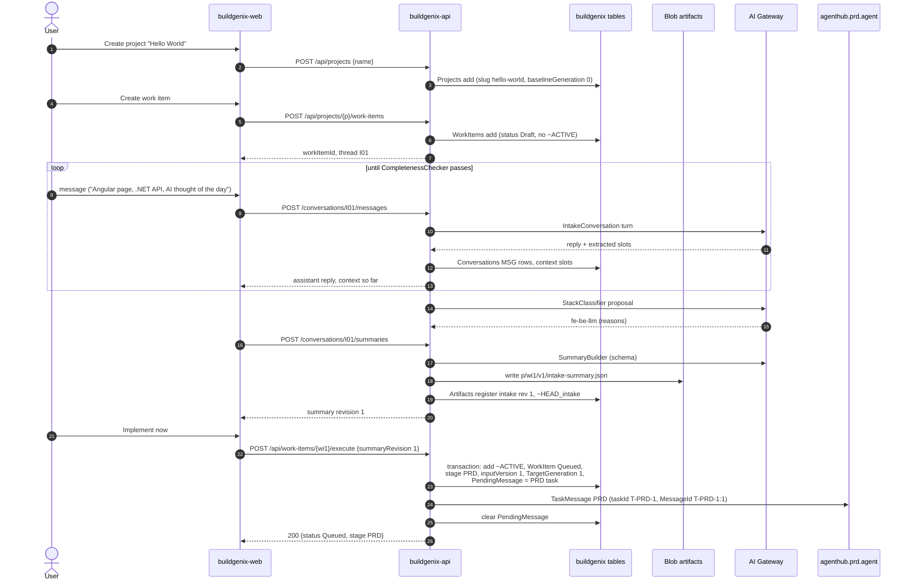

#### 10.1.2 PRD stage and gate

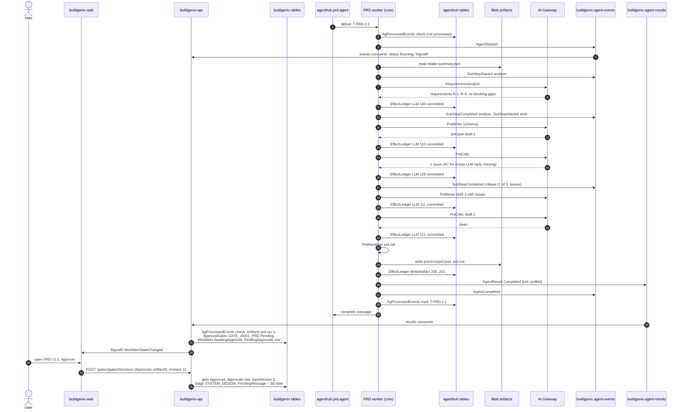

#### 10.1.3 System Design stage and gate

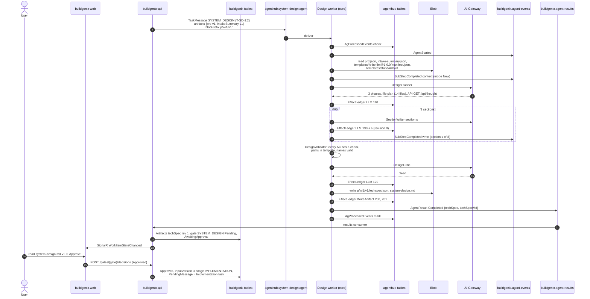

#### 10.1.4 Implementation stage (builder)

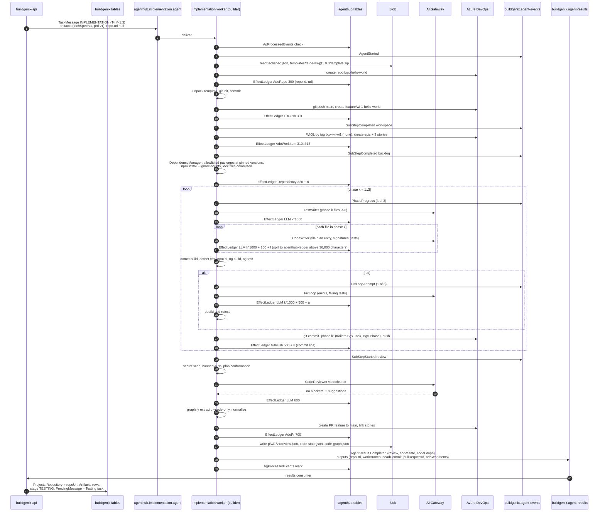

#### 10.1.5 Testing

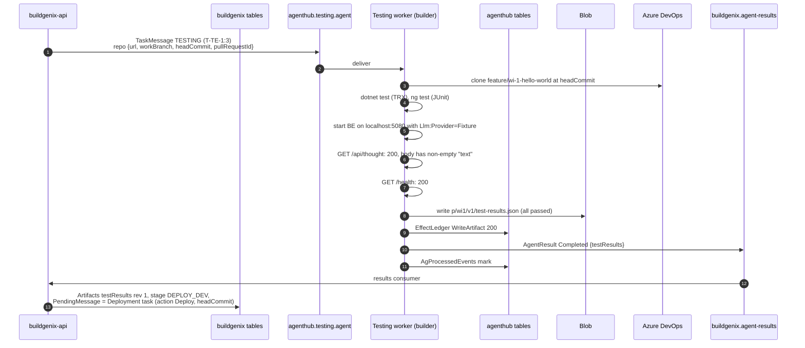

#### 10.1.6 Deployment, DEV acceptance and Finalize

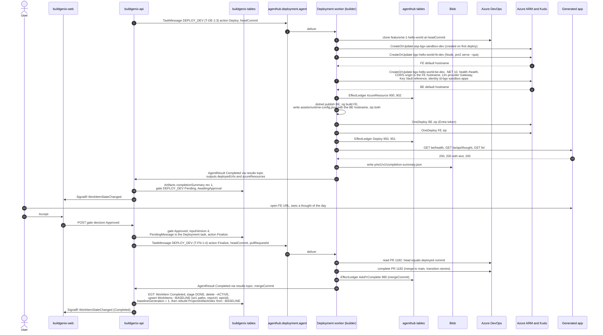

### 10.2 Example 2: Calculator that adds two numbers (new project, `fe-be`, with a reject and a test failure)

**Step by step**

1. Intake classifies `fe-be` and writes intake v1.0. Implement now.
2. The PRD agent writes PRD v1.0. The user rejects it: "inputs can be decimals; show an error for non-numeric input".
3. buildgenix-api writes `feedback-prd.json`, creates a redraft task (new `taskId`, output revision 2), and the PRD agent writes PRD v1.1 addressing both points. The user approves.
4. The Design agent writes design v1.0: `POST /api/calculator/add` with `{a, b}` as decimals, validation returning 400 with a message, an Angular form with two inputs and a result.
5. Implementation creates repo `bgx-calculator`, implements two phases, opens the PR.
6. Testing finds one acceptance check failing: `0.1 + 0.2` returns `0.30000000000000004`, the techspec expects `0.3`. It reports Completed with RouteBack.
7. buildgenix-api writes `feedback-implementation.json` with the failing check and publishes Implementation revision 2 with `loopIndex 1`. Implementation fixes the BE to use `decimal`, pushes, updates the PR.
8. Testing revision 2 is green. Deployment provisions `bgx-calculator-be-dev` and `bgx-calculator-fe-dev` and deploys the tested commit. The user accepts, Finalize merges the PR, and the baseline becomes generation 1.

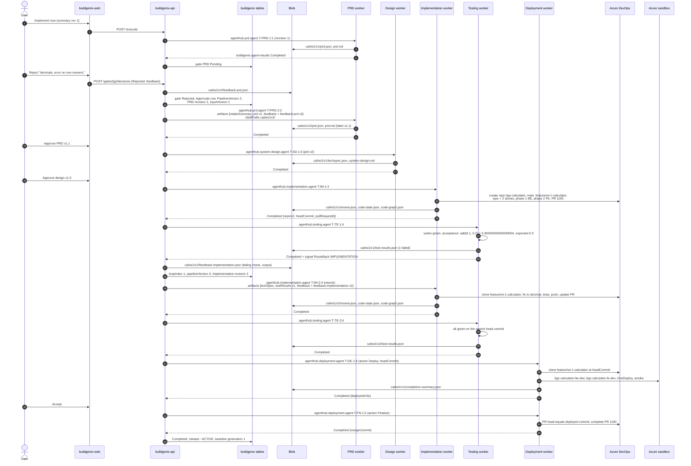

Each arrow from a worker to `API` is an AgentResult on `buildgenix.agent-results`; each arrow from `API` to a worker is a TaskMessage on that worker's `agenthub.{agent}.agent` topic. Sub-step events flow throughout exactly as in section 7 and are omitted here to keep the diagram readable.

### 10.3 Example 3: Update the calculator to subtract (existing project)

**Step by step**

1. The user creates a second work item on the Calculator project. buildgenix-api reads the project's `~BASELINE` row: generation 1, repo `bgx-calculator`, epic 52140, baseline PRD `cal/wi1/v2/prd.json`, techspec `cal/wi1/v1/techspec.json`, code-state `cal/wi1/v2/code-state.json`. Intake writes `cal/wi2/v1/intake-summary.json`, which names the existing app and the one new behaviour.
2. Implement now: `TargetGeneration = 2`, `context.projectMode = Existing`, `context.repo.url` and `context.ado.epicId` filled from the baseline, and every task carries the three `baseline*` paths.
3. The PRD agent writes PRD v2.0 at `cal/wi2/v1/prd.json`. It is cumulative: the add story and its acceptance criteria are carried forward unchanged, a subtract story is added and marked `added`, and a regression requirement says add must keep working.
4. The Design agent runs in existing mode. RepoContextBuilder finds `CalculatorController.Add`, `CalculatorService.Add`, `CalculatorComponent` and their tests in `code-state.json`. DesignPlanner produces a modify-only file plan: `CalculatorService.cs` and `CalculatorController.cs` (add `Subtract`), `calculator.component.ts` and `.html` (an operation selector), plus the two test files. The techspec carries the add acceptance checks forward and adds `POST /api/calculator/subtract {a: 5.5, b: 2}` expecting `{result: 3.5}`. DesignValidator confirms every "modify" target exists and no baseline check was dropped.
5. Implementation clones `main`, creates `feature/wi-2-subtract`, adds a story under epic 52140, writes the subtract tests first, modifies the four source files, runs every test (add and subtract), regenerates `code-state.json`, and opens PR 1203.
6. Testing runs every suite and every acceptance check in the cumulative techspec, add and subtract, on the head commit.
7. Deployment finds both apps already exist (CreateOrUpdate changes nothing), deploys the new zips, and smoke tests both operations.
8. The user accepts. Finalize merges PR 1203 into `main`, and the `~BASELINE` row moves to work item 2, generation 2.

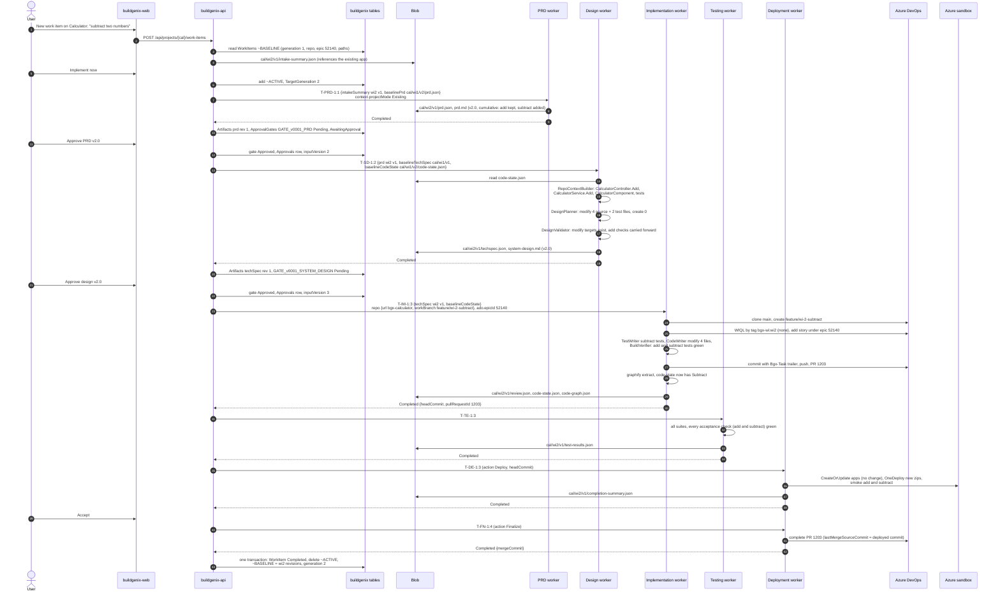

## 11. Failure and recovery sequences

### 11.1 Builder restarts in the middle of phase 2

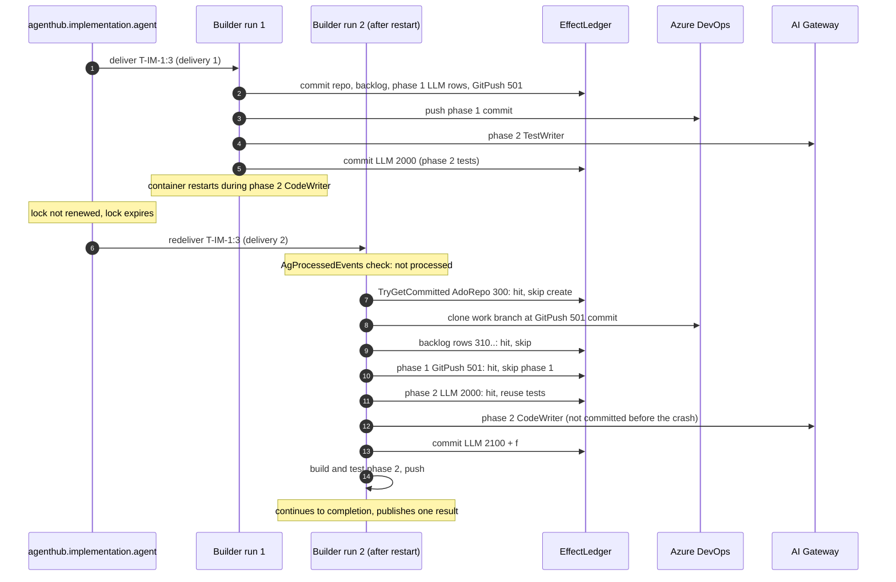

Nothing paid for twice: the repo, the backlog and every committed LLM call are replayed from the ledger. Builds are re-run because they are deterministic and cheap.

### 11.2 Agent asks a question and the user answers

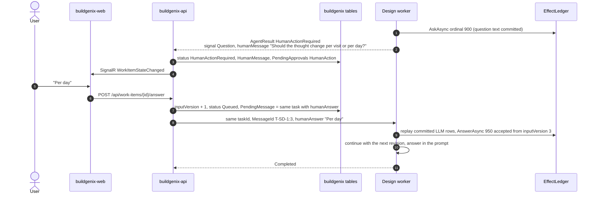

### 11.3 Other failure paths

| Case | What happens |
|---|---|
| First work item on a new project fails after the repo was created | The Failed result still carries the `outputs` gathered so far, so buildgenix-api stores the repo URL on the project. The next work item is still New (no accepted baseline): WorkspaceManager finds and reuses the repo, Provisioner's CreateOrUpdate reuses any DEV apps, and BacklogSync creates fresh stories under the new work item's tag. Stories left by the failed attempt keep their own `bgx-wi` tag, so they are easy to find; Phase 0 leaves them for the user to close, and the North Star closes them automatically when a work item fails |
| Crash on the last delivery (no Failed result could be published) | The broker dead-letters the task; the dead-letter watcher turns the work item into `HumanActionRequired` `Stuck` with the reason; the person retries or stops |
| Result or event arrives out of order, or from an old task | Ignored for state by the current-task and expected-state guards (section 3.9); recorded in Activity |
| Approve clicked twice, or against an old revision | The gate row is ETag-checked and the decision must quote the current artifact revision; a stale or repeated decision returns 409 (contracts `GateArtifactMismatch`) |
| Key Vault reference does not resolve in a generated app | Provisioner checks the reference status through ARM before deploying and fails with `ExternalService` naming the setting |
| Graphify fails or returns an empty graph | CodeStateBuilder fails the step; the agent ends Failed `BuildEnvironment` rather than publishing an empty code-state that example 3 would trust |
| PR conflict or moved head at Finalize | HumanActionRequired with the ADO `mergeStatus` |
| Handler reaches its deadline | Failed `DeadlineExceeded` |
| `PendingResenderService` sends a duplicate task | Same message id; the agent's dedup completes it as a no-op |
| Required input blob missing | Agent ends Failed `MissingInput`; buildgenix-api fails the work item and releases the lock. This only happens if storage was tampered with, so it is never retried silently |
| Malformed message or wrong topic | Dead-lettered without retry (template §7) |
| LLM provider outage | Exceptions abandon the message; Service Bus retries up to 5 deliveries; the ledger keeps completed calls; the last delivery publishes one Failed result |
| Guardrail blocks a prompt or a reply | Failed `GuardrailBlocked`, no retry, host stays up (P-GUARDRAILS-PHASE0) |
| ADO or Azure returns 403 | Failed `ExternalService` with the operation named; an identity grant is missing |
| buildgenix-api down when a result is published | The result waits on `buildgenix.agent-results`; nothing is lost |
| buildgenix-api crashes after saving state, before sending the next task | `PendingResenderService` sends `PendingMessage` after the threshold |
| Budget exhausted | HumanActionRequired `BudgetExceeded`; the user can raise the budget and retry (a new task, section 6.3) or stop |

---

## 12. Resources each agent and subagent creates

| Created by | Resource | Where | Idempotency (see the find-or-create table in section 3.6) |
|---|---|---|---|
| Intake (buildgenix) | Conversations rows (messages, attachments, slots); `intake-summary.json` | Table `Conversations`; Blob `artifacts` | Message id per turn; one file per summary revision |
| buildgenix-api | WorkItems, Artifacts, ApprovalGates, Approvals, WorkItemEvents, SgProcessedEvents; StageStatuses, ClientEvents, RunLog, WorkItemTelemetry, PendingApprovals, ProjectArtifactIndex (planned) | Tables | ETag and conditional writes; dedup by message id |
| buildgenix-api | `feedback-prd.json`, `feedback-system-design.json`, `feedback-implementation.json` | Blob | One per redraft or rework revision |
| buildgenix-api (Stop) | `control/cancelled.json` | Blob | Written once, before the work item is failed |
| buildgenix-api | TaskMessages | Task topics | MessageId `{taskId}:{inputVersion}` |
| Every agent | EffectLedger, ActivityLog, AgProcessedEvents rows; large ledger payloads | Tables; Blob `agenthub-ledger` | Write-once (D-C2) |
| Every agent | AgentResult, AgentEvents | `buildgenix.agent-results`, `buildgenix.agent-events` | Stable result id; forward-only projection |
| PRD | `prd.json`, `prd.md` | Blob | Ledger WriteArtifact |
| System Design | `techspec.json`, `system-design.md` | Blob | Ledger WriteArtifact |
| Implementation: WorkspaceManager | ADO repo `bgx-{slug}` (new projects), `main` scaffold, work branch | ADO | Ledger AdoRepo, GitPush |
| Implementation: BacklogSync | Epic and stories | ADO Boards | Tags + query before create |
| Implementation: PhaseCommitter | One commit per phase | ADO repo | Ledger GitPush with commit sha |
| Implementation: PullRequestPublisher | Pull request | ADO repo | Ledger AdoPr; update if exists |
| Implementation: CodeReviewer, CodeStateBuilder | `review.json`, `code-state.json`, `code-graph.json` | Blob | Ledger WriteArtifact |
| Deployment: Finalizer (after acceptance) | PR completion, merge commit on `main`, stories transitioned | ADO | Ledger AdoPrComplete; no-op if already completed; refuses if the PR head moved |
| Testing | `test-results.json` | Blob | Ledger WriteArtifact |
| Deployment: Provisioner | `asp-bgx-sandbox-dev` (first time), `bgx-{slug}-be-dev`, `bgx-{slug}-fe-dev`, their settings and identity attachment | `rg-bgx-sandbox-dev` | ARM CreateOrUpdate is idempotent; ledger AzureResource |
| Deployment: Deployer | Deployed BE and FE packages | Those apps | Ledger Deploy |
| Deployment: SummaryWriter | `completion-summary.json` | Blob | Ledger WriteArtifact |

---

## 13. Identity and security

`DefaultAzureCredential` everywhere, `IHttpClientFactory` everywhere, no connection strings or keys in source or committed files, no temperature parameter. Service Bus access moves from connection strings (today's code, kept by MIG-4) to `FullyQualifiedNamespace` plus managed identity in slice 2; only the local emulator keeps a connection string, from user secrets.

| Identity | Grants |
|---|---|
| buildgenix-api (system-assigned) | Storage Table Data Contributor scoped to each buildgenix table; Storage Blob Data Contributor on `artifacts`; Service Bus Data Sender on the `agenthub.*` topics, Data Receiver on `buildgenix.*` and, scoped per subscription, on the dead-letter sub-queue of each task subscription; Key Vault Secrets User on the gateway secret it needs for Intake |
| agenthub-api core (system-assigned) | Table Data Contributor scoped to EffectLedger, ActivityLog, AgProcessedEvents only; Blob Data Contributor on `artifacts` and `agenthub-ledger`; Blob Data Reader on `templates`; Service Bus Data Receiver on its own topics, Data Sender on `buildgenix.*` and on `agenthub.healthy.agent` (the HEALTHY REST endpoint publishes its task); Key Vault Secrets User on the gateway secrets it uses (secret-scoped role assignments, not the whole vault) |
| agenthub-api builder (user-assigned `id-bgx-builder`) | Everything the core identity has; AcrPull on `bgxdevacr`; an Azure DevOps user with Contributor rights in a dedicated ADO project for generated repos (open item 6), not in the whole organisation; Contributor on `rg-bgx-sandbox-dev` only; Managed Identity Operator on `id-bgx-sandbox-apps` (it can attach that identity but cannot grant roles) |
| `id-bgx-sandbox-apps` | Key Vault Secrets User on `kv-bgx-sandbox-dev` |

Table-scoped role assignments turn the ownership rule (D-CL-7) into an Azure guarantee: if agenthub code ever tried to write `WorkItems`, Azure returns 403. Because a table-scoped identity cannot create tables, every table, container, topic and subscription is created by the infrastructure script in slice 1, not at host start; hosts only check their tables with a point read of a known `_meta` row (listing tables needs account-level rights a table-scoped identity does not have). Slice 1 verifies this works with the scoped roles.

What goes to which model, all through the AI Gateway (APIM), which meters and logs it:

| Step | Data sent | Endpoint |
|---|---|---|
| Intake | The user's chat and attachments text | APIM chat |
| PRD, System Design | Intake summary, PRD, baseline documents, code-state symbol names and signatures, template manifest, standards pack | APIM chat |
| Implementation, Testing | Techspec, one file plan entry, signatures, the current content of the one file being written, compiler and test output after redaction | APIM chat |
| Deployment | The completion facts for the summary blurb | APIM chat |

The Responses API path for codex models (`ai-gateway.md` §4) goes straight to Azure OpenAI and bypasses APIM, so Phase 0 does not use it (open item 7).

Audit trail, kept for the life of the project: Blob artifacts (every document version, never overwritten), the Artifacts registry, WorkItemEvents and Approvals (every human decision with the revision shown), and ADO history (every commit, PR and work item). Diagnostic records with shorter retention (section 5.1): ActivityLog (every agent step, 90 days) and EffectLedger (every side effect with inputs and outputs, 30 days after the work item ends). Storage Blob Data Contributor includes delete; in Phase 0 that is accepted because no code path deletes blobs, and versioning plus 14-day soft delete recover any mistake. North Star replaces it with a custom role without delete and an ABAC condition limiting writes to the task's `blobPrefix`.

## 14. Phase 0 build order

Each slice needs Badru's explicit GO before coding (iteration plan). Each slice ends with PE review, automated tests, and Manual QA on actual resources (P-MANUAL-E2E-ACTUAL): locally Azurite, the Service Bus emulator and Ollama; in Azure the deployed apps with the Gateway. Before every Manual QA run a reset script deletes the test project's `bgx-{slug}` repo, its `bgx-{slug}-*-dev` apps, its table partitions and its blob prefix, so every run starts clean.

Unless a row says otherwise, exits for slices 2 to 10 are measured locally (Docker Compose, Ollama) and again in Azure (`AzureDev`, Gateway); slice 1 only in Azure; slice 11 only in Azure. Open items that block a slice: items 1 and 2 block slice 2 (the contract and topic names), item 5 blocks slice 1, item 6 blocks slice 8, items 4 and 10 block slice 10, item 7 blocks slice 6, item 9 blocks Gateway runs from slice 6 on.

| Slice | What | Done when (measured) |
|---|---|---|
| 1 | Infrastructure script (tables, containers, topics, subscriptions, identities, role assignments), builder image, ACR, builder App Service, egress and isolation proof | Every endpoint in 9.5 answers from inside the container; `npm ci --ignore-scripts`, `ng build`, `ng test`, `dotnet test` and `graphify extract . --code-only` on the `fe-be` template exit 0, with times recorded; the 9.3 isolation test shows no identity data; a scoped identity reads and writes its tables and gets 403 on a foreign one |
| 2 | Contract v2 with golden JSON tests; topic rename by configuration; shared `AgentDispatcher` extracted from HEALTHY (MIG-7); Service Bus on managed identity; per-worker concurrency; deadline; resilience | HEALTHY passes end to end on `agenthub.healthy.agent` and `buildgenix.agent-results`; each `CrashAt` point recovers with exactly one result |
| 3 | buildgenix orchestration: task publisher with PendingMessage and resender, results consumer, events consumer with the guards of 3.9, dead-letter watcher, watchdog, the new columns and `~BASELINE` row, StageStatuses, ClientEvents, RunLog, WorkItemTelemetry, PendingApprovals, SignalR (`StageProgress`, `HighLevelSummary`, `VerboseLog`, `WorkItemStateChanged`), terminal `~ACTIVE` release (MIG-6) | A HEALTHY run published from buildgenix-api changes the browser within 2 seconds of each event; a forced dead-letter shows `Stuck`; a silent run with `RunningSilenceMinutes` set to 1 shows `Stuck` within 2 minutes; an out-of-order event does not change status |
| 4 | Intake and human decisions: Conversations table and routes, the four Intake steps, summary revisions, Implement now binding, gate decisions (ETag, Approvals, PipelineVersion, feedback files), Request changes, `/answer`, retry and Stop (section 6.3) | A chat produces `intake-summary.json` revision 1; Implement now publishes `T-PRD-1:1`; Reject writes `feedback-prd.json` and publishes a redraft; an answer republishes the same `taskId` with `inputVersion + 1`; Stop writes `control/cancelled.json` and releases `~ACTIVE`, and a task republished afterwards ends `Failed` with `errorCode` `Cancelled` and performs no external effect (HEALTHY stands in for the agents) |
| 5 | Templates `fe-be` and `fe-be-llm` with manifests and dependency allowlists; standards pack v1 | Both templates build and test in the builder in slice 1's measured time or less |
| 6 | PRD agent | The three example prompts produce PRDs that pass PrdCritic on Fixture (20 of 20) and on Ollama; a scripted reject produces v1.1 that addresses every feedback point |
| 7 | System Design agent | Examples 1 to 3 write `techspec.json` and `system-design.md` that pass the DesignValidator row in section 8.2; example 3 is modify-only and the add checks are still present |
| 8 | Implementation agent | Example 2 on Fixture produces a green branch and a PR; `CrashAt mid-phase:2` resumes without a second repo, epic, story or PR; a `Fixture:Signal LoopLimit` in phase 2 followed by a retry runs in `Continue` mode, keeps the phase 1 commit and builds phases 2 and 3 |
| 9 | Testing agent | Example 2's scripted float bug routes back once and passes on revision 2 |
| 10 | Deployment agent with Finalize | Example 2 live in DEV; smoke passes; Accept merges with `noFastForward`; `~BASELINE` moves in one transaction |
| 11 | Full runs | Examples 1, 2 and 3 end to end in Azure on the Gateway, with Manual QA evidence for every row of sections 6.3 and 11.3 |

## 15. Risks and mitigations

| Risk | Mitigation |
|---|---|
| Builder cannot reach package feeds from Azure | Slice 1 proves egress first; fallback is an Azure Artifacts feed with upstream sources |
| Generated code reaches platform resources | Environment allowlist, one sandbox user per builder agent, git as its own user, least-privilege builder identity, isolation test in slice 1 (section 9.3); North Star per-run job without platform identity |
| Implementation run exceeds its lock | Handler deadline below the 4-hour cap; phases are small for Phase 0 apps; North Star splits phases into separate jobs |
| Ledger row too large for Table Storage | Spill above 30,000 characters to `agenthub-ledger` blob with hash |
| Graphify output format changes | Version pinned in the image; CodeStateBuilder normalises into our schema, so a change touches one class |
| LLM writes code that fails repeatedly | Fix loops capped; LoopLimit asks the human with the failing output attached |
| Token spend runs away | Per-stage caps and work item budget passed on every task; BudgetExceeded stops the run |
| One instance of each host | Acceptable for three examples; topics buffer work. Scaling out later needs specific code changes, not a redesign: leader election for the resender and watchdog, the per-work-item `~SEQ` counter for ClientEvents kept as one counter with ETag retry (contention is per work item, and reload relies on a gap-free sequence, so it must not be sharded), Azure SignalR Service, and lifting D-7 for more than one active work item per project |
| Code reaches `main` without a human reading the diff | Follows from Badru's answers of 2026-10-07 (code review as a subagent of Implementation; human approval only at PRD, design and after DEV deployment). Consequence: LLM-written code, including any package it adds, runs in DEV and can use the sandbox LLM key before any person has read it. Compensating controls: CodeReviewer's deterministic checks block and cannot be overridden by the LLM; packages only from the allowlist; the merge happens only after a human accepted the running app, and only for the exact commit that was tested and deployed; the acceptance screen links the PR diff and says "Accept merges code that no person has reviewed". Open item 11 asks Badru to confirm this wording. North Star adds a separate review agent and an human code-review floor for ladders beyond DEV |

---

## 16. Open items and decision changes

### 16.1 Open items (for Badru; not assumed)

1. Confirm the inbound topic names `buildgenix.agent-results` and `buildgenix.agent-events`. Blocks slice 2.
2. Confirm results travel on a topic rather than a REST call (section 3.2). Blocks slice 2.
3. Confirm "DEV" and the prompt's "Sandbox" are the same pre-created resource group, and its name.
4. Which key the generated "thought of the day" app uses for LLM calls in DEV, and who approves it.
5. Package egress from the builder (public feeds or an Azure Artifacts upstream feed).
6. An ADO organisation admin adds `id-bgx-builder` as a user, with Contributor rights only in a dedicated ADO project for generated repos (name to confirm). Fallback: a PAT in Key Vault scoped to Code and Work Items read and write, 90-day expiry, a named owner and a rotation reminder.
7. Model per agent. Recommendation: `opus` for PRD and System Design, `5.4` for code writing, review and failure analysis, all through APIM chat; Ollama locally. The codex models need the Responses API, which bypasses APIM; using them waits for a governance decision.
8. Owner of the standards pack content.
9. AI Gateway Consumer ID (OPEN-I2-6).
10. The corporate IP ranges for the access restrictions on generated DEV apps.
11. Confirm in these words: "In Phase 0, code written by the Build agent is merged to main after automated review, tests and a human's acceptance of the running app, without a person reading the diff."
12. ACR and Key Vault names are global; `bgxdevacr` and `kv-bgx-sandbox-dev` need an availability check when slice 1 creates them. With dummy auth (D-CL-9) approvals cannot be attributed to a person; SSO is the fix and is outside Phase 0.
13. Who may open the BuildGenix screen in Phase 0 (with dummy auth anyone who can reach it can approve). Recommendation: buildgenix-web and buildgenix-api restricted to the corporate network and a named pilot group until SSO.
14. What users may type into Intake: the screen tells users not to paste personal data or secrets, the secret scan blocks secret shapes, but a data-classification rule for what may go to the models needs an owner (the old dump's docket item D4).

### 16.2 Decision-log changes this design introduces

| Change | From | To | Source |
|---|---|---|---|
| agenthub-api deployments | One deployment (D-AS-1) | Core (zip) + builder (container) from the same code | Badru 2026-10-07 answers 1 and 9 |
| Container exception | No container registry (D-CL-2) | Allowed for the builder deployment only | Same |
| Topic names | `sdlc-tasks-*`, `sdlc-results`, `sdlc-events` (D-AS-5) | `agenthub.{agent}.agent`; `buildgenix.agent-results`, `buildgenix.agent-events` (open item 1) | Answer 5 |
| Code review | Separate CODE_REVIEW stage (D-AS-7) | CodeReviewer subagent inside Implementation for Phase 0 | Answer 6 |
| Human gates | PRD, SD, CODE_REVIEW, TESTING (D-AS-7, D-5) | PRD, SYSTEM_DESIGN, DEV acceptance | Answer 7 |
| Graphify | Parked (D-CL-10) | Used inside the builder for `code-state.json` only | Answer 8, verified 2026-10-07 |
| Deploy in Phase 0 | Placeholder (agent-model §5) | Real deploy to the DEV sandbox via the Azure SDK | Answer 10 |
| `v{n}` meaning | InputVersion or pipeline attempt (D-C3) | Output revision of the writing stage; generation per project | Answers 3 and 4 |
| Reject at a gate | Interim Failed (schema) | Redraft with feedback, max 3 | Prompt; Answer 7 |
| When code reaches `main` | Not stated | Merge only after DEV acceptance, by the Deployment agent's Finalize action, for the deployed commit | Design review 2026-10-07 |
| Filename catalog | D-C3 catalog with `techspec.md` | Adds `prd.md`, `code-graph.json`, `feedback-{stage}.json`; `system-design.md` replaces `techspec.md` | This design |
| HEALTHY topic | `sdlc-tasks-healthy`, `sdlc-results` (D-I2-2) | `agenthub.healthy.agent`, `buildgenix.agent-results` | Answer 5 |
| StateContextId | ProjectId/WorkItemId/InputVersion composite (D-I2-4 text) | `{projectId}:{workItemId}`, as the HEALTHY code already does | Code at `e8d5b0a` |
| EventId | `{TaskId}:{Sequence}` (agent-model §3) | `{taskId}:{inputVersion}:{deliveryCount}:{seq}` | This design |
| Worker concurrency | `Workers:MaxConcurrentRuns = 1` (agent-model §9) | `MaxConcurrentCalls = 1` per worker, no global gate | Design review 2026-10-07 |
| Baseline location | `ProjectArtifactIndex` (planned) | `~BASELINE` reserved row in `WorkItems` | Design review 2026-10-07 |
| Existing-project documents | Not stated | Cumulative PRD and techspec | Design review 2026-10-07 |
| Stop | OPEN in contracts | Allowed when no agent is running; writes a cancel marker that agents check before acting; Failed, lock released | This design |
| Implementation modes | Not stated | `Build`, `Continue` (retry after a limit), `Rework` (route-back, change request) | Design review 2026-10-07 |
| Generated repos | `AI-Operations` project | A dedicated ADO project (open item 6) | Design review 2026-10-07 |
| API catalog additions | | SignalR `StageProgress`; Stop semantics; retry after a limit; Request changes on the acceptance gate | Contracts doc to update |
| Agent data access | Message or REST (D-CL-7) | Message + blobs only in Phase 0; read-only REST later; table-scoped RBAC | Answer 11 |
