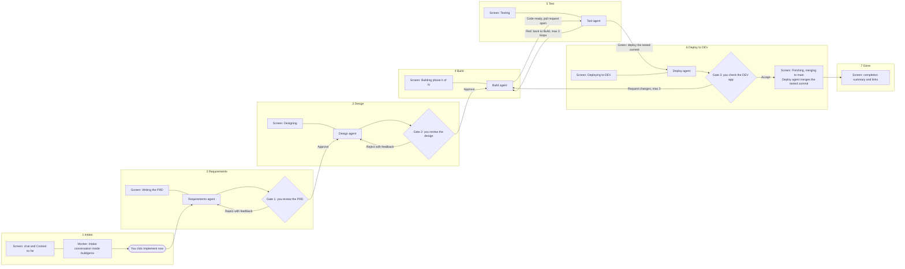
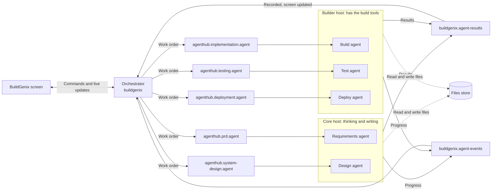
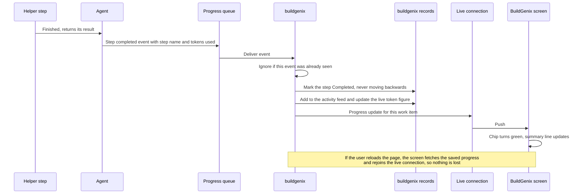
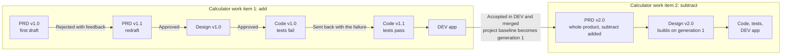
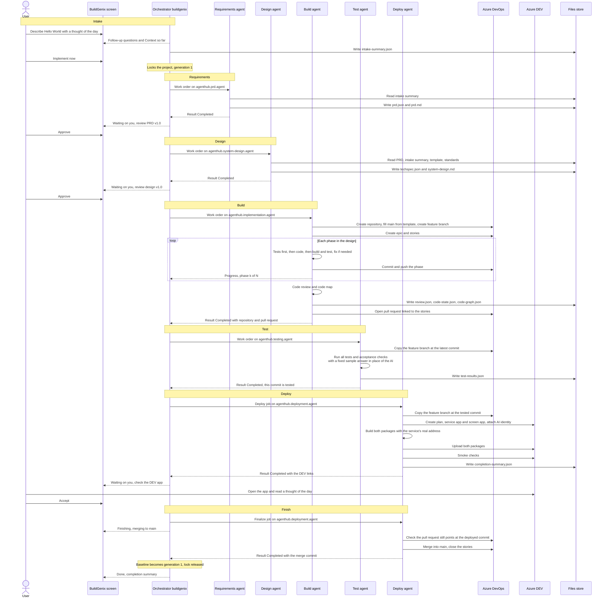
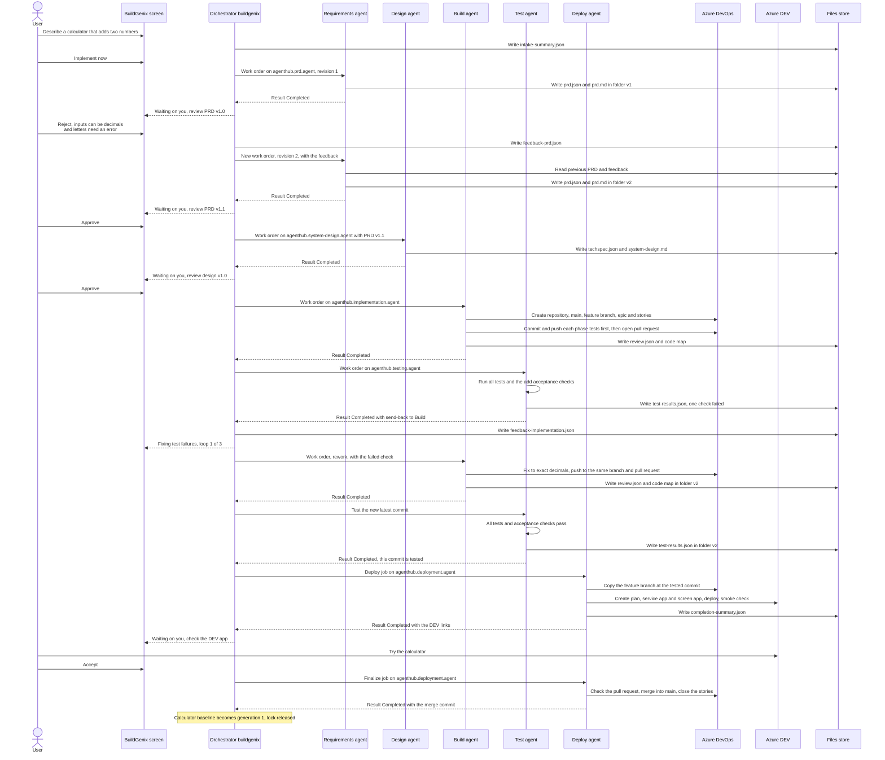
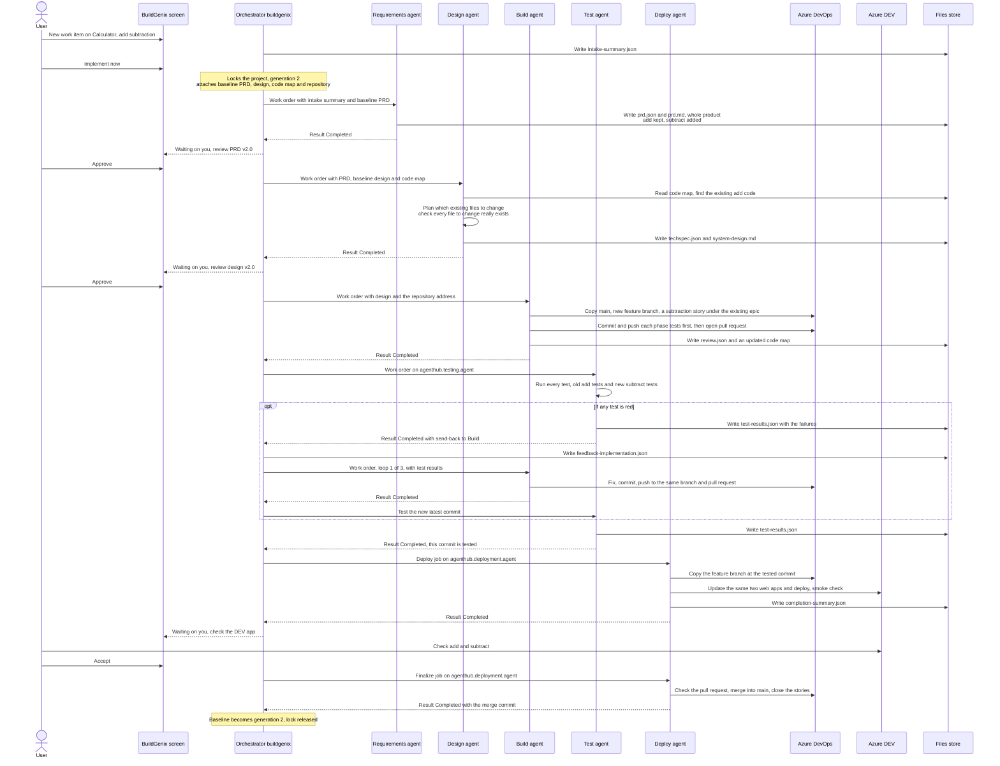

# BuildGenix: how the AI delivery pipeline works

**Document type:** Leadership overview
**Audience:** Directors, VPs, heads of architecture and engineering
**Design owner:** Badru Siddique
**Date:** 2026-10-07
**Status:** FINAL-CONDITIONAL. Describes Phase 0 as designed; the pipeline agents are not built yet. Leadership still needs to accept the Phase 0 trade-offs and decide the open items in "What we need from you" and section 13.8. Not implementation GO.
**Source of truth:** the BuildGenix Phase 0 Implementation Guide (`docs/architecture/phase-0-implementation-guide.md`) for what Phase 0 builds, and the North Star System Design (`docs/architecture/north-star-system-design.md`) for what comes later. Both follow the design spec of 2026-10-07. This overview translates them into plain language; where it and those documents differ, they win.

> **What exists today.** A working test agent (the "HEALTHY" harness) that proves messages flow end to end, the messaging setup on Azure Service Bus, the first set of record tables in Azure Table Storage (work items, approvals and the agents' own logs), and the starting code for the two back-end services. The tables behind the progress screen, and the new fields this design adds, are still to be built (step 3 of section 14). Another team has the screens running on sample data. None of the five pipeline agents described below exists in code yet. This document is the plan they will be built to.

---

## In one page

BuildGenix takes a feature request written in a chat and carries it through requirements, design, code, tests and deployment to a running app in a DEV sandbox, using AI agents for the work and people for the decisions. A person approves the requirements, approves the design, and tries the running app before anything is merged into the main code line.

Phase 0 proves this end to end on three small examples: a Hello World app with an AI-written thought of the day, a calculator that adds (with a rejected requirements draft and a failing test that is sent back and fixed), and an update that makes it subtract. Today a test agent, the messaging and the first record tables exist; none of the five pipeline agents is built yet.

The main risks we are asking you to accept for Phase 0 are these. Code merges without a person reading it. Approvals cannot yet be tied to a named person, because sign-in is a placeholder. The build machine runs AI-written code on the same machine and network as a powerful identity, with controls that keep that code away from the identity's credentials but not off the network (section 13).

Costs have not been measured, and this document does not estimate them; section 13.7 lists what will cost money, and the first full runs will give real figures. Phase 0 is finished when the three examples are accepted in DEV and every stop and failure path has evidence (section 14). The decisions and actions we need are listed next.

## Table of contents

- [In one page](#in-one-page)
- [What we need from you](#what-we-need-from-you)
1. [What BuildGenix does](#1-what-buildgenix-does)
2. [The pipeline at a glance](#2-the-pipeline-at-a-glance)
3. [What the user sees at each stage](#3-what-the-user-sees-at-each-stage)
4. [How the agents talk to each other](#4-how-the-agents-talk-to-each-other)
5. [Each agent and its helpers](#5-each-agent-and-its-helpers)
6. [How progress reaches the screen](#6-how-progress-reaches-the-screen)
7. [What each agent creates](#7-what-each-agent-creates)
8. [Versions per project and work item](#8-versions-per-project-and-work-item)
9. [Three Phase 0 examples, step by step](#9-three-phase-0-examples-step-by-step)
10. [Phase 0 now, and what comes later](#10-phase-0-now-and-what-comes-later)
11. [Deploying only to the DEV sandbox](#11-deploying-only-to-the-dev-sandbox)
12. [Key decisions in plain English](#12-key-decisions-in-plain-english)
13. [Risks and governance](#13-risks-and-governance)
14. [What happens next](#14-what-happens-next)

## What we need from you

**To accept for Phase 0** (leadership):

1. Code written by the AI is merged to main after automated review, tests and a person's acceptance of the running app, with no person reading the code (section 13.6).
2. Sign-in is a placeholder in Phase 0, so approvals cannot be tied to a named person, and the person who asked for a change can also approve it (section 13.3).
3. The build machine needs a container registry, an exception to the earlier rule not to use one, limited to this one machine (section 12).

**To decide** (leadership, with security where noted):

4. Who may open the BuildGenix screen in Phase 0, since anyone who can open it can approve, accept and raise a budget. The design recommends the corporate network and a named pilot group until real sign-in arrives (security). With it, who may raise a work item's token budget (section 13.2).
5. What users may type or attach in the intake chat, since it is sent to the AI model and kept with the documents (security; section 13.5).
6. How long approvals and work item history are kept once a project is closed, and what closing a project means (section 13.3).
7. Who owns the content of the platform standards pack, who receives the Phase 0 alerts, and who removes old DEV apps and leftover backlog items (sections 11 and 13.6).

**To ask of other teams**, with the step in section 14 that each one blocks:

8. Platform team: package downloads from the build machine (step 1) and the sandbox resource group and its name (step 1).
9. AI Gateway team: the consumer ID for live AI runs (every AI run in Azure, from the first agent on) and the key the generated apps use (before the Deploy agent).
10. Azure DevOps organisation administrator: add the build machine's identity to a dedicated project for generated code (before the Build agent).
11. Network team: the corporate address ranges allowed to open the DEV apps (before the Deploy agent).

Badru's own confirmations (section 13.8, items 1, 2, 7 and 11) do not need anything from you. The full list, with owners, is in section 13.8.

### Words used in this document

| Word | Meaning here |
|---|---|
| Work item | One request to build or change something, for example "add a subtract button". A project holds many work items over time |
| PRD | Product requirements document: what the feature must do and how we will know it works |
| Agent | A program that does one stage of delivery, using an AI model for the thinking parts and ordinary code for everything else |
| Helper step (subagent) | One focused step inside an agent, such as "write the tests" or "check the design against the PRD" |
| Orchestrator | buildgenix, the service that runs the pipeline: it hands each agent a work order (task message), keeps the records and drives the screen |
| Files store | Azure Blob Storage, where every document the pipeline writes is kept, with a new file for each version |
| Azure DevOps | The organisation's existing tool for code repositories, pull requests and work tracking |
| Commit | One saved change to the code |
| Branch | A separate line of work in the repository, merged into main when finished |
| Head commit | The latest commit on a branch |
| Pull request | A proposed change to the main code line, checked and then merged |
| Acceptance check | An automatic test, written into the design, that calls the service and checks its answer |
| Smoke check | A quick check after deployment that the app is up and answers |
| Hosting plan | The Azure capacity that web apps run on |
| Resource group | A named container for Azure resources |
| DEV | The development environment, where new work is tried out. In Phase 0 it is one sandbox set aside for BuildGenix, and nothing in this document goes beyond it |
| Tokens | The units of text an AI model reads and writes. AI usage is measured and paid for in tokens |
| AI Gateway | The organisation's single governed entry point to AI models, which meters and logs every call |

## 1. What BuildGenix does

**Why we are building it.** A small change today waits on requirement write-ups, design documents, ticket grooming, test writing and environment requests, and most of that effort is coordination rather than engineering. What we know about how an application is built lives in people and scattered documents, so every change starts by rediscovering it. Coding assistants speed up the typing, which was never the slow part. BuildGenix aims at the handoffs: one governed pipeline from request to running app, with people deciding at the points that matter and a full record of what was done. We have not measured how much time this saves. Phase 0 is meant to show that the chain works end to end, not to measure savings.

**What it does.** A developer or product owner opens BuildGenix and describes a feature in an ordinary chat, the way they would brief a colleague. BuildGenix asks the questions a good analyst would ask until the request is complete, then, when the person clicks **Implement now**, it takes the work from there. It writes the product requirements, designs the solution, creates the code repository and the backlog in Azure DevOps, writes tests first and then the code, builds and tests it, and deploys a working application to an Azure DEV sandbox. People stay in charge of the three decisions that matter: they approve the requirements, they approve the design, and they try the running application in DEV and either accept it or send it back. Only after they accept is the code merged into the main code line. Everything in between runs on its own, within fixed limits, and every step is recorded so anyone can see later what was done, by which agent, and from which inputs.

## 2. The pipeline at a glance

A work item moves through seven steps. The first, intake, runs inside buildgenix itself. Five agents do the rest. The diamonds are the three gates, where the work stops until a person decides.



Each box shows what the screen says and which worker is busy at that moment. Build and Test move on by themselves. The three gates are the only planned stops; an agent can also stop to ask a question or when it reaches a limit (section 3.3). This document uses plain names for the agents; the names used in the design spec are in brackets.

| Agent | Name in the design | What it does |
|---|---|---|
| The Requirements agent | [PRD agent] | Turns the intake summary into a PRD with stories, acceptance criteria and a test plan, and checks that every requirement is covered |
| The Design agent | [System Design agent] | Designs the solution from the PRD and the organisation's standards: components, the files to create or change, tests, the backlog and the DEV resources |
| The Build agent | [Implementation agent] | Sets up the code repository and the backlog, writes tests first and then code, phase by phase, reviews and maps the code, and opens a pull request |
| The Test agent | [Testing agent] | Runs every test and the acceptance checks on the latest commit, sends the work back on red, does not merge |
| The Deploy agent | [Deployment agent] | Creates or updates the Azure resources in the DEV sandbox, deploys the tested commit, checks the app is alive, and after you accept, merges it into main |

## 3. What the user sees at each stage

### 3.1 The journey in words

Work starts in a chat. The user describes what they want, and beside the chat a **Context so far** panel fills in as BuildGenix understands the goal, the users, the expected behaviour, how success will be judged and the kind of application needed (a screen only, a screen with a service, one with a database, or one that calls an AI model). BuildGenix keeps asking until those points are complete. The user can save a draft and come back later. Phase 0 has starting templates for two of these kinds only: a screen with a service, and a screen with a service that calls an AI model. For the other two, intake tells the user plainly that the kind is not supported yet and does not offer Implement now.

Clicking **Implement now** fixes that summary as the input to the pipeline and takes a lock on the project, so no second work item can enter the pipeline for the same project until this one ends.

From then on the screen shows the current stage with a row of small **progress chips**, one per helper step, which turn green as each finishes. A one-line summary says what is happening in words, and a detailed log can be opened for anyone who wants to look under the hood. The user mostly watches. The screen changes to **"Waiting on you"** three times: to review the PRD, to review the design, and to check the running app in DEV. At each of these the user approves or rejects with written feedback. A rejection sends the work back to the same agent with that feedback, and the agent produces a new version. If an agent needs an answer, the screen shows **"Question for you"** and waits; section 3.3 explains every kind of stop and the way forward from each. After the user accepts the DEV app, the screen shows **"Finishing: merging to main"** while the tested code is merged. This is a short job, but it waits in line if the Deploy agent is busy with another project. Then the screen shows a completion summary with the links to the running application, and the user can start the next work item on the same project.

### 3.2 Stage by stage

| Stage | The screen says | The user can | Working behind the screen |
|---|---|---|---|
| Intake | Chat and "Context so far" | Chat, attach files, save a draft, click Implement now | buildgenix's intake helpers: the conversation, the stack classifier, the completeness check, the summary writer |
| Requirements | "Writing the PRD" | Watch | Requirements agent: analyse, write, critique, render, publish |
| PRD gate | "Waiting on you: review the PRD" | Approve, reject with feedback, or Stop | Nothing |
| PRD redraft | "Redrafting the PRD (revision n)" | Watch | Requirements agent, with your feedback |
| Design | "Designing" | Watch | Design agent and its helpers |
| Design gate | "Waiting on you: review the design" | Approve, reject with feedback, or Stop | Nothing |
| Design redraft | "Redrafting the design (revision n)" | Watch | Design agent, with your feedback |
| Build | "Building: phase k of N" | Watch | Build agent and its helpers |
| Test | "Testing" | Watch | Test agent: copy the latest commit, run the test suites, run the acceptance checks, analyse any failures, publish the results |
| Fixing | "Fixing test failures (loop L of 3)" | Watch | Build agent, with the test results |
| Retry after a limit | "Continuing the build with your guidance" | Watch | Build agent, with your guidance |
| Deploy | "Deploying to DEV" | Watch | Deploy agent: workspace, provision, package, deploy, smoke check, summary |
| DEV gate | "Waiting on you: check the DEV app" | Accept, Request changes, or Stop | Nothing |
| Change request | "Applying your requested changes (round R of 3)" | Watch | Build agent, with your note, on the same branch and pull request |
| Finishing | "Finishing: merging to main" | Watch | Deploy agent, Finalize job: checks the pull request still points at the tested and deployed commit, merges it into main, closes the linked backlog items |
| Merge conflict | "Resolving a merge conflict" | Watch | Build agent, bringing the latest main into the branch and re-running every test |
| Any stage | "Question for you" | Answer | Nothing |
| Any stage | "Stopped: limit reached" | The choices in section 3.3 | Nothing |
| Any stage | "Waiting for capacity" | Watch | Nothing yet; the work order is queued behind other work |
| Any stage | "Stuck" | Retry, or Stop | Nothing; the watchdog or the dead-letter watcher flagged it (section 3.3) |
| Done | Completion summary and links | Open the app, start the next work item | Nothing |
| Any stage | The reason it failed | Read the reason, start a new work item | Nothing |

Behind the screen, each work item carries a simple status: Draft, Queued, Running, AwaitingApproval, HumanActionRequired, Completed or Failed. The project lock is taken at Implement now and released when the work item is Completed (after the merge) or Failed.

### 3.3 When the work stops, and how it moves on

Each kind of stop has a defined way forward, so a work item is not left locked with nothing to press.

| Why it stopped | What the user can do | What happens next |
|---|---|---|
| An agent asked a question (at most 3 per run) | Answer | The agent takes its defined next step with the answer, and is granted one extra attempt to use it |
| An agent reached one of its own limits, or the token budget | Give guidance and retry; raise the budget and retry; or Stop | A fresh attempt at the same stage starts from the latest documents plus the guidance. For the Build agent it continues where it stopped: finished phases are kept, the phase that hit the limit restarts with the guidance, then the remaining phases are built. A budget can be raised by at most half per retry, to at most twice the configured budget, and each raise is recorded |
| 3 rejections at a gate, 3 Request changes at the DEV gate, or 3 test send-backs | Allow one more loop, up to a hard cap of 5; or Stop | The work goes round once more; at 5 only Stop remains |
| "Stuck": a run went quiet, or its last delivery crashed before it could report | Retry, or Stop | The run picks up again. AI calls and outside actions that were already recorded are not repeated; builds and tests run again, because they are cheap and give the same answer |

Every point where an agent can ask has a defined next step after the answer. Two matter most to a leader:

- **The smoke check.** If the DEV app still fails its checks after 5 minutes, the Deploy agent stops with the logs and asks whether to check again, deploy again, or stop.
- **The final merge.** It does not report success without actually merging. If the branch moved after it was tested, the answer "re-test" sends it back to testing, then to deployment and acceptance again. If it cannot merge cleanly into main, the answer "resolve" sends it to the Build agent, which brings the latest main into the branch, runs every test again and pushes; testing, deployment and acceptance then follow again. The other choice is Stop.

**A job that stops reporting is flagged on screen.** A running job sends a **heartbeat** (a short "still working" signal) every minute, and a **watchdog** marks a job that has been silent for 15 minutes as Stuck. A job that has not started yet shows "waiting for capacity" after 6 hours and is marked Stuck only after 12, so a queue is not mistaken for a failure; Stop is not offered while it may still start. A **dead-letter watcher** catches a work order whose last delivery crashed before it could report. Either one marks the work item "Stuck" with the reason, so a person can retry or stop. Phase 0 also has a minimum set of alerts for operations (section 13.6).

**Stop** is available whenever no agent is running: while the work waits on a person or is marked Stuck. It ends the work item as Failed ("Stopped by user") and frees the project for the next work item. Stopping is final: buildgenix first leaves a "cancelled" marker for the work item, and every agent checks it before it pushes code, deploys or merges, so a late or still-queued copy of the job cannot act afterwards. A running agent cannot be stopped in Phase 0. It has to finish, ask a question, or reach a limit first, and for the Build agent that can take up to its 4 hour limit.

## 4. How the agents talk to each other

*Sections 4 to 8 explain how it works, for readers who want the detail. The examples in section 9 and the risks in section 13 can be read without them.*

Agents do not call each other. buildgenix sends each agent a **work order** (the design calls it a task message) on that agent's own **topic**, a named mailbox on Azure Service Bus, Microsoft's managed messaging service. Every topic is named after the one who receives from it, for example `agenthub.prd.agent`. Agents send their answers back on two topics named after buildgenix: one for results and one for progress.

All five agents are background workers in one codebase, agenthub, which is deployed twice. The **core host** runs the Requirements and Design agents, which only think and write. The **builder host** runs the Build, Test and Deploy agents. It is the same code packaged in a container image (a ready-made machine with tools installed) that adds the .NET build kit, Node and Angular tools, git, the Azure command-line tools and Graphify, the code-mapping tool. Each agent works on one job at a time, and agents on the same host can work side by side.



**Only buildgenix knows the order of stages.** An agent receives one work order, does its stage, and returns one result. buildgenix records it, updates the screen, and decides what comes next.

**Agents share files, not conversations.** Everything an agent needs is in the work order: identifiers, a small block of facts about the project, and the addresses of the documents to read in the files store. buildgenix names the latest version of each input, so an agent does not have to search. Code is shared through the Azure DevOps repository.

**Results come back on a queue rather than as a direct call.** buildgenix runs as a single copy. If it is restarting at the moment an agent finishes, a direct call would fail and finished work could be lost; a queue holds the result safely until buildgenix is back. The message is the same either way, so a direct call stays available as a fallback. Badru still has to confirm this choice and the two topic names (section 13.8, items 1 and 2). Neither needs a leadership decision.

**A repeated delivery is harmless.** If a host restarts in the middle of a job, Service Bus delivers the work order again, up to 5 times. The agent does not redo finished work: every AI call, file write and outside action is recorded once in its **action ledger**, and a repeat reuses the recorded answer. A crash can happen just after an outside action and before it is recorded, so every outside action also checks first whether it already happened. For example, it looks the repository up by name before creating one, and the stories by their tag. buildgenix likewise ignores any result or progress event it has already seen.

If every delivery fails, the last attempt reports the work item as Failed with the reason, and the project is freed for a new work item. Only if that last attempt crashes before it can report does the dead-letter watcher mark the work item Stuck, so a person can retry or stop. Short outages do not use up attempts this way: each step first retries its own calls for up to 10 minutes.

### 4.1 A work order, simplified

This is the shape of a work order asking the Design agent to design Hello World.

```json
{
  "workItemId": "01JC8W4M...",
  "projectId": "01JC8W2F...",
  "stage": "SYSTEM_DESIGN",
  "taskId": "01JC9A0B...",
  "outputRevision": 1,
  "blobPrefix": "{project}/{work item}/v1/",
  "artifacts": {
    "intakeSummary": ".../v1/intake-summary.json",
    "prd": ".../v1/prd.json"
  },
  "context": {
    "projectName": "Hello World", "projectMode": "New",
    "baselineGeneration": 0, "targetGeneration": 1, "stackProfile": "fe-be-llm",
    "repo": { "url": null, "workBranch": "feature/wi-1-hello-world" }
  }
}
```

In words: design work item 1 of the project, write the output into the `v1` folder, read the intake summary and the approved PRD at these addresses, and note that this is a new project with no code yet (so no repository address), built as a screen, a service and an AI call.

### 4.2 A result, simplified

```json
{
  "workItemId": "01JC8W4M...",
  "taskId": "01JC9A0B...",
  "stage": "SYSTEM_DESIGN",
  "status": "Completed",
  "artifacts": {
    "techSpec": ".../v1/techspec.json",
    "techSpecMd": ".../v1/system-design.md"
  },
  "signal": null,
  "tokenUsage": { "input": 61234, "output": 18877 }
}
```

`status` is one of three answers: **Completed**, **HumanActionRequired** (with a `signal` saying why: a question, a limit reached, or the token budget used up) or **Failed** (with a reason). `artifacts` names the files written. `tokenUsage` records what the AI work cost in tokens; the figures above are illustrative, not a measurement. For later stages the result also carries facts that are not files, such as the repository address, the pull request, the merge commit and the deployed URLs.

A red test run is not a failure of the Test agent. It reports Completed with a send-back signal and the test results, and buildgenix decides whether to send the work back to the Build agent or to stop and ask a person.

### 4.3 Where the state lives

Each part of the system keeps what it needs in a place that survives a restart.

| Between | Carried by | Kept in |
|---|---|---|
| The screen and buildgenix | Commands from the screen, live updates back | buildgenix's tables |
| buildgenix and an agent | The work order | The queue until the job is done, plus a copy on the work item until it is sent |
| One agent and the next | Documents, registered by buildgenix and passed by address | The files store |
| One work item and the next on a project | The baseline: the accepted PRD, design, code map, repository, epic and generation | One baseline record per project |
| An agent and its helpers | Ordinary calls inside the agent, with each AI call and outside action recorded | The action ledger |
| Generated code | The work branch, pushed after every phase | Azure DevOps |

Nothing that matters lives only in memory. If any host restarts, the work order comes back, the ledger replays what was done, git holds the code, and the run continues.

## 5. Each agent and its helpers

Every agent is built the same way. Shared code loads the inputs named in the work order, applies safety checks to what goes into and comes out of the AI model, records each AI step in the action ledger, scans every file for secrets before writing it, reports each helper step to the screen, and lets the agent stop and ask a question. Within each step, the AI returns a structured answer that ordinary code then checks; the AI is not given tools to roam freely.

### 5.1 The Requirements agent

**Reads:** the intake summary; for an existing project, the accepted PRD; on a redraft, the previous PRD and the user's feedback.

- **RequirementsAnalyst:** turns the intake requirements into a numbered list, and flags conflicts and gaps. A gap that blocks the work becomes a question for the user.
- **PrdWriter:** writes the PRD: summary, requirements, epics, stories, tasks, estimates, acceptance criteria, a test plan and what to automate. For an existing project it describes the whole product as it will be after this change, carrying every earlier requirement forward and marking what is added or changed.
- **PrdCritic:** checks that every intake requirement maps to a story and that every story can be tested. Problems go back to the writer, up to 3 drafts.
- **PrdRenderer:** turns the PRD into a readable document.

**Produces:** `prd.json` and `prd.md`. **A human is pulled in:** at the PRD gate, and if the draft limit is reached or a question comes up.

### 5.2 The Design agent

**Reads:** the PRD, the intake summary, the template for the chosen kind of application, and the platform standards pack; for an existing project, the accepted design and the code map. Like the PRD, the design of an existing project describes the whole product, while its file plan lists only the files this change touches.

- **ModeDetector and TemplateResolver:** decide whether this is a new or an existing project and load the template's layout.
- **RepoContextBuilder (existing projects only):** picks out the parts of the code map that the new stories touch.
- **DesignPlanner:** plans the components, the phases of work, the files to create or change, and the service contracts.
- **SectionWriter:** writes each section of the design, including the test plan, acceptance checks the Test agent can run, the backlog, the DEV resources and how to run the app.
- **DesignValidator:** checks that every acceptance criterion has a test, every story has files, every file to change really exists, nothing new collides with existing code, no earlier acceptance check is dropped unless it is deliberately retired, and names follow the convention.
- **DesignCritic:** compares the design with the PRD and the standards. Problems go back for revision, up to 3 times.
- **DesignRenderer:** turns the design into a readable document.

**Produces:** `techspec.json` and `system-design.md`. **A human is pulled in:** at the design gate, and if the revision limit is reached or a question comes up.

### 5.3 The Build agent

**Reads:** the design and the PRD; for an existing project, the code map; on a send-back or Request changes, the feedback and the test results.

- **WorkspaceManager:** for a new project, creates the repository in Azure DevOps, fills main from the template, and sets branch security on main so that only the build machine's identity can push to it or complete a pull request into it (people can read and open pull requests, but not push). For an existing project, it copies main. It creates the work branch, or reuses it when the work is sent back.
- **BacklogSync:** on the first work item of a project, creates the project's epic in Azure DevOps; on every work item, adds that work item's stories under it, tagged with the work item, and does not duplicate them on a retry.
- **DependencyManager:** adds the packages the design lists, only from the template's approved list, at fixed versions, with install scripts switched off, and commits the lock files. The code-writing step may not change the package files; the code review rejects it if it does.
- **PhaseRunner:** for each phase in the design, writes the tests first, then the code one file at a time, builds it and runs the tests, repairs failures up to 3 times, then commits and pushes the phase.
- **CodeReviewer:** scans for secrets and banned code, checks the design is fully covered, and asks the AI to review the code against the design. Blocking findings go back for fixes, up to 2 rounds.
- **CodeStateBuilder:** runs Graphify to map the code and saves the map for the next work item. If the mapping fails or produces an empty map, the run fails rather than saving an empty map that the next change would trust.
- **PullRequestPublisher:** opens the pull request from the work branch to main, linked to the stories, or updates the same pull request when the work comes back.

**Produces:** code on the work branch, a pull request, `review.json`, `code-state.json` and `code-graph.json`. **A human is pulled in:** no gate; only if a fix limit is reached or a question comes up.

### 5.4 The Test agent

**Reads:** the design, the code review, and the head commit (the latest saved change) of the work branch with its pull request.

- **WorkspaceManager:** copies the work branch at that commit.
- **SuiteRunner:** runs every .NET and Angular test.
- **AcceptanceRunner:** starts the service on the build host with a fixed sample answer in place of the AI, and runs every acceptance check in the design, old and new, so earlier features are re-checked each time (a regression test). For AI features it checks the shape of the answer, not its wording. These checks call the service directly. The screen is covered by its own unit tests, by a check after deployment that the page loads, and by the person who tries the app at the DEV gate. No automated test clicks through the screen in Phase 0.
- **FailureAnalyst (only on failure):** summarises what failed and why. In Phase 0 a failure goes back to the Build agent, until the loop limit is reached.

**Produces:** `test-results.json` only; the Test agent does not merge. On green, the exact commit it tested moves on to deployment. On red, the work goes back to the Build agent with the results, up to 3 loops per work item. **A human is pulled in:** no gate; only when the loop limit is reached.

### 5.5 The Deploy agent

**Reads:** the deployment part of the design, and the work branch with the commit the Test agent tested. It receives two jobs for each work item: **Deploy**, and after you accept, **Finalize**.

- **WorkspaceManager:** copies the work branch at the tested commit, not main.
- **Provisioner:** creates or updates the hosting plan and the two web apps in the DEV sandbox, with their settings, and reads back their real addresses.
- **PackageBuilder:** builds the service and the screen, telling the screen the service's real address.
- **Deployer:** uploads both packages and waits until Azure confirms them.
- **SmokeValidator:** checks the service's health page, one real request and that the screen loads, retrying for up to 5 minutes.
- **SummaryWriter:** writes the completion summary: links, resources, the deployed commit, how to run the app locally and what changed.
- **Finalizer (after you accept):** a second, short job that checks the pull request still points at the commit that was tested and deployed, then merges it into main and closes the linked backlog items.

**Produces:** the running app in DEV and `completion-summary.json`; after acceptance, the merge into main. **A human is pulled in:** at the DEV acceptance gate, where the user tries the app and accepts it or requests changes; if the app still fails its checks after 5 minutes, when the agent stops with the logs and asks whether to check again, deploy again, or stop; and if the Finalizer finds the pull request has moved ("re-test") or cannot merge cleanly ("resolve", section 3.3), so that nothing is merged until the work has been tested again.

Why this order matters: BuildGenix itself only merges code that a person has seen running and accepted. In Phase 0 there is no branch policy on main; only the build machine's identity is given rights to complete the pull request, and it merges only after acceptance. Someone with administrator rights in the Azure DevOps project could still change that setting. If a work item fails or is abandoned before acceptance, main is left as it was at the last accepted version (on a brand-new project, the starting template).

## 6. How progress reaches the screen

Each time a helper step starts or finishes, the agent sends a small progress event. buildgenix records it and pushes it to the screen over a **live connection** (SignalR, a Microsoft technology that lets a server push updates to a web page as they happen).



The screen gets three kinds of update: the progress chips, the one-line summary, and the detailed log for anyone who opens it. Progress only moves forward, so an event that arrives twice or late cannot turn a green chip back. The token count used for budgets is taken from each agent's final result, not from progress events, so nothing is counted twice. Per step, tokens are kept in the agents' activity log.

When an agent finishes its stage, its result arrives on the separate results queue. buildgenix checks that it belongs to the current job, records it, moves the work item to its next status, sends the next work order and updates the screen.

## 7. What each agent creates

| Who | Files in the files store | Code in Azure DevOps | Backlog in Azure DevOps | Azure resources in DEV |
|---|---|---|---|---|
| buildgenix intake | `intake-summary.json` | None | None | None |
| buildgenix, on a rejection, send-back or change request | `feedback-prd.json`, `feedback-system-design.json` or `feedback-implementation.json` | None | None | None |
| buildgenix, on Stop | A "cancelled" marker for the work item, kept outside the version folders | None | None | None |
| Requirements agent | `prd.json`, `prd.md` | None | None | None |
| Design agent | `techspec.json`, `system-design.md` | None | None | None |
| Build agent | `review.json`, `code-state.json`, `code-graph.json` | The repository and main from the template (new project only), the work branch, a commit per phase, the pull request | On the project's first work item, the project's epic; on every work item, that work item's stories under it | None |
| Test agent | `test-results.json` | Reads the work branch at its latest commit; does not merge | None | None |
| Deploy agent | `completion-summary.json` | Deploys the work branch at the tested commit. After you accept: merges the pull request into main | After you accept: closes the linked stories | The hosting plan (first time only), a web app for the service and one for the screen, named `bgx-{project}-be-dev` and `bgx-{project}-fe-dev`, and their settings |

Every agent also writes its own records: an activity log of each step, the action ledger, and a list of the work orders it has already handled. buildgenix keeps the work items, approvals, document versions and the progress shown on screen. Agents cannot write to buildgenix's tables; Azure access rights stop them. The files store is different: agents can add files to any work item's folder, and their access right technically includes delete. That is accepted in Phase 0 because no part of the pipeline deletes files, and storage keeps deleted files recoverable for 14 days. The later design removes delete and limits each job to its own folder.

## 8. Versions per project and work item

Every document is stored in a folder for its project and work item, with a version folder: `{project}/{work item}/v{n}/{file}`. Here `n` counts the runs of that stage in this work item: 1 the first time, then one more for each redraft after a rejection, each rework after a test failure or a change request, and each retry after a limit. The intake summary is numbered separately, by how many times the user regenerated it. The pipeline does not write over a file: each write happens once. If anything did write over one, the storage keeps the earlier version, and a deleted file can be recovered.

The screen shows a friendlier label, `v{g}.{n-1}`. The first number, the **generation**, says which accepted change of the project this work item will become: it is set at Implement now as the project's last accepted generation plus one. The second number counts redrafts. So the first PRD of the first work item is v1.0, a redraft after one rejection is v1.1, and the first PRD of the second work item is v2.0.



**Example: Calculator work item 1.** Each file is listed with its folder and the label the screen shows.

| File | Folder | Label |
|---|---|---|
| Intake summary | v1 | v1.0 |
| PRD, first draft (rejected) | v1 | v1.0 |
| Your rejection feedback | v2 | Written for the redraft |
| PRD redraft (approved) | v2 | v1.1 |
| Design | v1 | v1.0 |
| Build output (review, code map) | v1 | v1.0 |
| Test results, first run (one failure) | v1 | v1.0 |
| Test failure feedback | v2 | Written for the rework |
| Build rework output | v2 | v1.1 |
| Test results, second run (green) | v2 | v1.1 |
| Completion summary | v1 | v1.0 |

The folder number counts how many times that stage ran, so different stages in the same folder are not related. Nobody reads by folder: buildgenix keeps a register of every file and hands the next agent the exact latest one. Work item 2 (subtract) writes everything into its own folders labelled v2.0, and reads the accepted versions above as its baseline.

Code has its own versions in Azure DevOps: a commit for each phase on the work branch, and one merge commit on main for each accepted work item. The work item keeps its merge commit, the completion summary records which commit was deployed, and the baseline records which work item each generation came from.

The moment of acceptance in DEV matters. Only when the Deploy agent reports that the accepted code is merged into main does buildgenix move the project's **baseline** (the latest accepted PRD, design, code map and repository) forward. The next work item starts from that accepted baseline, not from an unfinished draft. buildgenix records the new baseline, the release of the project lock and the Completed status in one single step, so the three cannot disagree, even if a server fails at that moment.

Because the PRD and the design of an existing project describe the whole product, not only the change, the baseline is a complete description. Requirements agreed earlier are carried forward, and every earlier acceptance check is run again on each change unless the design deliberately retires it.

A work item that fails does not use up its generation: the next work item on the project reuses it. Because of that, the screen shows the work item number beside the version label, so two attempts at the same generation are not confused.

## 9. Three Phase 0 examples, step by step

Phase 0 is proven with three examples. Each one tests something the one before it does not.

### 9.1 Hello World with a thought of the day

**What it proves:** the whole chain on a new project, from chat to a running app in DEV, including a service that calls an AI model.

Each step starts with what the screen says.

1. **Intake.** Screen: chat and Context so far. The user creates the Hello World project and describes a page that shows an AI-written thought of the day. BuildGenix asks follow-up questions until it has a screen, a service and an AI call, and writes the intake summary.
2. **Implement now.** The project is locked and the work item becomes generation 1.
3. **Requirements.** Screen: "Writing the PRD". The Requirements agent analyses the summary, writes the PRD, checks it, and publishes PRD v1.0.
4. **Gate 1.** Screen: "Waiting on you: review the PRD". The user reads PRD v1.0 and approves it.
5. **Design.** Screen: "Designing". The Design agent loads the template for a screen, a service and an AI call, plans three phases, writes and checks each section, and publishes design v1.0.
6. **Gate 2.** Screen: "Waiting on you: review the design". The user reads the components, file plan, tests and DEV resources, and approves.
7. **Build.** Screen: "Building: phase k of N". The Build agent creates the repository with main holding the starting template, then the work branch, the epic and the stories. It writes tests and then code for each phase, reviews the code, maps it and opens the pull request. Main holds only the starting template; none of the new code is on it yet.
8. **Test.** Screen: "Testing". The Test agent copies the branch at its latest commit and runs every test and acceptance check, using a fixed sample answer in place of the AI. All pass.
9. **Deploy.** Screen: "Deploying to DEV". The Deploy agent creates the hosting plan and the two web apps, deploys the tested commit, checks the health page, a real thought-of-the-day request and the page, and writes the completion summary.
10. **Gate 3.** Screen: "Waiting on you: check the DEV app". The user opens the DEV link, reads a thought of the day, and accepts.
11. **Finishing.** Screen: "Finishing: merging to main". The Deploy agent checks that the pull request still points at the deployed commit, merges it and closes the stories.
12. **Done.** Screen: the completion summary with the links, the resources created and how to run the app locally. The baseline is now generation 1 and the project is free for its next work item.



### 9.2 Calculator: add two numbers

**What it proves:** a rejection at a gate produces a new version that uses the feedback, and a failing test is sent back to the Build agent, fixed, and passes on the second run.

1. **Intake.** Screen: chat and Context so far. The user describes a calculator that adds two numbers, as a screen and a service with no AI.
2. **Implement now.** The project is locked and the work item becomes generation 1.
3. **Requirements.** Screen: "Writing the PRD". The Requirements agent writes PRD v1.0.
4. **Gate 1, first draft.** Screen: "Waiting on you: review the PRD". The user reads PRD v1.0 and rejects it with the feedback "inputs can be decimals, and show an error when someone types letters".
5. **Redraft.** Screen: "Redrafting the PRD (revision 2)". buildgenix saves the feedback and sends the Requirements agent a new work order. The agent reads the previous PRD and the feedback and writes PRD v1.1 into a new version folder. The user approves it.
6. **Design.** Screen: "Designing", then "Waiting on you: review the design". The Design agent writes design v1.0: an add operation that takes two decimals, a clear error for anything that is not a number, and a form with two inputs and a result. The user approves it.
7. **Build.** Screen: "Building: phase k of N". The Build agent creates the repository, the backlog and the code in two phases, and opens a pull request.
8. **Test, first run.** Screen: "Testing". One acceptance check fails: 0.1 plus 0.2 comes back as 0.30000000000000004 instead of 0.3. The Test agent writes the results and reports the failure, and the work goes back.
9. **Fix.** Screen: "Fixing test failures (loop 1 of 3)". buildgenix writes the failure into a feedback file. The Build agent changes the service to use exact decimal arithmetic, pushes the fix to the same branch and updates the same pull request.
10. **Test, second run.** Screen: "Testing". Every test and acceptance check passes on the new latest commit.
11. **Deploy.** Screen: "Deploying to DEV". The Deploy agent creates the two DEV apps, deploys the tested commit and checks that both respond.
12. **Gate 3 and finishing.** Screen: "Waiting on you: check the DEV app". The user opens the DEV app, adds two numbers, tries letters, sees the error message, and accepts. The screen shows "Finishing: merging to main", the code is merged into main, and the work item completes.

The rounding mistake is scripted in the test setup so that it happens on every run. A real AI model cannot be relied on to make a specific mistake, so this is how the send-back loop is proven.



### 9.3 Calculator: add subtraction

**What it proves:** a change to an existing project starts from the accepted baseline and the code map, changes only what it must, and keeps the old behaviour working.

1. **Intake.** Screen: chat and Context so far. On the Calculator project, the user starts a second work item and asks for subtraction. The intake summary names the existing app and the one new behaviour.
2. **Implement now.** The work item becomes generation 2. buildgenix attaches the accepted PRD, design, code map, repository address and epic to every work order.
3. **Requirements.** Screen: "Writing the PRD". The Requirements agent writes PRD v2.0, which describes the whole calculator: the add story is carried forward unchanged, the subtract story is added and marked as new, and a requirement says add must keep working.
4. **Gate 1.** Screen: "Waiting on you: review the PRD". The user approves PRD v2.0.
5. **Design.** Screen: "Designing". The Design agent works from the code map and finds the existing add code. Design v2.0 keeps every earlier acceptance check and lists the existing files that change (four source files and two test files in this example, with no new files), and checks that every file it plans to change really exists.
6. **Gate 2.** Screen: "Waiting on you: review the design". The user approves design v2.0.
7. **Build.** Screen: "Building: phase k of N". The Build agent copies main, creates a new work branch, adds a subtraction story under the project's existing epic, writes the subtraction tests first, changes the four source files, updates the code map and opens a pull request.
8. **Test.** Screen: "Testing". The Test agent runs every test and every acceptance check, the old add ones and the new subtract ones, so it proves add still works. If any were red, the work would go back to the Build agent on the same branch, as in example 2.
9. **Deploy.** Screen: "Deploying to DEV". The Deploy agent finds both DEV apps already exist, deploys the new version to them, and checks both operations.
10. **Gate 3.** Screen: "Waiting on you: check the DEV app". The user opens the same DEV link as before, checks both Add and Subtract, and accepts.
11. **Finishing.** Screen: "Finishing: merging to main". Only now is the change merged into main. The baseline becomes generation 2.

Had the user clicked **Request changes** at step 10, the work would have gone back to the Build agent on the same branch and pull request, and main would still hold the accepted add-only calculator. The DEV app, however, keeps running the subtract version that was deployed for checking. Phase 0 has no step that puts the accepted version back on the DEV app, so after Request changes it shows the latest attempt until the rework is deployed, and after a Stop it keeps showing the unaccepted version until the next change on the project is deployed.



## 10. Phase 0 now, and what comes later

Phase 0 is deliberately small: it proves that the whole chain works end to end before anything is scaled up. The later design, which the team calls the North Star, reuses the same agent code, the same work order and result format, and the same records. It adds a separate Code Review agent, moves the Deploy agent onto the core host because Azure DevOps pipelines do the deploying, and lets Azure DevOps report pipeline results back to buildgenix.

**The Later column is a design target, not a plan or a commitment.** Nothing in it is approved by this review. Some of it is designed in detail, such as the separate build jobs, the deployment pipeline and the identity changes. Some of it is still open, such as what the Sandbox step is, how promotions to higher environments are recorded, and who owns the extra Azure DevOps rights.

| Area | Phase 0 now | Later (design target, not committed) |
|---|---|---|
| Build host | One App Service container, where each of the three builder agents runs one job at a time | A separate short-lived job for each run. The agent's job has its own narrowly scoped identity; the generated code runs in a second, separate job that has no platform identity and can only reach the package sources |
| Code review | A helper step inside the Build agent | Its own agent, with an optional human review |
| Approval gates | PRD, design and DEV acceptance | Configurable per stage and per environment |
| Who signs in and approves | A placeholder user; approvals cannot be tied to a person, and the requester can approve their own work | Sign-in with the organisation's identity, and the person approving a gate cannot be the person who asked for the change |
| Deployment | The Deploy agent deploys directly into one DEV sandbox | Azure DevOps pipelines from the template. The pull request build tests the commit and deploys it to a Sandbox. The Deploy agent then asks the pipeline to deploy that same tested commit to DEV. After a person accepts it, the pull request is merged, and the merged build is promoted to System Test, Stage and Production, each with its own approvals in Azure DevOps. Production approval stays with people |
| When tests fail | The work goes back to the Build agent, up to the loop limit | A check that proposes whether the PRD or the code should change |
| Testing the screen | Unit tests and a page-loads check; the person checks the screen at DEV acceptance | Browser tests generated from the acceptance criteria |
| DEV app after a stop or a change request | Keeps the last deployed version; old apps are removed only by hand | A step that puts the accepted version back, and automatic cleanup of inactive projects |
| Standards and knowledge | A fixed standards pack kept with the templates | A searchable knowledge base behind a context service |
| Who can open the DEV apps | Only people on the corporate network | Sign-in with the organisation's identity in front of every generated app |
| Stopping a running agent | Not possible; Stop works only while no agent is running | A cancel instruction for a running job |
| Scale | One instance of each service, one job at a time per agent, one active work item per project | Many build runs in parallel across projects, and a managed live-update service. buildgenix itself can be scaled out after specific code changes that the design already lists. More than one active work item per project is possible later, but it needs a way to combine parallel changes to the same code, and that is not designed yet |
| What agents can see | Only the work order and the files it names | The same, plus read-only live lookups from buildgenix when needed |

## 11. Deploying only to the DEV sandbox

In Phase 0, the Deploy agent can deploy to exactly one place: a single Azure resource group that is created in advance and set aside for DEV. The design treats "DEV" and "sandbox" as this same resource group; its final name still needs confirming. The build host's right to create and change Azure resources covers that resource group and nothing else in the organisation's Azure estate.

Each generated application gets a predictable pair of web apps there, one for the service and one for the screen, on a shared hosting plan. Deploying again simply updates the same apps, so running the same deployment twice is harmless. In Phase 0 these apps can be reached only from the corporate network; the exact address ranges still need confirming (section 13.8).

These apps are not removed automatically, whether the work item was accepted, failed or stopped. They stay on the shared hosting plan until someone deletes them; the only cleanup in Phase 0 is a reset script used for testing. After a Request changes or a Stop, the DEV app keeps the last version deployed, which may not be the accepted one (section 9.3). The design does not yet say how many apps one shared plan can hold, or who cleans up old apps and leftover backlog items. Both need an owner before Phase 0 is opened to more projects (section 13.8).

We think this is the right starting point, for four reasons.

- **It is a real deployment, not a simulation.** Deploying for real proves that every link in the chain works, from chat to a running URL, which is the point of Phase 0.
- **The blast radius is limited.** The DEV apps cannot reach production or shared environments, and the build host's right to change Azure resources stops at the sandbox resource group. It is not zero. The build host can also create and change repositories and backlog items in the generated-code Azure DevOps project, write to the pipeline's files store and call the AI Gateway. All generated apps share one hosting plan and one AI key, so one faulty app can affect the others in DEV.
- **A person decides at the end.** Nothing is "done" until someone has opened the app in DEV and accepted it, and BuildGenix merges nothing into the main code line before that acceptance. In Phase 0 the system cannot tell who that person was (section 13.3).
- **It respects the organisation's existing release controls.** Higher environments keep their established reviews and approvals. BuildGenix earns trust in DEV first; the path to System Test, Stage and Production comes later through Azure DevOps pipelines, not through this agent.

## 12. Key decisions in plain English

- **Azure only.** Every part runs on Azure, with code and work tracking in Azure DevOps, so the platform sits inside the organisation's existing cloud, identity and tooling.
- **App Service for hosting.** The screen, buildgenix and the agent hosts all run on Azure App Service, Microsoft's managed web hosting service, so there are no virtual machines to manage. The build machine is the part that needs looking after. It is a large container image with the build tools, which the team must rebuild when those tools need updates or security patches. It should only be replaced when no build is running; otherwise the running job is delivered again and has to rebuild its workspace. *What it costs us:* one build at a time per agent type, and the build machine shares a machine and network with code no person has read.
- **One specialised build machine image.** The standard App Service host can run a finished .NET program but has none of the tools to build one (no .NET build kit, no Node or Angular tools, no git), so the Build, Test and Deploy agents run on a second copy of the same agent code packaged in a container image that includes those tools. This needs a container registry to hold the image. That is an exception to the earlier decision not to use one, and the exception covers this one build machine only.
- **Human approval at PRD, design and after DEV deployment.** People decide what gets built, how it is built, and whether the result is acceptable; building and testing in between run automatically. *What it costs us:* no person reads the code before it merges (section 13.6).
- **Main holds only accepted code from BuildGenix.** The Test agent does not merge. The Deploy agent deploys the exact commit that was tested, and only after a person accepts the running app does a short Finalize job merge that commit into main. In Phase 0 there is no branch policy on main; only the build machine's identity is given rights to complete the pull request. If anything fails before acceptance, main still matches the last accepted version.
- **Every loop has a limit, and every stop has a way forward.** Self-corrections, fixes, test send-backs and human rejections all have a maximum, and reaching one pauses the work and asks a person instead of carrying on. The person can answer, retry with guidance, allow one more loop up to a hard cap, or stop (section 3.3).
- **Documents describe the whole product.** For an existing project the PRD and the design are rewritten as a complete description, not a list of changes, so earlier requirements are carried forward and every earlier check runs again.
- **All AI goes through the AI Gateway.** Every AI call the agents and intake make in Azure passes through the AI Gateway, the single governed entry point that meters and logs AI use. The generated apps are designed to call the Gateway too, with one shared key read from the sandbox key vault, so their use shows as a single consumer. Which key that is, and who approves it, is still open (section 13.8, item 4). When engineers run the pipeline on their own machines, a local model is used instead.
- **One stack for generated apps.** In Phase 0 every generated app is an Angular screen with a .NET 10 service and, where it stores data, Azure Table Storage. The Design agent's checks reject anything else.
- **One active work item per project in Phase 0.** Many drafts can exist, but only one can be in the pipeline at a time, so two changes do not collide on the same code. *What it costs us:* a second change on the same project waits until the first is accepted or stopped.
- **Agents do not call each other.** Each agent receives a work order and returns a result; only buildgenix knows the order of stages, which keeps every agent simple, replaceable and testable on its own.
- **buildgenix alone updates the screen and its database.** Agents report, buildgenix records and displays, and Azure access rights stop agents from touching buildgenix's tables.
- **A code map for every project.** After each build, a code-mapping tool (Graphify, which reads the code locally with no AI and no network) records the structure of the code, so the next change starts from an accurate picture.

**What changed from earlier agreed decisions.** This design changes several decisions that were agreed before 2026-10-07. The human gates were PRD, design, code review and testing; they are now PRD, design and DEV acceptance, so no person reviews the code in Phase 0 (section 13.6). Code review was its own stage; it is now a step inside the Build agent. The earlier rule of no container registry now has one exception, for the build machine. agenthub was one deployment; it is now two from the same code. Deployment was a placeholder; it is now a real deployment to the DEV sandbox. The code-mapping tool, which had been parked, is now used. Generated repositories move from the platform's own Azure DevOps project to a dedicated one. These came from Badru's answers and the design review of 2026-10-07; the Phase 0 guide lists every change so the decision log can be updated in one pass.

## 13. Risks and governance

People decide at the points that matter: three approval gates (PRD, design, DEV acceptance) are built into the pipeline. Outside them, an agent can stop and ask a question when it meets something it cannot resolve. This section covers the limits, the budgets, the records, the controls on generated code, what goes to the AI models, what leadership should know, what it will cost, and the open items.

### 13.1 No unbounded loops

| Limit | Phase 0 starting value |
|---|---|
| Delivery attempts for one work order. After the fifth the work item ends as Failed, or is marked Stuck if the last attempt could not report | 5 |
| AI repair attempts for one step | 2 |
| PRD drafts per run (self-critique) | 3 |
| Design revisions per run (self-critique) | 3 |
| Build fix attempts per phase | 3 |
| Code review fix rounds | 2 |
| Test send-backs to Build per work item | 3 |
| Human rejections per gated stage, counted separately for the PRD, the design and Request changes at DEV (and separately from test send-backs) | 3 each |
| Hard cap after a person allows "one more loop" | 5 |
| Questions an agent can ask in one run | 3 |
| Smoke check window after deployment | 5 minutes |

All of these are configuration, so they can be tuned without changing code. Reaching any of them pauses the work item, shows the user why, and offers the choices in section 3.3. A run that goes quiet instead of reaching a limit is caught by the watchdog (15 minutes without a heartbeat) and marked Stuck.

### 13.2 Token budgets

Each work item has a token budget of 3,000,000 tokens, split into caps per stage: Requirements 300,000, Design 500,000, Build 1,800,000, Test 200,000 and Deploy 50,000. If a stage would go over, the work pauses and asks a person. That person can raise the budget and retry from the screen, by at most half per retry and to at most twice the configured budget. Each raise is recorded, but with placeholder sign-in the record cannot say who made it, and there is no separate approval for raising it. So the budget is a prompt to stop and think, not a hard spending ceiling. Who may raise a budget needs a decision (section 13.8).

The budget count comes from each agent's final result, and the activity log keeps tokens per step. Intake has its own budget of 200,000 tokens per work item, counted separately; if it runs out, intake asks the user to narrow the request.

### 13.3 Audit trail and retention

| What is recorded | Where | Kept for (Phase 0 starting values) |
|---|---|---|
| Every version of every document, and the register of those versions | The files store, written once, with versioning and soft delete switched on | The life of the project |
| Every change of work item state, every approval and rejection, with the version that was shown | buildgenix's work item history and approvals | The life of the project |
| Every commit, pull request, merge and backlog item | Azure DevOps history | As Azure DevOps keeps it |
| Every agent step and helper step, with tokens and errors | The agents' activity log | 90 days |
| The screen's activity feed and detailed run logs | buildgenix's records | 90 days |
| Every AI call, file write and outside action, recorded once with its inputs and result | The agents' action ledger (large outputs kept in a separate store, with a fingerprint) | 30 days after the work item ends |
| Lists of work orders and events already handled | Each service's own records | 14 days |

Together these answer who or what did this, when, and from which inputs. They cannot yet answer who approved it. In Phase 0 sign-in is a placeholder, so every approval is recorded against the same placeholder user, and the person approving can be the person who asked for the change. Until real sign-in arrives, the gates check the work but do not control who may approve it. Single sign-on, which fixes this, is outside Phase 0.

The full record of each AI call is available for a month after a work item ends; after that, the documents, the approvals and the code history in Azure DevOps remain. "The life of the project" is not yet defined, because the design has no step for closing or deleting a project. How long approvals and work item history are kept once a project is closed needs a decision (section 13.8).

### 13.4 Generated code cannot use the platform's credentials

When the build host compiles and tests generated code, that code runs as a separate, restricted user that starts with an empty environment and receives only the few settings a build needs: no platform identity details, no connection strings, no keys. It cannot read the settings of the agent that started it. Each kind of build job (build, test, deploy) runs as its own restricted user, and git runs as yet another user that alone holds the repository access token, so two projects building at the same time cannot touch each other's work, and generated code cannot steal the repository credentials.

git is also told to ignore any hooks or settings inside the repository, so generated code cannot plant something that git would run. git's own records are kept outside the folder the generated code works in, and the access token is only ever sent to Azure DevOps, even if a different address is planted in the repository. Each run has its own package caches, deleted with it, and at the end of every run all processes started by that run's restricted user are stopped, so nothing started by generated code survives into the next run.

Generated tests therefore cannot obtain the build host's access to Azure or Azure DevOps. This will be proven by a test inside the deployed build machine in the first build step, and no agent may use the build machine until that test passes.

**What these controls do not remove.** Generated code still runs on the same machine and the same network as the build host. It cannot get the host's access token, but it can reach anything on the network that the build host can reach, and Phase 0 does not limit where it connects. We propose to accept this for one DEV sandbox used by internal staff. The later design removes it by running generated code in a separate job with no platform identity, which can only reach the package sources.

Packages come only from an approved list for each template, and package install scripts are switched off, so a downloaded package cannot run its own code during installation. Every file an agent writes is scanned for secrets, and safety checks sit on what goes into and comes out of the AI model.

### 13.5 What goes to the AI models

Every model call in Azure goes through the AI Gateway, which meters and logs it.

| Step | What is sent |
|---|---|
| Intake | What the user types, and the text of any attachment |
| Requirements and Design agents | The intake summary, the PRD, earlier accepted documents, names and signatures from the code map, the template and the standards pack |
| Build and Test agents | The design, the plan and current content of the one file being written, the signatures of the code it uses, and compiler and test output with secrets removed |
| Deploy agent | Only the facts for its completion summary |

Whatever people type or attach in the intake chat is sent to the model and kept with the documents. The screen tells users not to paste personal data or secrets, and the secret scan blocks text that looks like a password or key. There is no rule yet on what kinds of data may go to the models, and that rule needs an owner. Until there is one, users should be told not to enter customer or personal data (section 13.8, item 14).

### 13.6 Things leadership should know

**Code reaches main without a person reading it.** This follows from the agreed gates. Code review is an automated step inside the Build agent, and people approve only the PRD, the design and the running app. Three consequences need to be clear before this is accepted.

- Code written by the AI, including any package it adds, runs in DEV and can use the shared DEV AI key before any person has read it.
- The one human check on the code is the Accept click at the DEV gate. In Phase 0 sign-in is a placeholder, so the system cannot tell who clicked it. Anyone who can open the BuildGenix screen can accept, including the person who asked for the change.
- Phase 0 repositories have no branch policy on main, so Finalize does not need a bypass permission. Only the build machine's identity is given rights to complete the pull request, and it merges only on BuildGenix's instruction after acceptance. No person reviews the merge inside Azure DevOps. (The North Star adds branch policies and a human code-review floor for ladders beyond DEV.)

The compensating controls are these. The automated review's fixed checks (secrets, banned code, the approved package list, no edits to package files, coverage of the design) block a merge, and the AI cannot override them. Packages come only from the approved list, with install scripts switched off. The merge happens only after the app has been accepted, and only for the exact commit that was tested and deployed. The acceptance screen links the code changes and says "Accept merges code that no person has reviewed".

The later design closes the gap in steps: a separate Code Review agent under its own identity, real sign-in with the rule that the approver is not the requester, and an optional human code review gate. Badru is asked to confirm the wording (section 13.8, item 11). Leadership is asked to accept the three consequences above for Phase 0, and to decide who may open the BuildGenix screen (section 13.8, item 13).

Other points:

- **Capacity is deliberately small in Phase 0.** There is one copy of each host, and each agent works on one job at a time, so across all projects at most one job per agent runs at once. Other work waits in the queue. A restart of any host pauses its work until it is back; waiting work stays in the queue and nothing is lost. One Build job can hold its slot for up to its 4 hour limit, so in the worst case another project's Build waits that long. The size, and so the cost, of the build machine is chosen in step 1 from measured memory use with three jobs running at once. This is fine for proving the pipeline, not for many teams at once.
- **Operations alerts are minimal.** Phase 0 has a starting set of Azure alerts: a work order set aside after its last delivery, any work item marked Stuck, a restart of the build machine, more than 20 percent of work items failing in an hour, and the AI Gateway refusing calls because a rate limit was reached. Someone has to be named to receive them (section 13.8). Dashboards and cost reporting come later.
- **Some Phase 0 shortcuts are deliberate.** No automated test clicks through the screens (section 5.4). The DEV app is not put back to the accepted version after a change request or a Stop, and old apps are not removed automatically (section 11). Approvals are not tied to a person (section 13.3). Each is named in the guide so it is not mistaken for the end state.
- **The real AI is exercised late in the AI example.** The Test agent uses a fixed sample answer in place of the AI so tests are repeatable. The live AI call in Hello World is first used by the smoke check in DEV and by the person accepting the app.
- **The build host is powerful.** It holds rights to create repositories and work items in one dedicated Azure DevOps project for generated code (proposed name BuildGenix-Apps), kept separate from the platform's own repositories, and to change the DEV sandbox. Those rights are scoped to that project and that resource group. The later design runs generated code in its own job with no platform identity (section 10).
- **A failed first attempt is not a dead end.** A first attempt that fails does not leave the next attempt stuck; it picks up the same repository and DEV apps.

### 13.7 What it will cost, and what we do not know yet

This document does not estimate cost, because nothing has been measured. Running costs come from three places.

- **The platform's own Azure resources:** the messaging service on its Premium tier, a storage account, three App Service apps (the screen, buildgenix and the core agents), the build machine, a container registry and a key vault. The build machine's size is chosen in step 1 from measured memory use, starting on the P2v3 App Service plan. The messaging service and the storage account may already exist; their names are being confirmed.
- **The generated apps:** two small web apps per project on one shared hosting plan, which stay running until someone removes them (section 11).
- **AI use:** each work item is capped at 3,000,000 tokens in the pipeline plus 200,000 for intake. What a token costs depends on the models chosen (section 13.8, item 7).

The AI Gateway meters every call, and buildgenix records tokens per stage and per work item, so the three full runs in step 7 will give the first real figures for tokens, run times and Azure costs.

### 13.8 Open items that need a decision or an action

Each item names who acts and the step in section 14 that it blocks, where it blocks one.

1. **Badru.** Confirm the names of the two return queues (`buildgenix.agent-results` and `buildgenix.agent-events`). Blocks step 2.
2. **Badru.** Confirm that results travel back on a queue rather than as a direct call. Blocks step 2.
3. **Badru with the platform team.** Confirm that "DEV" and "sandbox" are one pre-created resource group, and its name. Needed for step 1, because the setup script creates resources around it.
4. **AI Gateway team, with security.** Decide which AI key the generated "thought of the day" app uses in DEV, and who approves it. Blocks the Deploy agent (step 6).
5. **Platform team.** The build host must be able to download open-source packages (from nuget.org and npmjs) or use an internal mirror feed. Blocks step 1.
6. **Azure DevOps organisation administrator.** Add the build host's identity as a user, with rights only in a dedicated Azure DevOps project for generated code, separate from the platform's own repositories; the proposed name BuildGenix-Apps needs confirming. The fallback is an access token kept in Key Vault, limited to code and work items in that project, expiring after 90 days, with a named owner and a reminder to renew it. Blocks the Build agent (step 6).
7. **Badru, with AI governance.** Choose which AI model each agent uses. A recommendation exists; it is not decided. Models that would bypass the AI Gateway are not used in Phase 0 until governance decides on them. Blocks the Requirements agent (step 6).
8. **Leadership.** Name an owner for the content of the platform standards pack.
9. **AI Gateway team.** Issue the AI Gateway consumer ID needed for live AI runs. Blocks every AI run in Azure, from the first agent on (step 6).
10. **Network team.** Provide the corporate network address ranges that are allowed to open the DEV apps. Blocks the Deploy agent (step 6).
11. **Badru.** Confirm this wording: "In Phase 0, code written by the Build agent is merged to main after automated review, tests and a human's acceptance of the running app, without a person reading the diff."
12. **Platform team.** The container registry and sandbox key vault names must be unique across all of Azure; check they are free when step 1 creates them.
13. **Leadership, with security.** Decide who may open the BuildGenix screen in Phase 0, since with placeholder sign-in anyone who can reach it can approve, accept and raise a budget. The design recommends the corporate network and a named pilot group until real sign-in arrives.
14. **Leadership, with security.** Name an owner for a rule on what users may type or attach in the intake chat (section 13.5).
15. **Leadership.** Decide who may raise a work item's token budget, and whether a raise needs a second person (section 13.2).
16. **Leadership.** Decide how long approvals and work item history are kept once a project is closed, and what closing a project means (section 13.3). We propose at least as long as the documents.
17. **Leadership.** Name who receives the Phase 0 alerts (section 13.6), and who removes old DEV apps and leftover backlog items and decides how many apps the shared plan may hold (section 11).

## 14. What happens next

Phase 0 is built in this order, each step proving the ground the next one stands on.

1. **Infrastructure and build machine proof.** One script creates the storage, queues, identities and access rights. The build machine is set up on App Service and proves, from the inside, that it can reach every service it needs, build and test a template application, and keep generated code away from the platform's credentials (the test in section 13.4).
2. **Contract and messaging.** The agreed formats for work orders, results and progress, proven end to end with the existing test agent on the new queue names, including recovery after a crash.
3. **Orchestration and screen updates.** buildgenix gains the listeners it does not yet have (for results and for progress), the watchdog and the dead-letter watcher, and live updates to the screen.
4. **Intake and human decisions.** The intake chat, Implement now, approvals and rejections, Request changes, answers to questions, retry and Stop.
5. **Templates.** The starting templates for the application types, each with its approved package list, and the platform standards pack.
6. **The five agents, in pipeline order:** the Requirements agent and the Design agent on the core host, then the Build agent, the Test agent and the Deploy agent on the builder host.
7. **Full runs:** the three examples end to end in Azure, through the AI Gateway: Hello World, Calculator add, Calculator subtract.

Each step starts only with Badru's go-ahead and ends with a review, automated tests and manual testing on real resources.

Some open items block early steps, not only later ones. Package downloads (item 5) and the sandbox resource group and its name (item 3) are needed for step 1, because the build machine must download packages and the setup script needs the resource group. The two confirmations on the return queues (items 1 and 2) are needed for step 2. The AI Gateway consumer ID (item 9) is needed before any AI call can run in Azure, and the model choice (item 7) before the first agent. The Azure DevOps identity (item 6) is needed before the Build agent can create a repository. The AI key for generated apps (item 4) and the corporate address ranges (item 10) are needed before the Deploy agent.

Failure paths are tested on purpose. The test setup can stop a service at named points to prove that it recovers, and can make the AI give scripted answers so that, for example, the calculator's rounding mistake happens on every run. The final step must show evidence for every kind of stop and failure in section 3.3. Runs with the real AI prove the normal path.

Engineers also run the whole pipeline on their own machines, with a local AI model. Those runs use the engineer's own Azure sign-in against a test Azure DevOps project and a sandbox resource group, so the build machine's isolation is proven only on the deployed version in Azure.

**Phase 0 is finished when** all three examples run end to end in Azure through the AI Gateway: each app is running in DEV, accepted by a person and merged, with its completion summary on the work item, and there is manual test evidence that every kind of stop and failure in section 3.3 behaves as described. At that point we will come back with the measured figures (run times, tokens, Azure costs) and ask whether to start the later design.
