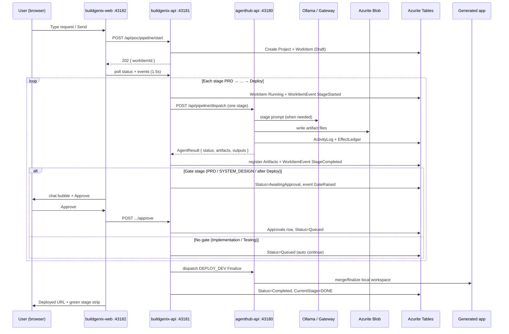

# How the interactive POC works (explain this to others)

**Audience:** anyone who needs a mental model of UI → BuildGenix → AgentHub → Azure emulators → deployed app.  
**Scope:** everything under `poc/` only (pre-phase-0). Root `agenthub-api` / `buildgenix-api` are separate production tracks.  
**Date:** 2026-10-09

---

## 1. Cast of characters

| Piece | Port (local) | Job |
|---|---|---|
| **buildgenix-web** (Angular) | `43182` | Chat UI, stage strip, Documents, Logs, Approve buttons |
| **buildgenix-api** (.NET) | `43181` | Orchestrator. Owns work-item state, gates, events, artifact registry. Never runs LLM itself. |
| **agenthub-api** (.NET) | `43180` | Hosts the one **Pipeline** agent. Runs one stage per HTTP dispatch, writes blobs, deploys the generated app. |
| **Azurite** | `10000` blob, `10002` table | Emulates Azure Blob + Table Storage |
| **Ollama** (or AI Gateway) | `11434` | LLM for PRD / System Design / Implementation hints (+ Hello World “thought”) |
| **Docker** (optional) | — | Preferred way to run the generated app; if missing, agent falls back to `dotnet run` |

Ownership rule (locked for Phase 0 and this POC):

- **AgentHub** writes only agent tables (`ActivityLog`, `EffectLedger`, `AgProcessedEvents`) + artifact **blobs**.
- **BuildGenix** writes only BG tables (`Projects`, `WorkItems`, `WorkItemEvents`, `Artifacts`, `Approvals`, …) + `AuditLog.json` mirror.
- The agent **never** calls the next stage. BuildGenix decides what runs next.

---

## 2. Big picture



---

## 3. Two ways to start a run

| Mode | API | Who uses it | Gates |
|---|---|---|---|
| **Script / auto** | `POST /api/poc/pipeline/run` | `verify-three.sh` | Auto-approved (same code path, no wait) |
| **Interactive / UI** | `POST /api/poc/pipeline/start` | Angular chat | Pauses for human at PRD, System Design, post-Deploy |

Interactive start returns **immediately** with `workItemId`. The orchestrator keeps running in the BuildGenix process (in-memory session + background `Task`). The UI discovers progress by polling:

- `GET …/status` → stage strip + `pendingGate`
- `GET …/events` → chat bubbles
- `GET …/artifacts` + `…/artifacts/{key}` → Documents tab
- `GET …/logs` → Logs tab  
(There is also `GET …/stream` SSE; the UI today uses polling every ~1.5s.)

---

## 4. Work-item state machine (what BuildGenix emits)

Statuses live on `WorkItems.Status` / `CurrentStage`. Important values:

| Status | Meaning |
|---|---|
| `Draft` | Intake just created |
| `Queued` | Ready for next stage (or between stages) |
| `Running` | AgentHub is executing the current stage |
| `AwaitingApproval` | Human gate up (PRD / System Design / Deploy) |
| `Completed` | Finalize done; app URL in `deployedUrl` / AuditLog |
| `Failed` | Orchestrator or agent threw |

### Stage strip (UI)

BuildGenix maps the work item into seven strip cells:

`Intake → PRD → System Design → Implementation → Testing → Deploy → Done`

Each cell state for the UI:

| Strip state | When |
|---|---|
| `pending` | Not reached |
| `running` / `active` | Current stage executing |
| `awaiting` | This stage is the pending human gate |
| `done` | Passed (or Completed for Done) |
| `failed` | Terminal failure on this stage |

### Events the UI turns into chat bubbles

BuildGenix appends `WorkItemEvents` rows (and keeps them in the session). Typical sequence for one gated stage:

1. `IntakeStarted` / `PipelineStarted`
2. `StageStarted` — “Running PRD…”
3. `ArtifactReady` — “Document ready: PRD” (human-facing keys only)
4. `StageCompleted`
5. `GateRaised` — review label
6. `WaitingForUser` — Approve CTA appears in chat
7. After click: `GateApproved`
8. Next `StageStarted` …

Implementation / Testing skip 5–7 and go straight to the next stage.

---

## 5. What the Pipeline agent does per stage

BuildGenix calls **one** HTTP dispatch per stage:

`POST http://127.0.0.1:43180/api/pipeline/dispatch`

Body includes `stage`, `taskId`, `blobPrefix`, `artifacts` (paths so far), and `context` (user request, stack, workspace, deploy action, …).

AgentHub’s `PipelineAgentHandler` switches on `stage`:

| Stage | LLM? | Side effects | Blobs written (under `{projectId}/{workItemId}/v1/`) | Result artifact keys |
|---|---|---|---|---|
| **PRD** | Yes | — | `prd.json`, `prd.md` | `prd`, `prdMd` |
| **SYSTEM_DESIGN** | Yes | — | `techspec.json`, `system-design.md` | `techSpec`, `techSpecMd` |
| **IMPLEMENTATION** | Yes (hints) | Copy stack template into a local workspace; git commit; optional “subtract” patch for Existing mode | `code-state.json`, `review.json` | `codeState`, `review` + outputs `workspaceRoot`, `headCommit` |
| **TESTING** | No | `dotnet test` or `dotnet build` in workspace | `test-results.json` | `testResults` |
| **DEPLOY_DEV** + action `Deploy` | No | Start the app (Docker **or** process) | `completion-summary.json` | `completionSummary` + output `deployedUrls` |
| **DEPLOY_DEV** + action `Finalize` | No | Local finalize / “merge” bookkeeping after human accept | may keep `completion-summary.json` | `mergeCommit` |

Also per agent run:

- **ActivityLog** — verbose progress lines (“PIPELINE PRD started”, …)
- **EffectLedger** — write-once intents (e.g. workspace materialize, blob writes)
- **AgProcessedEvents** — dedup so a redelivery does not double-apply
- Progress-style log events inside AgentHub (AgentStarted / AgentCompleted)

The agent returns one `AgentResult` (`Completed` / fail). It does **not** enqueue the next stage.

---

## 6. Where documents live

### Blob layout (source of truth for generated docs)

Container: `agenthub-artifacts` (Azurite or Azure).

```text
{projectId}/{workItemId}/v1/
  intake-summary.json      ← BuildGenix writes this locally + registers it
  prd.json                 ← agent
  prd.md                   ← agent (JSON wrapper with markdown body)
  techspec.json            ← agent
  system-design.md         ← agent
  code-state.json          ← agent
  review.json              ← agent
  test-results.json        ← agent
  completion-summary.json  ← agent (includes deployed URL)
  AuditLog.json            ← BuildGenix mirror into file root / audit dir
```

### How the UI reads them

1. BuildGenix `Artifacts` table (or in-memory index) maps `key → blobPath`.
2. Documents tab calls `GET /api/poc/pipeline/{wi}/artifacts` then `…/artifacts/{key}`.
3. BuildGenix resolves body from:
   - local file root (`PocPipeline__ArtifactFileRootPath`, e.g. `/tmp/bgx-poc-blobs`) when AgentHub used File provider, **or**
   - `GET AgentHub /api/pipeline/blob?path=…` when blobs are in Azurite/Azure.

### Audit trail (orchestrator)

Rewritten after every transition:

`/tmp/bgx-poc-audit-azurite/{workItemId}-AuditLog.json`  
(and a blob-style copy under `{projectId}/{workItemId}/v1/AuditLog.json` in the audit directory)

Holds original user request + each transition (stage, status, message, artifact path) + final URL.

---

## 7. Human gates (only three)

| After this completes | UI shows | Approve means |
|---|---|---|
| **PRD** | PRD doc + Approve | Continue to System Design |
| **SYSTEM_DESIGN** | Design doc + Approve | Continue to Implementation |
| **DEPLOY_DEV (Deploy)** | App is already live; Approve = “accept DEV” | Run **Finalize**, then `Completed` / `DONE` |

No Approve on Implementation or Testing in this POC (auto-advance).  
Reject / redraft is **not** implemented here (approve-only happy path).

Script mode (`/run`) calls the same gate points but auto-writes an `Approvals` row and continues without waiting.

---

## 8. Repo / workspace / deployment

### Where code is generated

Implementation does **not** push to GitHub in this POC. It:

1. Picks a local workspace directory for the work item.
2. Copies a stack template (`fe-be` or `fe-be-llm`) into that folder (Angular FE + .NET BE, etc.).
3. Applies LLM “implementation hints” lightly (e.g. thought-of-the-day copy for Hello World).
4. For **Existing** + calculator subtract: patches the prior workspace (add still works).
5. Runs `git init` / commit locally → `headCommit`.
6. Writes `code-state.json` describing the tree.

So “repo” here means **local git workspace on the AgentHub machine**, not ADO/GitHub.

### Deploy — with Docker

If `docker-compose.yml` exists in the workspace **and** `docker` is on PATH:

1. Rewrite host port to a free port (avoid clashes across work items).
2. `docker compose -p <workItemId> -f docker-compose.runtime.yml up -d --build`
3. Wait until `http://127.0.0.1:<port>/health` is OK.
4. Return that URL as `deployedUrls` (mode `docker-compose`).

Hello World containers reach Ollama via `host.docker.internal` when Ollama listens on `0.0.0.0:11434`.

### Deploy — without Docker

Fallback in `LocalComposeHost`:

1. `dotnet build` the backend project.
2. `dotnet run --urls http://127.0.0.1:<freePort>` as a child process.
3. Wait on `/health`.
4. Return URL (mode process / LocalCompose).

Same smoke contracts: calculator `/api/add`, Hello World `/api/thought`.

### Finalize

After the human Approves the live DEV app, BuildGenix dispatches the same stage with `deploymentAction=Finalize`. That records merge/baseline bookkeeping and sets the work item to **Completed**. Code does not go to a remote `main` in this POC.

---

## 9. End-to-end walkthrough (Calculator add, interactive)

1. User opens UI → clicks **Calculator add** → **Send**.
2. UI `POST /start` with `stackProfile=fe-be`, `projectMode=New`.
3. BuildGenix creates Project + WorkItem, writes intake summary, sets stage `PRD`, status `Queued`→`Running`.
4. AgentHub PRD: LLM → `prd.json` / `prd.md` in blob → Completed.
5. BuildGenix registers artifacts, raises gate → UI shows Approve (Documents can open PRD).
6. User Approves → BuildGenix records Approval, runs SYSTEM_DESIGN the same way.
7. User Approves design → Implementation copies template + git commit → Testing builds/tests → Deploy starts app.
8. Gate after Deploy: user opens URL, Approves → Finalize → `Completed`, strip all green, banner shows URL.
9. Logs tab shows the full `WorkItemEvents` timeline; Documents lists every blob key registered.

Hello World is the same loop with `fe-be-llm` (extra LLM thought endpoint in the generated app).  
Calculator subtract reuses `projectId` + baseline artifact paths (`projectMode=Existing`).

---

## 10. Azure resources in this POC (local emulators)

| Azure concept | Local stand-in | Who uses it |
|---|---|---|
| Blob Storage | Azurite `:10000` container `agenthub-artifacts` | AgentHub writes; UI reads via BG/AH |
| Table Storage | Azurite `:10002` | BG catalog tables + AH ActivityLog / EffectLedger / AgProcessedEvents |
| Service Bus | **Not required** for POC | Pipeline uses `InProcessOnly` HTTP dispatch |
| App Service / ACA | **Not used** | Local Docker Compose or `dotnet run` |
| AI | Ollama local **or** AI Gateway (APIM) | AgentHub `Llm__Provider` |

Production Phase 0 will replace Azurite with real Storage, InProcess with Service Bus topics, and LocalCompose with App Service — same ownership rules.

---

## 11. One-sentence summary

**The UI talks only to BuildGenix; BuildGenix is the conductor that pauses for you at three gates; AgentHub is the single worker that writes blobs and brings up the generated app (Docker if present, otherwise `dotnet run`); Azurite holds the tables and documents.**
